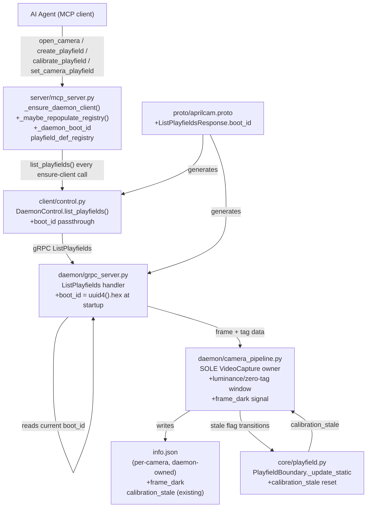
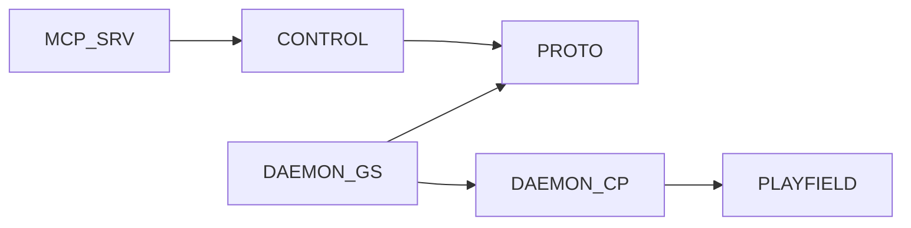

<!-- CLASI: Before changing code or making plans, review the SE process in CLAUDE.md -->

# Architecture Update -- Sprint 016: MCP Daemon-Restart Registry Restore and Calibration Robustness

## What Changed

This sprint makes one structural change (daemon-identity detection +
registry re-populate) and two smaller, bounded additions (a
dark-frame/zero-detection signal; a staleness-flag reset fix). All three
preserve the Sprint 014/015 invariants: **the daemon is the sole vision
authority and the sole camera owner; the MCP server is a thin gRPC client
that never touches pixels or camera hardware directly.**

---

### 1. Daemon-restart detection: `boot_id` + reconnect-triggered repopulate (PRIMARY)

**Root cause recap** (see issue, confirmed in code): `_on_daemon_connect()`
(`mcp_server.py:312`) is the only populator of `playfield_def_registry`.
`_ensure_daemon_client()` (`mcp_server.py:349-360`) fires it only when
`_daemon_client is None` — i.e. on the very first connection. A daemon
restart leaves the module-level `_daemon_client` gRPC channel object
non-`None` (the channel transparently reconnects at the TCP/HTTP2 layer), so
the hook never re-fires and `playfield_def_registry` stays permanently
stale after any daemon restart.

**Design.** Two complementary mechanisms, both cheap and both required —
one is the primary signal, the other is a safety net for the case where the
primary signal is unavailable or missed:

**(a) `boot_id` identity field — primary signal.**

- **`proto/aprilcam.proto`**: add a `string boot_id = N;` field to the
  existing `Empty`-returning admin RPCs' response that the MCP server
  already calls unconditionally on every connect — specifically
  `ListPlayfieldsResponse` (already fetched by `_on_daemon_connect` itself,
  so no new RPC round-trip is introduced). This is additive to an existing
  message; no new RPC.
- **`daemon/grpc_server.py`** (or the daemon startup module,
  `daemon/__main__.py` / `daemon/server.py`): generate one `boot_id =
  uuid.uuid4().hex` at process startup, held as an instance attribute on the
  servicer, stamped onto every `ListPlayfieldsResponse`.
- **`client/control.py`**: `list_playfields()` return type gains the
  `boot_id` field (already a pass-through of the proto message — no new
  wrapper needed, or a one-line addition to the Pydantic model if the client
  wraps responses).
- **`server/mcp_server.py`**: a new module-level `_daemon_boot_id:
  Optional[str] = None`. `_ensure_daemon_client()` changes from "populate
  only if `_daemon_client is None`" to: always call a new lightweight check
  `_maybe_repopulate_registry(client)` after obtaining a non-`None` client.
  That function calls `list_playfields()` (already the payload of
  `_on_daemon_connect`, not an extra call), compares the returned `boot_id`
  to `_daemon_boot_id`; on first connect or on a **changed** `boot_id`, it
  runs the existing `_on_daemon_connect` body (clear + repopulate) and
  updates `_daemon_boot_id`. On an unchanged `boot_id`, it is a no-op (the
  registry is already correct — this is the mechanism that avoids clobbering
  valid state on a transient blip: a `boot_id` that hasn't changed means the
  daemon process itself never restarted, even if the TCP connection blipped).

**(b) Empty-registry-but-daemon-reachable fallback — safety net.**

- Any tool handler that consults `playfield_def_registry` and finds it
  empty (the exact symptom in the issue — `calibrate_playfield` raising
  `"Available playfields: [(none)]"`) first calls
  `_maybe_repopulate_registry(client)` once before raising the error. This
  covers the case where `boot_id` propagation lands in a later sprint
  version mismatch (daemon not yet upgraded) or a future daemon restart
  scenario the `boot_id` check doesn't catch — the registry-empty condition
  is itself always evidence of a stale MCP-side cache when the daemon is
  reachable, since a legitimately-empty playfields directory is
  distinguishable (the daemon still returns a valid, empty
  `ListPlayfieldsResponse` either way — the retry is harmless in that case
  too, just a wasted RPC).
- This mechanism intentionally does NOT run unconditionally on every tool
  call (that would reintroduce a hidden per-call RPC cost); it runs only at
  the point of the specific failure mode the issue describes.

**Where this plugs in**: `_ensure_daemon_client()` is the single choke point
already used by every tool handler (per `mcp-required.md`-style
centralization already in place for daemon access), so mechanism (a) costs
one dict comparison per call, using an RPC (`list_playfields`) that the
system already made unconditionally on first connect — the only change is
*when* it's called (every `_ensure_daemon_client()` invocation vs. only the
first). Given `list_playfields` is not in any hot per-frame path (it is not
called by `get_tags`/`stream_tags`/anything in the live-detection path,
confirmed in code), a comparison-gated repeat call on every tool invocation
is acceptable overhead — the fetched blob is small (playfield defs, not
frames) and the comparison against `_daemon_boot_id` short-circuits the
expensive repopulate body when nothing changed. If this overhead proves
non-trivial after implementation, the interval can be throttled (e.g. only
recheck if >N seconds since last check) — flagged as an open question, not
designed in this sprint.

**Explicitly not chosen**: gRPC channel-state subscription
(`channel_ready_future`/`subscribe`). Investigation confirmed no existing
use of this in `client/control.py`, and it detects *transport*-level
state changes, not *daemon-process-identity* changes — a daemon restart
that comes back up fast enough may never produce an observable channel
state transition, while `boot_id` directly answers the question "is this
the same daemon process I populated my registry from." Channel-state
subscription is a plausible defense-in-depth addition but out of scope.

---

### 2. Exposure fragility: dark-frame / zero-detection signal (surfacing only)

**Scope decision**: per the issue's own framing and my investigation, this
item has no existing health-signal surface to build on (no brightness/
histogram check, no "zero tags for N frames" counter — confirmed by code
search). Deciding the *correct remediation* (fixed exposure tuning,
auto-exposure, adaptive gain, operator alert, detection-side gamma
correction) requires field data this sprint does not have. **This sprint
ships detection + surfacing only, non-blocking, and explicitly defers
remediation strategy to a follow-up issue** (see Open Questions and the
Deferred section below).

**Design.**

- **`daemon/camera_pipeline.py`**: extend the existing per-pipeline frame
  loop (the same loop that already tracks `consecutive_failures` for
  `cap.read()` returning falsy, at the `_reopen_usb` self-heal site) with a
  cheap **mean-luminance sample** (downsample + `numpy.mean`, no new CV
  dependency — pure NumPy, already a base dependency of the daemon) computed
  once per N frames (not every frame, to keep cost negligible), plus the
  detector's own per-frame tag count (already computed every frame — no new
  detection work). A **sustained** condition — mean luminance below a
  configurable floor **and** zero tags detected for a configurable window
  (e.g. last 30 frames ≈ 1s) — sets a new boolean, `frame_dark: bool`, on
  the same `info.json` write path already used by
  `_maybe_update_stale_flag()`/`_write_info_json()` (`camera_pipeline.py`).
  This reuses the existing "write only on change" pattern — no new file, no
  new write frequency concern.
- The signal is **purely advisory**: nothing reads `frame_dark` to gate or
  refuse an operation (matching the existing, confirmed-advisory behavior of
  `calibration_stale`). It is visible via the camera's `info.json` (already
  an operator-inspectable file) and a rate-limited log warning.
- **No MCP tool surface change required** for this ticket; whether to add an
  MCP-visible field (e.g. on `open_camera`'s response, alongside the
  existing `calibration_stale` passthrough) is small enough to include if
  time allows, but is not a hard acceptance criterion — flagged as an open
  question.

**Deferred (explicitly out of this sprint, recommend `split_issue` /
follow-up)**: automatic exposure or gain remediation (adaptive re-exposure,
auto-exposure-mode switching, gamma/CLAHE compensation in the detector).
These require empirical tuning against real field lighting conditions and
risk destabilizing a currently-working (if fragile) configuration without
that data. Shipping only the diagnostic signal this sprint gives the
operator/agent visibility now while the remediation strategy is scoped
separately with real measurements.

---

### 3. Calibration-stale flag: investigate + fix reset gap (bounded)

**Investigation finding** (this sprint's planning, grounded in code): the
reported ~3px corner shift is *below* the default 25px
`DEFAULT_MOVEMENT_THRESHOLD_PX` (`calibration/geometry.py:58`) used by the
live-boundary check in `core/playfield.py` (`_update_static`,
`_effective_movement_threshold()`). A 3px shift should **not**, by itself,
set `boundary.calibration_stale = True` under default configuration. Two
candidate explanations, both discoverable in existing code:

1. **No reset path.** `core/playfield.py` sets `_calibration_stale = True`
   (line ~346) when the threshold is exceeded, but no code path was found
   that ever sets it back to `False` once a marker's live position returns
   within threshold. If the flag was set by an earlier, larger excursion
   (e.g. during the camera's actual reopen/reconnect transient, where marker
   positions can swing more than 3px momentarily) and never resets, the
   ~3px figure reported at the time of inspection is a red herring — it
   reflects the marker position *at inspection time*, not the position that
   originally tripped the flag.
2. **Path (a) (slug/dimension mismatch)** in
   `calibration/calibration.py:467-506` is a different mechanism entirely
   (compares `calibrated_playfield`/width/height, not pixel positions) and
   was not ruled out by the issue's report alone.

**Design** — this sprint fixes the confirmed structural gap (missing reset)
rather than speculatively loosening the threshold, since the evidence does
not support "the threshold is too strict":

- **`core/playfield.py`**: `_update_static` (or the boundary's
  update cycle) gains a symmetric reset: when all tracked static markers are
  within threshold on a given check, `_calibration_stale` is cleared back to
  `False` (mirroring the set path already there). This closes the latent
  gap identified above; `_maybe_update_stale_flag()` in
  `camera_pipeline.py` already handles a value *change* correctly in either
  direction (it writes `info.json` only "when the flag changes" — this
  logic is reused unmodified, since it already treats `True→False` and
  `False→True` symmetrically; only the producer side was missing the
  `False` transition).
- **No threshold value change** in this sprint — the default 25px is not
  contradicted by any evidence gathered. If field testing after the reset
  fix still shows spurious staleness, that is new evidence for a follow-up,
  not something this sprint should pre-emptively "fix" by guessing.
- **Regression test**: exercise `PlayfieldBoundary`/`_update_static`
  directly — simulate marker positions exceeding threshold then returning
  within threshold across successive `update()` calls — and assert
  `calibration_stale` transitions `False → True → False`.

---

## Why

| Change | Use Cases Addressed |
|--------|---------------------|
| `boot_id` proto field + daemon stamping | SUC-001 |
| `_maybe_repopulate_registry` in `_ensure_daemon_client` | SUC-001 |
| Empty-registry fallback repopulate | SUC-001 |
| Regression test (fake daemon restart) | SUC-001 |
| Dark-frame / zero-detection signal in `camera_pipeline.py` | SUC-002 |
| `info.json` `frame_dark` field + rate-limited log | SUC-002 |
| `_calibration_stale` reset-on-recovery fix | SUC-003 |
| Staleness investigation + regression test | SUC-003 |

---

## Impact on Existing Components

| Component | Change | Backward-Compatible? |
|-----------|--------|----------------------|
| `proto/aprilcam.proto` | `ListPlayfieldsResponse` gains `boot_id: string` field | Yes — additive |
| `src/aprilcam/proto/aprilcam_pb2*.py` | Regenerated | Yes |
| `daemon/grpc_server.py` (or `daemon/server.py`/`__main__.py`) | Generates and stamps `boot_id` at process start | Yes — additive |
| `client/control.py` | `list_playfields()` response carries `boot_id` (pass-through or +1 model field) | Yes — additive |
| `server/mcp_server.py` | `_ensure_daemon_client()` gains `_maybe_repopulate_registry` check on every call (was: only on first connect); new module-level `_daemon_boot_id`; registry-empty fallback added at the `calibrate_playfield`/`create_playfield`/`set_camera_playfield` call sites that already consult `playfield_def_registry` | Yes — behavior-only change, no signature change |
| `daemon/camera_pipeline.py` | New windowed luminance + zero-tag-count check; `info.json` gains `frame_dark: bool` | Yes — additive field, existing write-on-change pattern reused |
| `core/playfield.py` | `_update_static` gains a `False`-transition reset for `_calibration_stale` | Yes — behavior fix, no interface change |
| `calibration/calibration.py` | No change (path (a) staleness untouched — confirmed distinct mechanism, not implicated) | N/A |

---

## Migration Concerns

### `boot_id` requires daemon+MCP version match for the primary mechanism

An MCP server built against this sprint talking to an **older** daemon
(pre-`boot_id`) will not find the field on `ListPlayfieldsResponse` (proto3
default-empty-string semantics: an old daemon simply never sets it, so the
new field reads as `""` on the client). In that case `_daemon_boot_id`
compares `""` against a prior `""` and never detects a change via mechanism
(a) — but mechanism (b) (empty-registry fallback at the point of failure)
still recovers correctly, just one call later than with a fully-upgraded
daemon. This is why mechanism (b) is not optional scaffolding — it is the
compatibility floor for mixed-version deployments (e.g. a Pi daemon not yet
redeployed after a Mac-side MCP server upgrade). Document this in the
sprint's ticket and in `deploy/README.md` if a note is warranted.

### No data migration

No on-disk file formats change. `info.json` gains one new optional boolean
field (`frame_dark`); existing readers that don't know the field ignore it
(same pattern as the existing `calibration_stale` field addition in Sprint
011).

### Deployment sequencing

None required beyond normal rollout — both mechanisms degrade gracefully
when only one side (daemon or MCP server) has been upgraded, per the
version-skew note above.

---

## Component Diagram

## Dependency Graph

No cycles. Dependency direction unchanged from Sprint 014/015: MCP server →
client → proto; daemon subsystems remain a leaf relative to client/server
packages. `core/playfield.py` continues to be consumed only by daemon-side
code (`camera_pipeline.py`), never by `mcp_server.py` directly — consistent
with the Sprint 015 vision-boundary invariant.

---

## Design Rationale

### Decision: `boot_id` on the existing `ListPlayfieldsResponse`, not a new RPC

**Context**: Detecting "is this the same daemon process" needs some
identity signal. Options: (a) a new dedicated `Ping`/`GetDaemonInfo` RPC,
(b) a field added to an RPC already called at the right moment.

**Alternatives considered**:
1. New `Ping`/health RPC returning `boot_id` — clean separation of concerns,
   but adds a second RPC round-trip to every `_ensure_daemon_client()` call,
   doubling the per-call gRPC overhead this design is trying to keep small.
2. Stamp `boot_id` onto `ListPlayfieldsResponse` (chosen) — `_on_daemon_connect`
   already calls `list_playfields()` unconditionally; adding one field to
   its response is free (same round trip, same payload size class).

**Why option 2**: `list_playfields()` is already the exact call this
mechanism needs to make (to repopulate the registry when `boot_id`
changes) — piggybacking the identity signal onto it means detection and
the corrective action share one RPC, not two. No new RPC surface, no new
proto service method, minimal proto diff.

**Consequences**: `boot_id` is logically a daemon-wide property but lives
on a playfield-specific response message. This is a minor modeling
compromise; a future sprint could introduce a dedicated lightweight
`GetDaemonInfo` RPC if more daemon-identity metadata (uptime, version,
pid) becomes useful — noted as an open question, not committed here.

### Decision: boot_id comparison runs on every `_ensure_daemon_client()` call, not on a timer

**Context**: Running the check unconditionally on every tool invocation
adds a `list_playfields()` RPC to every MCP tool call that wasn't there
before (previously only fired once, at first connect). A timer/interval
throttle would reduce this.

**Alternatives considered**:
1. Unconditional check on every call (chosen for this sprint).
2. Time-throttled check (e.g. at most once per 10s).

**Why option 1 for now**: `list_playfields()` is confirmed (by code
inspection) to be off the hot/per-frame path — it is never called by
`get_tags`, `stream_tags`, or anything in the live-detection loop, only by
admin-surface tools (`open_camera`, `create_playfield`,
`calibrate_playfield`, `set_camera_playfield`, and now the ensure-client
gate itself). The payload is small (playfield definitions, not frames).
Correctness (never serving a stale registry) is prioritized over a
micro-optimization whose cost has not been measured. If profiling after
implementation shows meaningful latency added to every tool call, a
time-throttle is a small, isolated follow-up change to
`_maybe_repopulate_registry` alone — it does not touch any other part of
this design.

**Consequences**: Every admin-surface MCP tool call now costs one extra
small RPC compared to before this sprint (previously zero after the first
connect). Accepted given the correctness benefit and the confirmed-small
payload.

### Decision: fix the `_calibration_stale` reset gap; do not adjust the 25px threshold

**Context**: The issue reports a 3px shift triggering staleness, which read
initially as "the threshold is too strict." Investigation shows 3px is well
under the 25px default — the numbers don't support that diagnosis.

**Alternatives considered**:
1. Lower expectations and loosen the threshold anyway, to be safe.
2. Investigate first; fix only what the evidence supports (chosen).

**Why option 2**: Loosening a threshold without evidence it's actually too
strict risks masking real movement (defeating the purpose of the check —
Sprint 011's explicit design goal was "never silently deskew with a stale
transform after a bump"). The missing reset path is a genuine, evidence-backed
defect (confirmed by code inspection: no `False`-transition exists) that
independently explains a stale-looking flag persisting from an unrelated
earlier event (e.g. the camera reopen transient during the same restart
episode). Fixing the reset is the change actually supported by the
investigation.

**Consequences**: If, after the reset fix ships and is field-tested, spurious
staleness still occurs at small pixel shifts, that becomes new evidence for
a follow-up threshold-tuning ticket — this sprint does not preclude that,
it just doesn't act on unconfirmed evidence now.

---

## Open Questions

1. **`boot_id` placement**: is stamping it on `ListPlayfieldsResponse`
   acceptable long-term, or should a future sprint introduce a dedicated
   `GetDaemonInfo`/`Ping` RPC carrying `boot_id` + version + uptime? Not
   blocking for this sprint (see Design Rationale above) — flagged for
   stakeholder input on priority.
2. **`_maybe_repopulate_registry` call frequency**: unconditional per-call
   vs. time-throttled. This sprint ships unconditional; revisit only if
   profiling after implementation shows a real cost. Not blocking.
3. **`frame_dark` MCP visibility**: should `open_camera`'s response surface
   `frame_dark` alongside the existing `calibration_stale` passthrough, or
   is `info.json` + logs sufficient for this sprint? Recommend deferring the
   MCP-surface addition to keep the ticket bounded; stakeholder can request
   it as a fast-follow if operators find `info.json` insufficiently visible.
4. **Exposure remediation strategy** (config tuning / auto-exposure /
   detection-side compensation / operator alert only): explicitly deferred
   out of this sprint. Recommend the team-lead file this as a new issue
   (`split_issue` from the source issue, or a fresh issue) once the
   dark-frame signal from item 2 has produced real field data to inform the
   choice. Attempting to design the remediation now would be speculative.
5. **Stale-threshold field evidence**: if the reset fix does not fully
   explain observed staleness episodes in subsequent field use, threshold
   tuning becomes a legitimate follow-up — captured here so it isn't lost,
   not committed to this sprint.
