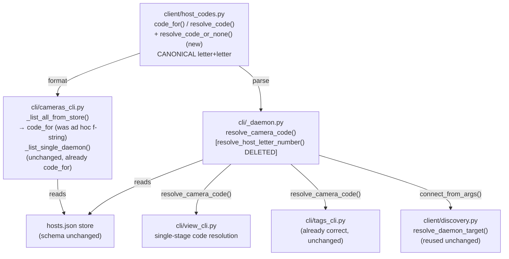
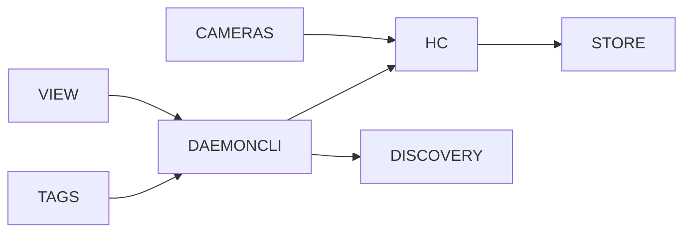

<!-- CLASI: Before changing code or making plans, review the SE process in CLAUDE.md -->

# Architecture Update -- Sprint 017: Unify aprilcam host-qualified camera codes across cameras and view

## Canonical Scheme Decision

**Canonical scheme: letter+letter (bijective base-26), as already
implemented by `client/host_codes.py`'s `code_for()` / `resolve_code()`.**
Local cameras are a single letter (`C` = local camera 3); remote cameras are
host-letter + camera-letter (`FB` = host F, camera 2).

The letter+digit scheme (`B6`) used by `cameras`' network-listing path and
`cli/_daemon.py:resolve_host_letter_number` is retired.

### Why letter+letter, not letter+digit

The issue framed this as an open choice, but investigation of the actual
codebase (not just the issue's read-only notes) shows letter+letter is
already the de facto standard everywhere except one code path:

1. **It is already the documented, user-facing contract.**
   `docs/wiki/daemon.md:85-98` ("`aprilcam probe` and short codes") shows
   `FB = host F, camera 2` and the worked example `aprilcam view AB`. This
   is the *only* place in the docs that specifies a host-qualified scheme,
   and it is letter+letter. The letter+digit `B6` scheme appears nowhere in
   the docs — it is an undocumented behavior of one internal function.
2. **It is already the tested, working implementation.** `resolve_code()`
   validates the camera exists on the resolved host and raises a clear
   `ValueError` otherwise (`host_codes.py:130-195`). `tests/test_host_codes.py`
   has full coverage for `code_for`/`resolve_code`/`resolve_host_token`.
   `resolve_host_letter_number` ("B6") has thinner coverage, and one of its
   three tests (`test_local_code_no_reconnect`) documents the exact defect
   the issue reports: it returns `("1", None)` for `"A1"` without checking
   camera "1" exists on host A.
3. **It is already the live consumer in two of three call sites.**
   `resolve_camera_code` (letter+letter) is called from both
   `view_cli.py:444` and `tags_cli.py:93` and is fully correct: it validates
   the camera against the resolved host via `resolve_code()`, sets
   `args.daemon_host` for remote hosts, and returns the daemon's `enum`
   handle directly (no store-num↔daemon-enum translation gap — see next
   point). `resolve_host_letter_number` (letter+digit) is only reachable
   from `view_cli.py:427`, and — critically — it runs *before* the
   letter+letter resolution at line 444 and shadows it for any argument
   matching `[A-Za-z]\d+` (which includes every valid letter+letter code
   whose second letter happens to look like it isn't, e.g. `"A1"` is
   letter+digit-shaped and gets caught first even though `resolve_camera_code`
   would also treat single-letter `"A"` correctly on its own). Removing the
   letter+digit branch entirely, rather than "fixing" it, eliminates this
   shadowing and collapses `view`'s two-stage resolution into one call.
4. **letter+letter avoids a translation gap that letter+digit has by
   construction.** The store's per-camera `num` (stable, used to build the
   letter) is deliberately *not* the same value as the daemon's live `enum`
   (`host_codes.py` docstring: "cameras enumerated from each host's daemon,
   with stable numeric IDs" — assigned independently by `_merge_cameras`).
   `resolve_code()` looks up the camera by `num` and returns the `cam_entry`
   dict, from which the caller reads `enum` — the correct translation.
   `resolve_host_letter_number` returns the raw digit substring from the
   *printed* code text unchanged and lets the caller re-interpret it as a
   camera number against a possibly-different daemon — no translation step
   exists, which is the direct mechanism of the "no camera numbered 6"
   failure in the issue's repro (index 6 was the store's stable `enum` for
   display, but it was queried as a raw int against the *local* daemon after
   the local-kind shortcut skipped reconnecting).
5. **Letter+letter has no collision-with-bare-index ambiguity.**
   `view`'s fallback path (`view_cli.py:463-491`) already accepts a bare
   integer as a local persistent enum. A letter+digit scheme (`B6`) is
   visually adjacent to that fallback and easy to mistype or misparse
   against it (`"B6"` vs `"6"` vs `"B"`). A pure-alpha scheme has zero
   overlap with the bare-integer path — parsing an argument is either "all
   alphabetic, 1-2 chars" (a code) or "parses as `int`" (a bare enum); there
   is no third shape to disambiguate.

The one thing letter+digit had going for it — matching what `cameras`
*currently* prints in network mode — is exactly the bug being fixed, not a
reason to keep it. `cameras`' single-daemon listing already prints
letter+letter via `code_for` (`cameras_cli.py:159`); only the network
listing is the outlier, and it is the one being corrected.

## What Changed

### 1. `client/host_codes.py` — becomes the single canonical format+parse module

No change to `code_for()` / `resolve_code()` / `resolve_host_token()` /
`num_to_alpha()` / `alpha_to_num()` — these already implement the canonical
scheme correctly and are kept as-is, including their existing test coverage.

**New function `resolve_code_or_none(code, store)`** — a thin wrapper around
`resolve_code()` that returns `None` instead of raising on any
`ValueError`/malformed input, matching the "return `None` to let the caller
fall back" convention `_daemon.py`'s helpers already use. This lets
`resolve_camera_code` in `cli/_daemon.py` shrink to a direct call instead of
duplicating the try/except-any-Exception pattern it uses today
(`_daemon.py:165-169`, which currently catches bare `Exception` — a
code-smell this sprint also cleans up incidentally since the new function
gives it a precise `ValueError` to catch).

### 2. `cli/_daemon.py` — remove the divergent letter+digit parser

- **Delete `resolve_host_letter_number()`** entirely (`_daemon.py:192-251`).
  It has no remaining callers once `view_cli.py`'s two-stage resolution
  collapses to one (see below).
- `resolve_camera_code()` (`_daemon.py:131-189`) is kept as the sole camera
  code resolver, updated to use `resolve_code_or_none()` from
  `host_codes.py` instead of its own broad `except (ValueError, Exception)`.
  Its contract is unchanged: returns `(resolved_host, cam_enum)` or `None`,
  and patches `args.daemon_host` for remote hosts.

### 3. `cli/view_cli.py` — single-stage code resolution

- **Delete the letter+digit resolution block** (`view_cli.py:423-441`,
  the `_rhln = resolve_host_letter_number` call and its reconnect branch).
- The existing letter+letter block (`view_cli.py:443-462`, using
  `resolve_camera_code`) becomes the only code-resolution path, unchanged.
- Net effect: `view`'s camera-argument resolution goes from three stages
  (letter+digit code → letter+letter code → bare int/name fallback) to two
  (letter+letter code → bare int/name fallback), removing the shadowing
  and the local-kind shortcut bug simultaneously — the whole defective
  code path is deleted rather than patched.

### 4. `cli/cameras_cli.py` — network listing switches to `code_for`

- **`_list_all_from_store()`** (`cameras_cli.py:52-94`): replace the ad hoc
  `code = f"{num}" if is_local else f"{h_letter}{num}"` (line 83, using the
  daemon `enum` directly, letter+digit) with a call to
  `code_for(h_num, c["num"], is_local)` — the same function
  `_list_single_daemon` already uses (line 159). This requires iterating
  cameras by their store `num` (already available on each camera dict) to
  build the code, while continuing to *display* the daemon `enum` for
  informational sorting/labeling if desired (the printed code and the
  printed enum are allowed to differ — the code is the durable address, the
  bracketed/labeled enum, where shown, is informational, mirroring how
  `_list_single_daemon` already separates the two).
- Update the usage hint (`cameras_cli.py:91-93`) to show a letter+letter
  worked example consistent with `docs/wiki/daemon.md`, e.g.
  `'aprilcam view FB'  (camera 2 on host F)`, replacing the `B6` example.
- **`_list_single_daemon()`**: no change — already uses `code_for` correctly.

### 5. `cli/tags_cli.py` — no change

Already calls `resolve_camera_code` (letter+letter) exclusively
(`tags_cli.py:93`). Confirmed as already-correct; included here only so the
"every consumer" claim in Why/Impact is verified, not assumed.

### 6. `docs/wiki/daemon.md` — no content change required

The doc already documents the letter+letter scheme as canonical
(`daemon.md:85-98`). This sprint brings the code in line with the doc,
rather than the reverse. Verified during planning; re-verify during
implementation that no line in that section describes `B6`-style codes
(none currently does).

### 7. Tests

- `tests/test_host_codes.py`: add tests for `resolve_code_or_none` (mirrors
  existing `resolve_code` cases, plus the "returns None, doesn't raise" case
  for a malformed/unknown code).
- Remove `TestResolveHostLetterNumber` (`test_host_codes.py:441-473`) — it
  tests deleted code, including the test that documents the bug
  (`test_local_code_no_reconnect`).
- New round-trip test module (or extend `test_host_codes.py`): for a matrix
  of store shapes — local-only, one remote, two-plus remotes (forcing a
  two-letter *host* code, e.g. host num 27 → `AA`) — generate the codes
  `_list_all_from_store`'s logic would print (via `code_for`) and assert
  each parses back through `resolve_code` to the exact `(host, camera)` pair
  it was generated from.
- `cli/view_cli.py` and `cli/cameras_cli.py` currently have no dedicated
  unit tests for code resolution (confirmed by grep — only
  `test_host_codes.py` exercises this area); this sprint's round-trip tests
  at the `host_codes`/`_daemon` layer are the primary regression coverage,
  since that layer is what both commands delegate to after this change.

## Why

| Change | Reason | Use Cases |
|--------|--------|-----------|
| Retire letter+digit scheme; canonicalize on letter+letter | Two divergent, coexisting schemes is the root cause; the doc and two of three call sites already agree on letter+letter | SUC-001, SUC-002, SUC-003 |
| Delete `resolve_host_letter_number` (not fix it) | It has no unique capability `resolve_code`/`resolve_camera_code` lacks; fixing it would mean maintaining two parsers for one concept | SUC-003 |
| `_list_all_from_store` switches to `code_for` | Makes `cameras`' two listing paths format identically — the internal inconsistency the issue flagged | SUC-002 |
| `resolve_code_or_none` helper | Removes a broad `except Exception` in `_daemon.py`; gives `resolve_camera_code` a precise exception to narrow on | SUC-003 |
| Round-trip test matrix | Directly satisfies the issue's explicit ask: "every code `cameras` emits must parse back through `view`'s parser" | SUC-003 |
| Usage-hint text update | Stops advertising a syntax that (before this sprint) does not work, and (after) simply keeps the advertised example in the one true scheme | SUC-001, SUC-002 |

## Impact on Existing Components

| Component | Impact | Backward-Compatible? |
|-----------|--------|----------------------|
| `client/host_codes.py` | Additive: one new function (`resolve_code_or_none`). No changes to existing public functions. | Yes |
| `cli/_daemon.py` | `resolve_host_letter_number` deleted (was only called from `view_cli.py`). `resolve_camera_code` internals narrow their exception handling; external contract unchanged. | Breaking only for the deleted function's direct callers (none outside `view_cli.py`, confirmed by grep). |
| `cli/view_cli.py` | Two-stage code resolution collapses to one stage. Behavior for letter+letter codes and bare-int/name is unchanged. Behavior for letter+digit codes (`B6`) changes: previously mis-resolved against the wrong daemon, now falls through to the bare-int branch and fails clearly (see Migration Concerns) or is reported as an unrecognized code. | Breaking for anyone who had memorized `B6`-style codes (see Migration Concerns) — but those codes never reliably worked, per the issue. |
| `cli/cameras_cli.py` | `_list_all_from_store` code format changes from letter+digit to letter+letter. Usage hint text updated. `_list_single_daemon` unchanged. | Breaking for the *printed output format* in network-listing mode — this is the intended fix. |
| `cli/tags_cli.py` | None — already used the canonical scheme. | Yes |
| `hosts.json` store schema | No change. `num` fields (host and camera) are unchanged; only which function formats them into a display code changes. | Yes — no data migration. |
| `docs/wiki/daemon.md` | No change needed (already correct). | Yes |
| Test suite | `TestResolveHostLetterNumber` removed; new round-trip tests added; `resolve_code_or_none` tests added. | N/A |

## Migration Concerns

### Users who learned the `B6` codes from `aprilcam cameras`' current output

Since Sprint 014 introduced the network listing, any user who ran
`aprilcam cameras` (no `--host`) has seen letter+digit codes printed and may
have muscle-memorized one. Per the issue, **those codes already do not work
reliably** via `aprilcam view` (that is the bug being fixed) — so there is
no working behavior being taken away, only a broken-but-familiar-looking
string format. No persisted state references the letter+digit format:
`hosts.json` stores raw `num` integers, not formatted code strings, so
nothing on disk needs migrating. The only user-facing change is: the next
time they run `aprilcam cameras`, the printed codes look different
(letter+letter instead of letter+digit) and now work when pasted into
`aprilcam view`.

### `view` behavior for a leftover `B6`-shaped argument after this sprint

After `resolve_host_letter_number` is deleted, an argument like `"B6"` no
longer matches the (removed) letter+digit branch and no longer matches the
letter+letter branch either (`resolve_code` requires 1-2 *alphabetic*
characters — `isalpha()` rejects `"B6"`). It falls through to the
bare-int/name branch, where `int("B6")` raises `ValueError`, and `view`
treats it as a camera *name* pattern via `get_camera_info("B6")` — which
will fail with "could not resolve camera 'B6'" rather than the current
misleading "no camera numbered 6 on the daemon." This is an improvement
(the error no longer implies a wrong-daemon lookup happened) but is not a
dedicated "did you mean the new format?" hint. Whether to add such a hint
is an open question below.

### No daemon-side or wire-protocol change

This sprint is entirely within the CLI client layer (`cli/`, `client/`).
No proto changes, no daemon changes, no `DaemonControl` changes. Consistent
with the Sprint 014 architecture: `client/discovery.py`'s
`resolve_daemon_target` and its explicit/env/local-socket/mDNS precedence
are reused unchanged via the existing `connect_from_args` call sites — this
sprint only changes *which camera-code text* feeds into that existing
machinery, not the machinery itself.

## Component Diagram

## Dependency Graph

No cycles. `host_codes.py` remains a leaf module (no imports from `cli/`);
`cli/_daemon.py` depends on it and on `discovery.py`, matching the existing
Sprint 014 dependency direction (CLI commands → `cli/_daemon.py` → `client/*`).

## Design Rationale

### Decision: delete `resolve_host_letter_number` rather than fix its bugs in place

**Context:** The issue's "fix direction" section could be read either way —
patch the letter+digit parser to validate and translate correctly, or
retire it in favor of the already-correct letter+letter parser.

**Alternatives considered:**
1. Fix `resolve_host_letter_number` in place: add camera-existence
   validation, add store-num↔daemon-enum translation, fix the local-kind
   shortcut to still verify the camera exists.
2. Delete it; make `resolve_camera_code` (letter+letter) the sole parser
   (chosen).

**Why option 2:** Option 1 would leave two parsers implementing the same
concept — camera code → (host, camera) — with two different string
grammars, which is the structural problem the issue identifies as the root
cause ("two divergent, coexisting host-code schemes ... never reconciled by
a shared parse/format helper"). Patching one of them in place doesn't
reconcile them, it just makes both of them correct-but-different, which
still allows future drift and still requires `cameras` to pick one to print
(and it would still have to change its printed format to match whichever
parser is "the truth"). Deleting the redundant one is strictly simpler and
directly satisfies the issue's explicit ask for "one canonical parse/format
helper."

**Consequences:** Any external scripts or muscle memory built on `B6`-style
codes stop parsing as codes (see Migration Concerns) — but per the issue's
own repro, they were already failing, so this is not a regression in
practice, only a change in the failure's error text.

### Decision: `code_for`/`resolve_code` keep their current 1-2 letter, ≤26×26 addressing limit

**Context:** The bijective base-26 scheme supports up to 26 hosts and 26
cameras per host with 1-2 letter codes (`host_codes.py` module docstring:
"lab-scale deployments (≤26 hosts, ≤26 cameras per host)"). This sprint does
not touch that limit.

**Alternatives considered:** None seriously — expanding the addressing
space is out of scope; the issue is entirely about the two schemes
disagreeing, not about running out of letters.

**Why no change:** No evidence any real deployment is near 26 hosts or 26
cameras on one host. Revisiting the limit is speculative generality for
this sprint.

**Consequences:** None beyond the existing (undocumented-as-a-problem)
ceiling.

## Open Questions

1. **Should `view` print a "did you mean the new format?" hint for a
   `B6`-shaped argument that fails to resolve?** After this sprint, a
   letter+digit argument falls through to the name-pattern branch and fails
   with a generic "could not resolve camera" message. A more helpful error
   could detect the `[A-Za-z]\d+` shape specifically and suggest running
   `aprilcam cameras` to see the current (letter+letter) codes. This is a
   UX nicety, not required for correctness — left to the implementer's
   discretion during ticketing, or explicitly deferred if it adds scope.
2. **Should the informational `enum` continue to be shown alongside the code
   in `_list_all_from_store`'s network listing, the way `_list_single_daemon`
   shows `[num] code name`?** The issue doesn't ask for this, and it's a
   presentation-only question with no correctness impact either way — left
   to ticketing.
