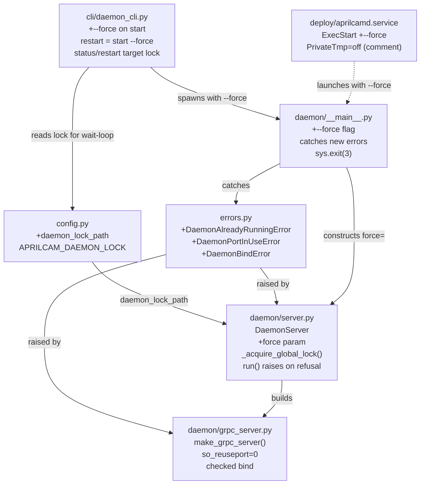
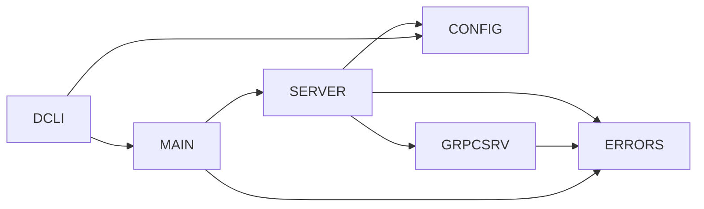

<!-- CLASI: Before changing code or making plans, review the SE process in CLAUDE.md -->

# Architecture Update -- Sprint 018: Enforce one aprilcamd daemon per machine

## What Changed

This sprint replaces the daemon's **per-user** duplicate-instance guard with a
**per-machine** guard, and closes a second, independent hole that let the
per-user guard's protection be bypassed at the network layer. Two structural
shifts:

1. **Singleton scope: per-user pidfile flock → per-machine lock file.**
   `DaemonServer.run()` (`src/aprilcam/daemon/server.py:107-141`) currently
   takes an exclusive `fcntl.flock` on `config.daemon_pidfile`
   (`<socket_dir>/aprilcamd.pid`). `socket_dir` is uid/runtime-namespaced
   (`config.py:_default_dirs()`, lines 310-350): `/run/aprilcam` under
   systemd/root, `$XDG_RUNTIME_DIR/aprilcam` / `/run/user/<uid>/aprilcam` /
   `$TMPDIR/aprilcam-<uid>` otherwise. Two daemons with different
   `socket_dir`s (e.g. a systemd instance and an ad hoc `python -m
   aprilcam.daemon` run by a developer) each flock their own pidfile
   successfully and coexist — confirmed the root cause of the "8 MCP servers
   against a confused mix of daemon instances" incident. This sprint adds a
   fixed, world-writable lock path (`/tmp/aprilcamd.lock`, overridable via
   `APRILCAM_DAEMON_LOCK`) that every daemon on the machine contends for,
   regardless of `socket_dir`. `daemon_pidfile` is retained unchanged for
   local `status`/`stop` pid discovery — it is not the singleton mechanism
   anymore, just a convenience cache.

2. **gRPC TCP bind: implicit `SO_REUSEPORT` → explicit single-listener bind
   with checked return.** `make_grpc_server()`
   (`src/aprilcam/daemon/grpc_server.py:1112-1147`) builds `grpc.server(...)`
   with no `options=` kwarg and calls `server.add_insecure_port(addr)` for
   each transport without inspecting the return value (line 1145: `for addr
   in transports: server.add_insecure_port(addr)`). gRPC's C-core defaults to
   `GRPC_ARG_ALLOW_REUSEPORT=1`, so N daemons bind `[::]:5280` with zero
   error and the kernel load-balances RPCs between them — this is the
   confirmed primary cause of the incident (multiple daemons silently served
   traffic on the same port; code fixes appeared not to "take" because calls
   were randomly routed to a stale daemon). This sprint disables reuseport
   and treats a zero return from `add_insecure_port` as a bind failure.

Both guards are independent and mutually reinforcing: the lock stops a second
daemon from starting at all; the reuseport fix stops a second daemon that
*did* start (e.g. before this sprint ships, or via a lock-path override
mismatch) from silently sharing the port. Neither alone is sufficient — the
lock only protects processes that participate in it (see Open Questions),
and the reuseport fix alone doesn't prevent duplicate daemons from existing,
only from silently co-serving TCP.

### Affected modules

- **`config.py`** — new `daemon_lock_path: Path` field (env
  `APRILCAM_DAEMON_LOCK`, default `Path("/tmp/aprilcamd.lock")`), parsed in
  `Config.load()` and registered in the `CONFIG_VARS` table (line ~200)
  alongside the other `APRILCAM_*` entries, following the existing pattern
  used for `APRILCAM_SOCKET_DIR` / `APRILCAM_DAEMON_HOST`.
- **`errors.py`** — three new exceptions: `DaemonAlreadyRunningError`
  (carries `existing_pid: int | None`), `DaemonPortInUseError`,
  `DaemonBindError`. Follow the existing style of `DaemonNotFoundError`
  (docstring explaining cause and remedy).
- **`daemon/server.py`** — `DaemonServer.__init__` gains `force: bool =
  False`. `run()`'s pidfile-flock block (107-141) is replaced by a new
  `_acquire_global_lock()` method that flocks `config.daemon_lock_path`
  instead of `config.daemon_pidfile`; on contention it either raises
  `DaemonAlreadyRunningError(existing_pid)` (default) or runs the takeover
  sequence and retries (when `force=True`). The existing `daemon_pidfile`
  write (local, per-`socket_dir`) is kept as-is, immediately after the
  global lock is acquired, so `status`/`stop` continue to work unchanged.
  `_release_pidfile` is renamed in spirit but keeps its no-unlink shutdown
  behavior (LOCK_UN + close only) — same reasoning extended to the new lock
  file: never unlink, so a `flock()` + `open()` on shutdown never races a
  fresh create.
- **`daemon/grpc_server.py`** — `make_grpc_server()` passes
  `options=[("grpc.so_reuseport", 0)]` to `grpc.server(...)`; each
  `add_insecure_port()` return is captured, and a `0` return raises
  `DaemonPortInUseError` for a TCP address or `DaemonBindError` for a Unix
  address.
- **`daemon/__main__.py`** — new `--force` argparse flag threaded into
  `DaemonServer(config, force=args.force)`; `main()` wraps `.run()` in a
  `try/except` for the three new errors, prints `"aprilcamd already running
  (pid N)"` (or the port/bind-specific message), and calls `sys.exit(3)`.
- **`cli/daemon_cli.py`** — `--force` added to the `start` subparser and
  threaded through `_cmd_start` → `_spawn_daemon` (currently lines 35-56,
  which Popens `[sys.executable, "-m", "aprilcam.daemon"]` with no extra
  argv) so a detached spawn under `--force` launches with `-m aprilcam.daemon
  --force`. `_cmd_restart` (lines 248-284) is redefined as `start --force`
  semantics for the *new* daemon's launch (it already stops the old one
  first); its wait-loop, which currently flocks `config.daemon_pidfile`
  directly (lines 263-280), is repointed at `config.daemon_lock_path`. `status`
  continues to read `config.daemon_pidfile` for display, documented as
  "best-effort local cache of the machine-global pid," since on a correctly
  operating machine the two files agree.
- **`deploy/aprilcamd.service`** — `ExecStart` gains `--force` (systemd's
  instance should always win over a stray developer-launched daemon on boot
  or restart), plus a comment that `PrivateTmp` must never be set (a private
  `/tmp` namespace would give systemd's daemon its own `/tmp/aprilcamd.lock`,
  silently defeating the machine-global guard — the unit today has no
  `PrivateTmp` directive, so this is a preventive comment, not a fix).

No proto changes, no data-model changes, no new RPCs. This sprint is entirely
process-lifecycle and transport-binding — it composes with, and does not
modify, the Sprint 014 remote-daemon/discovery model (`daemon_host`/
`daemon_port`, mDNS, `client/discovery.py`) or the Sprint 015 sole-vision-
authority boundary (no MCP/CLI code gains new camera-adjacent capability;
the daemon remains the only camera opener).

## Why

| Change | Use Cases Addressed |
|--------|---------------------|
| `daemon_lock_path` config field | SUC-001, SUC-002 |
| New error types (`errors.py`) | SUC-001, SUC-002, SUC-003 |
| `_acquire_global_lock()` in `server.py` | SUC-001, SUC-003 |
| `run()` raises instead of silently returning | SUC-001, SUC-003 |
| `force` param + takeover sequence | SUC-002 |
| gRPC `so_reuseport=0` + checked bind | SUC-001 (closes the silent-coexistence gap even when a lock is bypassed) |
| `--force` CLI/entrypoint flag | SUC-002 |
| `daemon status`/`restart` repointed at global lock | SUC-001, SUC-002 |
| `deploy/aprilcamd.service` `--force` + `PrivateTmp` note | SUC-002 |

## Impact on Existing Components

| Component | Change | Backward-Compatible? |
|-----------|--------|----------------------|
| `config.py` | New `daemon_lock_path` field + `CONFIG_VARS` entry; no existing fields removed | Yes — additive |
| `errors.py` | Three new exception classes | Yes — additive |
| `daemon/server.py` | Pidfile-flock singleton guard replaced by global-lock guard; `run()` behavior on refusal changes from silent `return` to a raised exception | **Breaking for direct callers of `DaemonServer.run()`**: any caller relying on silent-return-on-duplicate must now catch `DaemonAlreadyRunningError` |
| `daemon/grpc_server.py` | `SO_REUSEPORT` disabled; bind failures now raise instead of silently succeeding | **Breaking (intentional)**: a second daemon that previously started silently now fails to bind; an unrelated process squatting on port 5280 now correctly refuses the daemon rather than silently degrading |
| `daemon/__main__.py` | New `--force` flag; non-zero exit (3) on refusal instead of implicit exit 0 | **Breaking (intentional)**: scripts checking only "process launched" now see a real failure signal |
| `cli/daemon_cli.py` | `--force` on `start`; `restart` takeover path now targets the global lock; `status` documents the pidfile as best-effort | Yes — existing invocations without `--force` keep today's refuse-and-report behavior, now with a clearer message |
| `deploy/aprilcamd.service` | `--force` added to `ExecStart` | Yes — systemd restarts now always win, which is the desired boot-time behavior |
| `tests/test_daemon_server.py` | `test_pidfile_lock_prevents_duplicate` replaced by lock-path-based tests (same-lock/different-socket-dir refusal, `--force` takeover, stale-lock reclaim) | N/A — test-only |

## Migration Concerns

- **No data migration.** The lock file is ephemeral machine state
  (`/tmp/aprilcamd.lock`), created on first daemon start after this sprint
  ships; nothing reads or migrates a prior format.
- **Deployment sequencing:** `deploy/aprilcamd.service` must be redeployed
  with the new `--force` `ExecStart` at the same time as the code upgrade —
  an old unit file running new daemon code still works (refuse-by-default is
  a safe default), but loses the "systemd always wins" property. This is a
  one-line config change, not a blocking dependency; documented as an
  in-scope ticket rather than a hard gate.
- **Behavior change requiring operator awareness:** an unrelated process
  already bound to TCP port 5280 now causes the daemon to refuse to start
  (`DaemonPortInUseError`) instead of silently running Unix-socket-only (today
  the bind failure is invisible — the discarded return means the daemon
  logs nothing and simply doesn't get a TCP listener). This is a deliberate
  correctness fix; call out in the runbook change.
- **`APRILCAM_DAEMON_LOCK` is the test isolation escape hatch,** mirroring
  the existing `APRILCAM_SOCKET_DIR`/ephemeral-port pattern already used in
  `tests/test_daemon_server.py` and `tests/test_daemon_spawn_race.py`. CI and
  the new tests must never touch the real `/tmp/aprilcamd.lock` or bind the
  real port 5280.
- **No breaking change to the MCP server, CLI query commands (`cameras`,
  `tags`, `calibrate`, `view`), or any client-facing RPC.** This sprint is
  scoped entirely to daemon process startup/shutdown and the `daemon`
  CLI subcommand group.

## Component Diagram

## Dependency Graph

No cycles. Dependency direction unchanged from arch-014: `config` and
`errors` are leaves; `daemon/server.py` and `daemon/grpc_server.py` are
daemon-internal and depend only on `config`/`errors`; `cli/daemon_cli.py`
(client-side) depends on the daemon entrypoint only through subprocess
spawn, not an import — consistent with the existing daemon-is-a-leaf
invariant from arch-014.

## Design Rationale

### Decision: fixed path `/tmp/aprilcamd.lock`, not a `socket_dir`-relative path

**Context:** The bug is precisely that today's guard lives under a
uid/runtime-namespaced directory. Any fix that keeps the lock inside
`socket_dir` (or any other per-invocation-configurable directory) reproduces
the same class of bug the moment two invocations disagree on that directory.

**Alternatives considered:**
1. Move the pidfile itself to a fixed system path (e.g. `/run/aprilcamd.pid`
   or `/var/run/aprilcamd.pid`) — rejected: `/run` requires root on Linux and
   doesn't exist at all on macOS, where the daemon also runs (developer
   Macs). `/var/run` needs root too.
2. Use an abstract Linux namespace socket as the lock primitive — rejected:
   not portable to macOS, which has no abstract namespace.
3. Fixed path under `/tmp` (chosen) — `/tmp` exists and is world-writable on
   both macOS and Linux/Raspberry Pi without elevated privileges, and is the
   only location satisfying "any user, any distro, no root."

**Why this choice:** Portability across the daemon's actual deployment
targets (developer Macs, Raspberry Pi via systemd running as a non-root
user) is a hard constraint; `/tmp` is the only common denominator. The
0666-mode file plus advisory `flock` (which is enforced by the kernel
independent of the pid text's ownership, and auto-released on process death)
gives correct multi-user semantics without needing a shared directory owner.

**Consequences:** `/tmp/aprilcamd.lock` is a well-known, guessable path.
This is intentional and desired — it is a coordination point, not a secret.
Multi-tenant hosts where mutually distrusting users each want their own
daemon must set `APRILCAM_DAEMON_LOCK` explicitly (documented as an
operator responsibility, not a default AprilCam supports out of the box —
see Open Questions).

### Decision: lock-first-then-rewrite for stale-lock recovery, not unlink-and-retry

**Context:** The current pidfile code's stale-file branch (triggered on a
non-`BlockingIOError` `OSError`) unlinks the file and retries — a pattern
that has an inherent TOCTOU race if two processes hit the stale branch
concurrently (both unlink, both recreate, at most one flock succeeds but the
loser has already destroyed the winner's freshly-created file in some
interleavings).

**Alternatives considered:**
1. Keep unlink-and-retry, extended to the new lock path — rejected: same
   race, just relocated.
2. Lock-first-then-rewrite (chosen): open (or create) the lock file, attempt
   `flock(LOCK_EX | LOCK_NB)` unconditionally. If the previous holder is
   dead, the kernel has already released its advisory lock, so a fresh
   `flock` on the *same* (not recreated) file simply succeeds — no unlink
   needed. Only after the lock is held do we `ftruncate` + rewrite the pid.

**Why option 2:** It removes the race entirely by never destroying and
recreating the file — `flock` semantics on a stale-but-not-unlinked file
already do the right thing when the holder is dead (`kill -9` included,
since the OS releases the flock on process exit regardless of exit
cleanliness). This is strictly simpler than the current code and closes a
correctness gap at the same time.

**Consequences:** The lock file, once created, lives forever on the
filesystem (never unlinked, including on graceful shutdown) — this is
intentional (see next decision) and means `/tmp/aprilcamd.lock` is not a
reliable "daemon is running" signal by its mere *existence*; only a held
flock (or the pid recorded inside, cross-checked with `kill(pid, 0)`) means
that.

### Decision: never unlink the lock file, including on graceful shutdown

**Context:** Symmetric with the existing pidfile behavior
(`_release_pidfile`, lines 257-267: `LOCK_UN` + `close()`, no `unlink`).

**Why:** Unlinking on shutdown reintroduces a create/lock race window
between "process A unlinks" and "process A closes its fd" versus "process B
opens a new path entry and locks it" — two processes could then hold locks
on two different inode instances of what they both believe is *the* lock
file, defeating the whole mechanism. Never unlinking avoids the window
entirely; the fixed path always refers to the same inode for the life of the
machine (until an operator or reboot process manually clears `/tmp`).

**Consequences:** Consistent with the existing pidfile precedent already in
the codebase — no new operational surprise. `/tmp` clearing on reboot (the
common case on Linux, and irrelevant on macOS where `/tmp` need not survive
reboot either) naturally resets the lock file's inode, which is harmless.

### Decision: `--force` performs Shutdown-RPC → SIGTERM → SIGKILL → wait-for-free → acquire, not an immediate SIGKILL

**Context:** A forced takeover needs to guarantee it eventually wins, but
should prefer to let the existing daemon shut down its camera pipelines and
gRPC server cleanly first.

**Alternatives considered:**
1. Immediate `SIGKILL` on the lock-file pid — rejected: skips graceful
   camera-pipeline teardown (`CameraPipeline.stop()`), risking a wedged V4L2
   device that then also breaks the *new* daemon's open.
2. Shutdown RPC first, escalating only on timeout (chosen) — reuses the
   already-existing `DaemonControl.shutdown()` client call and
   `_cmd_stop`'s SIGTERM-then-wait fallback pattern (`daemon_cli.py`
   181-245), rather than inventing a new shutdown path.

**Why option 2:** Reuses proven code (`_cmd_stop`'s pattern) instead of
adding a second, subtly different shutdown implementation. Graceful-first
with a bounded escalation (SIGTERM, then SIGKILL after a timeout, mirroring
the existing 5-second grace window pattern in `_shutdown()`'s
`grpc_server.stop(grace=5)`) balances correctness (release the camera
cleanly when possible) against the hard guarantee that `--force` must
eventually succeed even against a wedged process.

**Consequences:** `--force` takeover is not instantaneous — it can take up
to the sum of the RPC timeout, the SIGTERM grace window, and the
wait-for-flock-free poll interval (bounded, on the order of a few seconds
under the existing `_cmd_restart` wait pattern of up to 15s). This is
acceptable: `--force` is an explicit, infrequent operator/systemd action,
not a hot path.

### Decision: `run()` raises instead of silently returning on refusal

**Context:** Today, `run()` returning silently on "already running" means a
caller (systemd, a shell script, `_cmd_start`'s foreground path) sees the
process exit 0 having done nothing — indistinguishable from a successful
run that was later stopped, unless the caller inspects logs.

**Why raise:** A raised exception forces every call site
(`daemon/__main__.py`, `cli/daemon_cli.py`'s foreground `DaemonServer(...).run()`
call at line 81) to make an explicit decision about the refusal, and enables
a real non-zero exit code (`sys.exit(3)`) for systemd/scripts. Silent success
on a no-op is a correctness hazard that directly enabled the original
incident (duplicate daemons went unnoticed).

**Consequences:** Any code (in this repo or downstream) constructing
`DaemonServer` directly and calling `.run()` without a `try/except` will now
see an unhandled exception instead of a quiet no-op. Grep for direct
`DaemonServer(...).run()` callers confirms only `daemon/__main__.py:main()`
and `cli/daemon_cli.py:_cmd_start`'s foreground branch (line 81) call it
directly; both are updated in this sprint.

## Open Questions

1. **Non-participating processes on port 5280.** The lock only coordinates
   processes that call `_acquire_global_lock()` — i.e. `aprilcamd` itself.
   An unrelated process (not an AprilCam daemon) that happens to already
   hold TCP port 5280 is *not* detected by the lock; it is caught by the
   `SO_REUSEPORT`-disabled bind-failure check instead (`DaemonPortInUseError`).
   This is by design (two independent guards for two independent failure
   modes) but should be stated explicitly in the runbook so an operator
   seeing `DaemonPortInUseError` knows to check `lsof -i :5280` rather than
   assume it's another `aprilcamd`.
2. **Multi-tenant / shared-host override.** A host where multiple mutually
   distrusting users each want an independent daemon is explicitly out of
   scope for the default path — `APRILCAM_DAEMON_LOCK` (and
   `APRILCAM_DAEMON_PORT`) is the documented escape hatch, but nothing in
   this sprint builds tooling to manage such a setup. Flagging for
   stakeholder awareness, not blocking implementation.
3. **`daemon/client.py:ensure_running()`** (legacy) also Popens the daemon
   but has no callers in `src/` today. Per the issue, left as-is this
   sprint — the new guard protects it transparently if it is ever re-wired,
   since it goes through the same `DaemonServer.run()` path. No ticket
   needed unless a future sprint re-activates that code path.
4. **`daemon status` reporting when the lock and local pidfile disagree.**
   Normally they agree (both written by the same process, immediately
   sequentially, right after lock acquisition). If an operator manually
   edits or removes one, `status` (which reads `daemon_pidfile`) could
   report a pid that no longer holds the lock. This sprint documents
   `daemon_pidfile` as "best-effort local cache" in `status`'s output/docs
   rather than building active reconciliation — reconciliation would need
   `status` to read the lock file too, which is a small addition a ticket
   can pick up if the ambiguity proves confusing in practice, but is not
   required by the stakeholder-approved scope.
