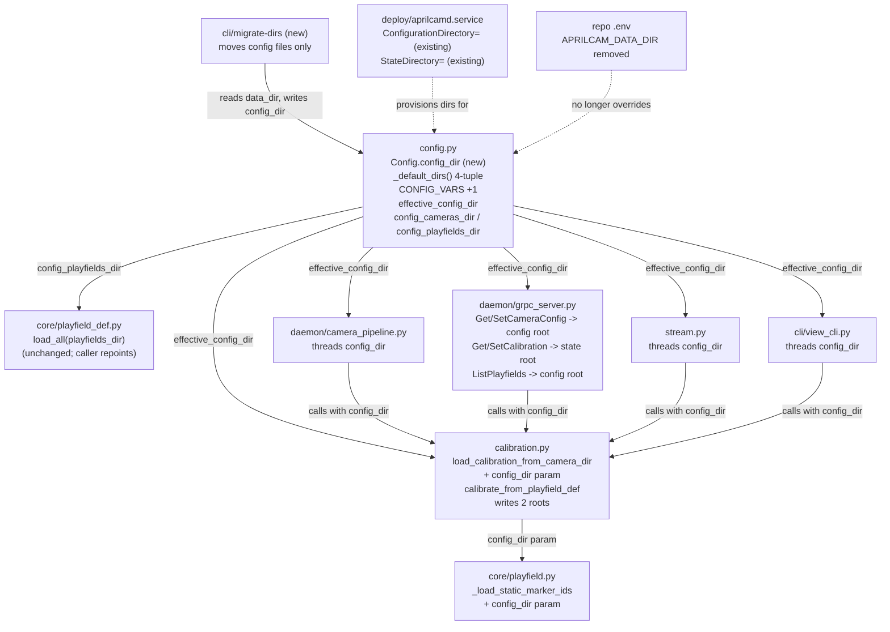
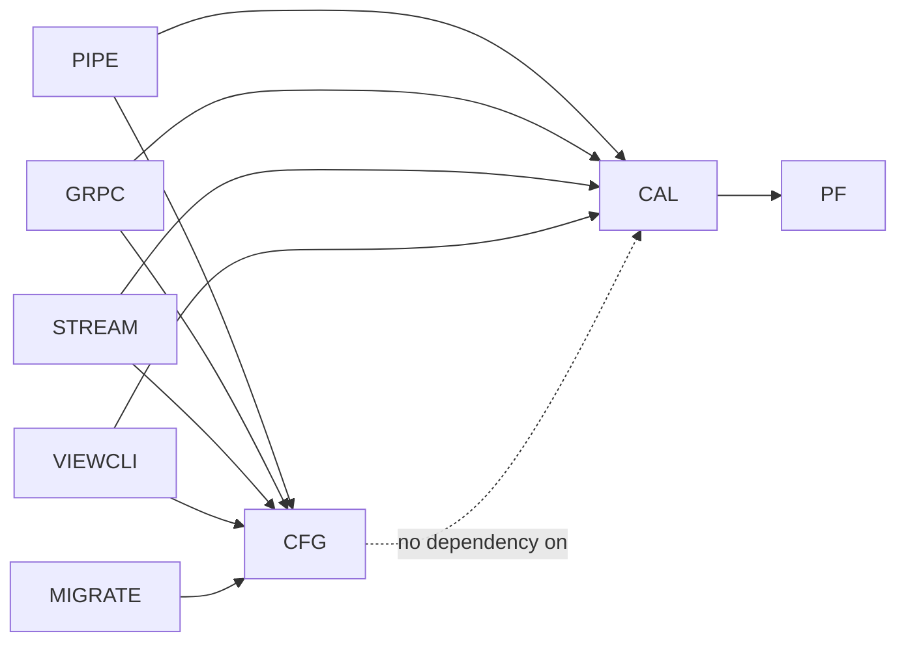

<!-- CLASI: Before changing code or making plans, review the SE process in CLAUDE.md -->

# Architecture Update -- Sprint 019: Split config from state into FHS XDG roots

## What Changed

### 1. `config.py` — new `config_dir` root, 4th `_default_dirs()` return, legacy fallback

**`_default_dirs()` signature changes** from returning 3 dirs to 4:

```python
def _default_dirs() -> tuple[Path, Path, Path, Path]:
    """Return (data_dir, socket_dir, log_dir, config_dir)."""
```

FHS branch adds `Path("/etc/aprilcam")` as the 4th element; XDG branch adds
`Path(os.environ.get("XDG_CONFIG_HOME", "") or Path.home() / ".config") /
"aprilcam"`. This mirrors the existing `data`/`run`/`log` construction
pattern already in the function (lines 318-358 today) — no new pattern is
introduced, one more tuple element following the same FHS/XDG selection
logic keyed on `use_fhs` (computed once, reused for all four).

**`Config` dataclass gains a `config_dir: Path` field**, resolved in
`load()` the same way `data_dir`/`socket_dir`/`log_dir` already are: via
`_path("APRILCAM_CONFIG_DIR", _cd)` where `_cd` is the 4th tuple element
from `_default_dirs()`. `Config.load()`'s existing `_path()` closure
(485-487 today) is reused unchanged.

**Legacy fallback** — a new `Config.__post_init__` (or a `load()`-time
check, implementer's choice) computation: `config_dir` is used as-is if
`APRILCAM_CONFIG_DIR` was explicitly set OR if `config_dir` (the new
default) already contains config files. Otherwise, if `data_dir` contains a
`cameras/*/config.json` and `config_dir` does not, config reads fall back
to `data_dir`. This fallback is exposed as a resolved property (e.g.
`effective_config_dir`) rather than mutating `config_dir` itself, so
`config_dir` always reflects the "correct" target (useful for
`migrate-dirs` and the one-time warning) while a distinct accessor gives
callers the dir to actually *read* config from today.

**New properties**: `config_cameras_dir` (`effective_config_dir /
"cameras"`) and `config_playfields_dir` (`effective_config_dir /
"playfields"`), parallel to today's `cameras_dir`/`playfields_dir`
properties (434-442) which continue to mean the **state** roots
(`data_dir / "cameras"`, `data_dir / "playfields"`) unchanged.

**`CONFIG_VARS`** (200-278 today) gains one entry:

```python
{
    "key": "APRILCAM_CONFIG_DIR",
    "default": "(FHS: /etc/aprilcam · XDG: ~/.config/aprilcam)",
    "description": "Root directory for admin-owned config (per-camera config.json, playfields/*.json).",
}
```

---

### 2. `calibration/calibration.py` — loader takes an explicit config root

`load_calibration_from_camera_dir(camera_dir, camera_config=None,
playfield_def=None)` gains a 4th optional parameter:

```python
def load_calibration_from_camera_dir(
    camera_dir: str | Path,
    camera_config: "dict | None" = None,
    playfield_def: "object | None" = None,
    config_dir: "str | Path | None" = None,
) -> Optional["CameraCalibration"]:
```

Today, line 453 does:
```python
cfg = camera_config if camera_config is not None else _load_config(camera_dir)
```
This becomes:
```python
cfg = camera_config if camera_config is not None else _load_config(
    Path(config_dir) / Path(camera_dir).name if config_dir is not None else camera_dir
)
```
i.e. when `camera_config` is not pre-supplied (the daemon-local, non-MCP
path) AND an explicit `config_dir` is given, the config-file read resolves
`<config_dir>/<camera_slug>/config.json` instead of
`<camera_dir>/config.json`. The MCP path (which already always supplies
`camera_config`) is untouched — this parameter only affects daemon-local
callers passing a bare directory. Backward-compatible: omitting
`config_dir` preserves today's exact behavior (read `config.json` next to
`calibration.json`).

`calibrate_from_playfield_def`'s daemon-local write branch (~1348, guarded
by `if not skip_save:`) is split: it currently writes both
`calibration.json` and `config.json` to one `camera_dir`. It changes to
accept (or derive from `Config`) both a state dir and a config dir,
writing `calibration.json` via `save_calibration_to_camera_dir(...,
state_dir)` and `config.json` via `save_camera_config(config_dir, ...)`
separately. The MCP `skip_save=True` branch (already decoupled — it
returns the computed calibration without writing anything) is unaffected.

---

### 3. `core/playfield.py` — `_load_static_marker_ids` takes the config dir explicitly

Today `_load_static_marker_ids(self, path: str)` (933) derives
`config_path = cal_path.parent / "config.json"` — a **sibling lookup**
relative to the calibration/homography file path it's given (called from
617 and 825 with a calibration file path, not a directory). This sibling
assumption breaks once config and calibration live in different roots.

Changes to take an explicit config directory:

```python
def _load_static_marker_ids(
    self, path: str, config_dir: "str | Path | None" = None,
) -> Optional[List[str]]:
```

When `config_dir` is provided, `config_path = Path(config_dir) /
Path(path).parent.name / "config.json"` (reconstructing the camera slug
from the calibration path's parent directory name) is checked first;
falls back to the old sibling behavior when `config_dir` is `None`
(backward-compatible for any caller not yet threading the config root).
Both call sites (617, 825) pass the playfield's stored config-dir
reference (see #4 below) through.

---

### 4. Threading the config root through daemon-local callers + RPC resolution

**`daemon/camera_pipeline.py`** (~272-273): `camera_dir =
self.config.cameras_dir / self.cam_name` stays state-only;
`load_calibration_from_camera_dir(camera_dir)` becomes
`load_calibration_from_camera_dir(camera_dir, config_dir=self.config.effective_config_dir)`.

**`daemon/grpc_server.py`** reload sites (~297 `ReloadCalibration`, ~878
post-`SetCalibration` reload): same one-argument addition,
`config_dir=self._config.effective_config_dir`.

**`stream.py`** (~69): same addition using `cfg.effective_config_dir`.

**`cli/view_cli.py`** (~557): same addition using
`config.effective_config_dir`.

**RPC resolution** (`daemon/grpc_server.py`):
- `GetCameraConfig`/`SetCameraConfig` (737, 761 today) resolve
  `config_cameras_dir/<cam_name>/config.json` instead of
  `cameras_dir/<cam_name>/config.json`.
- `GetCalibration`/`SetCalibration` (791, 816) and `GetPaths`/`SetPaths`
  (900, 923) are **unchanged** — they stay on `cameras_dir` (state); the
  camera registry (`registry.json`) also stays on `cameras_dir` (state) —
  not touched by this sprint.
- `ListPlayfields` (969) scans `config_playfields_dir` instead of
  `data_dir / "playfields"`.

**`core/playfield_def.py`**'s `load_all(playfields_dir)` (196) caller in
`daemon` startup passes `cfg.config_playfields_dir` instead of
`cfg.playfields_dir`.

---

### 5. New `aprilcam migrate-dirs` CLI command

New subcommand (new `cli/migrate_dirs_cli.py` or added to an existing CLI
module, implementer's discretion) with a `--dry-run` flag:

- Scans `data_dir/cameras/*/config.json` and `data_dir/playfields/*.json`
  (the legacy config-in-state-tree locations).
- For each, computes the destination under `config_dir` (creating parent
  dirs as needed) and either prints the planned move (`--dry-run`) or
  performs `Path.rename()` / copy+delete (atomic where possible, same
  filesystem in the common case) and reports what moved.
- Idempotent: files already absent from the legacy location are skipped
  silently (already migrated); a summary distinguishes "moved N files"
  from "nothing to migrate."
- Never touches state-category files (`calibration.json`, `registry.json`,
  `hosts.json`, `info.json`, `paths.json`) — these stay under `data_dir`
  unconditionally.
- Exit code 0 on success (including no-op); nonzero on a partial-failure
  (e.g. permission error mid-move), with per-file error reporting so the
  operator knows which files still need manual attention.

**Daemon one-time legacy-layout warning**: at daemon startup (`Config.load()`
call site or first `CameraPipeline.start()`), a check — "does `config_dir`
have zero config files while `data_dir` has at least one?" — logs one
WARNING (`"legacy config layout detected under %s; run `aprilcam
migrate-dirs` — see docs"`) and proceeds using the fallback read path from
change #1. A process-lifetime flag (module-level or on the `Config`
instance) suppresses repeat warnings within the same daemon process.

---

### 6. `deploy/aprilcamd.service` and `deploy/README.md`

`deploy/aprilcamd.service` **already declares**
`ConfigurationDirectory=aprilcam` (from a prior sprint) — this sprint does
not add the directive, but **must fix** the unit's hardcoded
`Environment=APRILCAM_DATA_DIR=/home/eric/aprilcam-data` line, which
bypasses FHS auto-selection with a non-standard absolute path. This sprint
either removes that override (letting `_default_dirs()`'s FHS branch
select `/var/lib/aprilcam` automatically under systemd's
`StateDirectory=`) or, if the operator wants to preserve the existing data
location for continuity, pairs it with a `migrate-dirs` run and a
follow-up sprint note — the sprint plan defers to the ticket to make this
call explicitly rather than leaving it ambiguous (see Open Questions).
`APRILCAM_CONFIG_DIR` is left unset in the unit so it defaults to
`/etc/aprilcam` via `ConfigurationDirectory=`.

`deploy/README.md` gains a row/section documenting `APRILCAM_CONFIG_DIR`
and the FHS config category, and a step referencing `aprilcam migrate-dirs`
for upgrading an existing Pi deployment.

---

### 7. Repo `.env`

Line 15, `APRILCAM_DATA_DIR=./data/aprilcam`, is **removed** so that a
fresh Mac dev checkout falls through to the XDG defaults
(`~/.local/share/aprilcam` for state, `~/.config/aprilcam` for config) —
per the locked stakeholder decision. Developers with existing
`./data/aprilcam` content run `aprilcam migrate-dirs` (after first setting
`APRILCAM_DATA_DIR=./data/aprilcam` one final time, or relying on the
legacy-layout fallback/warning) to relocate config files into
`~/.config/aprilcam`; state remains wherever `APRILCAM_DATA_DIR` pointed,
or migrates manually to `~/.local/share/aprilcam` if the developer also
drops the override entirely.

---

## Why

| Change | Reason |
|--------|--------|
| `config_dir` + 4th `_default_dirs()` return | Config and state are different FHS/XDG categories (admin-authored vs. app-generated); mixing them in `data_dir` was the root fragility this sprint fixes (SUC-001) |
| Legacy fallback in `config.py` | Existing installs (including this repo's own `data/aprilcam`) must keep working with zero action until the operator explicitly migrates (SUC-003) |
| Loader `config_dir` param | The one real coupling point (`load_calibration_from_camera_dir` overlaying `config.json` off the same dir as `calibration.json`) must support two different roots without breaking the MCP path, which already short-circuits via `camera_config` (SUC-004, SUC-005) |
| `_load_static_marker_ids` explicit config dir | Same coupling, second call path — a sibling-file assumption that silently breaks once config and calibration diverge in location (SUC-004) |
| Threading through daemon-local callers + RPC resolution | `GetCameraConfig`/`SetCameraConfig`/`ListPlayfields` must target the config root; `GetCalibration`/`SetCalibration`/`GetPaths` must keep targeting the state root — the RPC boundary was already file-scoped (Sprint 015+), this sprint just repoints half of it (SUC-005) |
| `aprilcam migrate-dirs` | Locked decision: migration must be explicit and operator-initiated, never automatic, to avoid silently moving files under a running daemon or during an unattended restart (SUC-002) |
| Daemon legacy-layout warning | Operators need visibility into the fact that migration is available/needed without the daemon taking unilateral action (SUC-003) |
| systemd/`.env` updates | `deploy/aprilcamd.service`'s hardcoded data path and the repo's CWD-relative `.env` override are exactly the two "launch-location-dependent config" cases the issue calls out; both must be corrected for the new model to actually take effect for the two real deployment targets (Mac dev, Pi) (SUC-001, SUC-006) |

---

## Impact on Existing Components

| Component | Impact |
|-----------|--------|
| `config.py` | New field (`config_dir`), new function return arity (`_default_dirs()` 3→4 tuple), new `CONFIG_VARS` entry, new properties (`config_cameras_dir`, `config_playfields_dir`, `effective_config_dir`). `cameras_dir`/`playfields_dir` properties keep their current meaning (state) — no rename, no behavior change for existing callers of those two properties. |
| `calibration/calibration.py` | `load_calibration_from_camera_dir` gains an optional 4th parameter (additive, backward-compatible default `None`). `calibrate_from_playfield_def`'s daemon-local write branch splits one write target into two; MCP `skip_save=True` branch unaffected. |
| `core/playfield.py` | `_load_static_marker_ids` gains an optional 2nd parameter (additive). Both call sites (617, 825) updated to pass it. |
| `daemon/camera_pipeline.py` | One-argument addition at the `load_calibration_from_camera_dir` call site (~272). |
| `daemon/grpc_server.py` | `ReloadCalibration` (~297) and post-`SetCalibration` reload (~878) gain the same argument. `GetCameraConfig`/`SetCameraConfig` (737/761) and `ListPlayfields` (969) resolve against the config root instead of the state root — a genuine behavior change for these three RPCs, scoped by the RPC boundary already being file-specific (no other RPC touches `config.json` or `playfields/*.json`). |
| `stream.py`, `cli/view_cli.py` | One-argument addition each at their respective loader call sites. |
| `core/playfield_def.py` | No code change to `load_all()` itself; its daemon-startup caller passes `config_playfields_dir` instead of `playfields_dir`. |
| `camera/registry.py`, `client/host_codes.py` | **No changes** — both are confirmed state-only (`registry.json` under `cameras_dir`, `hosts.json` under `data_dir`) and stay there; included here only to record that they were reviewed and correctly excluded from scope. |
| CLI (`cli/`) | New `migrate-dirs` subcommand (new file or added to an existing CLI module). |
| `deploy/aprilcamd.service` | `Environment=APRILCAM_DATA_DIR=/home/eric/aprilcam-data` line **removed** (stakeholder-resolved — see Open Questions #1) so the Pi resolves FHS defaults (`/var/lib/aprilcam` state, `/etc/aprilcam` config). `ConfigurationDirectory=aprilcam` already present — confirmed, not newly added. Ticket 5 documents the one-time Pi-side `migrate-dirs` run to relocate `/home/eric/aprilcam-data` content before the override is removed. |
| `deploy/README.md` | New `APRILCAM_CONFIG_DIR` documentation, FHS config row, `migrate-dirs` upgrade step. |
| Repo `.env` | `APRILCAM_DATA_DIR=./data/aprilcam` line removed. |
| Test suite | Shared-dir-assuming tests (`test_config_calibration_split.py`, `test_calibrate_from_def.py`, `test_sprint_012_integration.py`, `test_calibration_parallax.py`, `test_parallax_integration.py`, `test_open_camera_rehydrate.py`, `test_calibration_geometry_persist.py`, `test_file_proxy_rpcs.py`) continue to pass unmodified where they rely on the loader's backward-compatible default (`config_dir=None` → sibling read), and gain new parametrized cases where they should now assert config/state root separation. `test_config_loader.py`/`test_config_cli.py` gain `config_dir` field coverage. New tests: 4th `_default_dirs()` element (FHS + XDG), `APRILCAM_CONFIG_DIR` override, legacy fallback, `migrate-dirs` correctness + idempotency + `--dry-run`, daemon warning (once), RPC resolution to the correct root. |

---

## Migration Concerns

### No automatic migration — explicit CLI only

This is a **locked stakeholder decision**, not an implementation detail:
the daemon never moves files on its own, at startup or otherwise. The only
writer of the config root's new location (aside from admin hand-editing)
is `aprilcam migrate-dirs`, run explicitly by the operator. This avoids a
class of bugs where an unattended daemon restart (e.g. systemd
`Restart=on-failure`) silently relocates files mid-incident, which would
complicate debugging exactly when the operator can least afford surprise
side effects.

### Legacy layout must keep working until migrated

Any install created before this sprint (including this repo's own
`data/aprilcam` fixture-derived tree, and any deployed Pi with the current
`aprilcamd.service`) has config and state co-located under one tree. The
fallback in change #1 (read config from `data_dir` when `config_dir` is
empty and `APRILCAM_CONFIG_DIR` is unset) guarantees zero functional
regression for these installs pre-migration — the daemon opens cameras,
detects tags, and resolves world coordinates exactly as before. Only the
config-root *write* paths (`SetCameraConfig`, `migrate-dirs`) are new
behavior; all reads degrade gracefully.

### `deploy/aprilcamd.service`'s hardcoded `APRILCAM_DATA_DIR` — resolved

The unit currently pins `APRILCAM_DATA_DIR=/home/eric/aprilcam-data` — a
non-FHS, user-specific absolute path that predates (or was never updated
for) the FHS/XDG model from Sprint 013. **Stakeholder decision**: remove
the override. `StateDirectory=aprilcam` + FHS auto-selection then
provisions `/var/lib/aprilcam`, and `ConfigurationDirectory=aprilcam`
provisions `/etc/aprilcam`. Ticket 5 performs and documents (in
`deploy/README.md`) the one-time Pi-side data move: run
`aprilcam migrate-dirs` on the Pi to relocate config files out of
`/home/eric/aprilcam-data` into `/etc/aprilcam`, then relocate the
remaining state content (`calibration.json`, `registry.json`, etc.) from
`/home/eric/aprilcam-data` into `/var/lib/aprilcam`, before removing the
`Environment=` line and restarting the unit.

### Recalibration boundary

Because `calibrate_from_playfield_def`'s daemon-local write branch now
targets two roots instead of one, a partial failure (e.g. config root
writable, state root not, or vice versa) is a new failure mode that did
not exist when both writes went to the same directory. The implementing
ticket should decide and document an explicit ordering (state write, the
larger/more critical file, first) and whether a failure on the second
write is surfaced as a partial-success warning or a hard error — flagged
as an Open Question.

### Test fixture migration

`test_config_calibration_split.py`'s canonical fixture
(`data/aprilcam/cameras/arducam-ov9782-usb-camera` holding both files) is
the exact "legacy layout" shape this sprint must keep working via the
fallback path — it should gain new cases alongside its existing ones
rather than being restructured, since it documents the backward-compat
contract this sprint promises.

---

## Component Diagram



## Dependency Graph



No cycles: `config.py` sits at the bottom (no imports from `calibration.py`,
`playfield.py`, or the daemon layer); everything else depends downward on
it, matching the existing dependency direction from architecture-013.
`calibration.py` gains a one-directional call into `core/playfield.py`'s
marker-id helper only through the existing relationship (unchanged by this
sprint — `playfield.py` already called into calibration/config loading
utilities before this sprint; this sprint only adds a parameter to that
existing call, not a new edge).

---

## Design Rationale

### Decision: `config_dir` as a 4th `_default_dirs()` return, not a separate function

**Context:** `_default_dirs()` already computes `data`/`run`/`log` from one
`use_fhs` branch decision (318-358 today). A new config root needs the
same FHS-vs-XDG selection logic.

**Alternatives considered:**
1. A second pure function, e.g. `_default_config_dir()`, called separately.
2. Extend `_default_dirs()`'s return tuple to 4 elements (chosen).

**Why option 2:** `_default_dirs()`'s entire purpose is "compute the FHS or
XDG root for each category from one euid/env check"; a config root is just
a 4th category using the identical selection predicate (`use_fhs`).
Splitting it into two functions would duplicate the `use_fhs` computation
and risk the two functions disagreeing (e.g. one honoring
`APRILCAM_SYSTEM=0` and the other not) — a correctness risk with no
compensating benefit. Every existing caller of `_default_dirs()` already
unpacks a tuple; widening it by one element is a mechanical, low-risk
change caught immediately by type checkers and the one call site in
`Config.load()`.

**Consequences:** Any future FHS/XDG category (should one arise) follows
the same pattern — extend the tuple, extend the FHS/XDG branches
symmetrically. The function's docstring and signature both need updating
together (already true today for the existing 3-tuple).

---

### Decision: legacy fallback as a separate `effective_config_dir` accessor, not a `config_dir` mutation

**Context:** The legacy fallback ("if `data_dir` holds config files and
`config_dir` doesn't, read config from `data_dir`") needs a resolved value
for actual reads, but `migrate-dirs` and the one-time warning both need to
know the **target** config root (where files *should* end up) to report
correctly ("moving to `/etc/aprilcam`" — not "moving to `data_dir`,
because that's where we're currently reading from").

**Alternatives considered:**
1. Mutate `config_dir` itself when the legacy layout is detected, so all
   callers transparently get the fallback location.
2. Keep `config_dir` as the pure FHS/XDG-resolved target; add a distinct
   `effective_config_dir` property that applies the fallback for read call
   sites (chosen).

**Why option 2:** Option 1 would make `migrate-dirs --dry-run` report a
confusing plan ("moving files from `data_dir` to `data_dir`" if
`config_dir` had already been silently overwritten to equal `data_dir`).
Keeping `config_dir` as the honest FHS/XDG target and introducing a
separate accessor for "where should I actually read from right now" keeps
the migration tool's plan computation simple (`config_dir` is always the
destination) while still giving daemon-local read call sites
zero-regression behavior.

**Consequences:** Two properties to keep straight (`config_dir` vs.
`effective_config_dir`); the docstring on each must be explicit about
which one a new caller should use. Write call sites (`SetCameraConfig`,
`migrate-dirs`) always use `config_dir`; read/loader call sites use
`effective_config_dir`.

---

### Decision: loader parameter is `config_dir`, not a boolean flag or separate function

**Context:** `load_calibration_from_camera_dir` needs to read `config.json`
from a location that may differ from `calibration.json`'s location, but
only for daemon-local callers passing a bare directory — the MCP path
already short-circuits this entirely via the pre-loaded `camera_config`
dict.

**Alternatives considered:**
1. A new function `load_calibration_from_camera_dir_v2` or similar,
   duplicating the existing function with a different signature.
2. A boolean flag (`use_config_root: bool`) that internally re-derives the
   config path from a `Config` singleton.
3. An optional `config_dir` parameter defaulting to `None` (chosen),
   preserving today's sibling-read behavior when omitted.

**Why option 3:** Backward compatibility is a hard constraint — the
function is called from at least five daemon-local sites plus the MCP
path, and the issue's investigation confirmed the MCP path already passes
`camera_config` (bypassing the parameter entirely). A boolean flag coupled
to a global `Config` singleton would make the function impure and harder
to test in isolation (the existing test suite constructs `Config` objects
directly with tmp dirs — a singleton dependency would fight that pattern).
An explicit optional parameter keeps the function pure and lets each
call site pass exactly the directory it has already resolved from its own
`Config` instance.

**Consequences:** Five call sites each need a one-line addition
(`config_dir=self.config.effective_config_dir` or equivalent). This is
the "thread the config root through callers" ticket's core mechanical
work — flagged explicitly in the Sprint Changes and use cases so it isn't
missed at any site.

---

## Open Questions

1. ~~**`deploy/aprilcamd.service`'s hardcoded `APRILCAM_DATA_DIR`
   override**~~ — **RESOLVED by stakeholder**: remove
   `Environment=APRILCAM_DATA_DIR=/home/eric/aprilcam-data` from the unit
   so the Pi resolves to proper FHS defaults (`/var/lib/aprilcam` state,
   `/etc/aprilcam` config) via the existing `ConfigurationDirectory=` /
   `StateDirectory=` directives. Ticket 5 documents and performs the
   one-time Pi-side migration: operator runs `aprilcam migrate-dirs` on
   the Pi (while `APRILCAM_DATA_DIR=/home/eric/aprilcam-data` is still in
   effect, or relying on the legacy-layout fallback) to relocate config
   files into `/etc/aprilcam`, then relocates the remaining state content
   from `/home/eric/aprilcam-data` into `/var/lib/aprilcam`, before
   removing the `Environment=` override and restarting the unit under
   systemd's FHS-provisioned directories.
2. **Partial-write failure ordering in `calibrate_from_playfield_def`'s
   daemon-local branch** — once state and config writes target different
   roots, a mid-operation failure (one root writable, one not) is a new
   failure mode. The implementing ticket should pick an explicit write
   order and failure-reporting behavior (warn vs. raise) and document it
   in the function's docstring; not specified further here since it does
   not change the module boundary, only an internal sequencing detail.
3. **`migrate-dirs` conflict handling** — if a destination file already
   exists at the config-root target (e.g. a previous partial migration, or
   an operator who manually created `~/.config/aprilcam/cameras/<slug>/
   config.json`), should the command overwrite, skip-and-warn, or abort?
   Not specified in the issue; left to the ticket implementing
   `migrate-dirs`, with a preference for skip-and-warn (report the
   conflict, don't silently clobber admin-authored config) unless the
   stakeholder specifies otherwise.
