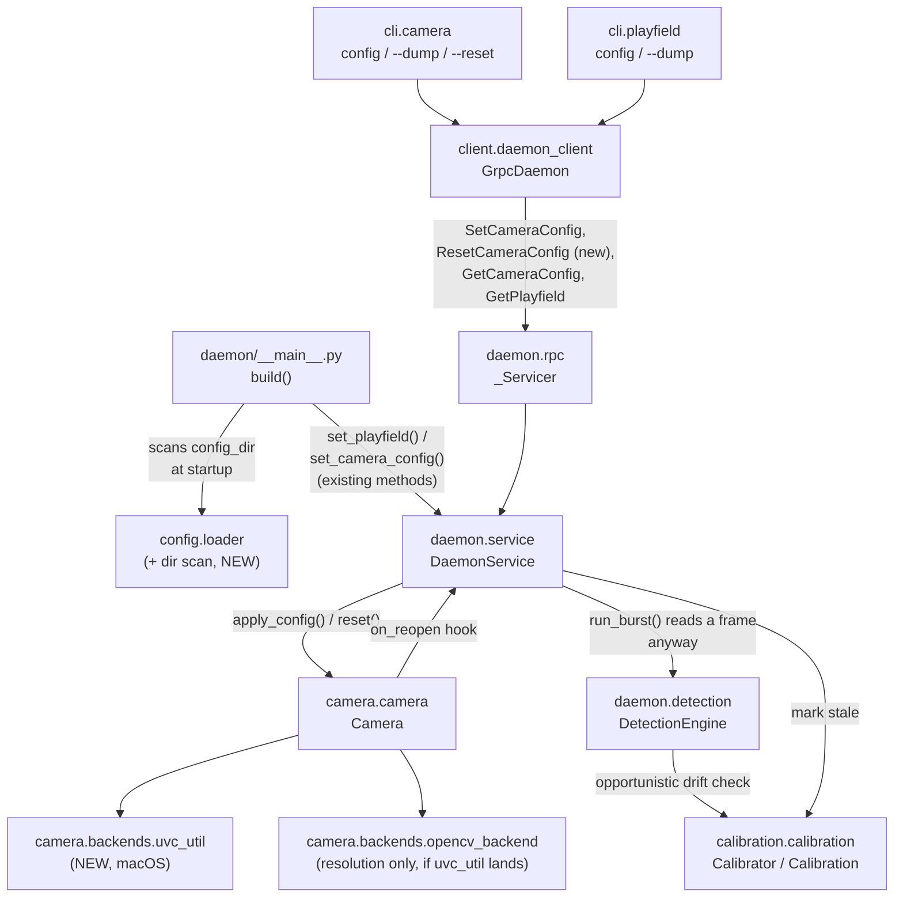

<!-- CLASI: Before changing code or making plans, review the SE process in CLAUDE.md -->

# Sprint 023: Config service completion and calibration trust

**Scope note (read first):** the issue behind this sprint originally had
three parts. This sprint plans **Part 1** (configuration that survives a
restart, with real hardware settings) **and Part 3** (calibration trust:
a reprojection threshold and reachable staleness). **Part 2 (the
annotation store) is deferred to sprint 024** — confirmed by the
stakeholder (`stakeholder_approval` gate, 2026-08-01) — see "Sizing
decision and recommended split" under Architecture for the full
reasoning. The originating issue was split accordingly:
`config-service-completion-and-annotations.md` now scopes Parts 1+3 only
(this sprint's linked issue); `annotation-store-for-shared-spatial-state.md`
carries Part 2 forward as its own pending issue for sprint 024's
planner. The sprint's frontmatter `title` has been narrowed to "Config
service completion and calibration trust" to match.

## Goals

1. Close the restart trap sprint 022 exposed live: install a playfield
   definition and a camera config on disk once, and every daemon restart
   comes back fully configured — no manual re-push required.
2. Make camera hardware settings (exposure, gain, white balance,
   resolution, UVC controls) actually reach the camera when pushed, with
   UC-03's hard-error, correct-ordering, never-half-configured contract
   honored for real hardware, not just the config-document round trip.
3. Complete the experiment workflow: `ResetCameraConfig` (end an
   experiment without a restart) and `--dump` (capture a winning
   experiment as an installable file) for both camera and playfield
   documents.
4. Make calibration trustworthy: reject a complete-but-degenerate solve
   (a reprojection-error threshold), and make `Calibration.stale`
   actually reachable so a physically bumped camera is flagged rather
   than silently serving plausible wrong coordinates — the failure mode
   the design calls the worst in the system.

## Problem

Sprints 020–022 built a working daemon — cameras, detection, calibration,
deskew, playfield config — but two operational gaps sit underneath all of
it:

- **Config doesn't survive a restart in practice**, even though the
  *design* (UC-01: disk is the source of record, RPC push is ephemeral)
  is correct and must not be weakened. The daemon simply never reads
  `config_dir` at startup — `set_camera_config`/`set_playfield` only
  populate in-memory dicts from RPC pushes. A calibrated camera reports
  `calibrated=True` after a restart (calibration is file-backed and does
  survive), but its playfield link and hardware settings vanish, so
  `aprilcam camera calibrate` and `playfield image` fail until two
  documents are re-pushed by hand — exactly the trap hit live during
  sprint 022 verification.
- **Pushed hardware settings are accepted but inert.** Sprint 022 shipped
  a minimal `SetCameraConfig` that stores `name`/`playfield` and echoes
  `settings` back verbatim, but never calls `Camera.apply_config`. The
  ordering/hard-error machinery `Camera.apply_config` needs already
  exists (`camera/camera.py`) and is unit-tested against a mocked
  backend, but nothing in the daemon calls it, and nothing has validated
  it against real hardware.
- **Calibration accepts anything complete.** `Calibrator.calibrate`
  requires every specified ArUco fiducial (UC-04's all-or-nothing rule,
  correctly implemented), but applies no upper bound on reprojection
  error — a complete-but-sloppy solve succeeds exactly like a good one.
- **`Calibration.stale` is hardcoded `False`.** Nothing in this codebase
  ever sets it. A camera bumped after calibration keeps reporting
  confident, plausible, wrong world coordinates forever, with no signal
  anywhere in the system that anything is wrong.

## Solution

Two coherent bodies of work, both about making the system trustworthy
across time (a restart, a drift, a bump) rather than only trustworthy at
the moment it was configured:

**Config-service completion.** Wire the config-document machinery that
already exists (`ConfigLoader`, `Camera.apply_config`,
`config.interfaces.Directories`) into the two paths that don't yet use
it: daemon startup (load `config_dir` before doing anything else) and
the live push path (actually call `apply_config` on the camera, not just
store the document). Add the two capabilities the experiment workflow
needs and doesn't have: `ResetCameraConfig` and `--dump`.

**Calibration trust.** Add a named, tunable reprojection-error ceiling to
the existing homography-solve path, and make staleness a real,
opportunistically-checked signal rather than a permanently-`False` field
— piggybacked on frames the daemon is already reading, so the
idle-efficiency budget (dev-plan Stage 8) is not disturbed.

## Success Criteria

- Install `main-playfield.json` and a camera config on disk, restart the
  daemon, and immediately run `aprilcam playfield image` — it works with
  no manual pushes (UC-01.S-4's defining round trip, closed for real).
- Push a config containing an unsupported/out-of-range setting: the whole
  push fails, names the offending key, and the camera is left exactly as
  it was.
- Push a manual-exposure config to camera 3 (`arducam-ov9782-usb-camera`,
  real OV9782 hardware): a frame captured immediately after is visibly
  darker than one captured before.
- `aprilcam camera config <camera> --reset` re-applies the on-disk
  document, discarding a live override, with no daemon restart.
- Dump a live config, install it, restart the daemon, dump again —
  byte-for-byte identical (UC-24.S-1's round trip).
- A complete-but-degenerate calibration solve (near-collinear markers, or
  reprojection error above the threshold) is rejected with an explicit
  reason, not silently accepted.
- Physically move camera 3 after calibrating it: the system reports the
  calibration stale rather than continuing to serve confident wrong
  positions.

## Scope

### In Scope

- Daemon boot-time load of `config_dir` (playfields, then camera
  configs), tolerant of a malformed individual file.
- `Camera.apply_config` wired into `DaemonService.set_camera_config`
  (live push) and into camera-open (boot-loaded / previously-pushed
  configs taking effect when a camera opens).
- Real-hardware validation of the settings-apply path on camera 3
  (OV9782) and, for the "independently configured" scenario, a second
  real camera (`hd-usb-camera`).
- The self-describing config template (`Camera.effective_config`
  reporting every settable key, blank when unset) and a `resolution`
  (frame width/height) settable key.
- `ResetCameraConfig`: proto RPC, `daemon.rpc` servicer,
  `DaemonService.reset_camera_config`, `Camera.reset()` wired to a real
  `ConfigLoader` re-read, `client.daemon_client.GrpcDaemon` method, CLI
  verb.
- `--dump` for `aprilcam camera config` and `aprilcam playfield config`
  (the latter needs its first CLI *read* path — only push exists today).
- A reprojection-error acceptance threshold in `Calibrator.calibrate`.
- Calibration staleness made reachable: an opportunistic low-rate drift
  check against stored static ArUco markers, plus a camera-reopen
  trigger; wiring `calibration_stale` through to `TagFrame`/`ImageFrame`
  (the field already exists in `types.py` and is already read by the CLI
  and the client `Renderer` — this sprint makes it non-constant).

### Out of Scope

- **Part 2 — the annotation store** (UC-28, spec §9 decision 8):
  `put_annotation`/`remove_annotation`/`replace_layer`/
  `clear_annotations`/`get_annotations`, frame embedding, the client
  `Renderer`'s annotation-drawing half, and `playfield annotations`
  CLI. Recommended for a follow-on sprint — see the sizing decision
  below. `types.py`'s `Annotation`/`AnnotationSet`/shape types already
  exist and need no rework when that sprint arrives.
- Linux/Raspberry Pi UVC control (this sprint validates real hardware
  settings on macOS only, where the real cameras are). The existing
  OpenCV best-effort path is left unchanged for non-macOS platforms, so
  nothing regresses there; real Linux/Pi validation is a future
  bring-up sprint's job, consistent with dev-plan Stage 3's original
  scoping.
- Elapsed-time-alone as a staleness trigger (considered, rejected — see
  Design Rationale).
- MCP config/annotation tools — the `mcp/` subsystem does not exist yet
  in v2 (dev-plan vertical slice 5, not reached).
- Annotation TTL, layer-namespace reservation, per-layer limits — all
  Part 2 concerns, moot while it is deferred.

## Test Strategy

- **Headless, fixtures/mocks only** (the majority): `ConfigLoader`
  directory-scan round trips against `tmp_path`; `DaemonService` boot
  load from a `tmp_path` config tree, including a malformed file among
  valid ones; `Camera.apply_config` against a mocked backend for
  ordering and rollback-on-failure; the reprojection-threshold rejection
  against synthetic pixel/world point sets with a known-bad solve;
  drift-check logic against a fixture frame with shifted marker
  positions; proto (de)serialization for the new `ResetCameraConfig`
  RPC, matching the existing per-RPC test pattern in
  `tests/aprilcam/daemon/test_service.py` / `daemon/rpc.py`'s tests.
- **`@pytest.mark.camera` (real hardware, skip cleanly without it)**:
  push a manual-exposure config to camera 3 and assert a visibly darker
  frame; push an out-of-range/unsupported setting and assert the whole
  push fails with the camera state unchanged; configure two real cameras
  (camera 3 + `hd-usb-camera`) independently and assert neither affects
  the other; `--reset` after a live override, assert the on-disk value
  wins; boot a daemon against a real `config_dir` fixture pointed at
  camera 3, and run `playfield image` immediately with no manual push
  (the UC-01.S-4 round trip end to end); physically move camera 3 (or
  simulate via a fixture frame with shifted corner markers, for the
  headless variant of this test) and assert `calibration_stale` flips.
- Baseline: 629 passing / 1 skipped must remain green throughout; new
  tests are additive.

## Architecture

**Substantial** — this sprint touches 6+ modules
(`config.loader`, `camera.camera`, a new `camera.backends.uvc_util`,
`daemon.service`, `daemon.detection`, `calibration.calibration`,
`proto/aprilcam_v2.proto`, `client.daemon_client`, `cli.camera`/
`cli.playfield`), introduces a new cross-module dependency (daemon
startup now depends on `config.loader`'s disk-scanning, where before it
only existed for CLI-side reads) and a new external integration (a
`uvc-util` subprocess control path on macOS, pending real-hardware
validation — see Design Rationale). The full 7-step methodology applies,
with diagrams.

### Sizing decision and recommended split

The issue's three parts do not equally belong in one sprint. Parts 1 and
3 share a theme — **make the system trustworthy over time**: a restart
should not silently discard configuration, and a physical change to the
rig should not be silently ignored. Both are fixes to existing,
already-built subsystems (config service, calibration), touching no new
data model and adding no new consumer-facing capability — they make
existing promises actually true.

Part 2 is different in kind: it is a **new capability** (a shared,
in-memory, multi-writer drawing surface) with its own subsystem
(`AnnotationStore`), its own proto additions (five new RPCs), its own
client-side rendering work, and its own CLI surface — independently
useful and **has no dependency on Parts 1 or 3** (annotations do not
need config-boot-load or calibration staleness to be meaningful; UC-28
only requires a daemon and a playfield). Estimating ticket counts:
Part 1 is 5 tickets, Part 3 is 2 tickets (7 total, in line with sprint
022's 7-ticket precedent), and Part 2 is a further 3-4 tickets on top —
pushing a single sprint to 10-11 tickets, which exceeds what one
programmer session can execute serially without the sprint's own
architectural story becoming two unrelated stories glued together
("config/calibration trust" and "multi-service spatial communication"
have nothing to do with each other structurally).

**Recommendation: split.** This sprint (023) plans and tickets **Parts 1
and 3 only**. Part 2 should be roadmap-planned as its own sprint
(024) once this one closes — nothing in Part 2's design (spec §9 decision
8, UC-28, the already-complete `types.py` shapes) depends on anything
built here, so no rework is at risk from the delay. This is a scope call
within the sprint-planner's authority (feature decomposition and
sequencing, not an upstream architecture or use-case override); flagged
here for the stakeholder's awareness at the approval gate rather than
imposed silently, since it changes what ships relative to the issue's
full three-part framing and the sprint's own title.

**Confirmed 2026-08-01** at the `stakeholder_approval` gate. The
originating issue was split via `split_issue`:
`config-service-completion-and-annotations.md` (this sprint's linked
issue) now scopes Parts 1+3 only; Part 2 carries forward unchanged as
`annotation-store-for-shared-spatial-state.md`, a pending issue with
UC-28's design references intact for sprint 024's planner.

### Problem, responsibilities, and modules

Distinct responsibilities this sprint introduces or changes, grouped by
what changes independently:

1. **Loading configuration from disk at daemon startup** — new
   responsibility. Belongs in `config.loader` (the scan/parse mechanism,
   symmetric with its existing single-file `load_camera_config`/
   `load_playfield`, returning successes plus per-file errors rather than
   raising) plus `daemon.__main__.build()` (the existing assembly module —
   "what a real daemon process wires together," per its own docstring —
   which calls the scan, logs any per-file errors, and feeds each
   successfully-loaded document into `DaemonService` via its
   **already-existing** `set_playfield`/`set_camera_config` methods).
   Deliberately **not** a new method on `DaemonService`: the service
   already exposes exactly the setters loading needs, and giving it its
   own filesystem-scanning responsibility on top would duplicate what
   `daemon.__main__` already owns (assembly) and couple `DaemonService` to
   "where configs come from," a coupling it does not have today and does
   not need — `DaemonService` stays ignorant of disk entirely, consistent
   with `Camera.state`'s own documented stance that config-service state
   is layered on top of, never mixed into, the lower-level object.
   Changes independently of hardware-settings application: this is "get
   the documents into memory," not "make them take effect."

2. **Applying a camera config document to real hardware** — existing
   responsibility (`Camera.apply_config`'s ordering/hard-error contract
   is already built and unit-tested), currently disconnected from both
   callers that should invoke it (`DaemonService.set_camera_config`, and
   camera-open for a config that arrived before the camera did). Belongs
   in `camera.camera` (the contract) and a new `camera.backends` adapter
   for the real per-control mechanism, since the *mechanism* (OpenCV
   property setters vs. a `uvc-util` subprocess) is a backend concern,
   not a `Camera`-level one — `Camera` already delegates to whatever its
   backend exposes.

3. **Self-describing template + resolution key** — a refinement of (2)'s
   introspection half. Same module (`camera.camera`), same backend
   surface, sequenced after (2) because it needs the real per-camera
   settable-key answer (2) establishes, not the placeholder
   `device_name`/`frame_width` pair `effective_config` reports today.

4. **Ending an experiment (`ResetCameraConfig`)** — a new capability
   built entirely from (1)'s and (2)'s pieces: (1)'s "read a camera's
   on-disk config" and (2)'s "apply a config to hardware." Spans
   `camera.camera` (`Camera.reset`), `daemon.service`
   (`reset_camera_config`), the proto/rpc/client layers (a genuinely new
   RPC), and `cli.camera` (a new flag).

5. **Reading back a live config (`--dump`)** — a CLI-only responsibility;
   `GetCameraConfig`/`GetPlayfield` RPCs already exist and already return
   documents that round-trip via `to_dict()`. Only `cli.camera`/
   `cli.playfield` need work (plus `playfield`'s first *read* CLI path).

6. **Calibration acceptance threshold** — self-contained inside
   `calibration.calibration.Calibrator.calibrate`'s existing solve path;
   touches no other module.

7. **Calibration staleness** — spans `calibration.calibration`
   (`Calibration.stale` becomes settable), `daemon.detection`
   (the opportunistic drift check, piggybacked on `run_burst`), and
   `camera.camera` (a reopen notification hook). Changes independently
   of (6): (6) rejects a *bad solve at calibrate time*; (7) detects
   *drift after a good solve*. Different triggers, different code paths,
   same `Calibration` dataclass.

### Component diagram

Twelve nodes, all touched by this sprint's changes; no diagram-worthy
structure exists yet for Part 2 since it is deferred (§9 decision 8's own
architecture, unchanged, will get its own diagram in sprint 024). The
`CAM -> SVC` edge is a **runtime callback direction**, not a dependency
one: `camera.camera` never imports `daemon.service`, it only invokes a
constructor-injected `Callable[[], None]` that `DaemonService` happens to
supply (Decision 6) — the same inversion `DetectionEngine.
calibration_lookup` already uses. The *import*/type dependency graph
stays a strict DAG (`daemon.service` -> `camera.camera`, never the
reverse); no cycle exists at the module-coupling level this quality
check is about.

### What changed

- `config.loader`: new directory-scan function (`playfields/*.json`,
  `cameras/*/config.json`), tolerant per-file — returns successes plus
  named per-file errors rather than raising, so one bad file never
  aborts the scan.
- `daemon.__main__.build()`: calls the new scan, logs any per-file
  errors, and feeds each successfully-loaded document to the already-built
  `DaemonService` via its existing `set_playfield`/`set_camera_config`
  methods — no new `DaemonService` method for loading itself (see
  "Modules," point 1).
- `daemon.service.DaemonService`: `set_camera_config` and camera-open
  (`_camera_for`) both call `Camera.apply_config` when applicable; new
  `reset_camera_config`; a `_mark_stale(slug)` helper wired to both the
  drift check and the reopen hook.
- `camera.camera.Camera`: `apply_config`/`effective_config`/`reset`
  become real (reset needs a `ConfigLoader` + the camera's on-disk path);
  gains an optional `on_reopen` callback invoked from
  `_attempt_self_heal` on a successful reopen.
- `camera.backends`: possibly a new `uvc_util.py` adapter (macOS
  subprocess control) — see Design Rationale for why this is
  validate-first, not assumed; `opencv_backend.property_map` gains
  `frame_width`/`frame_height`.
- `calibration.calibration`: `Calibrator.calibrate` gains a
  reprojection-error rejection branch (named constant, overridable); a
  new opportunistic drift-check path that produces
  `dataclasses.replace(calibration, stale=True)`.
- `daemon.detection.DetectionEngine`: `run_burst` gains a "is a drift
  check due for this camera" step, piggybacked on the frame it already
  read.
- `proto/aprilcam_v2.proto` + `daemon.rpc` + `client.daemon_client`: new
  `ResetCameraConfig` RPC (request/response messages, servicer method,
  client method) — the only new wire surface this sprint adds.
- `cli.camera` / `cli.playfield`: `camera config --dump`, `camera config
  --reset`, `playfield config --dump` (plus the first `playfield`
  *read*-path CLI wiring — today only push exists).

### Impact on existing components

- `DaemonService.set_camera_config`'s current "stores whole, never
  applies" contract becomes "stores whole, applies immediately when the
  camera is held open" — the behavior UC-03 always specified; sprint
  022 deliberately scoped this out, this sprint closes it. No existing
  caller outside this codebase's own tests relies on the old inert
  behavior (module-boundary discipline: adapters hold no state of their
  own to break).
- `Camera.__init__` gains one optional, defaulted keyword parameter
  (`on_reopen`) — source-compatible.
- `CameraConfig.settings`'s informal key vocabulary grows
  (`frame_width`/`frame_height`) — additive, no existing key renamed or
  reinterpreted.
- No existing RPC's wire shape changes; `ResetCameraConfig` is purely
  additive to the proto service.
- `CameraState.calibration_stale`/`ImageFrame.calibration_stale` (already
  declared fields, already read by `cli._common`'s `camera list`
  "(stale)" flag and by `view.viewer`'s mid-view advisory status line,
  UC-18) start reflecting real state instead of a constant `False` —
  every existing reader of that field already handles both values
  correctly (the field was designed for this from sprint 021/022), so no
  consumer code changes. `TagFrame.calibration_stale` exists as a field
  too but is not yet read by any consumer this sprint touches; it gets
  wired the same way for free once `Calibration.stale` is real.

### Migration concerns

- **Real hardware validation is mandatory before any field-connected
  daemon relies on this.** A `settings` push that was previously a
  harmless no-op (sprint 022's config service) now actually changes
  exposure/gain/white-balance on the camera. Any scratch config file
  left over from the sprint-022 era with stale or exploratory values
  will now take effect on first push instead of silently doing nothing.
- If the `uvc-util` path is built (see Design Rationale), it is a new,
  macOS-only subprocess dependency, assumed present on `PATH` or in a
  well-known location (mirroring v1's `env_dir/bin` then `PATH` search).
  Its absence must surface as a clear, typed error for the controls it
  owns — never a silent fallback to a path that archived evidence
  suggests may not actually work.
- No data migration: nothing on disk changes shape.
  `calibration.json`'s `stale` field already exists in the persisted
  schema (currently always written `false`) and simply starts reflecting
  real state; old calibration files remain loadable unchanged.

### Design Rationale

**Decision 1 — boot-time malformed config is skip-and-warn, not
refuse-to-start.**
*Context:* UC-01 leaves this as an open question. *Alternatives:* (a)
refuse to start the daemon if any file in `config_dir` is malformed —
safer for a single-purpose field deployment, but one typo in one of five
cameras' configs takes down every camera; (b) skip the bad file, log a
warning, start with everything else. *Why (b):* matches the existing,
already-shipped precedent in this exact codebase —
`DaemonService._load_calibrations` already treats "a corrupt file must
never crash the daemon" as settled for calibration; extending the same
stance to config keeps the codebase internally consistent, and the
real-hardware target for this sprint (5 cameras on one Mac) is exactly
the "don't let one bad file take down four working cameras" case.
*Consequences:* an operator must check logs/`status()` to notice a
skipped file — acceptable because `Directories.describe()` already
established "which roots were chosen is never a mystery" as this
project's standing discipline, and this extends it to "which files were
loaded" rather than inventing a new stance.

**Decision 2 — validate the existing OpenCV-only settings-apply path on
real hardware before adding anything; `uvc-util` is the archived,
proven fallback if it does not work.**
*Context:* `camera/backends/opencv_backend.py`'s own docstring already
flags that its property map is "best-effort," not a verified
per-camera-model answer, and explicitly defers real UVC introspection to
"the config-push ticket" — this sprint. Archived evidence
(`archive/src/aprilcam/camera/DESIGN.md`: "the daemon's open path drains
5 warm-up frames before applying UVC controls — AVFoundation resets
controls applied before its capture session settles... UVC settings come
from `config.json`'s `settings.controls` map applied via `uvc-util -s
key=value`"; `archive/camera_setup.sh`: "`uvcc` does NOT work for UVC
control on modern macOS — UVCAssistant claims the USB interface and
every libusb control transfer stalls") shows v1 never actually relied on
a generic capture-library property setter for exposure/gain/white
balance at all — it always used the native `uvc-util` CLI, present on
this dev machine at `~/.local/bin/uvc-util`. v1's evidence is against
`uvcc`, not against OpenCV's `cap.set()` specifically, so this sprint
does not assume `cap.set()` is broken — it has simply never been
validated against this exact hardware, and the archived experience says
"generic control paths on macOS are not to be trusted without checking."
*Alternatives:* (a) trust `cap.set()` untested — the current code path,
carrying forward an unverified assumption from sprint 022; (b) validate
first against camera 3 (a real, visible-darkening-on-manual-exposure
test is unambiguous), and if it fails, build a `uvc_util.py` backend
adapter mirroring `camera_setup.sh`'s proven sequence (`auto-exposure-mode=1`
before `exposure-time-abs`; `auto-white-balance-temp=false` before a WB
temperature; OV9782 ranges `exposure-time-abs` 1..5000 in 100µs ticks,
`gain` 0..100) inside `Camera.apply_config`'s existing ordering/rollback
contract. *Why (b):* it costs one hardware-test assertion to find out for
certain, versus shipping a plausible-looking config-push feature that
silently does nothing on the exact hardware this project's stakeholder
already hit a live trap on once this quarter. *Consequences:* ticket 001
carries both outcomes as acceptance criteria — "cap.set() verified
working, no new backend needed" or "cap.set() verified not working,
uvc_util backend built and verified" — so the ticket cannot be marked
done on an untested assumption either way. If built, the adapter
invokes `uvc-util` as an argument list (`subprocess.run([...],
shell=False)`), never a shell string — a config-document value reaching
a subprocess command line is exactly the shape of thing that must not
become an injection surface, even on a trusted local network.

**Decision 3 — `ResetCameraConfig` always means "re-read
`config_dir/cameras/<slug>/config.json`," never "whatever file was last
pushed."**
*Context:* UC-01's "re-applies the stored on-disk config" needs one
unambiguous meaning; a scratch-file push (UC-23.S-2, `/tmp/exposure-B.json`)
has no natural "on-disk config" of its own. *Alternatives:* (a) track a
per-push provenance pointer to whatever file a config last came from —
flexible, but reintroduces exactly the hidden-state bookkeeping the
ephemeral-config rule exists to avoid; (b) reset always means the fixed,
predictable `config_dir` location for that camera's slug, matching
`configuration.md`'s documented layout exactly. *Why (b):* one meaning,
independent of how a live override arrived (CLI, and in a future sprint
MCP). *Consequences:* resetting a camera with a live override but
nothing installed in `config_dir` falls back to the introspected-plus-blank
template (the same document an unconfigured camera reports) rather than
erroring — "discard the override, nothing to revert to" is an honest
answer, not a failure.

**Decision 4 — reprojection-error threshold: a named, overridable
constant, default 1.0 cm.**
*Context:* the live sprint-022 solve ran ≈0.18 cm; UC-04 flags "a
complete-but-sloppy solve is still a bad solve" as unresolved.
*Alternatives:* (a) no threshold (status quo — the issue calls this a
trap); (b) a strict threshold near the observed-good value (~0.3 cm) —
risks rejecting an ordinary, acceptable solve on a day with slightly
different lighting or camera angle than the one good data point this
project has; (c) a generous threshold (≈5× the observed-good solve) that
catches a genuinely degenerate solve (a mismatched marker, a corner
detected but badly wrong) without being trigger-happy on ordinary
variance. *Why (c):* one real data point is not enough evidence to place
a tight bound with confidence, and a named constant is trivially
retuned once more field data exists. *Consequences:* the exact number
was a domain-tuning call, not a structural one — confirmed by the
stakeholder at 1.0 cm (see Decisions below).

**Decision 5 — the staleness drift check piggybacks on frames already
being read; no independent poll loop.**
*Context:* dev-plan Stage 8's efficiency budget ("an idle daemon does
near-zero work... detection functions called 0 times over 10 s" with
zero subscribers) and Stage 6's own framing ("low-rate drift validation
(stored markers re-checked opportunistically from frames already being
processed...) replaces per-frame corner detection"). *Alternatives:* (a)
a dedicated background timer per calibrated camera, polling
independently — simple, but burns camera reads and CPU on a camera
nobody is asking about, breaking the pinned idle-efficiency regression
tests; (b) opportunistic, inside `DetectionEngine.run_burst` (which
already reads a frame whenever anything asks for tags): check whether
enough time has elapsed since this camera's last drift check, and if so
run ArUco detection on the frame already in hand. *Why (b):* a camera
nobody is querying does zero extra work, matching the existing
contract exactly; a camera under active use gets staleness re-verified
"for free" on its own traffic. *Consequences:* a calibrated camera that
sits unqueried for a long silence does not get re-validated during that
silence — acceptable, since nobody is being served a wrong answer while
nobody is asking; the next query pays for one drift check before
answering.

**Decision 6 — camera reopen is a staleness trigger; elapsed time alone
is not.**
*Context:* the issue's candidate trigger list includes "camera reopen,
elapsed time." *Alternatives:* elapsed-time-alone marks a perfectly
still, correctly calibrated camera stale purely because a clock ticked —
a false positive on the ordinary case of a field left untouched for an
hour. *Why reopen, not elapsed time:* a reopen (self-heal, or an
explicit close/open) correlates with a real-world event that can move a
camera — someone unplugged it to swap a port, bumped it while
investigating a problem — far better than the passage of time
approximates; the drift check (Decision 5) is the mechanism that
actually answers "did the geometry change," which is what elapsed-time
was trying to proxy for. *Consequences:* `Camera` needs a narrow
`on_reopen` notification hook (a constructor-injected callable, mirroring
`DetectionEngine`'s existing `calibration_lookup` injection pattern) so
`DaemonService` — which owns calibration state, never `Camera` itself —
can mark the relevant calibration stale on a successful reopen without
`camera.camera` gaining any notion of calibration. Both this hook and the
drift check (Decision 5) write `self._calibrations` from whatever thread
is servicing the triggering RPC (`rpc.py`'s server runs a
`ThreadPoolExecutor`) — `_mark_stale` must take `self._lock` exactly like
every other `_calibrations` mutation already does (`calibrate`), so two
concurrent bursts on the same camera cannot race a stale flip.

### Planned ticket breakdown (informational — tickets are created after
stakeholder approval, in the ticketing phase)

1. **Real hardware settings apply on push** — wire
   `Camera.apply_config` into `DaemonService.set_camera_config`;
   validate (and, if needed per Decision 2, build) the real per-control
   mechanism against camera 3 live. No dependencies.
2. **Self-describing config template + resolution key** — real
   per-camera settable-key introspection for `effective_config`;
   `frame_width`/`frame_height` as a settable key. Depends on 1.
3. **Daemon boot-time config load from disk** — `config.loader`
   directory scan; `daemon.__main__.build()` wiring via `DaemonService`'s
   existing setters; apply-on-open for a boot-loaded camera config
   (the one real `DaemonService` change this ticket needs). Depends
   on 1.
4. **`ResetCameraConfig` end to end** — proto RPC, servicer, service
   method, `Camera.reset()` + `ConfigLoader`, client method, CLI verb.
   Depends on 1, 3.
5. **`--dump` for camera and playfield config** — CLI verbs, plus
   `playfield`'s first read-path CLI wiring. Depends on 2.
6. **Calibration reprojection-error threshold** — named constant,
   rejection branch, explicit reason. No dependencies.
7. **Calibration staleness reachable** — opportunistic drift check in
   `DetectionEngine.run_burst`; camera-reopen trigger via `on_reopen`;
   wire `calibration_stale` through `TagFrame`/`ImageFrame`. No hard
   dependency on 1-5; sequenced after 6 for narrative coherence (both
   touch `calibration.calibration`).

### Decisions

All four open questions below were resolved by the stakeholder at the
`stakeholder_approval` gate (2026-08-01, "Carry on" — continue
development per roadmap), each cheaply reversible if field data later
says otherwise.

1. **Reprojection-error threshold = 1.0 cm**, as a named, overridable
   constant (Design Rationale, Decision 4). Reasoning of record: ~5×
   headroom over the observed-good 0.179 cm live solve, and 0.7% of the
   134.3 cm `main-playfield` width — tight enough to reject a genuinely
   degenerate solve, loose enough that it will not fail the
   stakeholder's currently-working calibration.
2. **Staleness drift tolerance = 2.0 cm, checked at most every 10
   seconds per camera** (Design Rationale, Decision 5). Reasoning of
   record: ~11× the observed noise floor, so it should not
   false-positive on ordinary detection jitter; cheap because it
   piggybacks on frames already being read, preserving the
   idle-efficiency budget by construction rather than by a separate
   guard.
3. **Reset CLI spelling = `aprilcam camera config <camera> --reset`**,
   consistent with the existing `--dump` flag's shape (a flag on the
   existing `camera config` noun, not a new subcommand).
4. **Part 2 (the annotation store) deferred to sprint 024 — split
   confirmed.** Parts 1 and 3 are "make existing promises actually
   true" work on already-built subsystems; Part 2 is a new subsystem
   plus five new RPCs plus client-side rendering plus a CLI surface,
   with zero dependency on Parts 1/3 — combining them would have made
   this sprint ~10-11 tickets across two structurally unrelated
   stories. The originating issue was split via `split_issue`:
   `config-service-completion-and-annotations.md` (linked to this
   sprint) now scopes Parts 1+3 only;
   `annotation-store-for-shared-spatial-state.md` carries Part 2
   forward, unchanged, as its own pending issue with UC-28's design
   references intact for sprint 024's planner.

## Use Cases

Sprint-level use cases below cover Parts 1 and 3 only, per the scoping
decision above. Part 2's use case (UC-28, already fully drafted with six
scenarios in `docs/design/use-cases/daemon.md`) needs no new SUC here —
it is unchanged and will be picked up as-is by the deferred sprint.

### SUC-001: Configuration survives a daemon restart
Parent: UC-01 (scenarios S-4, S-4a)

- **Actor**: A-04 (operator), A-03 (developer)
- **Preconditions**: `config_dir` holds a playfield definition and a
  camera config naming it; the daemon has never been started, or is
  being restarted.
- **Main Flow**:
  1. Operator starts (or restarts) the daemon with no RPC pushes.
  2. Daemon reads `config_dir/playfields/*.json`, then
     `config_dir/cameras/*/config.json`, loading each via `ConfigLoader`.
  3. A malformed individual file is skipped and logged; every other file
     loads normally.
  4. Fetching the playfield or camera config returns exactly what was on
     disk. A camera named in a loaded config that is also physically
     present has its hardware settings applied when it is opened.
- **Postconditions**: `aprilcam playfield image` / `camera tags` work
  immediately after start, with no manual push, exactly as if the
  documents had just been pushed by hand.
- **Acceptance Criteria**:
  - [ ] UC-01.S-4's full cycle (disk A → push B → restart → A) passes
        end to end, including the previously-broken playfield-link half.
  - [ ] A malformed file among valid ones does not prevent the daemon
        from starting or loading the other files.
  - [ ] `aprilcam playfield image` succeeds immediately after a fresh
        daemon start against a populated `config_dir`, no push run first.

### SUC-002: Hardware settings actually reach the camera
Parent: UC-03 (scenarios S-1 through S-5)

- **Actor**: A-03 (developer)
- **Preconditions**: Camera enumerated; daemon running.
- **Main Flow**:
  1. Client fetches the camera's config: every settable key is present,
     blank when unset (the real per-camera answer, not a placeholder).
  2. Client fills in exposure, gain, white balance, resolution, playfield
     link and pushes the complete document.
  3. Daemon applies it to the hardware immediately, in the correct
     order (auto-modes off before their manual values).
  4. An unsupported or out-of-range value fails the **whole** push,
     naming the key; the camera is left exactly as it was.
- **Postconditions**: A frame captured after the push visibly reflects
  the new settings; re-fetching the config returns the pushed values.
- **Acceptance Criteria**:
  - [ ] UC-03.S-1's template lists this camera's real settable keys
        (not a fixed placeholder set).
  - [ ] UC-03.S-2 verified live on camera 3: a manual low-exposure push
        produces a visibly darker frame.
  - [ ] UC-03.S-3 verified live: an unsupported/out-of-range value fails
        the whole push, camera state unchanged.
  - [ ] UC-03.S-4 verified live: camera 3 and `hd-usb-camera` configured
        independently, neither affects the other.

### SUC-003: An experiment ends without a daemon restart
Parent: UC-01 (spec §4.1's `ResetCameraConfig` bullet)

- **Actor**: A-03 (developer)
- **Preconditions**: A camera has a live, pushed override in effect,
  different from what (if anything) is installed in `config_dir`.
- **Main Flow**:
  1. Developer runs `aprilcam camera config <camera> --reset`.
  2. Daemon discards the live override and re-applies whatever is at
     `config_dir/cameras/<slug>/config.json` (or, if nothing is
     installed there, the introspected-plus-blank template).
  3. Hardware reflects the reverted state immediately.
- **Postconditions**: Fetching the camera's config returns the on-disk
  document (or the blank template), not the discarded override.
- **Acceptance Criteria**:
  - [ ] Reset re-applies the installed `config_dir` document exactly.
  - [ ] Reset on a camera with no installed document falls back to the
        blank template, not an error.
  - [ ] No daemon restart is involved anywhere in this flow.

### SUC-004: Capture a winning experiment permanently
Parent: UC-24 (scenarios S-1 through S-4)

- **Actor**: A-03 (developer)
- **Preconditions**: A camera or playfield has a live document (pushed
  or boot-loaded) worth keeping.
- **Main Flow**:
  1. Developer runs `aprilcam camera config <camera> --dump` or
     `aprilcam playfield config <name> --dump`.
  2. The live document is written to stdout in exact on-disk format,
     including `name`.
  3. Developer redirects it into `config_dir` and restarts (or, for a
     remote daemon, `scp`s it across first).
- **Postconditions**: The next daemon start loads exactly the dumped
  document — `ConfigLoader.load_*(dump output) == the live document`.
- **Acceptance Criteria**:
  - [ ] Dump → install → restart → dump again is byte-for-byte
        identical (UC-24.S-1).
  - [ ] Dumping an unconfigured camera returns the blank template
        (UC-24.S-3), not an error.
  - [ ] Dumping an unknown target names what the daemon actually has
        (UC-24.S-4).

### SUC-005: A sloppy calibration is rejected, not silently accepted
Parent: UC-04 (open question resolved)

- **Actor**: A-03 (developer)
- **Preconditions**: Camera linked to a playfield; all specified ArUco
  fiducials detectable, but the resulting solve's reprojection error
  exceeds the acceptance threshold.
- **Main Flow**:
  1. Developer triggers calibration.
  2. Every fiducial is found (UC-04's completeness rule is satisfied).
  3. The homography solve's reprojection error exceeds the threshold.
  4. Daemon reports failure with an explicit reason (not "missing ids" —
     none are missing) and stores nothing.
- **Postconditions**: Any previously-good calibration is left untouched;
  the developer gets an actionable reason to re-aim or re-survey.
- **Acceptance Criteria**:
  - [ ] A synthetic complete-but-degenerate solve above the threshold is
        rejected with a named reason.
  - [ ] A solve at or below the threshold succeeds exactly as before
        (no regression on the sprint-022 real 0.179 cm solve).
  - [ ] A failed threshold check does not disturb an existing good
        calibration.

### SUC-006: A bumped camera's calibration is flagged stale
Parent: UC-04 (failure mode), UC-11.S-3 (in-band flag, already typed)

- **Actor**: A-01 (robot/agent consumer), A-03 (developer)
- **Preconditions**: Camera calibrated and in active use (streamed or
  polled for tags).
- **Main Flow**:
  1. Camera is physically moved (or reopened after a self-heal / replug).
  2. The next opportunistic drift check (piggybacked on an in-flight
     detection burst) compares stored static marker positions against
     what the current frame shows.
  3. Drift exceeds tolerance → the calibration is marked stale
     (`dataclasses.replace(calibration, stale=True)`); a reopen alone
     also marks it stale.
  4. `calibration_stale` rides in-band on `TagFrame`/`ImageFrame` and in
     `CameraState`/`camera list`/`daemon status`.
- **Postconditions**: Every consumer already reading
  `calibration_stale` (`camera list`'s "(stale)" flag, `playfield view`'s
  mid-view advisory line, per sprint 021/022) sees real state instead of
  a constant `False`; no consumer code changes.
- **Acceptance Criteria**:
  - [ ] A fixture frame with shifted static-marker positions flips
        `stale` on the next drift check.
  - [ ] A camera reopen flips `stale` even with no detectable pixel
        drift yet.
  - [ ] An idle, uncalibrated, or unqueried camera incurs zero extra
        detection work from this mechanism (idle-efficiency budget
        preserved).
  - [ ] Re-calibrating clears `stale`.

## GitHub Issues

(none)

## Definition of Ready

Before tickets can be created, all of the following must be true:

- [x] Sprint planning document is complete (sprint.md, including its
      Architecture and Use Cases sections)
- [x] Architecture review passed (or skipped, for changes with no
      architectural impact)
- [x] Stakeholder has approved the sprint plan

## Tickets

| # | Title | Depends On |
|---|-------|------------|
| 001 | Real hardware settings apply on push | — |
| 002 | Self-describing config template and resolution key | 001 |
| 003 | Daemon boot-time config load from disk | 001 |
| 004 | ResetCameraConfig end to end | 001, 003 |
| 005 | Dump for camera and playfield config | 002 |
| 006 | Calibration reprojection-error threshold | — |
| 007 | Calibration staleness reachable | — (sequenced after 006) |

Tickets execute serially in the order listed. All seven carry
`issue: config-service-completion-and-annotations.md`; only ticket 007
(the last against it) carries `completes_issue: true` — tickets 001-006
carry `completes_issue: false` so the issue is not archived until every
ticket implementing it is done.
