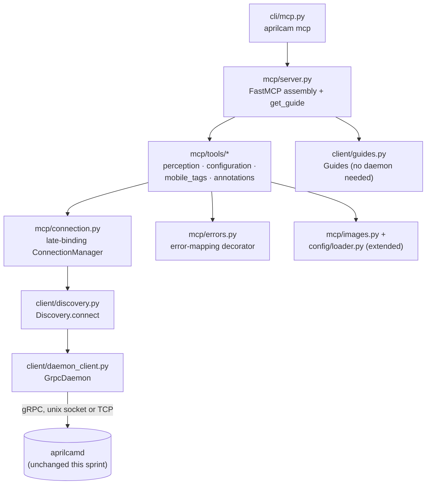

<!-- CLASI: Before changing code or making plans, review the SE process in CLAUDE.md -->

# Sprint 026: MCP server

## Goals

Build `src/aprilcam/mcp/` and wire up `aprilcam mcp` (UC-22) — the
capability the project is named for, and the only major subsystem that
does not exist at all in the v2 tree. Give an AI agent a real, working
MCP stdio server that is a pure daemon client: perception, whole-document
configuration, mobile-tag registration, annotation drawing, and
self-description, over the now-complete daemon surface (sprint 025
finished the last three daemon methods — `find_feature`, the mobile-tag
registry, `get_guide` — specifically so this sprint would not have to
build the wire layer twice).

## Problem

Five sprints (020–025) built a daemon that answers every perceptual and
configuration question the project's problem statement asks for, plus a
CLI that exercises all of it. But `AGENT_GUIDE.md`'s promise — "an AI
agent can perceive and reason about the playfield" — has no programmatic
interface an agent can actually call. `.claude/rules/project-overview.md`
opens with exactly this gap. Every daemon capability an agent needs is
built and proven on real hardware (main-playfield calibrated on camera 3
at ~0.18cm reprojection error); there is simply no adapter translating it
into MCP tool calls.

## Solution

A new `mcp/` subsystem, structured as a thin translation layer over the
existing `client/` library (`docs/design/adapters.md`'s rule: "every
adapter is a translation layer and nothing more... none of them holds
authoritative state, and none of them does vision"):

- A **late-binding connection manager** (`mcp/connection.py`) that
  resolves a `Daemon` per tool call from a small revalidated cache,
  so the server never fails at startup for lack of a daemon and
  transparently recovers from a daemon restart mid-session (UC-22).
- A **shared error-mapping layer** (`mcp/errors.py`) that turns every
  `aprilcam.errors.AprilCamError` the client library can raise into a
  tool-level MCP error, analogous to `daemon/rpc.py`'s typed-exception →
  gRPC-status-code table — so no individual tool function re-derives
  "is this fatal" or parses message text.
- Four tool-group modules under `mcp/tools/` — perception,
  configuration, mobile-tags, annotations — each a thin set of
  request-shape-then-call wrappers over `client.interfaces.Daemon`,
  plus a `get_guide` tool and matching `aprilcam://` guide resource for
  self-description (UC-27).
- One CLI entry point, `cli/mcp.py`, wiring `aprilcam mcp [-d HOST]`
  into the existing subcommand dispatcher.

No daemon-side change is required anywhere in this sprint — every RPC
this server calls already exists in `daemon.interfaces.Daemon` and is
already implemented by `DaemonService`/exposed by `GrpcDaemon`
(confirmed by reading both in full during planning; see Architecture).
That is itself the signal the boundary is drawn correctly
(`adapters.md` §2, rule 5: "a new adapter must not require a new daemon
capability").

## Success Criteria

- `aprilcam mcp` starts a stdio MCP server with **no daemon required**
  and does not fail startup when none is running (UC-22.S-2).
- A scripted MCP client session can, with no shell access: read the
  packaged guide, list cameras, trigger calibration, read tags in world
  coordinates, fetch a deskewed frame, draw an annotation and read it
  back — all as MCP tool calls (the issue's Verification section,
  restated as this sprint's acceptance bar).
- A daemon restart mid-session causes the in-flight call to fail
  cleanly and the *next* call to succeed, with no agent-visible server
  crash (UC-22.S-3).
- `cv2` is absent from `sys.modules` after importing every `mcp/`
  module (extends `tests/test_no_cv2_in_client_modules.py`).
- `uv run mypy` stays clean; no `typing.Protocol` anywhere in `mcp/`.
- Image-returning tools support both `base64` and `file` output modes,
  per request, never handing an agent an unrequested path.

## Scope

### In Scope

- `src/aprilcam/mcp/` subsystem: `server.py`, `connection.py`,
  `errors.py`, `images.py`, `tools/perception.py`,
  `tools/configuration.py`, `tools/mobile_tags.py`,
  `tools/annotations.py`.
- `src/aprilcam/cli/mcp.py` and its wiring into `cli/__init__.py`.
- Extending `config/loader.py` with dict-based (not file-path-based)
  parsing entry points, reused by both the existing file-based CLI push
  path and this sprint's MCP configuration tools, so the whole-document
  validation logic is not duplicated.
- Extending `tests/test_no_cv2_in_client_modules.py`'s scanned-package
  list to include `mcp`.
- Full MCP tool surface named in the issue: perception (list/probe
  cameras, get_tags, get_tag, tag history, get_frame, where),
  configuration (camera config get/set/reset, playfield get/set/list,
  calibration trigger, get_calibration), mobile tags
  (register/unregister/list), drawing (`draw_marker`, `draw_path`,
  `draw_polygon`, `draw_circle`, `draw_text`, `remove_annotation`,
  `clear_layer`, `list_annotations`), self-description (`get_guide`).

### Out of Scope

- `stream_images`/`stream_tags` MCP tools — the underlying
  `Daemon.stream_images`/`stream_tags` methods are unimplemented until
  sprint 027; this sprint's perception tools are one-shot queries only,
  matching the daemon's current surface exactly.
- Any daemon-side change. Every RPC this sprint's tools call already
  exists and is implemented (verified by reading `daemon/interfaces.py`
  and `client/daemon_client.py` in full during planning).
- Streamable-HTTP MCP transport (stdio only, per the project overview
  and spec §8).
- A `status`/`get_status` MCP tool for daemon readiness — not named in
  the issue's tool surface; `list_cameras`/`get_calibration` already
  cover the perceptual questions an agent needs answered. Flagged as a
  candidate for a future sprint if agent usage shows it is missing.
- Temp-file cleanup/TTL policy for `format="file"` image responses —
  files are written and left, matching v1's behaviour; revisited only
  if it becomes an operational problem.
- The `server/` → `mcp/` directory *rename* bookkeeping and any other
  package-restructure work — `mcp/` is created fresh here since no `server/`
  package exists in the v2 tree; the restructure stage (12) in
  `docs/design/development-plan.md` is about moving already-final code,
  which does not apply to a subsystem built for the first time.

## Test Strategy

Every tool group gets unit tests against a fake `Daemon` (the existing
CLI-test pattern: a small `_FakeDaemon`/stub class exercising one method
per test with injectable return values and raised exceptions — see
`tests/aprilcam/cli/test_camera_cli.py`'s `_FakeDaemon`), following
`docs/design/development-plan.md` Stage 11's test list:

- Connection manager: resolves and caches a `Daemon` per target; evicts
  and reconnects on the next call after a `ConnectionFailed`; never
  contacts a daemon at construction time.
- Error mapping: every `aprilcam.errors.AprilCamError` subtype maps to
  a tool-level error carrying its message; an unexpected exception maps
  to a generic internal error without leaking a raw traceback.
- Every MCP tool, one test per success path and at least one per
  documented failure mode, against a fake `Daemon` — no real daemon, no
  network, no camera.
- Image-output helper: `base64` mode returns inline content; `file`
  mode writes to the session temp directory and returns only that path
  (never both).
- No-cv2 import sweep: import every `mcp/` module, assert `cv2` absent
  from `sys.modules` afterward (extends the existing test).
- `get_guide` works with a `Discovery`/`Daemon` that would raise
  `ConnectionFailed` if called — proving no daemon connection is even
  attempted for this tool (UC-27.S-1).
- CLI: `aprilcam mcp -h` and flag parsing tested the same way as every
  other `cli/` module; the actual `FastMCP.run()` stdio loop is not
  exercised by unit tests (mocked/monkeypatched).
- Integration/acceptance (last ticket): an in-process MCP client
  session (using the `mcp` SDK's in-memory client/server transport, no
  subprocess needed) drives the full golden path against a fake daemon;
  a `@camera`-marked variant repeats it against the real daemon and
  hardware, matching the issue's Verification section and Stage 11's
  `@camera` end-to-end test. Also verifies: server starts and answers
  `get_guide` with no daemon running, then a later call succeeds once
  one starts (UC-22.S-2, requires a real daemon process — `@camera` or
  a lighter `@integration` marker as appropriate).

## Architecture

**Substantial** — this sprint introduces a brand-new subsystem
(`mcp/`, four tool-group modules plus a connection manager and an
error-mapping layer) and a new cross-module dependency (`cli/` →
`mcp/` → `client/`), matching the development plan's own description of
sprint 026 as "the only major subsystem that does not exist at all."
Per the effort-decision rubric this clears the substantial bar on
module count and new-dependency grounds alone; the full 7-step
methodology applies, including a diagram.

### Step 1 — Understand the problem

The daemon and its full RPC surface (27 `Daemon` methods, of which this
sprint's tools use 21 — everything except the two stream methods,
`start`/`stop`/`restart` process lifecycle, which is intentionally
local-only and out of MCP's remit) already exist and are exercised by
the CLI. The problem is purely translation: MCP tool calls in, `Daemon`
method calls out, with two cross-cutting concerns — late-binding
connection resolution and typed-error-to-tool-error mapping — that
every tool needs and neither the CLI nor the client library already
provides in the shape MCP needs.

### Step 2 — Identify responsibilities

- **Late-binding connection management** — resolve, cache, and recover
  a `Daemon` connection per tool call. Changes independently of any
  particular tool: it is pure session/connection lifecycle.
- **Error translation** — `aprilcam.errors` → MCP tool-level errors.
  Changes independently of connection management and of any one tool
  group; it is a pure mapping table, same shape as `daemon/rpc.py`'s
  `_STATUS_CODES`.
- **Image output shaping** — encoded bytes in, `base64`-inline-or-file
  MCP content out. Used only by perception (`get_frame`), but factored
  out because it is a distinct concern (output-format policy) from tag
  or camera queries.
- **Perception** — read-only queries: cameras, frames, tags, feature
  lookup. Changes when the daemon's query surface changes.
- **Configuration** — whole-document push/fetch for cameras and
  playfields, plus calibration trigger. Changes when the config
  document schema changes; needs the dict-based document parsing
  `config/loader.py` does not yet expose (today it is file-path-only).
- **Mobile-tag registration** — register/unregister/list mount
  parameters. Small, independent surface (three daemon methods), no
  shared state with any other group.
- **Annotation authoring** — the drawing tool surface. Independent of
  configuration and perception; changes when the annotation shape
  vocabulary (`types.AnnotationShape`) changes.
- **Self-description** — `get_guide`, plus MCP's own server
  instructions text. The one capability that must work with **no**
  daemon connection at all (UC-27.S-1), which is why it does not route
  through the connection manager.
- **CLI entry point** — argv-to-server-construction only, the same
  shape as every other `cli/` module.

### Step 3 — Define subsystems and modules

| Module | Purpose (one sentence) | Boundary | Serves |
|---|---|---|---|
| `mcp/connection.py` | Resolves a live `Daemon` for a tool call, from cache when possible. | In: an optional target host. Out: a `Daemon`. Never a tool's business logic. | UC-22 |
| `mcp/errors.py` | Translates `aprilcam.errors` exceptions into MCP tool-level errors. | In: a raised `AprilCamError` or unexpected exception. Out: the MCP SDK's tool-error signal. No RPC calls. | UC-22 (failure modes) |
| `mcp/images.py` | Shapes already-encoded image bytes into a `base64` or `file` MCP response. | In: bytes + encoding + requested format. Out: MCP content. No decoding, no cv2, no pixel work. | UC-06, UC-17, UC-19 |
| `mcp/tools/perception.py` | Exposes read-only camera/tag/frame/feature queries as tools. | Calls `Daemon` query methods only; never mutates daemon state. | UC-06, UC-08, UC-09, UC-10, UC-14, UC-17, UC-19, UC-20, UC-26 |
| `mcp/tools/configuration.py` | Exposes whole-document camera/playfield config and calibration as tools. | Calls `Daemon` config/calibration methods; owns dict↔document parsing via extended `config/loader.py`. | UC-02, UC-03, UC-04, UC-15, UC-23, UC-24 |
| `mcp/tools/mobile_tags.py` | Exposes mount-parameter registration as tools. | Calls `Daemon.register_tag`/`unregister_tag`/`list_tag_parameters` only. | UC-12 |
| `mcp/tools/annotations.py` | Exposes the drawing/annotation-store surface as tools. | Calls `Daemon` annotation methods only; builds `types.AnnotationShape` values from flat tool arguments. | UC-28 |
| `mcp/server.py` | Assembles the `FastMCP` instance, registers every tool group, serves `get_guide`. | Owns server instructions text and tool registration; no daemon calls of its own except via the modules above. | UC-22, UC-27 |
| `cli/mcp.py` | `aprilcam mcp [-d HOST]` — parses argv, builds and runs the server. | Zero business logic, per every other `cli/` module. | UC-22 |

Every module addresses at least one use case (table above); no module
is responsible for more than one of the groupings in Step 2 (the
cohesion test — each row's Purpose column has no "and").

### Step 4 — Component diagram

No ERD: this sprint introduces no data model and no persistent state of
its own — `mcp/` holds only a transient connection cache, the daemon
remains the sole owner of every durable fact. No separate dependency
graph beyond the diagram above: the dependency direction is a single
line (`cli` → `mcp` → `client` → daemon over gRPC), matching
`adapters.md`'s presentation → domain → infrastructure shape with `mcp`
purely on the presentation/adapter side.

### Step 5 — What Changed / Why / Impact / Migration

**What Changed.** New subsystem `src/aprilcam/mcp/` (nine files per
Step 3's table) and new CLI entry point `src/aprilcam/cli/mcp.py`,
wired into `cli/__init__.py`'s subparser assembly alongside `daemon`,
`camera`, `playfield`, `tags`, `guide`. `config/loader.py` gains two
additive dict-based parsing entry points reused by both this sprint's
tools and (optionally, no behaviour change required) the existing
file-based loader methods. `tests/test_no_cv2_in_client_modules.py`'s
scanned-package tuple gains `"mcp"`.

**Why.** Stated in Problem/Solution above: the project's stated purpose
has no adapter yet, and every capability it needs is now built.

**Impact on Existing Components.** None to `daemon/`, `camera/`,
`vision/`, `calibration/`, `playfield/`, or the wire protocol
(`proto/`) — every RPC this sprint calls already exists. `client/` gains
no new public surface either; `mcp/` consumes `client.interfaces.Daemon`
and `client.interfaces.Discovery`/`Guides` exactly as they stand today.
`config/loader.py`'s two new entry points are additive; existing
`load_camera_config`/`load_playfield` (file-path-based) keep their
current signatures and behaviour unchanged — this is refactoring the
shared validation core out from under both call sites, not changing
either one's contract. `cli/__init__.py` gains one import and one
`add_subparser` call.

**Migration Concerns.** None. This is a pure addition: no existing
command, RPC, or stored document changes shape or meaning. `aprilcam
mcp` is a new, optional entry point; nothing depends on it existing
yet, and nothing breaks if a consumer never calls it.

### Design Rationale

**Decision: cache-and-evict-on-failure for the late-binding connection,
not reconnect-per-call or preflight-probe-per-call.**
*Context:* UC-22 requires the server to survive a daemon restart
without requiring the agent to restart its session, while also not
paying an unnecessary reconnection cost on every single tool call in
the (overwhelmingly common) case where the daemon has not restarted.
*Alternatives considered:* (a) reconnect fresh on every tool call —
correct but pays a channel-setup cost on every call, wasteful for an
agent session that may issue dozens of calls per minute; (b) a
preflight health check before every real call — adds a full extra RPC
round trip to every call just to catch a rare restart window.
*Why this choice:* `mcp/connection.py` caches a resolved `Daemon` per
target key; on `ConnectionFailed` from an actual tool call, it evicts
that cache entry so *only the next* call for that target reconnects.
*Consequences:* this reproduces UC-22.S-3's scenario exactly — "the
in-flight call fails with a connection error; the following call
reconnects and succeeds" — with zero overhead in the common case and
self-healing within exactly one failed call, never more.

**Decision: a single shared error-mapping layer (`mcp/errors.py`),
not per-tool try/except.**
*Context:* Roughly twenty tool functions each need to turn a caught
`aprilcam.errors.AprilCamError` into an agent-legible tool failure
without leaking Python tracebacks, and need to do it identically.
*Alternatives considered:* each tool function catches and formats its
own errors — the pattern `daemon/rpc.py` explicitly rejected in favour
of its own shared `_STATUS_CODES` table plus one `_abort` helper.
*Why this choice:* one decorator (or thin wrapper function) applied to
every tool body, analogous in shape and purpose to `daemon/rpc.py`'s
table — see the mapping below.
*Consequences:* a new `aprilcam.errors` type added in a future sprint
needs one new entry in one table, not an audit of every tool function.

**Error-mapping table** (`mcp/errors.py`, the MCP-side analogue of
`daemon/rpc.py`'s `_STATUS_CODES`):

| `aprilcam.errors` type | Tool-level error message shape |
|---|---|
| `ConnectionFailed` | "no daemon reachable at {host}: {reason}" — the tool fails cleanly; the server itself stays up (UC-22.S-2, UC-22.S-3) |
| `DiscoveryFailed` | "daemon discovery failed: {reason}" |
| `UnknownCamera` / `UnknownPlayfield` / `UnknownGuide` | "unknown {kind} {requested!r}; available: {available}" — `str(exc)` is already exactly this shape, passed through verbatim |
| `CameraNotPresent` | "camera {slug!r} is registered but not currently present" (verbatim `str(exc)`) |
| `NotCalibrated` | "camera not calibrated" (verbatim) — never a silently-substituted raw/uncalibrated result |
| `NoPlayfieldLinked` | "camera {camera!r} has no playfield link; nothing to calibrate" (verbatim) |
| `UnsupportedSetting` | "unsupported or rejected setting: {key!r}" (verbatim) |
| `MalformedDocument` | verbatim message — client-side validation failure, no RPC even attempted |
| `InvalidTagId` | verbatim message naming the valid range |
| any other exception | "internal error: {type name}" — logged server-side with the full traceback, never echoed to the agent |

Every message above is `str(exc)` passed through unchanged — the
`aprilcam.errors` types already build agent-legible messages (naming
what was requested and what is available); `mcp/errors.py` adds no new
message vocabulary, it only decides *how* the message reaches the
agent (a tool-level error, not a crashed server or a swallowed
exception).

*Open item, not blocking planning:* the exact MCP SDK mechanism for
surfacing a tool-level error (raising the SDK's tool-error type vs.
returning a `{"error": ...}` sentinel, v1's pattern) is confirmed
against the pinned `mcp>=1.0` dependency's actual API at ticket 001's
implementation time — see Open Questions.

**Decision: configuration tools take structured JSON content, never a
file path.**
*Context:* spec principle 7 — "clients see handles and services, never
file paths" — and the issue's explicit statement that this applies to
images doubly applies to configuration documents, which an MCP agent
has no filesystem access to produce in the first place.
*Alternatives considered:* accept a path and read it — rejected
outright; an MCP agent's filesystem, if it has one at all, is not the
daemon host's and is not guaranteed to exist.
*Why this choice:* `set_camera_config`/`set_playfield` tools accept the
document as a JSON object (dict) tool parameter; `mcp/tools/
configuration.py` calls new dict-based parsing entry points added to
`config/loader.py` (`parse_camera_config_dict`/`parse_playfield_dict` —
exact names finalized in ticket 003) that share every validation rule
`load_camera_config`/`load_playfield` already enforce, rather than
re-implementing whole-document validation a second time in `mcp/`.
*Consequences:* the CLI's file-based push and MCP's dict-based push are
provably validated identically (same code, two entry points), and a
future validation-rule change only needs to happen once.

**Decision: `aprilcam mcp` gets a `-d`/`--daemon HOST` flag as a
session *default*, plus an optional per-tool-call `daemon` parameter.**
*Context:* UC-22's own open question — "does the server expose daemon
selection as a tool parameter, or a separate connect tool" — was left
unresolved in the use-case draft.
*Alternatives considered:* (a) no flag at all, every tool always
targets the local daemon or `APRILCAM_DAEMON_HOST` — simplest, but
forecloses UC-22's own example scenario of "a local daemon and a field
Pi in the same session"; (b) a separate `connect_daemon` tool holding
mutable session state — adds a stateful tool with sequencing
requirements (must be called before others) that the late-binding
design specifically avoids elsewhere.
*Why this choice:* `-d HOST` at startup seeds `ConnectionManager`'s
default target (mirroring every other `cli/` module's `-d` convention,
`cli/_common.py add_daemon_option`) without contacting a daemon at
startup; any tool's optional `daemon` parameter overrides that default
for one call, using the exact same `Discovery.connect` precedence
(explicit argument beats the flag-seeded default beats
`APRILCAM_DAEMON_HOST` beats local) every other adapter already
follows.
*Consequences:* resolves UC-22's open question explicitly rather than
leaving it open past this sprint; no new connection-establishment
mechanism is invented.

**Decision: `mcp/images.py` writes `format="file"` output to a
per-server-process temp directory (`tempfile.mkdtemp(prefix=
"aprilcam-mcp-")`), not the bare system temp root.**
*Context:* the issue requires a `file` output mode for images alongside
`base64`, and the destination has to be *some* path.
*Alternatives considered:* `tempfile.NamedTemporaryFile` directly in the
system temp root (v1's approach) — works, but scatters files with no
grouping, making a long-running session's temp output hard to find or
reason about.
*Why this choice:* one subdirectory created once per server process,
named files within it — easier to locate, and trivially bulk-removable
by an operator without touching unrelated temp files.
*Consequences:* no automatic cleanup this sprint (see Open Questions) —
files accumulate for the life of the directory, exactly as v1 did, just
grouped.

### Open Questions

- **Exact MCP SDK error-surfacing mechanism.** Confirm at ticket 001's
  implementation time whether raising the installed `mcp` package's
  tool-error type produces a clean `isError: true` result under
  `mcp>=1.0`'s pinned behaviour, or whether a `{"error": ...}` sentinel
  return (v1's pattern) is still the more reliable contract. Whichever
  is chosen, it is used uniformly by `mcp/errors.py` — no tool decides
  this individually.
- **Temp-file cleanup policy** for `format="file"` image output — none
  this sprint; revisit only if it becomes an operational problem.
- **A future `status`/daemon-readiness tool** — not in this sprint's
  scope (see Scope); revisit if agent usage in practice shows
  `list_cameras`/`get_calibration` are insufficient for orientation.
- **Streaming tools** — deferred structurally to sprint 027, which adds
  the underlying `Daemon.stream_images`/`stream_tags` methods this
  sprint's tools cannot call yet.

## Use Cases

### SUC-001: Agent orients and perceives the field via MCP
Parent: UC-22, UC-27, UC-14, UC-10, UC-06, UC-19

- **Actor**: A-02, AI agent
- **Preconditions**: `aprilcam mcp` is running (with or without a
  daemon reachable yet).
- **Main Flow**:
  1. Agent calls `get_guide()` — succeeds with no daemon running
     (UC-27.S-1).
  2. Agent calls `list_cameras()` — resolves the local daemon via
     late binding, returns every camera with its playfield link and
     calibration state.
  3. Agent calls `get_tags(camera)` — world-coordinate tag positions if
     calibrated, pixel-plus-flag otherwise (UC-20.S-3).
  4. Agent calls `get_frame(camera, deskewed=true, format="base64")` —
     receives an inline image, never a file path it did not ask for.
- **Postconditions**: Agent has enough state to reason about the field
  without ever touching a filesystem or a shell.
- **Acceptance Criteria**:
  - [ ] `get_guide` succeeds with zero daemon connection attempts.
  - [ ] `list_cameras`/`get_tags`/`get_frame` each resolve the daemon
        via the late-binding connection manager, not a hardcoded target.
  - [ ] `get_frame` honours `format="base64"` and `format="file"`
        identically to the acceptance criteria in SUC-005.

### SUC-002: Agent configures and calibrates a camera via MCP
Parent: UC-02, UC-03, UC-04, UC-15, UC-23, UC-24

- **Actor**: A-02, AI agent (also serves A-03 scripting the same flow)
- **Preconditions**: Daemon reachable; a playfield definition document
  and a camera config document are available to the agent as data
  (never as a file path).
- **Main Flow**:
  1. Agent calls `set_playfield(document)` with the definition as a
     JSON object.
  2. Agent calls `set_camera_config(document)` naming the playfield.
  3. Agent calls `calibrate(camera)` and receives a `CalibrationResult`
     — success with matched ids, or failure naming missing ids
     (UC-04.S-2), never a silent partial result.
  4. Agent calls `get_camera_config(camera)`/`get_playfield(name)` to
     confirm what is now live.
- **Postconditions**: The daemon's live configuration matches what was
  pushed; a failed calibration leaves any prior calibration untouched.
- **Acceptance Criteria**:
  - [ ] `set_playfield`/`set_camera_config` accept a JSON object, never
        a path, and reuse `config/loader.py`'s validation.
  - [ ] A malformed document is rejected with a tool-level error naming
        what was wrong, and never partially applied.
  - [ ] `calibrate` on a camera with no playfield link fails with the
        `NoPlayfieldLinked` message, before any frame is requested.

### SUC-003: Agent registers a robot's mobile-tag mount
Parent: UC-12

- **Actor**: A-02, AI agent
- **Preconditions**: Daemon reachable; a tag is mounted on a robot at a
  known offset.
- **Main Flow**:
  1. Agent calls `register_tag(tag, mount_params)` at session start.
  2. Subsequent `get_tags`/`get_tag` calls report the robot's centre
     and heading, not the raw tag's.
  3. Agent calls `unregister_tag(tag)` when done, or lets the
     registration lapse on daemon restart (it does not survive one, by
     contract).
- **Postconditions**: Reported positions reflect the robot, not the
  tag, for the life of the registration.
- **Acceptance Criteria**:
  - [ ] `register_tag`/`unregister_tag`/`list_tag_parameters` map
        directly onto `Daemon`'s three matching methods with no added
        business logic.
  - [ ] Unregistering an absent tag is a no-op, not an error.

### SUC-004: Agent draws and reads back an annotation via MCP
Parent: UC-28

- **Actor**: A-02, AI agent
- **Preconditions**: Daemon reachable; a playfield exists.
- **Main Flow**:
  1. Agent calls `draw_marker(playfield, layer, id, at, label)`.
  2. Agent calls `list_annotations(playfield, layer)` and finds the
     marker it just drew.
  3. A second agent (or a human via `aprilcam playfield view`) sees the
     same marker embedded in the next deskewed frame.
  4. Agent calls `clear_layer(playfield, layer)`; the marker is gone
     from subsequent frames.
- **Postconditions**: The daemon's annotation store reflects exactly
  what was drawn; no rendering happens in the MCP server (spec §9
  decision 8 — authoring is a daemon RPC, rendering is client-side).
- **Acceptance Criteria**:
  - [ ] All eight drawing tools (`draw_marker`, `draw_path`,
        `draw_polygon`, `draw_circle`, `draw_text`, `remove_annotation`,
        `clear_layer`, `list_annotations`) are implemented as thin
        wrappers, world-coordinates only, no cv2.
  - [ ] `draw_*` tools build the correct `AnnotationShape` and call
        `Daemon.put_annotation`; `clear_layer` calls
        `Daemon.clear_annotations`.

### SUC-005: MCP server survives daemon absence and daemon restart
Parent: UC-22

- **Actor**: A-02, AI agent · A-04, daemon operator (indirectly)
- **Preconditions**: None — this is the property that must hold at
  every point in the server's lifecycle.
- **Main Flow**:
  1. `aprilcam mcp` starts with no daemon running. Startup succeeds.
  2. Agent calls any daemon-backed tool; it fails with a
     `ConnectionFailed`-shaped tool error. The server process is still
     alive.
  3. Operator starts a daemon (`aprilcam daemon start`). The agent
     retries the same call, in the same session, and it succeeds
     (UC-22.S-2).
  4. Later, the daemon restarts (`aprilcam daemon restart`). The
     in-flight call fails; the next call reconnects and succeeds
     (UC-22.S-3), and any RPC-pushed configuration is gone per UC-01 —
     which the agent may observe as changed camera settings, not as a
     server error.
- **Postconditions**: No daemon absence or restart ever crashes the
  MCP server process itself.
- **Acceptance Criteria**:
  - [ ] Server construction and startup perform zero daemon RPCs.
  - [ ] A `ConnectionFailed` from any tool call maps to a tool-level
        error, never an unhandled exception that kills the transport.
  - [ ] The connection manager's cache is evicted on failure and
        re-resolved on the next call for that target (see Architecture
        Design Rationale).

## GitHub Issues

(None linked yet — this sprint tracks CLASI issue
`mcp-server-the-agent-facing-product.md` only.)

## Definition of Ready

Before tickets can be created, all of the following must be true:

- [x] Sprint planning document is complete (sprint.md, including its
      Architecture and Use Cases sections)
- [x] Architecture review passed (or skipped, for changes with no
      architectural impact)
- [ ] Stakeholder has approved the sprint plan

## Tickets

| # | Title | Depends On |
|---|-------|------------|
| 001 | MCP server scaffolding, late-binding connection manager, error mapping, `get_guide`, CLI entry point | — |
| 002 | Perception tools (cameras, frames, tags, `where`) | 001 |
| 003 | Configuration tools (camera config, playfield, calibration) | 001 |
| 004 | Mobile-tag tools (register/unregister/list) | 001 |
| 005 | Annotation/drawing tools | 001 |
| 006 | End-to-end integration and acceptance | 002, 003, 004, 005 |

Tickets execute serially in the order listed.
