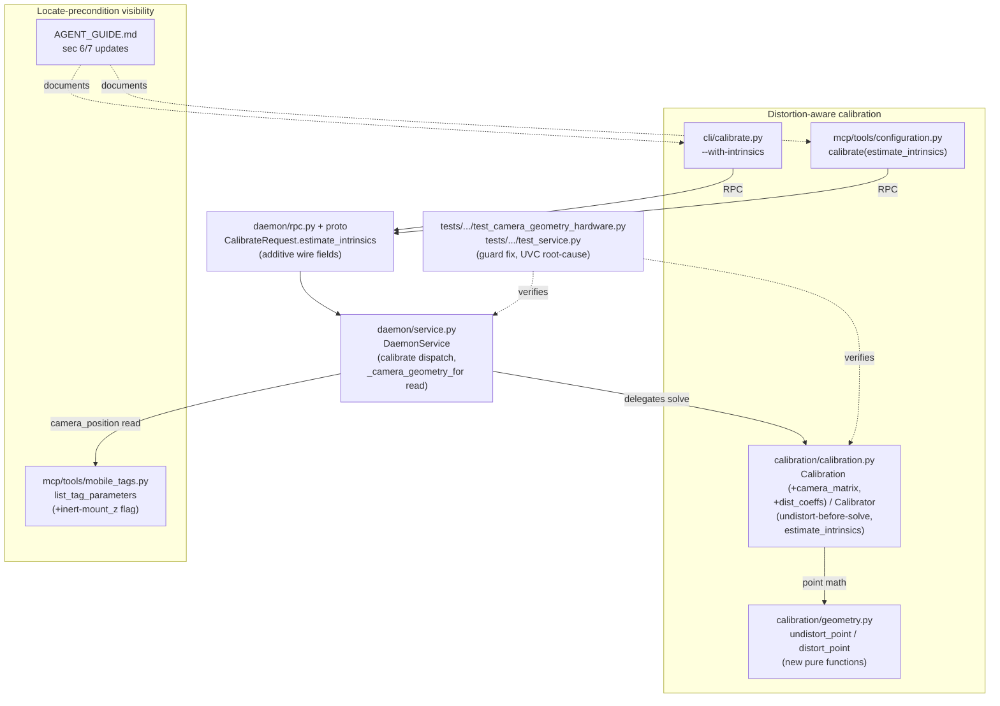

<!-- CLASI: Before changing code or making plans, review the SE process in CLAUDE.md -->

# Sprint 030: Distortion-aware calibration and the locate surface

## Goals

Close the accuracy gap sprint 029 itself flagged and could not fix: v2's
pixel-to-world mapping is a bare homography with no lens model, while
v1 had one. Give `Calibration` an optional intrinsic matrix and
distortion coefficients, apply them at the two points that need them
(point-level pixel undistortion inside `to_world`/`to_pixel`, and
before the homography solve itself), and let an operator estimate them
as an opt-in extension of the calibration they already run — no new
equipment. Then close the two secondary gaps that ride along with it:
`camera locate` is invisible to MCP-only agents (a silent-wrong-answer
trap), and two hardware tests fail instead of skipping on an
under-guarded precondition, one of which may be hiding a real UVC
control bug.

This sprint is ordered first among the three remaining polish sprints
specifically because sprint 029's own camera-geometry solve is
contaminated by the defect this sprint fixes: camera 3's solved optical
height (128.25 cm) sits 1.25 cm above the physical sensor plane (127
cm), and 029's own sprint.md names unmodelled lens distortion as the
most plausible explanation. Every `camera_position` solved before this
sprint lands is fitted against a wrong pixel model.

## Problem

**v2 has no lens model.** `grep -rn "undistort|dist_coeff|camera_matrix"
src/aprilcam/` returns zero hits outside tests. `Calibration`
(`calibration/interfaces.py`) carries `stale`, `calibrated_at`,
`playfield`, and (on the concrete subclass, `calibration/calibration.py`)
`homography`, `matched_ids`, `reprojection_error_cm` — nothing about the
lens. `Calibration.to_world`/`to_pixel` are a single projective
transform. This is a **regression from v1**, not a design omission: v1
estimated `camera_matrix`/`dist_coeffs` (`archive/.../calibration.py`'s
`calibrate_single`), stored them, and undistorted before both the
homography solve and the deskew warp
(`archive/src/aprilcam/stream.py:433`, `archive/src/aprilcam/config.py:455`).
A v1-era `calibration.json` with real, non-null `dist_coeffs`
(`[0.42, -2.43, ...]`) sits in the state directory next to v2's
intrinsics-free file for the same physical camera.

**Measured impact.** Seven 46.5 mm AprilTags of identical, known size
placed on `secondary-playfield` (`hd-usb-camera`, 2026-08-12) show
apparent measured size correlating with image radius² at **-0.96** —
tags near centre measure ~5% large, tags near the edge ~5% small,
textbook uncorrected barrel distortion. A single-radial-term diagnostic
fit moves reported positions by 1.4-2.2 cm (mean 1.57 cm) on a
108.5 x 70.8 cm field — roughly 2%. `reprojection_error_cm` does not
catch this: it measures residual *at the markers the solve was fit to*,
where distortion is absorbed by construction, and re-emerges in the
field interior. A 4-marker calibration reporting `0.000 cm` reads as
"perfect" when it means "no redundancy to detect a problem with."

**The contamination this sprint exists to unblock.** Sprint 029 solved
camera 3's ground nadir and optical height from two elevated AprilTag
references via least squares
(`calibration.geometry.solve_camera_geometry`), recovering height
128.230 cm against a physical sensor plane at 127 cm and a lens end at
125 cm. Sprint 029's own sprint.md records: "most plausibly absorbing
unmodelled lens distortion." Every `camera_position` computed to date,
including camera 3's, is fitted to a model this sprint changes.
Continuing geometry work before this lands means redoing it later.

**Secondary problem 1 — `camera locate` is invisible to MCP agents.**
`register_tag` only rejects a nonzero `mount_z` when the daemon holds
**no calibration for any camera at all** (`daemon/service.py:1234`); a
calibrated-but-never-*located* camera passes that check silently.
`_camera_geometry_for` then falls back to nadir `(0,0)`/height `0.0`
(`daemon/service.py:1311-1313`), and `project_tag_to_field_plane`
short-circuits to the identity at `camera_height_cm <= 0.0`
(`calibration/geometry.py:281`). An agent registers a mount, gets no
error, and every subsequent `get_tag`/`get_tags` silently reports the
raw tag's position, as if `mount_z` were zero.  `AGENT_GUIDE.md`'s §7
command table lists eight `camera` subcommands and never mentions
`locate`; there is no `locate` MCP tool among the 27 exposed. Note this
sprint also inherits a small, separate documentation bug: `mcp/tools/
mobile_tags.py`'s own `register_tag` docstring still says camera
geometry is modelled "nowhere in this codebase" — true before sprint
029, false after it, and this sprint's own ticket 004 corrects it while
it is in the area.

**Secondary problem 2 — two hardware tests fail instead of skipping.**
A full-suite run (2026-08-20) gave 2 failed, 1385 passed, 4 skipped.
Neither failure is a regression in merged code:
`test_camera_geometry_hardware.py`'s locate-reproduction test guards
"camera attached" and "reference tags present" but not "a daemon is
reachable," so it fails hard (`no local daemon answered`) instead of
skipping when no daemon is running. `test_service.py`'s two-real-camera
exposure-push test fails with `UnsupportedSetting: 'exposure'` behind a
`uvc-util -s exposure-time-abs=300 exited 13` — this has the shape of
the UVC gate-ordering quirk CLAUDE.md documents (absolute exposure not
writable until auto-exposure is off), and v2's gate mechanism
(`_GATE_KEYS`) is present and ordered correctly, so the cause is one of:
a test-fixture gap, a gate value that doesn't actually reach manual
mode on this camera, an out-of-range value, or a control this specific
camera genuinely lacks. Training people to expect two red hardware
tests is how a third, real failure gets missed.

## Solution

1. **Point-level distortion, applied at both ends of the pixel<->world
   mapping.** `Calibration` gains optional `camera_matrix`/
   `dist_coeffs` fields (absent = today's exact behaviour, so every
   existing `calibration.json` keeps loading unchanged).
   `Calibration.to_world` undistorts the incoming pixel before applying
   the homography; `Calibration.to_pixel` applies the inverse
   homography and then redistorts the result. `Calibrator.calibrate()`
   undistorts its detected marker pixels before solving the homography
   and before computing `reprojection_error_cm`, whenever intrinsics
   are known for that camera — otherwise the homography re-absorbs the
   distortion it was meant to be freed from. All of this lives in
   `calibration/geometry.py` (new pure point-conversion functions) and
   `calibration/calibration.py`; nothing in `vision/`, `daemon/
   detection.py`, or `calibration/deskew.py` needs to change.
2. **Intrinsics estimation as an opt-in extension of `calibrate`, not a
   new command.** `aprilcam camera calibrate <camera> --with-intrinsics`
   (and the matching `estimate_intrinsics` MCP/RPC parameter) reuses the
   exact detection burst `calibrate` already performs — the playfield's
   surveyed ArUco corners plus any surveyed AprilTags
   (`main-playfield` has 11 such points: 10 ArUco + AprilTag 1) — and
   runs `cv2.calibrateCamera` over that single view's many points,
   mirroring v1's own `calibrate_single` and its earned `n_pts >= 6`
   floor. No checkerboard, no new physical setup. Ordinary
   recalibration (a field move) does not touch intrinsics — the
   previously estimated values are carried forward on the persisted
   `Calibration`, so intrinsics genuinely survive the field moving,
   matching the issue's own framing, without needing a second storage
   location.
3. **Re-verify sprint 029's own camera geometry against the falsifiable
   evidence.** With distortion modelled, re-run (or attempt to re-run)
   `aprilcam camera locate` on camera 3 / `main-playfield` and record
   whether the solved height moves toward the physical 127 cm, and
   re-check the radial size-consistency correlation. Update UC-29's own
   fixture prose (which currently names unmodelled distortion as the
   suspected cause) with whatever the real, re-measured answer turns
   out to be — including "it didn't move, here's why" if that is what
   happens.
4. **Make the locate precondition visible to MCP agents**, without
   expanding the MCP surface with a new tool: `AGENT_GUIDE.md` gains
   `camera locate` in its §7 table and the located-camera precondition
   in §6, and the daemon starts reporting an observable flag (surfaced
   through `list_tag_parameters`) when a registered `mount_z` is
   currently inert because its observing camera has no
   `camera_position`. `register_tag`'s existing guard is deliberately
   left as-is (see Design Rationale, Decision 4).
5. **Fix the two test guards.** Add the missing "daemon reachable"
   guard to the locate-reproduction hardware test. Investigate the UVC
   exposure rejection to a stated, evidence-backed conclusion, then fix
   the real cause (ordering/value/range bug) or, if the camera genuinely
   lacks the control, correct the test's premise and improve
   `UnsupportedSetting`'s diagnostic.

## Success Criteria

- An existing `calibration.json` (no `camera_matrix`/`dist_coeffs`)
  loads and behaves byte-for-byte as it does today — no forced
  migration.
- `aprilcam camera calibrate <camera> --with-intrinsics` against
  `main-playfield` succeeds, stores `camera_matrix`/`dist_coeffs` fit
  under the default **coplanar-constrained** model (fixed principal
  point, fixed aspect ratio, zero tangential distortion, fixed k3 —
  estimating only k1, plus k2 if held-out validation supports it), and
  a subsequent `aprilcam camera calibrate <camera>` (no flag) carries
  those values forward without re-estimating them.
- The constrained default's fitted coefficients pass a held-out
  reprojection check (fit on a subset of the playfield's surveyed
  points, validated against the remainder) and a sanity bound — an
  unconstrained overfit like v1's stored `dist_coeffs [0.42, -2.43,
  ...]` is rejected by the ticket's own tests, not shipped.
- **Falsifiable check 1 (radial consistency)**: re-measuring the seven
  46.5 mm AprilTags' apparent-size-vs-radius² correlation after
  distortion correction moves it toward 0 from the documented -0.96 —
  or, if the physical tags are no longer staged, the ticket says so
  plainly rather than fabricating a number (mirrors 029 ticket 004's
  precedent).
- **Falsifiable check 2 (optical height)**: re-running `camera locate`
  on camera 3 / `main-playfield` moves the solved height toward 127 cm
  from the documented 128.25 cm — treated as a genuine falsification,
  not explained away, if it does not.
- `AGENT_GUIDE.md` documents `camera locate` and the located-camera
  precondition; an agent following the guide end-to-end no longer lands
  in the mount_z trap unwarned.
- A registered, currently-inert `mount_z` is observable via
  `list_tag_parameters` (or the tag record), not just discoverable by
  cross-referencing `get_camera_config`.
- A `register_tag` call with a nonzero `mount_z`, made while no camera
  anywhere holds a `camera_position`, returns a warning at the moment
  of registration itself — not only discoverable later by auditing
  `list_tag_parameters`.
- Full test suite green on a machine with cameras attached and no
  daemon running, and on a machine with no cameras attached
  (`pytest -m "not camera"` unaffected either way).
- The UVC exposure rejection has a stated, tested root cause, and
  either the real bug is fixed or `UnsupportedSetting` names the real
  cause instead of a generic message.

## Scope

### In Scope

- `Calibration`/`Calibrator` gain optional lens-distortion storage and
  application (`calibration/geometry.py`, `calibration/calibration.py`),
  with a coplanar-constrained default intrinsics fit, held-out
  validation, and sanity-bounded coefficients. `Feature`
  (`config/interfaces.py`) gains an optional `height_cm` field so a
  playfield definition can survey elevated ground truth; when present,
  `Calibrator` uses it for intrinsics estimation automatically (never
  for the homography solve itself) and relaxes the model's constraints
  once enough elevation is present — see Design Rationale, Decision 2.
- `aprilcam camera calibrate --with-intrinsics` (CLI), the matching
  `estimate_intrinsics` parameter on the `calibrate` MCP tool and RPC,
  and the proto/wire plumbing that requires (`CalibrateRequest`,
  `Calibration` message — additive fields only).
- Re-verification of sprint 029's camera 3 geometry against the two
  falsifiable measurements, and the resulting update to UC-29's fixture
  prose.
- `AGENT_GUIDE.md` §6/§7 updates; an observable "mount_z inert" flag on
  the mount-parameter/tag-record surface; the stale `mcp/tools/
  mobile_tags.py` docstring correction.
- The two hardware-test guard/investigation fixes.

### Out of Scope

- The Pi/libcamera capture backend — desktop/USB is the stated finish
  line for this pass; `camera/backends/libcamera.py` stays
  `/sys`-enumeration only, deliberately deferred, not attempted here.
- A new `locate` MCP tool. UC-29 is deliberately kept CLI-only (see
  Design Rationale, Decision 5); the fix here is documentation plus an
  observable flag, not a new tool.
- Tightening `register_tag`'s `NotCalibrated` guard to require a
  *located* (not just calibrated) camera (see Design Rationale,
  Decision 4).
- Full-frame undistortion (e.g. of raw `get_frame`/`save_frame`
  exports) — only point queries (`to_world`/`to_pixel`, and therefore
  `get_tag`/`get_tags`/deskew) are corrected this sprint (see Design
  Rationale, Decision 1).
- A dedicated multi-pose checkerboard/ChArUco intrinsics command — the
  single-view, playfield-ground-truth estimate is what ships; a
  dedicated command is a future upgrade if evidence says the single-view
  estimate is not stable enough.
- General hardening, cleanup, `DESIGN.md` bootstrap,
  `testdev/capture_matrix.py`, `aprilcam config`, the guide→agent
  rename — sprints 031/032. `clasi design validate`'s pre-existing
  missing-`DESIGN.md` failures are a known gap owned by the hardening
  sprint issue and are not addressed here.

## Test Strategy

- **Unit, headless** (`calibration/geometry.py`,
  `calibration/calibration.py`): point undistort/redistort round-trip
  against hand-computed OpenCV values; homography-solve-order tests
  (undistorted points feed the solve once intrinsics are known);
  backward-compatible `Calibration.from_dict` load of a pre-sprint
  (intrinsics-absent) `calibration.json` fixture; intrinsics
  carried-forward-not-re-estimated on an ordinary recalibration.
- **Unit, headless** (intrinsics estimation): `cv2.calibrateCamera`
  invoked with a synthetic point set below/at/above the `n_pts >= 6`
  floor; explicit failure when a playfield defines fewer than 6
  ArUco+AprilTag ground-truth points.
- **RPC/proto round-trip**: `CalibrateRequest.estimate_intrinsics`,
  additive `Calibration` message fields — existing client tests must
  keep passing unmodified (additive-only wire change).
- **CLI/MCP**: `--with-intrinsics` / `estimate_intrinsics=True` against
  a fake daemon; `list_tag_parameters`'s new inert-mount_z flag.
- **Hardware** (`@pytest.mark.camera`, skip cleanly without cameras):
  live `--with-intrinsics` run against camera 3/`main-playfield`; the
  re-verification measurements for both falsifiable checks (skip
  cleanly and say so if the physical fixtures are gone, per 029 ticket
  004's precedent); the corrected locate-reproduction test's new
  daemon-reachability guard; the investigated/fixed exposure-push test.
- Full suite run at the end of the sprint on real hardware, confirming
  the Success Criteria's "green either way" claim.

## Architecture

**Substantial** — this sprint changes `Calibration`'s persisted data
model (new optional fields), adds a new cross-module contract
(`estimate_intrinsics` threaded through the CLI, the MCP tool, the RPC
proto, and the daemon service down into `Calibrator`), and touches
seven modules (`calibration/geometry.py`, `calibration/calibration.py`,
`cli/calibrate.py`, `mcp/tools/configuration.py`, `mcp/tools/
mobile_tags.py`, `daemon/service.py`, `daemon/rpc.py` + the proto file)
plus test infrastructure. The full 7-step methodology applies, with one
diagram covering both the distortion work and the locate-visibility
work, since they share the `daemon/service.py` hub and the sprint
treats them as one coherent pass (029's own contamination finding is
literally why they are sequenced together).

**Responsibilities this sprint introduces or changes**, grouped by what
changes independently:

1. *Point-level distortion math* — undistorting/redistorting a single
   pixel given a known lens model. Pure, stateless, no I/O. Changes
   independently of everything else (it is just numerics).
2. *Distortion-aware storage and solve order* — `Calibration` carrying
   optional intrinsics, `Calibrator` undistorting before it solves or
   reports reprojection error, and carrying intrinsics forward across
   an intrinsics-less recalibration. Changes with the calibration
   engine, not with any client surface.
3. *Intrinsics estimation* — turning a detection burst into
   `camera_matrix`/`dist_coeffs` via `cv2.calibrateCamera`. Changes
   independently of (2): it is a producer of the values (2) consumes
   and carries forward.
4. *Calibrate surface plumbing* — CLI flag, MCP parameter, RPC/proto
   field, daemon dispatch. Changes together (one option, threaded
   through four layers) but independently of the math above — this is
   pure "carry a bool from caller to `Calibrator`."
5. *Locate-precondition visibility* — the `AGENT_GUIDE.md` update and
   the observable inert-`mount_z` flag on `list_tag_parameters`/the tag
   record. Changes independently of everything else here: it needs no
   distortion math, only a read of already-existing
   `camera_position`/`mount_z` state.
6. *Hardware-test guard correctness* — a third skip guard plus a real
   root-cause fix or diagnostic improvement for the UVC rejection.
   Entirely test/backend-adjacent; changes independently of (1)-(5).

### Architecture Overview

**Modules**, one sentence of purpose each:

- **`calibration/geometry.py`** — Purpose: converts single points
  between pixel and world space, including (new) between distorted and
  undistorted pixel space. Boundary: pure NumPy/OpenCV point math, no
  I/O, no camera, no frame access — unchanged scope, two new functions.
  Serves: SUC-001.
- **`calibration/calibration.py`** — Purpose: solves and holds one
  camera's pixel<->world mapping, now including its optional lens
  model. Boundary: owns `Calibration`'s fields and `Calibrator`'s solve
  order; still takes frames handed in, never opens a camera itself.
  Serves: SUC-001, SUC-002.
- **`cli/calibrate.py`** — Purpose: triggers calibration over RPC and
  reports the result to a human. Boundary: no vision, no geometry, a
  thin orchestrator; gains one new flag. Serves: SUC-002.
- **`mcp/tools/configuration.py`** — Purpose: exposes calibration as an
  MCP tool for agents. Boundary: identical shape to the CLI's
  orchestration role, one layer over the wire; gains one new parameter.
  Serves: SUC-002.
- **`daemon/service.py`** — Purpose: the daemon's single point of
  authority for camera state, calibration, and mount registrations.
  Boundary: unchanged — still delegates all vision/geometry to
  `calibration/` and `calibration/geometry.py`; gains one parameter
  pass-through and one new read (surfacing the inert-mount_z flag).
  Serves: SUC-002, SUC-004.
- **`daemon/rpc.py` + `proto/aprilcam_v2.proto`** — Purpose: the wire
  contract between clients and the daemon. Boundary: message
  (de)serialization only, no logic; gains additive fields, nothing
  removed or renamed. Serves: SUC-002.
- **`mcp/tools/mobile_tags.py`** — Purpose: exposes the mount registry
  as MCP tools. Boundary: flat wrappers over `Daemon`, no
  reimplemented logic; `list_tag_parameters`'s reported shape gains one
  field, and its own `register_tag` docstring gets corrected. Serves:
  SUC-004.
- **`AGENT_GUIDE.md`** — Purpose: the one document an MCP-only agent is
  told to read first. Boundary: prose only, no code; gains a table row
  and a precondition note. Serves: SUC-004.
- **`tests/aprilcam/daemon/test_camera_geometry_hardware.py`,
  `tests/aprilcam/daemon/test_service.py`** — Purpose: hardware
  verification of the above. Boundary: test-only; one gains a guard,
  the other gets its root cause fixed or its diagnostic corrected.
  Serves: SUC-005.

No entity-relationship diagram: the only data-model change is two new
*optional* fields on an existing record (`Calibration`), not a new
entity or a new relationship between entities. No separate dependency
graph: no module's dependency *direction* changes — `cli/`, `mcp/`, and
`daemon/rpc.py` already depended on `daemon/service.py`, which already
depended on `calibration/calibration.py`, which already depended on
`calibration/geometry.py`; this sprint adds fields and one
pass-through parameter along those same existing edges, not a new edge
between previously-unconnected modules.

**What Changed**

| Module | Change |
|---|---|
| `calibration/geometry.py` | Two new pure functions: `undistort_point` (thin `cv2.undistortPoints` wrapper) and `distort_point` (its inverse, via a short fixed-point iteration — OpenCV has no direct `distortPoints`). No existing function's signature or behaviour changes. |
| `calibration/calibration.py` | `Calibration` gains `camera_matrix: Optional[Tuple[_Row3, _Row3, _Row3]] = None` and `dist_coeffs: Optional[Tuple[float, ...]] = None`, both round-tripped by `to_dict`/`from_dict` (absent when unset, matching `camera_position`'s own "never a null placeholder" precedent). `Calibration.to_world`/`to_pixel` undistort/redistort internally when these are set; identical to today when they are `None`. `Calibrator.calibrate()` gains an `estimate_intrinsics: bool = False` parameter: when `True` and the current detection burst yields >= 6 ArUco+AprilTag ground-truth points, runs `cv2.calibrateCamera` and stores the result; when `False`, carries forward whatever intrinsics the previously stored `Calibration` for that camera slug already had (if any) rather than discarding them. Either way, once intrinsics are known, marker pixels are undistorted before `_solve_homography`/`_reprojection_error_cm`. |
| `cli/calibrate.py` | New `--with-intrinsics` flag, threaded to the RPC call; prints whether intrinsics were estimated or carried forward, and (per the issue's secondary note) a caveat when `matched_ids` has <= 4 entries that `reprojection_error_cm` is degrees-of-freedom-limited rather than a real accuracy figure. |
| `mcp/tools/configuration.py` | `calibrate` tool gains `estimate_intrinsics: bool = False`. `CalibrationResult` gains an `intrinsics_estimated: Optional[bool]` reporting field for this call only — the raw `camera_matrix`/`dist_coeffs` values are deliberately **not** exposed to clients, mirroring `get_calibration`'s existing "reports what the interface promises, never the internal homography matrix" precedent. |
| `daemon/rpc.py`, `proto/aprilcam_v2.proto` | `CalibrateRequest` gains `optional bool estimate_intrinsics = 2`. `Calibration` (proto message) gains `optional bytes/repeated double` fields for `camera_matrix`/`dist_coeffs` for daemon-internal round-tripping; `client/models.py`'s `calibration_from_proto` deliberately does not surface them (same precedent as `homography`/`matched_ids` today). Additive only — no existing field renumbered or removed. |
| `daemon/service.py` | `calibrate()` passes `estimate_intrinsics` through to `Calibrator.calibrate()`. `register_tag`'s existing `NotCalibrated` guard is **unchanged** (Design Rationale, Decision 4). A new read alongside `_camera_geometry_for` reports whether a given registered `mount_z` is currently being applied. |
| `mcp/tools/mobile_tags.py` | `list_tag_parameters`'s `TagMountEntry` gains a computed `mount_z_applied: bool` field (`False` whenever `mount_z > 0` and the observing-camera lookup falls back to the pre-029 `(0,0)/0.0` stopgap). `register_tag`'s docstring is corrected — camera geometry modelling exists since sprint 029; the gap now is *locating* a camera, not the absence of the model itself. |
| `AGENT_GUIDE.md` | §7's command table gains a `camera locate` row; §6 gains the located-camera precondition where an agent about to register a mount will read it, plus an explicit "no MCP tool for this — ask your operator to run it" note. |
| `tests/aprilcam/daemon/test_camera_geometry_hardware.py` | A third guard (daemon reachability) added to the locate-reproduction test, matching the shape of the existing two; module docstring records the reasoning for *not* spinning up an isolated daemon here (this test's whole point is checking against the real production daemon's real state). |
| `tests/aprilcam/daemon/test_service.py` + `camera/camera.py`/`camera/backends/uvc_util.py` | Root cause of the exposure-time-abs rejection identified and fixed (or, if the camera genuinely lacks the control, the test's premise corrected) with an improved `UnsupportedSetting` diagnostic. |

**Why**: sprint 029 already proved the daemon can solve real camera
geometry from surveyed references; this sprint gives that solve an
honest input by removing the one systematic pixel-space error
(distortion) large enough to explain the 1.25 cm gap 029 measured and
could not close. Bundling the two secondary fixes here — rather than
deferring them to the hardening sprints — is deliberate: this sprint
already requires every camera to be re-located once distortion lands,
and shipping that requirement without also making `camera locate`'s
precondition visible to the MCP agents who will hit it would make the
underlying problem worse, not better.

**Impact on Existing Components**: every consumer of `Calibration.
to_world`/`to_pixel` (`daemon/detection.py`'s live tag-position
reporting, `calibration/calibration.py`'s own drift check,
`calibration/deskew.py`'s warp-quad construction) needs **zero**
changes — they already call these methods and get corrected output for
free once a camera has intrinsics, exactly as today when it does not.
`daemon/detection.py` needs no change for the distortion work; it
does gain the `mount_z_applied` read for the locate-visibility work,
sourced from the same `_camera_geometry_for` lookup that already
exists.

### Design Rationale

**Decision 1 — Point-level undistortion at `to_world`/`to_pixel` and
the homography solve; never a whole-frame undistort.** *Context*: v1
undistorted the entire captured frame before its deskew warp
(`stream.py:433`). *Alternatives considered*: (a) mirror v1 exactly —
undistort the frame once per capture, so every downstream consumer is
distortion-agnostic; (b) point-level undistortion confined to
`calibration/geometry.py`/`calibration/calibration.py`. *Why this
choice*: v2's `Deskewer` already builds its warp from four points via
`Calibration.to_pixel`, not a full-frame remap — v1's frame-level
approach doesn't map onto v2's already-different deskew architecture
without restructuring it, and would also require pushing
intrinsics-awareness into `vision/detector.py`/`vision/pipeline.py`,
which today know nothing about distortion and, per the vision-boundary
rule, should not need to. Point-level undistortion keeps every line of
distortion-aware code inside two files. *Consequences*: raw exports
(`get_frame`/`save_frame`) stay visually distorted — only point queries
are corrected. Recorded as an explicit scope boundary (Out of Scope),
not an oversight; a future sprint can add frame-level undistortion for
raw exports if an operator need surfaces.

**Decision 2 — Intrinsics estimation is a flag on the existing
`calibrate`, not a new command; the default fit is coplanar-constrained,
and non-coplanar ground truth is playfield structure, not a
calibrate-time argument.** *Context*: the issue proposed a new
`aprilcam camera intrinsics` command using a checkerboard/ChArUco
target requiring new physical equipment. Stakeholder review of this
decision's first draft corrected two things: (1) v1's `calibrate_single`
(`archive/.../calibration.py:1058`) is not evidence that single-view
estimation "works" — it calls `cv.calibrateCamera` with **no
constraining flags**, a fully free model (fx, fy, cx, cy, k1, k2, k3,
p1, p2) fit from points that all lie on one plane. `main-playfield`'s 11
surveyed points (10 ArUco + AprilTag 1) are, today, every one of them at
z=0. v1's own archived `archive/src/aprilcam/calibration/DESIGN.md:191`
names the problem directly: "single planar view under-constrains
`calibrateCamera`; treated as good-enough for a fixed overhead camera.
Revisit only if RMS demands it." This sprint *is* that revisit — and the
evidence of what a free fit produces on this exact kind of data is
sitting in the state directory: v1's stored `dist_coeffs [0.42, -2.43,
...]`, where a k2 of -2.43 is not a plausible lens property but
focal-length error a single plane cannot separate from real distortion.
(2) The first draft of this decision proposed reusing `camera locate`'s
`--reference` flag for non-coplanar ground truth at calibrate time; the
stakeholder redirected this to a better shape, below.

*Alternatives considered*: (a) new command + checkerboard; (b) new
command, reusing the field's own ArUco/AprilTag ground truth; (c) a flag
on `calibrate` fitting a **free** model, as v1 did; (d) a flag on
`calibrate` fitting a **constrained** coplanar model by default, with
non-coplanar ground truth supplied as a `camera locate` `--reference`
argument at calibrate time (this decision's original proposal, since
superseded); (e) a flag on `calibrate` fitting a **constrained** coplanar
model by default, with non-coplanar ground truth as an **optional,
surveyed property of the playfield definition itself** — elevated
`Feature`s that, when present, are used automatically on every
calibration, with no per-call argument at all.

*Why this choice*: (e). `camera locate`'s references are transient —
stands placed for one solve, then removed (ticket 003 is already at risk
of being unable to reproduce sprint 029's own measurement for exactly
this reason). A playfield-defined elevated tag is permanent field
furniture: surveyed once, benefiting every future calibration without an
operator having to remember a flag. This matches the stakeholder's own
framing directly: "if those tags exist on the PlayField, they will be
used. If they are not, they won't" — `Calibrator` inspects the linked
playfield's surveyed features and picks its estimation mode from what it
finds, never from an argument anyone passes.

*Schema*: `WorldPoint` (`types.py`) stays 2D — "a position on the
playfield, in cm, A1-centred" — and is not widened to 3D; it is the
field-plane coordinate type used everywhere, and widening it would
ripple through every consumer for a property only calibration ground
truth needs. Instead, `Feature` (`config/interfaces.py`) gains a
declared `height_cm: float = 0.0` field (never a `@property`, per
CLAUDE.md's frozen-dataclass rule) — "how far this feature sits above
the field plane," the same vocabulary `mount_z` and `camera locate`'s
`HEIGHT_CM` already use. `april_tags`/`aruco_tags` JSON entries gain an
optional `height_cm` (absent means 0.0); every playfield file on disk
today keeps loading and behaving identically (`ConfigLoader`'s
`load(x.to_dict()) == x` round-trip contract holds).

*The homography/intrinsics split (the easiest thing here to get
wrong)*: an elevated feature does not lie on the field plane, and the
homography maps the field plane to pixels — feeding an elevated point
into `compute_homography` corrupts the fit exactly the way unmodelled
parallax does, the same error class sprint 029 exists to correct,
reintroduced at calibration time instead of query time. So: the
homography solve and `reprojection_error_cm` use **coplanar features
only** (`height_cm == 0`), keeping that number comparable to every
calibration recorded before this sprint; intrinsics/distortion
estimation uses **all** features, with real 3D object points `(x, y,
height_cm)`.

*Mode selection is graded, not all-or-nothing*: all-coplanar gets the
constrained model (fixed principal point, fixed aspect ratio, zero
tangential distortion, fixed k3, k1-only by default). Genuine
z-variation frees the model further — but not on the strength of a
single elevated tag with a token height; ticket 002 must decide and
document a concrete minimum (elevated-feature count and z-spread) below
which the constrained model is kept regardless, and state the evidence
that minimum rests on. Either way, `calibrate`'s output reports which
mode ran and how many elevated features contributed, so an operator who
adds an elevated tag and sees no change in reported mode has been told
something concrete rather than left to guess.

*The `n_pts >= 6` floor counts surveyed points only*: archive
`DESIGN.md`'s own warning ("AprilTags pad but do not constrain the
homography... do not treat `tags_used` as a count of independent
ground-truth points") applies here — the floor must count points the
playfield definition itself surveys (`aruco_tags`/`april_tags` entries),
never markers merely detected in-frame. `main-playfield`'s 11 are all
genuinely surveyed, so the count is sound today; enforcing "surveyed,"
not "detected," keeps it sound as playfield definitions change.

*Consequences*: the constrained default cannot correct for a genuinely
non-circular lens or an off-centre principal point on an all-coplanar
playfield — an operator who needs that must survey at least one elevated
feature into their playfield definition, a real, if modest, surveying
cost. Ticket 002 adds held-out validation (fit on a subset of coplanar
surveyed points, measure residual on the rest) and a sanity bound on
fitted coefficients, so an overfit is caught by the ticket's own tests
rather than discovered downstream by falsifiable check 1. A follow-on
question — whether permanently-elevated tags could also let `camera
locate` retire sprint 029's temporary-stand ritual entirely — is real
and recorded in Open Questions rather than pulled into this sprint's
scope.

**Decision 3 — Intrinsics live on `Calibration` and are carried forward
across an ordinary recalibration, not stored on `CameraConfig`.**
*Context*: the issue frames intrinsics as needing to "persist
independently" of the homography — the field moves, the lens doesn't.
*Alternatives considered*: (a) store on `Calibration`, re-estimate every
`calibrate()` call; (b) store on `Calibration`, touch only when
explicitly requested, carry forward otherwise; (c) store on
`CameraConfig` instead, mirroring `camera_position`'s precedent as
camera-level (not playfield-level) metadata. *Why this choice*: (b).
Option (c) would break `Calibration.to_world`/`to_pixel`'s status as
pure methods over their own fields (`interfaces.py`'s own rule) — every
call site (`daemon/detection.py`, the drift check, `Deskewer`) would
need a `CameraConfig` handed in alongside the pixel, for a value that
never actually varies across the calls that already have only a
`Calibration` in hand. Keeping intrinsics on `Calibration` but simply
not overwriting them on an intrinsics-less recalibration achieves the
same "survives a field move" property with no interface disruption.
*Consequences*: deleting/corrupting `calibration.json` loses intrinsics
along with the homography, requiring a re-run of `--with-intrinsics` —
an acceptable coupling, matching how `camera_position` already accepts
"re-run the solve after data loss" as normal recovery.

**Decision 4 — `register_tag`'s `NotCalibrated` guard is left
unchanged; the fix is observability, not a stricter guard.** *Context*:
the issue's own proposal #3 raised tightening the guard to require a
*located* camera, but hedged: "needs thought... hard-failing may be
wrong," since a mobile tag isn't bound to one camera. *Alternatives
considered*: (a) tighten the guard to require a located camera; (b)
leave the guard, add an observable flag instead. *Why this choice*:
(b), matching the issue's own stated preference ("silence is the actual
defect... a flag an agent can check is worth more than prose") and
avoiding a regression to the legitimate, currently-tested workflow of
registering a mount before running `camera locate` on the observing
camera (UC-12's registration is deliberately order-independent).
*Consequences*: an agent that never checks the new flag can still land
in the trap silently — this sprint reduces the risk (documented
precondition, a checkable flag) without eliminating it structurally.
Recorded as an Open Question below for a future sprint if the trap
recurs in practice.

**Decision 5 — No new `locate` MCP tool; UC-29 stays CLI-only.**
*Context*: UC-29 (`docs/design/use-cases/cli.md`) already scopes
`**Interfaces:** CLI` only, and the issue's own proposal #4 frames a
`locate` MCP tool as optional, contingent on whether locating is best
understood as a one-time-per-physical-move operator step. *Alternatives
considered*: (a) add a `locate` MCP tool, extending UC-29's interfaces;
(b) keep CLI-only, document the boundary explicitly. *Why this choice*:
(b) — locating is physically tied to placing elevated reference tags
on stands at surveyed positions, an inherently hands-on, infrequent
operator task (once per physical camera move), unlike every other
MCP-exposed capability in this project (continuous perception queries,
config push/fetch). Adding a tool would also mean giving an MCP agent
write access to `camera_position`, which sprint 029 deliberately gated
behind a quality-gated CLI-only apply (`--force`/`--dry-run` semantics)
specifically because a plausible-looking bad solve is the exact failure
029 hit once already. *Consequences*: an MCP-only agent still cannot
self-serve a re-locate; `AGENT_GUIDE.md` now says so explicitly
("ask your operator to run `aprilcam camera locate`") rather than
staying silent about the gap, which is the actual defect this sprint
closes.

### Migration Concerns

- **Backward compatibility, not migration.** `camera_matrix`/
  `dist_coeffs` are optional fields defaulting to `None`; every
  existing `calibration.json` on disk keeps loading and keeps behaving
  exactly as it does today — there is no forced conversion step and no
  schema version bump.
- **No automatic invalidation of existing `camera_position` values.**
  Camera 3's `camera_position` (and any other operator's) was solved
  before a distortion model existed. This sprint does not track
  provenance (no timestamp exists on `CameraPosition` to compare
  against `Calibration.calibrated_at`, and adding one is judged
  disproportionate to a one-time transition — see Open Questions) and
  does not silently discard or flag existing values as poisoned.
  Instead: ticket 003's re-verification against the falsifiable optical-
  height check is the actual mechanism that catches this for the
  transition itself, and `camera locate`'s own CLI help/output gains a
  note that adopting `--with-intrinsics` on a camera means its existing
  `camera_position` (if any) predates the new lens model and should be
  re-solved.
- **Wire compatibility**: proto changes are additive-only
  (`CalibrateRequest.estimate_intrinsics`, `Calibration`'s new optional
  fields) — an old client talking to a new daemon, or vice versa, is
  unaffected; no deployment sequencing constraint beyond normal proto
  stub regeneration.
- **Deployment sequencing**: none beyond the normal sprint-close
  rebuild — this sprint touches no persisted schema in a way that
  requires draining or restarting anything in a particular order.

**Open Questions**

1. Should `CalibrationResult`/the CLI expose an intrinsics *summary*
   (fx, fy, k1) to callers, or stay boolean-only
   (`intrinsics_estimated`)? Drafted as: boolean-only for this sprint,
   matching the existing "hide the internal matrix" precedent
   (`get_calibration` already withholds `homography`); a follow-up
   issue can add an inspection tool if an operator need surfaces.
2. Should intrinsics be keyed by capture resolution (the issue's own
   "per camera+resolution" framing), so that changing a camera's
   `frame_width`/`frame_height` after estimating intrinsics doesn't
   silently invalidate them? Drafted as: out of scope — v2 has no
   first-class "change an already-calibrated camera's resolution" flow
   today, and neither UC-04 nor UC-15 model per-resolution keying;
   flagged as a known gap (the same class as `stale`, but unhandled)
   for whichever future sprint adds resolution-change support.
3. Are `cli/locate.py`'s provisional quality-gate thresholds
   (`RMS_RESIDUAL_THRESHOLD_CM = 1.0`, `CONDITION_NUMBER_THRESHOLD =
   447.2`, both already flagged as "evidence-based, revisit if data
   disagrees" by sprint 029) still right once distortion is modelled
   and camera 3 is re-located? Ticket 003 answers this empirically with
   the real re-run rather than guessing here.
4. If ticket 003's re-verification finds the solved height does *not*
   move toward 127 cm, is the residual gap explained by something this
   sprint didn't model (e.g. the ~1.9% scale-gap the issue itself
   leaves unresolved), or does it mean distortion is being applied at
   the wrong stage? Not pre-answered here — the sprint's own stance
   (Success Criteria) is that this must be treated as a real
   falsification, investigated, and reported honestly rather than
   rationalized away.
5. Should `k2` be freed in the all-coplanar default in addition to
   `k1`? Not pre-decided here — ticket 002 decides empirically via
   held-out validation: free `k2` only if doing so measurably improves
   held-out residual without the sanity bound flagging an overfit;
   k1-only otherwise.
6. What is the actual minimum (elevated-feature count, z-spread) below
   which a playfield with *some* elevation still gets the constrained
   coplanar model rather than a freed one? Not pre-decided here —
   ticket 002 must choose and document a concrete threshold with its
   reasoning, not default to "any elevation at all frees the model."
7. If `main-playfield` (or another playfield) is given two or three
   permanently-elevated, surveyed tags (ticket 002's new
   `Feature.height_cm`), does `camera locate` still need its own
   calibrate-external `--reference` stands at all, or could it solve
   nadir/height directly from the playfield's own permanent elevated
   structure? This would also resolve ticket 003's own reproducibility
   risk — sprint 029's temporary stands are already removed, but
   permanent elevated tags would not be. Genuinely promising, and
   explicitly **not** pulled into this sprint's scope unless it proves
   cheap once ticket 002's schema exists — recorded here for the
   stakeholder to weigh before deciding what to physically install on
   the field, and for ticket 003 to revisit if installing elevated tags
   turns out to be cheap enough to do during this sprint's own
   execution.

## Use Cases

Four sprint-level use cases extend three existing catalog use cases
(UC-04, UC-15, UC-29) and one existing one further (UC-12); a fifth
(process-quality) use case has no user-facing UC parent and is
traced directly to the issue's own Verification bullets instead.

### SUC-001: Camera calibration corrects for lens distortion
Parent: UC-04, UC-15

- **Actor**: A-03 (developer/operator running calibration)
- **Preconditions**: Camera configured and linked to a playfield
  (existing UC-04/UC-15 precondition, unchanged). A `Calibration` may
  or may not already carry intrinsics.
- **Main Flow**:
  1. An operator or agent triggers `calibrate` as today (UC-04's
     existing flow, unchanged in the no-intrinsics case).
  2. If the observing camera's stored `Calibration` already has
     `camera_matrix`/`dist_coeffs` (carried forward or estimated in a
     prior call), the daemon undistorts detected marker pixels before
     solving the homography and before computing
     `reprojection_error_cm`.
  3. Every subsequent `to_world`/`to_pixel` call (live tag queries,
     drift checks, deskew-quad construction) transparently undistorts/
     redistorts, with no change to any caller.
- **Postconditions**: World-coordinate answers reflect the corrected
  lens model whenever intrinsics are known; identical to pre-sprint
  behaviour whenever they are not.
- **Acceptance Criteria**:
  - [ ] A `calibration.json` with no `camera_matrix`/`dist_coeffs` loads
        and behaves exactly as before this sprint.
  - [ ] `to_world(to_pixel(w)) == w` (within numerical tolerance) for a
        `Calibration` with intrinsics set, exercising the
        undistort/redistort round trip.
  - [ ] `Calibrator.calibrate()` solves the homography from
        *undistorted* marker pixels whenever intrinsics are known for
        that camera, verified by a unit test comparing the solved
        homography against a known-good synthetic distortion case.

### SUC-002: An operator estimates lens intrinsics without new equipment
Parent: UC-04, UC-15

- **Actor**: A-03
- **Preconditions**: Camera linked to a playfield defining at least 6
  ArUco+AprilTag ground-truth points (`main-playfield` qualifies with
  11).
- **Main Flow**:
  1. `aprilcam camera calibrate <camera> --with-intrinsics` (or the MCP
     `calibrate(estimate_intrinsics=True)` equivalent).
  2. The daemon runs its normal multi-frame-averaged detection, adds
     any surveyed AprilTag ground truth to the existing ArUco-only
     point set, and — given >= 6 total points — runs
     `cv2.calibrateCamera` over that single view.
  3. The resulting `camera_matrix`/`dist_coeffs` are stored on the
     persisted `Calibration`, and the homography is (re)solved from the
     now-undistorted points.
  4. The CLI/MCP report success plus whether intrinsics were estimated
     this call.
  5. A later, ordinary `calibrate` (no flag) after the field moves
     carries the stored intrinsics forward unchanged.
- **Postconditions**: The camera has a persisted lens model that
  survives future homography-only recalibrations.
- **Failure modes**: Fewer than 6 total ArUco+AprilTag ground-truth
  points on the linked playfield → explicit failure naming the point
  count, no partial/garbage intrinsics stored.
- **Acceptance Criteria**:
  - [ ] `--with-intrinsics` against `main-playfield` (11 available
        points) succeeds and stores non-null `camera_matrix`/
        `dist_coeffs`.
  - [ ] A playfield defining fewer than 6 ArUco+AprilTag points fails
        `--with-intrinsics` explicitly, naming the point count.
  - [ ] A plain `calibrate` (no flag) run after a successful
        `--with-intrinsics` run preserves the previously stored
        `camera_matrix`/`dist_coeffs` unchanged.

### SUC-003: Sprint 029's camera geometry is re-verified against the corrected model
Parent: UC-29

- **Actor**: A-03
- **Preconditions**: Camera 3 (`arducam-ov9782-usb-camera`) calibrated
  with `--with-intrinsics` against `main-playfield`.
- **Main Flow**:
  1. Re-run (or attempt to re-run) the radial size-consistency
     measurement from the issue (seven known-size AprilTags) and record
     whether the apparent-size-vs-radius² correlation moves toward 0
     from -0.96 — or record plainly that the physical tags are no
     longer staged, if that's the case.
  2. Re-run (or attempt to re-run) `aprilcam camera locate` against
     camera 3, using whatever reference tags/stands are currently
     available, or record plainly that they are not (mirroring 029
     ticket 004's own precedent for this exact camera).
  3. Compare the solved height against the documented 128.25 cm and the
     physical 127 cm; record the result, whichever way it falls out.
  4. Update UC-29's own fixture prose with the real, re-measured
     outcome.
- **Postconditions**: UC-29's documentation reflects reality
  post-distortion-model, not sprint 029's pre-sprint hypothesis.
- **Acceptance Criteria**:
  - [ ] The optical-height re-measurement result (moved toward 127 cm,
        stayed put, or could not be re-measured) is recorded with real
        numbers or an honest "not reproducible" note — never fabricated.
  - [ ] UC-29's fixture paragraph is updated to match.
  - [ ] If the falsifiable check fails (height does not move toward
        127 cm), the ticket states that plainly as a finding, with
        whatever investigation was possible, rather than omitting or
        rationalizing it.

### SUC-004: An agent is warned before registering an inert mount_z
Parent: UC-12

- **Actor**: An MCP agent (A-02) following `AGENT_GUIDE.md`
- **Preconditions**: None beyond a connected daemon.
- **Main Flow**:
  1. The agent reads `AGENT_GUIDE.md` (§6/§7, updated) before
     registering a mount, and now sees that a nonzero `mount_z` needs a
     *located*, not just calibrated, observing camera, and that
     `camera locate` is CLI-only ("ask your operator").
  2. The agent calls `register_tag` with a nonzero `mount_z` regardless
     (e.g. because locating hasn't happened yet, or the agent is
     checking proactively).
  3. The agent calls `list_tag_parameters` and sees a `mount_z_applied:
     false` flag for that registration, because the observing camera's
     `camera_position` is still unset.
- **Postconditions**: The agent has a machine-checkable signal that its
  registered elevation correction is not yet taking effect, without
  `register_tag` itself becoming stricter.
- **Acceptance Criteria**:
  - [ ] `AGENT_GUIDE.md` §7's command table lists `camera locate`.
  - [ ] `AGENT_GUIDE.md` §6 states the located-camera precondition for
        a nonzero `mount_z`, and that no MCP tool performs locating.
  - [ ] `list_tag_parameters`'s `TagMountEntry` reports
        `mount_z_applied=False` for a registration whose observing
        camera has no `camera_position`, and `True` once one exists.
  - [ ] `mcp/tools/mobile_tags.py`'s `register_tag` docstring no longer
        claims camera geometry is unmodelled anywhere in the codebase.

### SUC-005: The hardware test suite skips cleanly instead of failing on environment gaps
Parent: none (process-quality; traced to the issue's own Verification
bullets)

- **Actor**: Any developer running the full suite.
- **Preconditions**: None.
- **Main Flow**:
  1. On a machine with cameras attached but no daemon running, the
     locate-reproduction hardware test skips cleanly instead of failing
     with `no local daemon answered`.
  2. On a machine with no cameras attached, `pytest -m "not camera"` is
     unaffected either way.
  3. The exposure-push hardware test either passes (root cause fixed)
     or fails with a diagnostic that names the real cause.
- **Postconditions**: A red hardware test means something real broke,
  not an under-guarded environment assumption.
- **Acceptance Criteria**:
  - [ ] `test_camera_geometry_hardware.py`'s locate-reproduction test
        gains a third guard (daemon reachable) and skips cleanly
        without one.
  - [ ] The module docstring records why this specific test still
        targets the real running daemon rather than an isolated
        `_short_tmp_dir` instance (unlike the module's other test).
  - [ ] The UVC exposure rejection has a stated, evidence-backed root
        cause (test-fixture gap / gate-value semantics / out-of-range
        value / control genuinely absent), and either the real bug is
        fixed or the test's premise and `UnsupportedSetting`'s message
        are corrected to match reality.

## GitHub Issues

(No GitHub issues linked yet — this sprint's three linked issues are
CLASI-local `clasi/issues/*.md` files, not GitHub issues.)

## Definition of Ready

Before tickets can be created, all of the following must be true:

- [x] Sprint planning document is complete (sprint.md, including its
      Architecture and Use Cases sections)
- [x] Architecture review passed (or skipped, for changes with no
      architectural impact)
- [x] Stakeholder has approved the sprint plan (recorded on the basis
      of the detailed sprint brief provided via team-lead; see the
      `stakeholder_approval` gate notes — human review of this
      sprint.md is still worthwhile before execution begins)

## Tickets

| # | Title | Depends On |
|---|-------|------------|
| 001 | Lens distortion model: point-level undistortion in Calibration | — |
| 002 | Opt-in intrinsics estimation on camera calibrate | 001 |
| 003 | Re-verify sprint 029 camera geometry against the corrected model | 001, 002 |
| 004 | camera locate visibility for MCP agents | — |
| 005 | Hardware test guards and UVC exposure investigation | — |

Tickets execute serially in the order listed. 004 and 005 have no
dependency on 001-003 (see their own descriptions) and could in
principle run first or in parallel; they are ordered last here to keep
the distortion work — the sprint's primary goal and the one with real
inter-ticket dependencies — together at the front.
