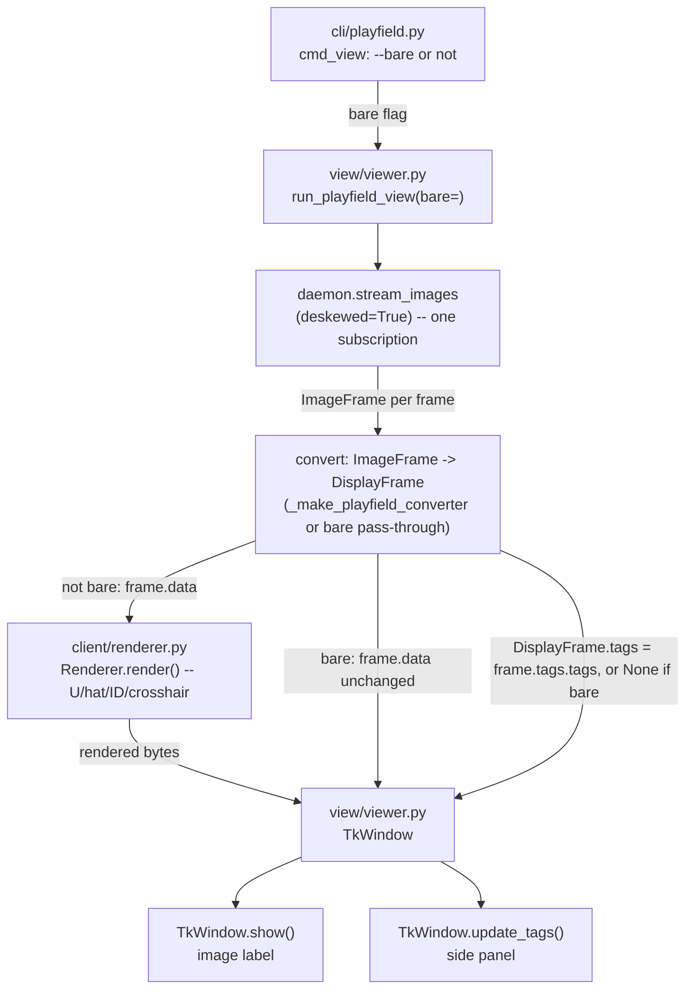

<!-- CLASI: Before changing code or making plans, review the SE process in CLAUDE.md -->

# Sprint 032: Playfield view v1-parity tag overlay and tag sidebar

## Goals

1. Replace the current tag overlay in `src/aprilcam/client/renderer.py`
   with v1's visual scheme, in Pillow (the client side is deliberately
   cv2-free — no port of v1's cv2 drawing calls): a red open 3-sided
   "U" boundary (never the front edge), a green peaked-roof hat closing
   the front edge, a tag ID label (red with a dark outline) centered on
   the tag, and a yellow crosshair at the parallax/mount-corrected
   `TagRecord.world` position. The daemon already computes this
   corrected position (sprint 029) — this is drawing only, no new
   geometry and no daemon changes.
2. Add a tag sidebar to `TkWindow` in `src/aprilcam/view/viewer.py`:
   one single ordered list of all detected tags (no mobile/stationary
   split — stakeholder-decided) with columns for ID, pixel position,
   world position (cm), orientation (degrees), and velocity when
   available. Sourced from the already-streamed `ImageFrame.tags` —
   must preserve the never-calls-`get_tags`, stream-only contract.
   Presentation should be a cleaned-up/prettier take on v1's panel, not
   a pixel-clone.
3. Make the annotated view (overlay + sidebar) the default
   `aprilcam playfield view` behavior; add a `--bare` flag for the
   current plain image-only mode.
4. Update the pinned renderer and viewer tests to match the new visual
   scheme and geometry.

## Problem

v2's `playfield view` draws a flattened, backwards approximation of
v1's tag overlay (full 4-sided lime box, single red hat line, no ID
label, no corrected-position marker) and has no side panel — just a
one-line status bar. The stakeholder wants the richer v1 read familiar
from the AprilTags directory view (tag ID, world position, orientation
at a glance) restored as the default experience, with a cleaner visual
treatment than v1's dated Tk panel. Driving issue:
`clasi/issues/playfield-view-should-draw-tag-ids-hats-and-a-tag-sidebar-like-v1.md`,
which is fully sharpened with stakeholder confirmations dated
2026-08-22 and mines the exact v1 geometry (colors, apex formula, arm
lengths) needed to reproduce the scheme in Pillow.

## Solution

Re-implement v1's overlay drawing in `client/renderer.py` using Pillow
`ImageDraw` (red U, green hat, ID label, yellow crosshair at
`TagRecord.world` via `world_to_deskewed_pixel` — mind the single y-flip
already inside that mapping, no second flip in view code). Add a side
panel to `TkWindow` that renders one ordered table of currently
detected tags from the same streamed `ImageFrame.tags` the renderer
already consumes — no new RPC or subscription. Wire the annotated
combination up as the new `playfield view` default, demoting the
current bare rendering to an opt-in `--bare` flag. All of `TagRecord`
(`world`, `world_velocity`, `speed`, `heading_rad`, `yaw_rad`,
`world_corners`, `pixel_corners`, `tag.number`) needed for both the
overlay and the sidebar is already on the wire — no daemon or RPC
changes.

## Success Criteria

- `playfield view` (no flags) shows the red-U/green-hat/ID-label/
  yellow-crosshair overlay and the tag sidebar by default.
- `playfield view --bare` reproduces today's plain image-only behavior.
- The sidebar lists every detected tag each frame (ID, pixel pos,
  world pos in cm, orientation in degrees, velocity when available) and
  updates only from the streamed `ImageFrame`, never by polling
  `get_tags`.
- Pinned renderer/viewer tests are updated to assert the new geometry
  and colors, and pass.

## Scope

### In Scope

- `src/aprilcam/client/renderer.py` — tag overlay redraw (shape,
  color, ID label, corrected-position crosshair).
- `src/aprilcam/view/viewer.py` — `TkWindow` side panel/layout.
- `src/aprilcam/cli/` — `playfield view` default vs. `--bare` flag.
- `tests/aprilcam/client/test_renderer.py`,
  `tests/aprilcam/view/test_viewer.py` — updated pinned
  geometry/color/boundary-pixel assertions.

### Out of Scope

- Any daemon, RPC, or wire-format change — `TagRecord.world` and all
  other fields the overlay/sidebar need are already computed and
  already streamed.
- The velocity arrow and the blue gripper-offset dot (v1 drew these for
  the registered robot tag; explicitly deferred, possible follow-up).
- Objects/Paths sidebar sections — the panel layout should not
  preclude adding these later, but they are not built in this sprint.
- Mobile/stationary tag list split — stakeholder decided against it;
  one single ordered list.

## Test Strategy

Entirely unit/headless — no daemon or hardware changes, so no new
integration coverage is needed beyond what already exercises
`stream_images(deskewed=True)`.

- **`tests/aprilcam/client/test_renderer.py`**: pixel-level, no-window
  checks against a fixture `ImageFrame` with known `world_corners`/
  `world`, exactly as today. Every geometry/color assertion tied to the
  old lime-box/red-hat scheme moves to the new red-U/green-hat/ID/
  crosshair scheme: the front-edge sample (`:121`) moves to a
  red-side (non-front) edge midpoint; the hat sample (`:134`) moves to
  a point along the green peaked-roof apex direction; the
  plain-background sample (`:157`) is unaffected in intent (still
  proves nothing stray is drawn) but its "far corner" pixel must stay
  clear of the new, larger ID-label footprint; the annotation/`Style`
  tests (`:523` and the rest of that block) are untouched — they
  exercise the annotation half, which this sprint does not touch. New
  cases: 3-sided U (front edge sampled as background, not drawn), hat
  apex position matches the clamp formula at both the 6px floor and the
  80px ceiling, ID label pixel-for-pixel presence near the tag centroid,
  crosshair drawn at `record.world` (not the raw centroid) with the
  documented arm-length floor, and every case skipped cleanly when
  `world` is `None` (uncalibrated) or the frame is raw (draws from
  `pixel_corners`, no crosshair).
- **`tests/aprilcam/view/test_viewer.py`**: the existing
  stream→render→display geometry tests (`:718`/`:752` and neighbors)
  move their `_front_edge_midpoint` sample to a red-U-side pixel or a
  green-hat-line pixel, per the renderer's new scheme — same intent
  (prove the viewer's own wiring doesn't lose or shift the geometry),
  new sample point. `test_run_playfield_view_never_calls_get_tags_only_stream_images`
  (`:533`) is a pinned contract, not touched in substance: it must keep
  passing with zero changes to its own assertions once the sidebar is
  wired, since the sidebar reads `DisplayFrame.tags`, sourced from the
  same one `stream_images(deskewed=True)` subscription and the same
  `frame.tags` the renderer already reads — no second subscription, no
  `get_tags` call, ever. New cases: `TkWindow`'s sidebar renders one row
  per tag with the documented columns and updates when the streamed
  frame's tag set changes; `Window.update_tags` default no-op is
  exercised by the raw-view path (a raw window never shows a sidebar,
  and the raw converter never populates `DisplayFrame.tags`, so nothing
  changes for `run_raw_view`); `run_playfield_view(bare=True)` shows the
  stream's frame bytes unmodified (pass-through, no renderer call) and
  never populates `DisplayFrame.tags`.
- **`tests/aprilcam/cli/test_playfield_cli.py`**: `cmd_view` without
  `--bare` calls `run_view` with `bare=False` (or omits the kwarg,
  relying on the default); `--bare` calls it with `bare=True`. Existing
  `run_view` injection tests (camera resolution, `--all` refusal,
  `NoDisplayAvailable`/`NotCalibrated` messages) are otherwise
  unaffected — none of that wiring changes.
- No new hardware/camera-marked tests: everything needed
  (`TagRecord.world`, `world_corners`, `pixel_corners`, `yaw_rad`,
  `world_velocity`, `speed`) is already on the wire and already
  exercised by prior sprints' hardware passes (029/030). This sprint
  draws and lists what is already there; it computes nothing new.

## Architecture

**Substantial** — by module count: three existing modules are touched
(`client/renderer.py`, `view/viewer.py`, `cli/playfield.py`). No new
cross-module dependency is introduced and no dependency direction
changes (the existing `cli/` → `view/` → `client/` chain is unchanged),
and no wire/persisted data model changes — this is presentation-layer
work end to end, not a data-model or integration change. Full 7-step
methodology below, with one component diagram (the fan-out from a
single streamed frame to two independent presentation concerns is worth
showing, not inferring); no ERD (nothing persisted changes) and no
dependency graph (no edge changes to show).

### Architecture Overview

**Step 1 — the problem.** `playfield view`'s current overlay
(`client/renderer.py`'s `_draw_tag`) draws a flattened, backwards
approximation of what the stakeholder actually wants back: v1's
red-3-sided-U / green-peaked-hat / ID label / world-corrected crosshair
scheme, plus a side panel listing every detected tag's position and
orientation. Sprint 029 already computes the one previously-missing
input (`TagRecord.world`, parallax/mount-corrected) — this sprint is
drawing and layout only, reusing what is already on the wire.

**Step 2 — responsibilities.**
- *Rasterize one tag's overlay from its own record* — boundary shape,
  hat, ID label, and the world-corrected crosshair. Changes only when
  the visual scheme itself changes; independent of window layout or
  CLI wiring.
- *Present a live per-frame table of every detected tag beside the
  image* — the sidebar's own layout, formatting, and (optional)
  ghosting of recently-disappeared rows. Changes only when the panel's
  presentation changes; independent of how the overlay is drawn.
- *Choose annotated-vs-bare and wire the result to argv* — the CLI's
  default-vs-`--bare` decision and help text. Changes only when the
  command surface changes; independent of both drawing responsibilities
  above.

Each is already owned by exactly one existing module, so no new module
is created — this sprint extends three, it does not add a fourth.

**Step 3 — modules.**

| Module | Purpose (one sentence) | Boundary | Serves |
|---|---|---|---|
| `client/renderer.py` (extended) | Rasterize v1-parity tag overlays (U, hat, ID, crosshair) onto a served frame, Pillow-only. | Draws from a `TagRecord`/`ImageFrame` pair alone, via the existing `world_to_deskewed_pixel` formula; no daemon call, no new geometry. | SUC-001 |
| `view/viewer.py` (extended) | Present the same streamed tag data as a live side panel next to the image, and choose annotated vs. bare per-frame conversion. | `TkWindow`'s new sidebar reads only `DisplayFrame.tags`, itself sourced from the one existing `stream_images(deskewed=True)` subscription; no new RPC, no new subscription. | SUC-002, SUC-003 |
| `cli/playfield.py` (extended) | Expose the annotated-by-default / `--bare` choice as `playfield view`'s own argv surface. | A new flag and one conditional keyword passed to `run_view`; no drawing or layout logic of its own. | SUC-003 |

**Step 4 — diagram.** Included: three modules land one coherent
feature, and the interesting structural fact — one streamed frame
fanning out to two independent presentation consumers, with zero new
subscriptions — is exactly the kind of thing a reader should see rather
than infer from prose.

No cycles: `Renderer` and the two `TkWindow` display paths are leaves.
The point of the diagram is the two arrows leaving `Convert` into
`Window` (rendered/pass-through bytes, and the tag list) — one frame,
one subscription, two presentation consumers that never talk to each
other or to the daemon independently.

**Step 5 — What Changed / Why / Impact / Migration Concerns.**

*What Changed.*
- `client/renderer.py`: `_draw_tag`'s shape and colors are replaced —
  red `#FF0000` open 3-sided boundary (`front_right→back_right`,
  `back_right→back_left`, `back_left→front_left`; the front edge
  `front_left→front_right` is never drawn red), green `#00FF00` peaked
  hat (two lines from `front_left`/`front_right` to an apex at
  `mid(front) + normalize(mid(front) − centroid) × clamp(0.35·|front
  edge|, 6px, 80px)`), a tag-ID number centered on the tag (red text,
  dark outline, via Pillow's `stroke_width`/`stroke_fill`), and a new
  yellow `#FFFF00` crosshair at `record.world` converted through the
  existing `world_to_deskewed_pixel` (arm = `max(4px, 0.5·px_per_cm)`,
  skipped when `world` is `None`). Raw frames keep drawing the U/hat/ID
  from `pixel_corners` as today; the crosshair only ever draws on a
  deskewed frame, since only that frame carries a world→pixel mapping.
  All widths stay 2px, matching the mined v1 constants.
- `view/viewer.py`: `DisplayFrame` gains one new optional field,
  `tags: Optional[Tuple[TagRecord, ...]] = None` — additive, default
  preserves every existing construction site. `Window` gains
  `update_tags(tags)`, a **concrete no-op default** (a deliberate,
  narrow exception to this module's existing "raise
  `NotImplementedError`" convention for `show`/`set_status`/`pump`/
  `close` — see Design Rationale). `TkWindow` gains a keyword-only
  `show_sidebar: bool = False` constructor flag; when `True`, it builds
  a side panel (a `tk.Frame` packed beside the existing image label,
  inside the same `tk.Tk()` root — v1's `left_frame`/`right_frame`
  shape) listing every currently-detected tag, one row per tag, ID
  order, monospace numeric columns (ID, pixel x/y, world x/y in cm,
  orientation in degrees from `yaw_rad`, velocity from `world_velocity`/
  `speed` when available, `"--"` placeholders otherwise), refreshed from
  `update_tags`. `run_playfield_view` gains a keyword-only `bare: bool =
  False`: when `True`, the window is built with no sidebar and frames
  are shown unmodified (no `Renderer` call at all — a new
  `_convert_bare_playfield_frame`, mirroring `_convert_raw_frame`'s
  zero-overhead shape but for the deskewed stream); when `False`
  (default), `_make_playfield_converter` additionally populates
  `DisplayFrame.tags` from the same `frame.tags` it already reads for
  rendering. `run_raw_view` is unchanged in behavior — its window is
  still built with `show_sidebar` defaulted to `False`, and its
  converter still never reads `frame.tags` (raw-means-raw, enforced by
  omission, unchanged).
- `cli/playfield.py`: `p_view` gains a `--bare` flag (`store_true`,
  default `False`); `cmd_view` passes `bare=args.bare` to `run_view`.
  No change to camera resolution, `--all` refusal, or the
  `NoDisplayAvailable`/`NotCalibrated` message wiring.
- `src/aprilcam/client/DESIGN.md`, `src/aprilcam/view/DESIGN.md`:
  updated to describe the new overlay scheme and the sidebar
  respectively (seeded into this sprint's `design/` overlay).
- `docs/design/use-cases/cli.md`: UC-18's "Open questions" note on
  which layers are on by default is narrowed — tag IDs, world
  coordinates (via the crosshair), and orientation (via the hat) are
  now on by default in the annotated view; velocity **vectors** (drawn
  arrows) remain explicitly out of scope (the sidebar's velocity
  *columns* are in scope and distinct from a drawn arrow).

*Why.* The stakeholder re-confirmed (2026-08-22) that v1's overlay and
side panel are the wanted default experience, with a "prettier, not a
pixel-clone" presentation. Sprint 029 already computes the corrected
world position the crosshair needs; nothing here required new geometry,
only new drawing and a new panel over data that already crosses the
wire.

*Impact on Existing Components.* `run_raw_view`/`camera view` is
unaffected — it never sets `show_sidebar=True` and its converter still
never reads `frame.tags`. Every other `DisplayFrame` construction site
gets the new `tags` field via its default (`None`); nothing has to be
updated to keep compiling. The daemon, wire protocol, and every
non-view/non-client/non-cli module are untouched. The one deliberate,
visible **behavior change** is `playfield view`'s own default output —
covered below.

*Migration Concerns.* No data migration — no persisted state changes
shape. The one real migration concern is behavioral, not data: the
`playfield view`'s **default** rendering changes from today's
lime-box/red-hat overlay with no side panel to the new v1-parity
overlay plus sidebar — anyone scripting or screenshotting against
today's exact pixel output needs `--bare` to keep it (and even `--bare`
now means "no overlay at all," not "today's overlay," since `--bare` is
a new, undecorated mode — see Design Rationale below for why it was
defined that way rather than as "today's overlay minus the panel").
This sprint's own pinned-test updates are the first, in-repo instance
of exactly that migration.

### Design Rationale

**Decision: `--bare` is the fully undecorated deskewed stream (no
overlay, no sidebar), not "today's overlay minus the sidebar."**
- *Context.* The driving issue's wording — "restore the plain
  image-only mode" — is ambiguous between two readings: (a) keep
  today's lime-box/red-hat drawing, only drop the new sidebar, or (b)
  show the deskewed frame's bytes completely unmodified, no drawing of
  any kind, no sidebar.
- *Alternatives considered.* (a) would require keeping the pre-sprint
  overlay code path alive indefinitely as a second, parallel drawing
  scheme nobody asked to preserve pixel-for-pixel — the issue explicitly
  frames the *old* scheme as the thing being replaced, not something to
  keep as a flag-selectable option.
- *Why this choice.* "Image-only" is most literally "nothing drawn on
  the image" — and this mirrors an existing, well-understood precedent
  in this exact codebase: `camera view`'s raw stream is the deliberate
  undecorated diagnostic counterpart to `playfield view`'s deskewed
  one. `playfield view --bare` becomes the same idea one level in: the
  deskewed-geometry check, with zero tag-detection drawing that could
  obscure a geometry problem. It is also strictly cheaper (no `Renderer`
  call, no PIL decode-draw-reencode round trip) — a genuine
  low-power-host benefit, not just a simpler implementation.
- *Consequences.* `--bare` is a new capability, not a preserved old
  one — anyone who specifically wants today's lime-box/red-hat look has
  no flag for it after this sprint, because that look is being retired
  project-wide, not made optional.

**Decision: `Window.update_tags` is a concrete no-op default, not an
abstract method raising `NotImplementedError`.**
- *Context.* Every other `Window` method (`show`, `set_status`, `pump`,
  `close`) raises `NotImplementedError` in the base class — this
  module's established convention for "every real window must supply
  real behavior here."
- *Alternatives considered.* Making `update_tags` abstract too, forcing
  every `Window` (including the raw-view window and every test fake) to
  implement a method whose only sensible body, for anything without a
  sidebar, is "do nothing."
- *Why this choice.* Not every window has a side panel by design — a
  window with no sidebar has no wrong way to handle a tag update, unlike
  `show`/`pump`/`close`, where "not implemented" would silently break
  core functionality the caller depends on. A concrete no-op is the
  honest default for a genuinely optional presentation hook.
- *Consequences.* This is a deliberate, narrow exception to the
  raise-by-default convention, called out here explicitly (and in the
  method's own docstring) so a future reader does not mistake it for
  drift from the pattern.

**Decision: the sidebar's row-tracking/ghosting state lives inside
`view/viewer.py` (on `TkWindow`), not in a new module.**
- *Context.* "Prettier" latitude (issue) suggests optionally dimming a
  tag's row for a short grace period after it stops appearing in the
  stream, rather than dropping it instantly.
- *Alternatives considered.* A new `view/sidebar.py` module owning the
  panel and its state.
- *Why this choice.* One class, one consumer (`TkWindow` itself), no
  other module needs this state — splitting it out would add an
  interface with a single implementation and no second caller, against
  this subsystem's own "three pieces" orientation (`Window`/
  `StreamLoop`/entry points) recorded in `view/DESIGN.md`.
- *Consequences.* `view/viewer.py` grows past its current ~580 lines;
  still one cohesive "display surface" concern, not a second one.
  Ghosting itself is optional polish for ticket 002 to include if it
  stays simple — the required columns (ID, pixel, world, angle,
  velocity) are not contingent on it.

### Migration Concerns

See Step 5 above (What Changed / Impact) — no data migration; the one
concern is the CLI's default output changing, which this sprint's own
test updates are the first migration instance of.

## Use Cases

UC-18 ("Watch the live calibrated playfield," `docs/design/
use-cases/cli.md`) already names its own open question — "which layers
are on by default" — that this sprint resolves. Three sprint-level use
cases, all under that parent.

### SUC-001: The annotated overlay reads like v1, at a glance
Parent: UC-18

- **Actor**: A-03 (developer), also served by A-01 via the same
  drawn geometry a robot program could independently verify against
  `TagRecord`
- **Preconditions**: Camera calibrated and linked to a playfield;
  `playfield view` open without `--bare`.
- **Main Flow**:
  1. The daemon streams a deskewed `ImageFrame` carrying one or more
     `TagRecord`s.
  2. `client/renderer.py` draws, per tag: a red open 3-sided boundary
     (never the front edge), a green peaked hat closing the front edge,
     a red/dark-outlined ID label centered on the tag, and — when
     `world` is not `None` — a yellow crosshair at the corrected
     position.
  3. The developer reads tag identity, facing, and corrected position
     directly off the image, without cross-referencing a separate
     query.
- **Postconditions**: None — drawing only, no daemon state change.
- **Acceptance Criteria**:
  - [ ] The front edge (`front_left→front_right`) is never drawn red;
        the other three sides are.
  - [ ] The hat apex matches `mid(front) + normalize(mid(front) −
        centroid) × clamp(0.35·|front edge|, 6px, 80px)`, including
        both the 6px floor and 80px ceiling cases.
  - [ ] The ID label is legible against a light and a dark background
        (dark-outlined red text).
  - [ ] The crosshair draws at `record.world` (via
        `world_to_deskewed_pixel`), not at the raw quad centroid, with
        arm length `max(4px, 0.5·px_per_cm)`.
  - [ ] A record with `world is None` draws no crosshair but still
        draws the boundary/hat/ID from `world_corners`.
  - [ ] A raw (non-deskewed) frame draws the boundary/hat/ID from
        `pixel_corners` and never draws a crosshair.

### SUC-002: The sidebar answers "where is everything" without a second query
Parent: UC-18

- **Actor**: A-03 (developer)
- **Preconditions**: `playfield view` open without `--bare`.
- **Main Flow**:
  1. Each streamed, already-deskewed `ImageFrame` carries its own
     `TagFrame` (`frame.tags`) — the same one the renderer draws from.
  2. `TkWindow`'s side panel lists every tag in that frame, ordered by
     ID, one row each: ID, pixel x/y, world x/y (cm), orientation in
     degrees (from `yaw_rad`), and velocity (from `world_velocity`/
     `speed`) when available, `"--"` placeholders when not.
  3. The panel refreshes on every displayed frame, from
     `DisplayFrame.tags` alone — no `get_tags`/`stream_tags` call is
     ever made.
- **Postconditions**: None.
- **Acceptance Criteria**:
  - [ ] The panel lists every tag in the current frame, ordered by ID,
        no mobile/stationary split.
  - [ ] Numeric columns are monospace-aligned.
  - [ ] A tag with no world position (uncalibrated observation) shows
        `"--"` in the world/angle/velocity columns rather than a
        fabricated value.
  - [ ] `test_run_playfield_view_never_calls_get_tags_only_stream_images`
        continues to pass unmodified — the sidebar adds zero new daemon
        calls.
  - [ ] `run_raw_view`'s window shows no sidebar and its converter still
        never reads `frame.tags`.

### SUC-003: `playfield view` defaults to the rich view; `--bare` opts out
Parent: UC-18

- **Actor**: A-03 (developer)
- **Preconditions**: None beyond UC-18's own (camera calibrated and
  linked).
- **Main Flow**:
  1. `aprilcam playfield view` (no flags) shows the annotated overlay
     (SUC-001) and the sidebar (SUC-002) by default.
  2. `aprilcam playfield view --bare` shows the deskewed stream's frame
     bytes unmodified — no overlay, no sidebar.
- **Postconditions**: None.
- **Acceptance Criteria**:
  - [ ] No-flag `playfield view` shows both the overlay and the
        sidebar.
  - [ ] `--bare` shows neither — no `Renderer.render()` call is made on
        that path.
  - [ ] `--camera`, `-d`, and `--all`-refusal behavior are unchanged by
        the new flag.

## GitHub Issues

(GitHub issues linked to this sprint's tickets. Format: `owner/repo#N`.)

## Definition of Ready

Before tickets can be created, all of the following must be true:

- [ ] Sprint planning document is complete (sprint.md, including its
      Architecture and Use Cases sections)
- [ ] Architecture review passed (or skipped, for changes with no
      architectural impact)
- [ ] Stakeholder has approved the sprint plan

## Tickets

| # | Title | Depends On |
|---|-------|------------|
| 001 | Renderer overlay rework: red U, green hat, ID label, world crosshair | - |
| 002 | TkWindow tag sidebar and viewer wiring (bare mode, DisplayFrame.tags) | 001 |
| 003 | CLI: annotated view as default, --bare flag, doc touch-ups | 002 |

Tickets execute serially in the order listed. Ticket 001 reworks the
drawing primitives the other two build on. Ticket 002 depends on 001
because its end-to-end viewer tests exercise the real `Renderer` against
the new overlay geometry, and because the sidebar and the overlay draw
from the same `TagRecord`s. Ticket 003 depends on 002 because the
`--bare` flag is a thin wire-through of `run_playfield_view`'s `bare`
keyword, which 002 introduces; it also closes out this sprint's
documentation debt (module docstrings, UC-18's open question) once the
whole feature exists to document accurately. The single linked issue
(`playfield-view-should-draw-tag-ids-hats-and-a-tag-sidebar-like-v1.md`)
is archived only once all three tickets reach `done`.
