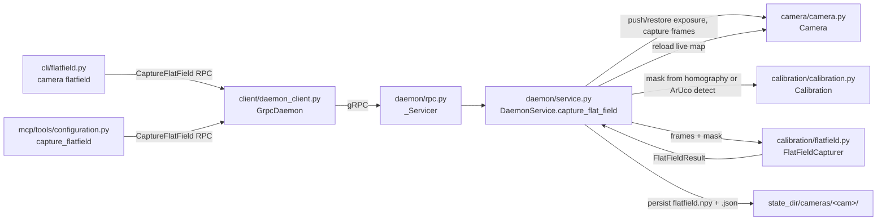

# daemon/

**Owner:** Eric Busboom · **Last reviewed:** 2026-08-21 · **Status:** stable

---

## 1. Purpose

`daemon/` is `aprilcamd` — the one process in the system that owns cameras and does vision. It exists as its own subsystem because two hard constraints only hold if exactly one process obeys them: **single vision authority** (all OpenCV work — capture, detection, tracking, homography, deskew, calibration — runs here and nowhere else) and **compute once, publish to all** (a deskewed image or a tag stream is computed once and every subscriber reads the same result). Every other component in the codebase — MCP server, CLI, viewer, robot client library — is a thin gRPC client of this process.

`interfaces.py`'s module docstring states the admission test directly: capability belongs in `daemon/` only when it needs camera or vision access, when two adapters would otherwise duplicate it, or when it must be computed once and shared. Everything else — vision math, calibration math, camera backend mechanics, config document parsing — is intentionally kept in other subsystems and only *orchestrated* from here; `daemon/` owns *when* things run and *who gets the result*, not the underlying algorithms.

Concretely, this directory owns: camera lifecycle glue on top of `camera/` (held-open handles, apply-on-open config, self-heal-triggered staleness), the per-camera detection pipeline (ring buffer, burst orchestration, confirmation, mount/parallax correction, drift checking), the gRPC control plane and its raw-socket stream transport, the in-memory config service (playfield/camera-config documents), the mobile-tag (robot mount) registry, the annotation store, — **sprint 037** — orchestrating flat-field gain-map capture: resolving the field-interior mask, pushing/restoring a temporary exposure override around a capture burst, and persisting the result, and — **sprint 038** — a background stall-detection pass, alongside the existing control-drift watchdog, that notices a worker-backed camera's capture session has wedged even when nothing is actively reading it, and drives the same close()+open() respawn `Camera`'s own demand-driven self-heal would eventually trigger anyway. At ~7,600 lines across 10 files it is the largest subsystem in the codebase.

## 2. Orientation

- **`__main__.py`** — process entry point (`python -m aprilcam.daemon`). `build()` is the single place a real daemon's full object graph is assembled: `CameraRegistry` + `CameraDiscovery` (sharing one `held_cameras` dict so `probe()` never disturbs an actively-subscribed camera) → `DaemonService` → boot-time config load (`_load_config_dir`, replaying every document under `config_dir` into `service.set_playfield`/`set_camera_config` before the listener exists) → `StreamTransportManager` (`build_stream_transport`) → `MdnsAdvertiser` → `DaemonLifecycle`. `main()` just calls `lifecycle.start()` and blocks on `SIGTERM`/`SIGINT`.
- **`lifecycle.py`** — `DaemonLifecycle`: the flock singleton (`daemon.lock`), the control-plane listener's start/stop, and the *local* process-readiness view. Also defines `ControlPlaneListener`, the minimal base class `rpc.py`'s gRPC wrapper implements, kept here so this module stays gRPC-free.
- **`service.py`** — `DaemonService(Daemon)`: the actual RPC method bodies. Holds every piece of daemon-owned mutable state and delegates camera mechanics to `camera/`, vision math to `vision/` (via `detection.py`), calibration/deskew math to `calibration/`, config parsing to `config/`, and — sprint 037 — flat-field gain-map math to `calibration/flatfield.py`'s `FlatFieldCapturer`. `capture_flat_field`/`get_flatfield`/`clear_flat_field` are thin wrappers over that class, the same split `calibrate`/`Calibrator` already established: this file resolves the camera/mask/exposure and persists the result, `calibration/flatfield.py` does the actual per-pixel math. **Sprint 038**: `_backend_factory`'s default (`_default_backend_factory` -> `OpenCVBackend`) becomes config/env-selectable to a `WorkerBackend`-constructing factory instead — no new method, an existing constructor-injected seam gets a second real implementation to choose between, gated off by default. The existing UVC control-drift watchdog (`reassert_controls`/`start_control_watchdog`) gains a sibling pass, `check_stalled_cameras` (see §3/§4), driven by the same background thread on the same interval.
- **`detection.py`** — `DetectionEngine`: per-camera ring buffers (`RING_BUFFER_SIZE=300`) plus one-burst-per-call orchestration (`run_burst`). First module to import both `camera/` and `vision/`.
- **`rpc.py`** — the gRPC servicer (`_Servicer`): pure marshalling (Python dataclass ↔ proto message) and typed-error-to-status-code mapping. `build_server()`/`build_stream_transport()` are the two factories `__main__.py` calls.
- **`streaming.py`** — `TagStreamProducer` / `ImageStreamProducer`: idle-gated background threads that drive the same `run_burst`/capture-encode calls the one-shot RPCs use, but on a steady cadence, for as long as at least one stream subscriber exists.
- **`broadcast.py`** — `Broadcaster`: a generic bounded-queue fan-out primitive with no camera/vision/proto knowledge — the mechanism that makes "N subscribers, one computation" true by construction.
- **`stream_transport.py`** — `StreamTransportManager`/`_Listener`: bridges an in-process `ImageStream`/`TagStream` to a real remote socket (`[uint32 BE length][protobuf]` framing), one reused listener per `(camera, product)` key.
- **`mdns.py`** — `MdnsAdvertiser`: `_aprilcam._tcp.local.` self-advertisement, never load-bearing.
- **`interfaces.py`** — the `Daemon`/`DaemonLifecycle` behavioral base classes, `ImageStream`/`TagStream` stream base classes, and the `DaemonStatus`/`MountRegistration` value dataclasses every implementation here derives from or constructs directly.

Control flow, end to end: an RPC arrives on the gRPC thread pool → `rpc.py`'s `_Servicer` marshals the request and calls a `DaemonService` method → that method takes `self._lock`, mutates or reads one of its in-memory stores, and (for camera-addressed calls) resolves/opens a `Camera` via `_camera_for` → for tag queries it delegates to `DetectionEngine.run_burst`, which reads one frame, runs `vision/`'s pipeline+detector, confirms, optionally converts to world coordinates via `calibration/`, applies mount correction, and appends to its own ring buffer → the result flows back through `rpc.py`'s proto converters. For streams, `GetImageStream`/`GetTagStream` never touch `DaemonService` directly — they only allocate a socket endpoint via `StreamTransportManager`; the real `stream_images`/`stream_tags` call (and the `TagStreamProducer`/`ImageStreamProducer` background thread it may start) happens lazily, inside the first accepted connection's own sender thread.

## 3. Constraints and Invariants

- **Configuration is ephemeral; disk is the source of record — except for two named, deliberate exceptions.** `Daemon`'s own docstring: "the config root is not writable by [the daemon]." `_playfields`, `_camera_configs`, `_annotations` remain plain in-memory dicts with no write-to-disk path — this is structural, not policy, for those three. Consequence: a restart wipes them; `__main__.py`'s `_load_config_dir` is what makes a *previously installed* `config_dir` document reappear after restart. `calibration.json` was the first deliberate exception — file-backed (`service._persist_calibration`/`_load_calibrations`), because a calibration surviving a restart is a UC-01 requirement. **`_mount_params` is the second, added sprint 036** (UC-12's mount-persistence issue): mount registrations describe physical reality (where a tag is bolted to a robot), not a per-session experiment, so they are now file-backed too — `state_dir/mounts/registry.json`, written through on `register_tag`/`unregister_tag` (`service._persist_mounts`) and reloaded at construction (`service._load_mounts`), the same atomic tmp+fsync+`os.replace` shape and the same tolerant-of-corruption load stance as `_load_calibrations`. `_annotations` remains the one runtime-only exception left of the two `AGENT_GUIDE.md` §6 originally named (mounts and annotations); annotation persistence is explicitly out of this sprint's scope, tracked as a separate future issue.
- **Lock, then enumerate, then listen, then advertise — in that exact order.** `DaemonLifecycle.start()` acquires the flock first; only then runs the synchronous half of camera discovery (`discovery.probe()`); only then builds and starts the gRPC listener; only then calls `advertise` if TCP bound. This order fixed a real regression (sprint 020-007): starting the listener before enumeration let a client's `camera list` reach a daemon whose registry was still empty, because "the socket accepts a connection" was being treated as the sole readiness signal. Violating this order silently reintroduces that race.
- **The lock is never unlinked** (matches v1) — removing it on release would reopen a create+lock race between the unlink and the next daemon's open+flock.
- **A background producer thread does not exist with zero subscribers — it is not "exists but throttles."** `Broadcaster`'s `on_active`/`on_idle` (fired exactly on the 0↔1 subscriber transition) is *the* idle-gating mechanism, not a policy layered on top of an always-running loop. This applies transitively through `stream_transport.py`: binding a listener socket costs nothing; only an *accepted connection's* sender thread calls `stream_images`/`stream_tags`, which is what actually starts a producer.
- **Presence-based tag confirmation, never position-based — do not "fix" this.** `DetectionEngine._confirm_detections` requires `CONFIRMATION_STREAK` (3) strictly consecutive bursts of the *same tag id*, checked by id alone, before it is confirmed. Adding a same-place-twice check would look like a reasonable extra safeguard but would reintroduce the exact bug (a phantom ArUco decode recurring at a *different* world position each time) this mechanism exists to fix, while also rejecting legitimate fast-moving tags. **Disappearance now has a bounded grace window (ticket 034-001) — a miss is no longer an instant drop.** Once a tag id is confirmed, it survives up to `CONFIRMATION_GRACE` (default 8) consecutive missed bursts, silently absent from those bursts' output, before its confirmed status is dropped and it must re-earn the full `CONFIRMATION_STREAK` again. This exists because a marginal-but-genuinely-present tag's raw detection rate is well below 1.0 (documented case: AprilTag 1 on `arducam-ov9281-usb-camera`, raw ~0.45–0.6), and an instant-drop-on-any-miss rule was making it "effectively invisible" — its reported rate collapsed to roughly the raw rate cubed. Grace never fabricates or re-emits a record for a burst the tag was not actually detected in; it only preserves confirmed *status* across the gap. Appearance is completely unaffected: an id must still satisfy `CONFIRMATION_STREAK` consecutive genuine hits to become confirmed in the first place.
- **Corner reordering is a verified no-op, not a skipped step.** `_pixel_corners` carries `Detection.corners` straight into `TagRecord.pixel_corners` with zero permutation, because OpenCV's native corner order for both AprilTag 36h11 and ArUco 4×4 was empirically confirmed to already match `design.md` §6's front-left/front-right/back-right/back-left convention. If a future tag family's native order ever differs, this silently produces wrong boundary/hat geometry — there is no runtime check.
- **`mount_z` (parallax correction) is silently inert until a camera is located.** `_camera_geometry_for` falls back to ground `(0,0)`/height `0.0` for any camera with no `CameraConfig.camera_position` — `project_tag_to_field_plane`'s own "nothing to correct" sentinel. A registered `mount_z` therefore has zero observable effect until an operator runs `aprilcam camera locate`. This is surfaced only via `register_tag`'s returned warning string and `list_tag_parameters`'s `mount_z_applied` flag (ticket 030-004) — there is no push notification when a camera later becomes located.
- **Everything mutable in `DaemonService` shares one `threading.Lock`; the gRPC server is a thread pool (`max_workers=10` default).** Concurrent RPCs against the same or different cameras are real, not theoretical. `DetectionEngine` guards its own buffers/streaks/detectors with a *separate* lock; `Broadcaster` and `stream_transport._Listener` each have their own again. No single global lock exists, and `Broadcaster.subscribe()` deliberately fires `on_active` *outside* its own lock — holding it would deadlock against a producer whose first tick publishes back into the same `Broadcaster`.
- **Stream geometry is snapshotted once per stream life, not recomputed per tick.** `ImageStreamProducer` builds exactly one `Deskewer` at the 0→1 subscriber transition and reuses it for the stream's entire life (UC-07's "frame geometry stable for the life of a stream"). Consequence: a `set_playfield` push that changes `width_cm`/`height_cm` mid-stream has zero effect on an already-running stream's `px_per_cm`/`world_extent` — only a fresh `start()` (last subscriber left, new one arrived) picks up the change. `calibration_stale` is deliberately *not* part of this snapshot — it is read fresh every tick.
- **A deskewed request must fail before any hardware access, never substitute a raw frame.** Both `_get_deskewed_frame` and `stream_images(deskewed=True)` check calibration (and that the calibrated-against playfield is still held) *before* `_camera_for`/producer construction. `Daemon.get_frame`'s docstring: "a raw frame that looks plausible but is not deskewed is how someone starts trusting wrong coordinates."
- **TCP bind and mDNS registration failures are never fatal.** `build_server` catches the pinned `grpc` (1.80.0) library's `RuntimeError` from a failed `add_insecure_port`; `MdnsAdvertiser` catches `OSError`/`zeroconf.Error`. Both log at WARNING and the daemon continues unix-socket-only. `grpc.so_reuseport` is explicitly disabled — without this, two independent daemon processes could both silently bind the same TCP port with the kernel load-balancing between them, a worse failure mode than an observable bind error.
- **Annotation store bounds are fixed constants, not configurable document fields.** `_MAX_ANNOTATIONS_PER_LAYER=1000`, `_MAX_POINTS_PER_SHAPE=10000` (ticket 031-010) — a deliberate scope decision, sized against the installed `main-playfield` (134.3×89.3 cm). `put_annotation`/`replace_layer` raise `AnnotationLimitExceeded` (mapped to gRPC `RESOURCE_EXHAUSTED`) *before* touching `self._annotations` at all, so a rejected write leaves the store completely unchanged; an upsert of an id already present never counts against the per-layer count bound.
- **Two same-named `DaemonLifecycle` classes exist by design — do not conflate them.** `daemon.lifecycle.DaemonLifecycle` runs *inside* the daemon process (this directory); `client.lifecycle.DaemonLifecycle` runs in the *caller's* process and spawns/signals `daemon/__main__.py` as a subprocess. Both derive from the same `daemon.interfaces.DaemonLifecycle` base but have genuinely different mechanics.
- **Flat-field capture always restores the camera's working configuration, on every exit path (sprint 037).** `capture_flat_field` pushes a temporary exposure override before the capture burst and restores the camera's prior stored/live config in a `finally`, unconditionally — success, a quality-gate refusal, or an exception mid-capture all restore identically. This mirrors `Camera.apply_config`'s own whole-push rollback discipline (`camera/DESIGN.md` §3) at one level up: a capture attempt must never leave a camera parked at the low-exposure override it needed only for the reference frames.
- **Flat-field state is file-backed and reloaded at startup, the same two-file shape `calibration.json` already established.** `flatfield.npy` (the gain array — apply side, commit `7f4c0ac`) gets a sibling `flatfield.json` (sprint 037: `captured_at`, `shape`, `gain_min`/`gain_max`, `stale`) written atomically alongside it (`_persist_flatfield`, the same tmp+fsync+`os.replace` shape as `_persist_calibration`) and reloaded at construction (`_load_flatfields`, tolerating a missing/corrupt sidecar the same way `_load_calibrations` tolerates a missing/corrupt `calibration.json`). `get_flatfield` answers from this in-memory cache, never a live re-read.
- **The stall watchdog respawns via `Camera`'s own `close()`+`open()`, never by reaching into `WorkerBackend` directly (sprint 038).** `check_stalled_cameras` (below) never imports or type-checks against `WorkerBackend` — it only knows "this held-open `Camera` hasn't produced a fresh frame in `STALL_THRESHOLD_S` seconds"; the respawn mechanics live entirely inside whichever backend `Camera` happens to be holding, per `camera/DESIGN.md`'s "backend-internal, not `Camera`-visible" rule. Against an `OpenCVBackend`-backed camera (the default until the config gate is flipped) this pass is a no-op by construction — that backend exposes no heartbeat signal, so "hasn't advanced" is never true for it. This keeps the daemon-level watchdog backend-agnostic, matching how `reassert_controls` already works uniformly across every `ControlBackend`.
- **A stalled worker is noticed even with zero RPC/stream activity (sprint 038).** This is the daemon-level half of the fix for the original issue's gap 3 ("the daemon should notice a stalled capture session") — `Camera.read()`'s own self-heal is demand-driven and cannot fire if nothing calls it. `check_stalled_cameras` runs on the same background thread and interval as `reassert_controls`, so a camera with no active stream and no recent one-shot RPC is still checked.
- **Flat-field staleness is marked on exactly the two events that already mark a calibration stale (sprint 037).** A successful self-heal or explicit camera reopen (`_mark_stale`'s call site) and a resolution-changing `set_camera_config` push both also flip the camera's flat-field `stale` bit (`_mark_flatfield_stale`, a sibling of `_mark_stale` sharing the same trigger points) — a flat-field map is tied to the same mounting/lighting/resolution facts a calibration is, so it goes stale for the same reasons. Unlike `calibration.stale` (which the daemon leaves the client to notice and act on), a stale flat-field map is **still applied** by `Camera._apply_flatfield` — staleness here is advisory-only, surfaced through `get_flatfield`/`list_cameras`-style reporting, never a refusal to serve frames.
- **`DaemonStatus.other_daemon_processes` is declared here but populated elsewhere.** `daemon/interfaces.py`'s `DaemonStatus` dataclass carries this field (ticket 031-002's orphan-daemon-process report), and its own docstring says so explicitly — but the *only* call site in the codebase that ever fills it with a real process-table scan is `client.lifecycle.DaemonLifecycle.status()`. Every status this directory itself produces — `daemon.lifecycle.DaemonLifecycle.status()` and `daemon.service.DaemonService.status()` (the RPC-answered value) — always reports it as the default empty tuple `()`. A reader expecting the orphan-scan logic to live in `daemon/lifecycle.py` will not find it there.

## 4. Design

**Key data structures and ownership.** `DaemonService` holds seven in-memory stores under one `threading.Lock`: `_cameras` (held-open `Camera` by slug — this dict doubles as `CameraDiscovery`'s `active_slugs` source, which is what makes `probe_cameras()`'s "never disturbs a live camera" guarantee real rather than just testable), `_playfields`, `_camera_configs`, `_calibrations` (disk-backed), `_annotations` (`playfield → layer → id → Annotation`) plus `_annotation_revisions` (one monotonic counter per playfield), `_mount_params` (`TagId → MountParameters`, **disk-backed as of sprint 036** — see Constraints §3), and the two stream-producer caches `_tag_stream_producers` (keyed by slug) / `_image_stream_producers` (keyed by `(slug, deskewed)`). **Sprint 037** adds an eighth, `_flatfields` (`str → FlatFieldInfo`, disk-backed the same way `_calibrations` is — see Constraints §3). Three of these eight are now file-backed (`_calibrations`, `_mount_params`, `_flatfields`); the rest remain pure in-memory runtime state. `DetectionEngine` separately owns per-camera ring buffers (`Dict[str, Deque[TagFrame]]`, `maxlen=300`), one lazily-built `TagDetector` per slug, and per-slug confirmation-streak counters, under its own lock.

**Lifecycle.** Init: `__main__.build()` wires the object graph and replays `config_dir` into the service before any RPC is possible; `DaemonLifecycle.start()` then does lock → enumerate → listen → advertise (Constraints §3). Per-frame tick has two paths: (1) **demand-driven** — `DetectionEngine.run_burst`, called synchronously and exactly once per `get_tags`/`get_tag` RPC, with no loop or timer of its own; (2) **streamed** — once a `TagStreamProducer`/`ImageStreamProducer` exists (because a stream has at least one subscriber), it drives the identical underlying call (`run_burst`, or `camera.read()` + optional `Deskewer.deskew` + `cv2.imencode`) on a private background thread at a fixed cadence (`TAG_STREAM_INTERVAL_S` ≈ 1/30 s, `IMAGE_STREAM_INTERVAL_S` ≈ 1/15 s — both explicitly flagged provisional, never tuned against real hardware). Teardown: `DaemonLifecycle.stop()` stops watching, stops mDNS, stops the listener (bounded grace), runs `on_stop` (`transport.stop()` then `service.close()`), then releases (never unlinks) the lock. `service.close()` stops every tracked stream producer — joining its thread — *before* closing any camera handle, specifically so no producer thread is mid-`Camera.read()` when a backend is torn down.

**Stall-detection watchdog, component view (sprint 038).** No new
cross-module dependency at the daemon level — `check_stalled_cameras`
calls only `Camera.close()`/`Camera.open()`, the same pair
`reassert_controls`'s sibling pass already calls into via
`Camera.reassert_config()`. The new dependency (`camera/` -> a spawned
`capture_worker` process) is entirely internal to `camera/`; see
`camera-DESIGN.md`'s own component diagram for that boundary.

```mermaid
graph LR
    THREAD["daemon/service.py<br/>watchdog thread (existing,<br/>CONTROL_READBACK_INTERVAL_S)"] -->|reassert_controls| CAM1["camera.camera.Camera<br/>(per held-open camera)"]
    THREAD -->|check_stalled_cameras (sprint 038)| CAM1
    CAM1 -->|close() then open()<br/>on a stalled heartbeat| BACKEND["Camera's own CaptureBackend<br/>(WorkerBackend when config-selected;<br/>no-op signal on OpenCVBackend)"]
```

**Flat-field capture, component view (sprint 037).** New cross-module
dependency: `daemon/service.py` → `calibration/flatfield.py` (mirrors the
existing `daemon/` → `calibration/calibration.py` edge). No existing
edge changes direction or shape.



**Concurrency model.** The gRPC server runs on a `ThreadPoolExecutor` (`max_workers=10`), so concurrent RPCs are real. Each stateful class in this subsystem owns exactly one lock scoped to its own state — `DaemonService._lock`, `DetectionEngine._lock`, each `Broadcaster._lock`, each `stream_transport._Listener._lock` — and no lock here is ever held across a call into another lock-owning object's public method.

**Load-bearing decisions and rejected alternatives:**
- *Demand-driven bursts by default, not an always-on poll loop* — an idle daemon runs zero detections by construction, not because a scheduler decided not to. A background thread per camera regardless of subscribers was rejected as wasted CPU.
- *One producer instance per `(camera[, deskewed])` key, reused across subscribers* — makes "compute once, publish to all" true structurally rather than by a dedup check; N subscribers cause exactly one warp/one burst per tick, never N.
- *`Broadcaster`'s backpressure is silent drop from a bounded per-subscriber queue (`DEFAULT_SUBSCRIBER_QUEUE_DEPTH=2`)*, adapted from v1's `_MAX_SENDER_QUEUE`. A blocking alternative was rejected because one slow subscriber must never stall the pipeline or any other subscriber.
- *`stream_transport.py` does zero eager validation at endpoint-allocation time* (`GetImageStream`/`GetTagStream`). Validating there was rejected on two grounds: it would either start a real producer with zero actual socket clients, or require a second, independently-maintained implementation of `_camera_for`'s slug/number resolution. Instead, every precondition (`UnknownCamera`, `CameraNotPresent`, `NotCalibrated`) surfaces inside the first accepted connection's sender thread — a caller that mistypes a camera name gets a socket that connects then immediately closes, not a gRPC-level error at allocation time.
- *Presence-only tag confirmation over position-similarity* — see Constraints §3; the rejected alternative was directly identified as reintroducing the original bug.
- *`grpc.so_reuseport` disabled* — trading "TCP bind failure is observable" for "silently identical to a load-balanced pair of daemons," see Constraints §3.
- *Flat-field capture orchestration in `daemon/service.py`, the actual gain-map math in `calibration/flatfield.py`* (sprint 037) — the identical split `calibrate`/`Calibrator` already established, rejected here as much as chosen: putting the median/Gaussian-blur math inline in `service.py` would violate this file's own "RPC method bodies, no business logic" rule (§1), and letting `flatfield.py` open/reconfigure the camera itself would break the "camera frame access is handed in, never owned" invariant `calibration/DESIGN.md` states for `Calibrator` and now states for `FlatFieldCapturer` too.
- *A dedicated watchdog thread for stall detection, separate from the existing control-drift watchdog* (sprint 038) — rejected: both passes are "iterate every held-open camera on a fixed interval, take a bounded per-camera corrective action, never let one camera's failure stop the pass." Adding a second thread would duplicate that shape for no isolation benefit (both already tolerate one camera's exception without affecting the others, `reassert_controls`'s per-camera `try`/`except` pattern reused verbatim); `check_stalled_cameras` is a sibling call from the same `_loop`, same as `reassert_controls`.
- *Stall detection reaching into `WorkerBackend` internals directly from `daemon/service.py`* (sprint 038) — rejected: would break the "backend-internal, not `Camera`-visible" boundary `camera/DESIGN.md` establishes for the worker-process fix, and would mean the daemon-level watchdog needs a backend-type check (`isinstance(backend, WorkerBackend)`) it does not need today. Routing the stall signal through `Camera`'s own state instead keeps the watchdog backend-agnostic, exactly like `reassert_controls` already is.

## 5. Interfaces

### Exposes

**gRPC control plane** (`proto/aprilcam_v2.proto`, translated by `rpc.py`'s `_Servicer`, built by `build_server`): `ListCameras`, `ProbeCameras`, `GetFrame` (raw or `deskewed=True`; `encoding` `"jpeg"`/`"png"`), `GetStatus` (now carries `protocol_version` — ticket 031-001, a constant `PROTOCOL_VERSION=1` in `rpc.py`, independent of `aprilcam.__version__`, bumped only on a breaking/renumbering wire change), `GetTags`/`GetTag`/`GetTagHistory`, `SetPlayfield`/`GetPlayfield`/`ListPlayfields`, `SetCameraConfig`/`GetCameraConfig`/`ResetCameraConfig`, `Calibrate`/`GetCalibration`, `CaptureFlatField`/`GetFlatField`/`ClearFlatField` (**sprint 037** — `CaptureFlatField` accepts optional `exposure`/`frames` and `force`/`dry_run` flags, mirroring `Calibrate`'s shape; a quality-gate refusal is a normal `FlatFieldResult(succeeded=False, reason=...)` return, never an error, the same "explicit failure is data" contract `CalibrationResult` already uses), `PutAnnotation`/`RemoveAnnotation`/`ReplaceLayer`/`ClearAnnotations`/`GetAnnotations`, `FindFeature`, `RegisterTag`/`UnregisterTag`/`ListTagParameters`, `GetGuide`, and the two stream-allocation RPCs `GetImageStream`/`GetTagStream` (return a `StreamEndpoint`, never touch `DaemonService` directly). Every RPC method body is a thin call into the matching `DaemonService`/`Daemon` method — the pre/post/error contract for each is authoritatively documented on the `Daemon` base-class method in `interfaces.py`, not duplicated here.

Error mapping (`rpc.py`'s `_STATUS_CODES`/`_abort`): `AlreadyRunning`→`ALREADY_EXISTS`; `UnknownCamera`/`UnknownPlayfield`/`UnknownGuide`→`NOT_FOUND`; `NotCalibrated`/`CameraNotPresent`/`NoPlayfieldLinked`/`NoFieldMask`→`FAILED_PRECONDITION` (**sprint 037**: `NoFieldMask` is `CaptureFlatField`'s precondition failure — no calibration *and* no detectable ArUco corners to derive a field-interior mask from — same status-code family as `NoPlayfieldLinked`, "cannot succeed given current state"); `AnnotationLimitExceeded`→`RESOURCE_EXHAUSTED`; anything else→`INTERNAL`. Every `AprilCamError` carries trailing metadata (`aprilcam-error-type` plus type-specific fields) so a client reconstructs the same typed exception rather than pattern-matching status text.

**Bulk streams** (raw sockets, `[uint32 BE length][protobuf]` framing, allocated via `GetImageStream`/`GetTagStream`, served by `stream_transport.StreamTransportManager`): a raw or deskewed image stream per camera, and a tag stream per camera. One socket connection is exactly one `Broadcaster` subscriber. Contract: connecting before the underlying precondition is satisfiable (bad camera name, uncalibrated deskewed request) yields a socket that accepts then immediately closes with nothing sent — never a synchronous allocation-time error, since allocation never touches `DaemonService`.

### Consumes

- **`camera/`** — `Camera`, `CameraDiscovery`, `CameraRegistry`, `CameraIdentity`/`resolve_all`, and backend selection (`OpenCVBackend`, `UvcUtilBackend`, `LibcameraDevice`, `resolve_capture_backend`). `daemon/` never derives camera identity or persists the registry itself; it only opens, holds, and configures already-resolved `Camera` handles.
- **`vision/`** — `TagDetector`/`Detection`, `run_pipeline`/`PipelineConfig`, `compute_motion`/`MIN_RELIABLE_DISPLACEMENT_CM`. Stateless per-frame vision math; `daemon/detection.py` owns only *when* it runs and the buffered state across calls.
- **`calibration/`** — `Calibrator`, `Calibration`/`CalibrationResult`, `Deskewer`, `correct_tag_pose`/`project_tag_to_field_plane`, `compute_drift_cm`, and — **sprint 037** — `FlatFieldCapturer`, `FlatFieldResult`, `FlatFieldInfo`. All homography-solving, deskew-warp, mount/parallax correction, drift-measurement, and flat-field gain-map math.
- **`config/`** — `Directories`, `ConfigLoader`, `CameraConfig`/`PlayfieldDefinition`/`Feature`/`CameraPosition`. Document parsing/validation and directory resolution; `daemon/` touches disk only at a few targeted points (boot-time `config_dir` scan in `__main__.py`, `Camera.reset`'s stored-config read, `calibration.json` read/write, and — sprint 036 — `mounts/registry.json` read/write).
- **`playfield/`** — `Playfield` (the served definition + linked-cameras wrapper) and `FeatureQuery` (backs `find_feature`/`WhereIs`).
- **`proto/`** — `aprilcam_v2_pb2`/`aprilcam_v2_pb2_grpc`, imported only by `rpc.py` (the sole owner of the proto boundary on the server side, per `design.md` §6).
- **Top-level `errors.py`/`types.py`** — the typed exceptions (`NotCalibrated`, `UnknownCamera`, `AnnotationLimitExceeded`, etc.) and shared value dataclasses (`TagRecord`, `TagFrame`, `ImageFrame`, `CameraState`, `Annotation`/`AnnotationSet`, `MountParameters`, `ProbeReport`) that cross every boundary described above.

## 6. Open Questions / Known Limitations

- **The stall watchdog's threshold constant is not yet validated against real hardware (sprint 038).** Mirrors the existing "cadence constants are honestly unvalidated" item below in spirit: a threshold too short flags a momentarily slow-but-healthy camera as stalled; too long delays recovery. Left as a named, constructor-overridable constant rather than tuned here.
- **No coordination between the stall watchdog and the control-drift watchdog's own timing (sprint 038).** Both run from the same background thread on the same interval today (a deliberate simplification, see Design Rationale), so they cannot race each other, but a future change splitting them onto separate schedules would need to reconsider whether a stall-triggered respawn and an in-flight `reassert_config` call against the same camera could overlap — `Camera._config_lock`/`_read_lock` already serialize each individually, but nothing here reasons about the two watchdog passes interleaving against the same camera on separate threads.
- **Cadence constants are honestly unvalidated.** `TAG_STREAM_INTERVAL_S` (~30 Hz) and `IMAGE_STREAM_INTERVAL_S` (~15 Hz) are both explicitly documented in `streaming.py` as provisional starting guesses, never tuned against real detection/encode CPU cost. No coordinated backpressure exists between a camera's tag-stream and image-stream producers if both run concurrently.
- **`CONFIRMATION_STREAK=3` rests on a bounded sample.** A longer real-hardware campaign could in principle observe a longer phantom-detection streak than the one this value was set against — which is exactly why it stays constructor-injectable rather than hardcoded.
- **`mount_z` inertness has no push notification.** A tag registered with a nonzero `mount_z` before any camera is located gets a one-time warning string from `register_tag` and a queryable `mount_z_applied` flag from `list_tag_parameters` — but nothing alerts a client when a *later* `aprilcam camera locate` call finally makes a previously-inert registration active.
- **Annotation store limits are fixed and playfield-specific by scope decision.** `_MAX_ANNOTATIONS_PER_LAYER`/`_MAX_POINTS_PER_SHAPE` were sized against one installed playfield's real dimensions; a genuinely larger field or a busier multi-robot session would need these revisited, and there is deliberately no per-playfield or pushed-document override yet.
- **No `stream_annotations` RPC, by design.** A client wanting live annotation updates on an *undeskewed* (raw) image stream has no channel at all — annotations only ride embedded in deskewed frames or via polling `GetAnnotations`, since raw frames carry no world→pixel mapping (UC-16).
- **`DaemonStatus.other_daemon_processes`'s home is split across two subsystems.** The field is declared in this directory's `interfaces.py` but is only ever populated by `client/lifecycle.py`; nothing server-side in `daemon/` performs the process-table scan. This is documented in the code but easy to miss when reasoning about ticket 031-002 from the interface declaration alone.
- **Corner-order equivalence between OpenCV's native detector output and `design.md`'s boundary convention is asserted from empirical verification, not enforced by a runtime check.** If a future tag family or OpenCV version ever changes native corner ordering, `_pixel_corners`' zero-permutation pass-through would silently produce wrong geometry with no test catching it structurally (only fixture-based regression tests would notice).
- **Per-camera `DetectorConfig` tuning (ticket 035-001) now has exactly one real entry, for one known real-hardware quirk.** `detection._DETECTOR_CONFIG_OVERRIDES: Dict[str, DetectorConfig]` lets `_default_detector_factory` hand back a differently-tuned `TagDetector` for one camera slug without touching any other. `arducam-ov9281-usb-camera` ("camera 5") missed AprilTag 1 on 1-3 of 10 real polls at night exposures per the source issue (`apriltag-1-detects-unreliably-on-arducam-ov9281-usb-camera.md`), while all 10 ArUco markers on the same frames decoded on effectively every poll. Ticket 035-002's reopened session ran seven independent real sweeps against the physical camera (`tests/aprilcam/daemon/test_detector_tuning_hardware.py`, `docs/knowledge/2026-08-23-camera-5-detector-tuning-blocked-by-sandbox-camera-permission.md`) and found loosening the three AprilTag-quad earned constants (`april_min_wb_diff`/`april_min_cluster_pixels`/`april_max_line_fit_mse`) hit AprilTag 1 in 70/70 real bursts vs. the default's 46/50 (92%), with no additional ArUco-recall cost beyond what the *default* config already exhibits. Every other camera slug still falls through to plain `DetectorConfig()` defaults, unchanged. **Open remainder:** every measurement ran in daylight (auto-swept exposure 3-25); the source issue's own 150-500-exposure *night* regime was not re-measured here (forcing that exposure in daylight would blow out the sensor rather than reproduce the condition), so a genuinely dark-room re-run is the one thing this investigation could not confirm.
