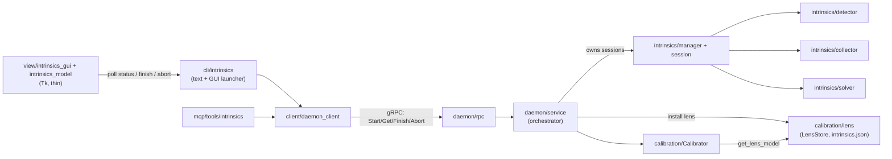
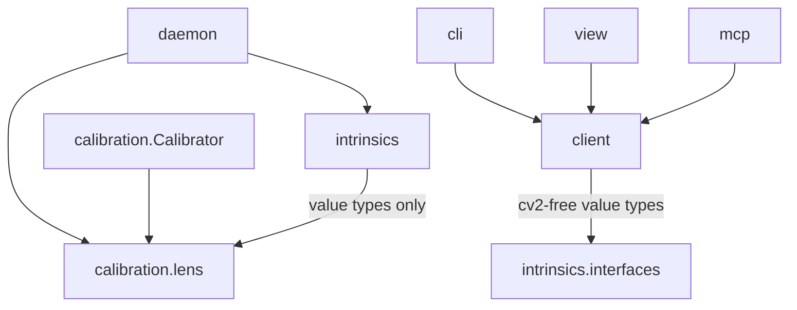
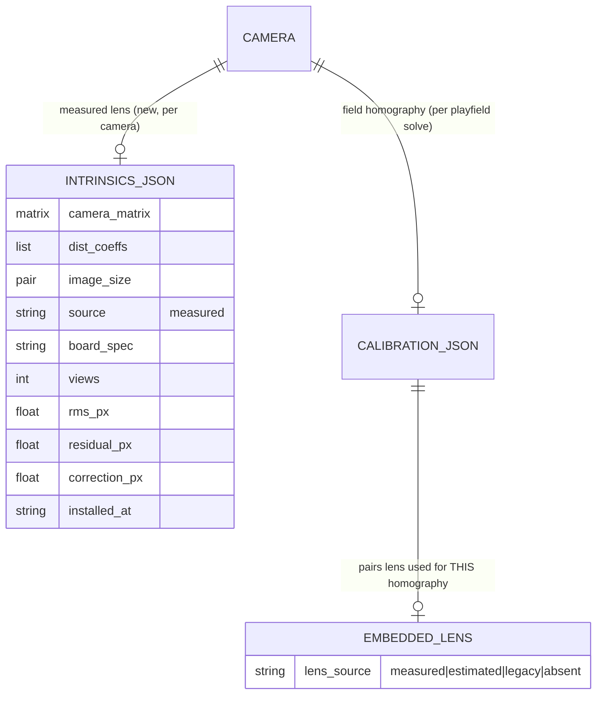

<!-- CLASI: Before changing code or making plans, review the SE process in CLAUDE.md -->

# Sprint 044: ChArUco-board intrinsics calibration as a daemon workflow

## Goals

In priority order:

1. **Daemon-side intrinsics session** per camera: `start_intrinsics`,
   `get_intrinsics_status`, `finish_intrinsics(install)`, `abort_intrinsics`.
   ChArUco detection and `cv2.calibrateCamera` run in the daemon (the sole
   vision authority). View quality gates (distinct, steady, sharp, confident
   IPPE pose), periodic background solve, and the "good enough" metric
   (full-vs-half-sample undistortion residual after a homography, central
   85 %; good = rms < 0.6 px and residual < 4 px), with coverage stats and a
   plain-language NEXT hint. Every constant and gotcha is in
   `docs/knowledge/2026-10-15-charuco-intrinsics-calibration-lessons.md`.
2. **Per-camera lens model storage**, separate from the per-playfield
   `calibration.json` (e.g. `intrinsics.json` per camera, with provenance:
   board spec, view count, rms, residual, timestamp, `measured` vs
   `estimated`). The running daemon uses it with no restart, and the field
   `calibrate` carries it forward.
3. **`aprilcam camera intrinsics <camera...> [--board SPEC] [--install]`**:
   fullscreen Tk GUI thin client polling daemon status (banner, big
   "error now"/"could still change by", 3x3 region and tilt tiles, one NEXT
   line; never auto-quits on green; Enter installs, Esc aborts; fresh
   session per run; several cameras at once) plus a `--no-gui` text mode.
4. **MCP tools** mirroring the four daemon commands.
5. **Reporting**: `calibrate` states which lens model it carried forward
   (measured / estimated / none); `camera list` and `get_calibration`
   expose measured / estimated / absent.

## Problem

The only way to get a lens model today is `calibrate --with-intrinsics`, a
degenerate single-coplanar-view fit that crashes at six points and gave
fx = 473 vs a true 911 on camera 4. On 2026-10-15 cameras 2, 3, 4 were
calibrated properly with an out-of-process prototype
(`docs/knowledge/assets/charuco-prototype/`) that writes `calibration.json`
behind the daemon's back; the daemon only re-reads it on restart and
`calibrate` overwrites it with the stale in-memory model. The portable table
moves often, so the frequent step must be the quick field `calibrate`, with a
measured lens model done once per camera.

## Solution

Port the *ideas* of the prototype (not its code) into daemon modules written
against fresh interface skeletons (real base classes, never
`typing.Protocol`): a ChArUco detector (marker clustering for boards sharing
the field dictionary, 2x upscale with loosened detector params, legacy vs
current layout auto-detect), a view collector with the relative gates, a
solver/quality evaluator, and a per-camera intrinsics store consulted by
`Calibrator` via the prior-calibration path. Expose through the existing
daemon RPC, CLI and MCP layers following the Sprint 037 flat-field pattern.
Clients import no OpenCV; the Tk GUI only polls status.

## Success Criteria

- From a cold daemon, `aprilcam camera intrinsics 3` reaches GOOD ENOUGH in
  under a minute of board motion; Enter installs; an immediate
  `aprilcam camera calibrate 3` reports the measured model carried forward;
  no daemon restart anywhere.
- `get_calibration` and `camera list` show measured / estimated / absent.
- Hardware-free tests pass (see Test Strategy).

## Scope

### In Scope

- Daemon session lifecycle, detection, gating, solving, metric, install.
- Board spec config value (default `5x7:37:28:DICT_5X5_100`).
- Per-camera intrinsics store and live reload; `calibrate` carry-forward.
- CLI `camera intrinsics` (Tk GUI and `--no-gui`), MCP tools, status fields.
- `--with-intrinsics` documented as the no-board fallback; clean refusal of
  the six-point crash if cheap to include.
- Knowledge/doc updates.

### Out of Scope

- The stdin-revoked daemon capture-worker TODO (separate).
- Changes to the field-homography algorithm itself.
- Board generation/printing tooling; fisheye/non-pinhole models.
- Automatic resumption of prior sessions (sessions are fresh unless
  explicitly resumed, and resume UI is not built here).

## Test Strategy

Hardware-free pytest using synthetic rendered boards and synthetic solves:
marker clustering against field-marker collisions and two boards; legacy vs
current layout auto-detect; pose-confidence rejection of a flat board;
relative blur and motion gates; coverage by board extent; good-enough
residual on synthetic solves; fresh-session semantics; store round-trip and
carry-forward through `Calibrator`; RPC/MCP/CLI surface with a fake daemon;
GUI logic tested via a status-to-view-model function, not a display. Manual
hardware acceptance on camera 3 at sprint close.

## Architecture

**Sizing: Substantial** -- a new daemon subsystem (the intrinsics session
engine), a new per-camera data store (so the lens model leaves the
per-playfield `calibration.json`), a new cross-module dependency
(`calibration.Calibrator` -> lens store), and a new RPC/CLI/MCP/GUI surface
touching 3+ modules. Component diagram and dependency graph are included;
the full self-review is recorded below.

This project has `design_docs: enabled`; the persistent `docs/design/` and
per-package `DESIGN.md` edits are scheduled as the last ticket (docs) rather
than as a seeded overlay -- see Open Questions.

### What Changed

**New package `src/aprilcam/intrinsics/`** (daemon-side vision; everything
except `interfaces.py` imports `cv2`):

| Module | One-sentence purpose |
|---|---|
| `interfaces.py` (cv2-free) | Value types and base classes for a session's public record: `BoardSpec`, `IntrinsicsStatus`, `IntrinsicsFinishResult`, banner/state enums. Real base classes / frozen kw_only dataclasses, never `Protocol`. |
| `detector.py` | Finds every physical ChArUco board in one frame (marker clustering, 2x upscale, loosened detector params, current/legacy layout auto-detect). |
| `collector.py` | Decides which detected boards become *views* (distinct, steady, sharp, confident pose) and tallies region/tilt coverage. |
| `solver.py` | Solves the lens from the kept views and evaluates "good enough" (rms, half-sample mapping residual, correction size, next hint). |
| `session.py` | One camera's fresh session: capture thread, background solve cadence, atomically published status snapshot. |
| `manager.py` | Registry of sessions (at most one per camera), idle-abort watchdog, orderly shutdown. |

**New module `calibration/lens.py`** (cv2-free): `LensModel` (camera matrix,
distortion, image size, provenance) and `LensStore`, which persists
`<state_dir>/cameras/<slug>/intrinsics.json` atomically (tmp + fsync +
`os.replace`, same pattern as `calibration.json`), tolerates a corrupt file,
and resolves "the lens model to use for this camera at this resolution".

**Changed modules**

- `calibration/calibration.py` -- `Calibrator` gains an injected
  `get_lens_model` lookup, consulted *before* `get_prior_calibration`'s
  embedded matrix. Carry-forward order: (1) measured model from the store whose
  image size matches the captured frames; (2) the prior calibration's embedded
  `camera_matrix`/`dist_coeffs` (legacy/estimated); (3) none. `Calibration`
  gains an additive `lens_source` field (written to `calibration.json`;
  absent in old files and read back as `legacy` when a matrix is present).
  `CalibrationResult` gains `lens_model_source` so `calibrate` can say which
  model it carried. `estimate_intrinsics=True` is refused (explicit failure,
  reason names the installed model) while a measured model is installed.
- `daemon/service.py` -- thin orchestration only: constructs `LensStore` and
  `IntrinsicsManager`, supplies the manager its frame source
  (`Camera.read()` on the resolved slug) and its install callback, adds
  `start_intrinsics` / `get_intrinsics_status` / `finish_intrinsics` /
  `abort_intrinsics`, overlays lens provenance onto `CameraState`, and closes
  sessions in `close()`. No ChArUco math lives here (the same
  `calibrate`/`Calibrator` split sprint 037 used for flat-field).
- `daemon/interfaces.py`, `proto/aprilcam_v2.proto` (+ regenerated
  `aprilcam_v2_pb2*.py`), `daemon/rpc.py` -- four new RPCs plus lens
  provenance fields on `CameraState`/`Calibration`/`CalibrationResult`.
- `client/daemon_client.py`, `client/models.py` -- wrappers and proto<->value
  converters (cv2-free).
- `cli/intrinsics.py` (new; registered from `cli/camera.py`),
  `view/intrinsics_gui.py` (new Tk fullscreen client), `view/intrinsics_model.py`
  (new, pure Tk-free status -> view-model/text), `mcp/tools/intrinsics.py`
  (new), plus provenance output in `cli/calibrate.py`, `cli/_common.py`
  (`camera list`) and the MCP `get_calibration`.

### Component Diagram

### Dependency Graph (new edges only)

No cycles. `intrinsics` does not depend on `Calibrator` or `daemon`; the
lens store is the only thing the two sides share, and it is a leaf. The
client-side packages import only `intrinsics.interfaces` (cv2-free), so
`tests/test_no_cv2_in_client_modules.py` keeps passing.

### Data Model

### Why / Design Rationale

**Decision 1 -- A separate `intrinsics.json` per camera, not more fields in
`calibration.json`.** Context: a lens model is a property of camera + lens +
focus + resolution; `calibration.json` is rewritten wholesale by every field
`calibrate` and discarded state by a failed one. Alternatives: (a) keep the
matrix in `calibration.json` and teach the daemon to hot-reload it (this is
what the prototype did, and what lost the model whenever the in-memory copy
overwrote it); (b) a global lens table. Why this: (a) couples two lifetimes
-- the table moves often, the lens almost never -- and a camera with no
playfield link could not hold a lens at all; a per-camera file mirrors the
existing `cameras/<slug>/` layout. Consequences: one more file per camera;
`Calibrator` has two lens sources with a defined order.

**Decision 2 -- A stored `Calibration` keeps the lens it was *solved with*;
the store feeds the *next* `calibrate`.** Context: the homography is solved on
points undistorted by a specific lens model. Swapping the lens under an
existing homography makes the pair inconsistent and silently wrong -- the
worst failure mode in this system (stale-but-plausible coordinates).
Alternatives: overlay the new lens onto the in-memory calibration at install
(rejected: inconsistent pair); auto-recalibrate at install (rejected: needs the
field markers visible and the playfield linked, which a lens session does not
guarantee). Consequences: "used immediately without a restart" means the very
next `calibrate` sees it; `camera list` shows a `lens-pending` flag when the
store's model differs from the one embedded in the current calibration, and
the finish result says "run `aprilcam camera calibrate N` to apply it".

**Decision 3 -- Legacy fallback, provenance inferred.** Existing
`calibration.json` files with `camera_matrix`/`dist_coeffs` and no
`lens_source` read as `legacy` (we cannot tell the 2026-10-15 prototype's
measured models from `--with-intrinsics` estimates). They keep working as the
lens fallback exactly as today. Nothing is rewritten on disk by this sprint's
migration; a camera graduates from `legacy` to `measured` when a session is
installed. A `calibrate` that carries a lens forward re-writes it with the
same inferred source it read.

**Decision 4 -- Session engine in its own package, thin service.**
`DaemonService` is already 3,100 lines; it holds orchestration and
persistence only. Detection, gating, solving, and the metric are separate
single-purpose modules so each is testable on synthetic data without a camera.
Sessions hold only per-view corner arrays (never frames), so memory is bounded
by view count.

**Decision 5 -- Session lifecycle.** One session per camera slug
(`start` on an already-active camera is an explicit error, not a silent
resume; "fresh unless explicitly resumed" -- resume is not built). Frame
source: the camera's live `Camera.read()` (read-locked, coexists with stream
producers and the detection loop; frames are consumed at a capped ~8 fps).
Threads per session: a capture/detect thread (detector -> collector) and a
solver thread that re-solves when the view count has grown by
`SOLVE_EVERY` (3) and publishes. The public status is an immutable
snapshot swapped under a lock, so RPC polling never blocks on a solve.
`finish(install)` stops capture, runs a final synchronous full solve on all
views (never installs a stale background result), checks a plausibility gate
(focal length vs frame width, loose band -- *not* the single-view bounds on
`|k1|`), and, only if `install` and the result is good (or `force`), writes the
store. A session whose polling stops for 120 s auto-aborts (a dead client
must not leave a camera pinned); a mid-session resolution change is a session
error and blocks install; daemon `close()` aborts all sessions. Layout
auto-detect state is per session, not process-global as in the prototype.

**Decision 6 -- One status record for every renderer.** `IntrinsicsStatus`
carries: camera, state (`collecting`/`finished`/`aborted`/`failed`), board
spec, layout lock (`current`/`legacy`/`unknown`), image size, `board_visible`,
`view_count`, `tilted_count`, `cell_coverage` (3x3 counts, NW..SE),
`tilt_coverage` (N/E/S/W counts), `rms_px`, `residual_px`, `correction_px`,
`fx`/`hfov_deg`, `good`, `banner` (`show_board`/`keep_going`/`good_enough`),
`next_hint`, `last_reject` (why the latest frame was not kept), `errors`,
`started_at`/`solved_at`. The Tk GUI, `--no-gui` text mode, and MCP all
render from that record; `view/intrinsics_model.py` turns it into display
strings and a tile model as a pure function (which is also what the tests
exercise instead of a display). Thresholds (good = rms < 0.6 px and residual
< 4 px; min 12 views; central 85 %; outer 40 % coverage bands; motion 12 px;
blur 45 % of the running best; IPPE confidence >= 18 corners and runner-up >
1.3x) are module constants taken from the knowledge entry, not request
parameters.

**Decision 7 -- Board spec.** A `BoardSpec` string
`COLSxROWS:SQUARE_MM:MARKER_MM:DICT`, resolution order: request value
(`--board` / MCP arg) > daemon environment `APRILCAM_CHARUCO_BOARD` >
built-in default `5x7:37:28:DICT_5X5_100`. Parsing/validation is cv2-free
(in `intrinsics/interfaces.py`) so the client can reject a malformed spec
before a round trip; dictionary-name resolution happens daemon-side.

### Impact on Existing Components

- `Calibrator`: one new optional constructor argument; behaviour unchanged
  when it is absent or the store is empty. Existing prior-calibration
  carry-forward remains the fallback.
- `CalibrationResult`, `Calibration`, `CameraState`: additive fields with
  defaults; old proto messages decode unchanged.
- `Daemon` base interface: four new methods raising `NotImplementedError`
  by default; existing fakes need no change.
- CLI `camera list` rows gain a `lens=` word; scripts parsing the old row
  prefix are unaffected (appended before the trailing flags).

### Migration Concerns

- Existing `calibration.json` files (including the three written on
  2026-10-15 with measured matrices) load unchanged and report
  `lens=legacy`. No file is rewritten at upgrade.
- First `calibrate` after upgrade on a camera with an `intrinsics.json`
  prefers the store; a camera with only a legacy matrix keeps carrying it.
- Resolution mismatch between a stored lens and the frames: the stored model
  is ignored for that calibrate (with a warning in the result) -- never
  applied at the wrong scale.
- Wire compatibility: new proto fields only; protocol version bump is not
  required, but `PROTOCOL_VERSION` handling is checked in the RPC ticket.
- `aprilcam camera calibrate --with-intrinsics` while a measured model
  is installed is now refused (previously it silently overwrote).

### Self-Review (Phase 3, full)

- **Consistency**: What Changed, diagrams, and rationale agree; the lens
  store is the sole new shared leaf. APPROVE.
- **Codebase alignment**: `get_prior_calibration` is bound to
  `DaemonService.get_calibration` (verified in `daemon/service.py`);
  `Calibration.camera_matrix` exists only on the concrete class and is
  *dropped* by the proto converter (`client/models.calibration_from_proto`
  builds the interface `Calibration` with three fields) -- therefore
  provenance cannot ride on the existing `get_calibration` wire shape and gets
  explicit new fields (planned). The prototype's `LEGACY` module global and
  the viewer's cv2-free rule are both accounted for. `_sanity_check_intrinsics`
  bounds are tuned for single-view degeneracy; reusing them verbatim for a
  measured fit is rejected (loose fx/width band only).
- **Design quality**: each module passes the one-sentence/no-"and" test; no
  cycles; fan-out of `DaemonService` grows by two (manager, store) --
  acceptable, both are narrow. The `session`/`manager` split avoids a
  god object.
- **Anti-patterns**: shotgun surgery risk on provenance fields (proto, rpc,
  models, CLI, MCP) is contained in one ticket; speculative generality
  avoided (no resume, no per-camera board config, no fisheye).
- **Risks**: CPU cost of 2x-upscale detection plus periodic
  `calibrateCamera` inside the daemon process (solver thread + GIL;
  mitigated by capped frame rate and solve cadence, verified at the live
  acceptance ticket); camera contention with the detection loop; Tk on
  headless/SSH hosts (`--no-gui` + `_headless_reason` precedent).

**Verdict: APPROVE WITH CHANGES** -- CPU/contention risk to be measured in
ticket 012; fold nothing else back into the plan.

### Open Questions

1. `design_docs: enabled`: this plan puts the architecture in `sprint.md` and
   defers the `docs/design/**` and `DESIGN.md` edits to ticket 011. Sprint 037
   instead seeded a `design/` overlay. Say if you want the overlay seeded now.
2. `calibrate --with-intrinsics` refused while a measured model exists
   (Decision 3 / Migration). Acceptable, or should it overwrite with a
   warning?
3. `finish --install` refuses a not-good result unless `--force`. GUI Enter
   on KEEP GOING: ignore (planned) or install anyway?
4. Should the three legacy 2026-10-15 models be promoted to `measured`
   automatically (their provenance is known to us, not to the daemon)?
   Planned: no; redo a ~1 minute session, or hand-edit later.
5. `read()` (flat-field-corrected) vs `read_raw()` as the session frame
   source: planned `read()` to match what detection sees; flat-field gain is
   photometric so geometry is unaffected.

## Use Cases

### SUC-001: Calibrate one or several lenses with a human holding a board
Parent: none (new capability; adjacent to UC-04 / UC-15)

- **Actor**: Operator holding a printed ChArUco board, via
  `aprilcam camera intrinsics 2 4`.
- **Preconditions**: Cameras enumerated; board printed per the board spec;
  Tk display available.
- **Main Flow**: (1) CLI starts one fresh session per camera. (2) A
  fullscreen window polls status and shows banner, "error now", "could still
  change by", 3x3 region tiles, tilt tiles, one NEXT line per camera.
  (3) Operator follows NEXT until the banner reads GOOD ENOUGH. (4) Operator
  presses Enter: the session finishes and installs; Esc aborts.
- **Postconditions**: Each installed camera has an `intrinsics.json`; sessions
  are closed.
- **Acceptance Criteria**:
  - [ ] Never auto-quits on green.
  - [ ] Enter installs; Esc installs nothing.
  - [ ] Two cameras in one window update independently.

### SUC-002: Same workflow over SSH (`--no-gui`)
Parent: none

- **Actor**: Operator on a headless host.
- **Main Flow**: Status lines print from the same status record; Enter on
  stdin finishes/installs, Ctrl-C aborts. `--install` finishes and installs
  once good without prompting only when the flag is explicit.
- **Acceptance Criteria**:
  - [ ] Text lines carry the same fields as the GUI.
  - [ ] No Tk import is required in this path.

### SUC-003: An agent runs the workflow while a human holds the board
Parent: none

- **Actor**: AI agent via MCP.
- **Main Flow**: `start_intrinsics` -> repeated `get_intrinsics_status`
  (reading `next_hint`, `banner`) -> `finish_intrinsics(install=True)` or
  `abort_intrinsics`.
- **Acceptance Criteria**:
  - [ ] All four tools return the status/finish record; failures are data or
        typed errors, never silent.
  - [ ] An abandoned session aborts itself and releases the camera.

### SUC-004: Install a lens model without a restart and carry it into `calibrate`
Parent: UC-04 / UC-15 (extends)

- **Actor**: Operator.
- **Main Flow**: Enter installs the model into the store; the next
  `aprilcam camera calibrate N` reports "carried forward: measured".
  A later calibrate that fails leaves the lens model intact; a playfield change
  does not touch it.
- **Acceptance Criteria**:
  - [ ] No daemon restart anywhere.
  - [ ] Existing calibration keeps its embedded (consistent) lens until
        recalibrated; `lens-pending` is shown meanwhile.
  - [ ] A resolution mismatch is ignored with a visible warning.

### SUC-005: Inspect a camera's lens-model status
Parent: UC-14 (extends)

- **Actor**: Operator or agent.
- **Main Flow**: `camera list` and `get_calibration` report
  measured / estimated / legacy / absent, with provenance for measured.
- **Acceptance Criteria**:
  - [ ] A camera with only an old matrix in `calibration.json` reports
        `legacy`.
  - [ ] A camera with neither reports `absent`.

### SUC-006: Sessions are always fresh and fail safe
Parent: none

- **Main Flow**: A second `start` for a camera with an active session is an
  error; after finish/abort a new `start` begins at zero views. A resolution
  change mid-session, a camera that cannot be read, or a dead client ends or
  blocks the session with an explicit error.
- **Acceptance Criteria**:
  - [ ] Fresh-session semantics covered by a hardware-free test.

## GitHub Issues

(None.)

## Definition of Ready

Before tickets can be created, all of the following must be true:

- [ ] Sprint planning document is complete (sprint.md, including its
      Architecture and Use Cases sections)
- [ ] Architecture review passed (or skipped, for changes with no
      architectural impact)
- [ ] Stakeholder has approved the sprint plan

## Tickets

| # | Title | Depends On |
|---|-------|------------|
| 001 | Per-camera lens store and Calibrator carry-forward with legacy fallback | - |
| 002 | ChArUco board spec and multi-board detector (clustering, upscale, layout auto-detect) | 001 |
| 003 | View collector: pose confidence, motion and blur gates, novelty, coverage | 002 |
| 004 | Solver, good-enough metric, next hint, and status record | 003 |
| 005 | Intrinsics session, manager, and DaemonService integration (install without restart) | 001, 004 |
| 006 | Proto, RPC handlers, and client wrappers for the four intrinsics commands | 005 |
| 007 | CLI camera intrinsics command, status view-model, and --no-gui text mode | 006 |
| 008 | Fullscreen Tk intrinsics GUI | 007 |
| 009 | MCP tools for the intrinsics session | 006 |
| 010 | Lens-model provenance reporting in calibrate, camera list, and get_calibration | 001, 006 |
| 011 | Documentation, DESIGN.md, use-case, and knowledge-base updates | 010 |
| 012 | Live acceptance runbook and stakeholder verification on camera 3 | 008, 009, 011 |

Tickets execute serially in the order listed.
