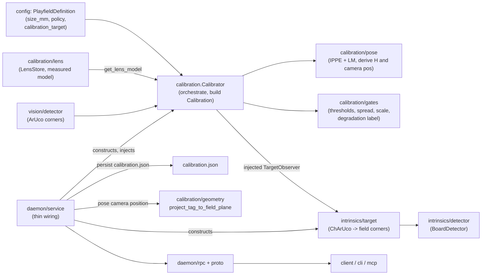
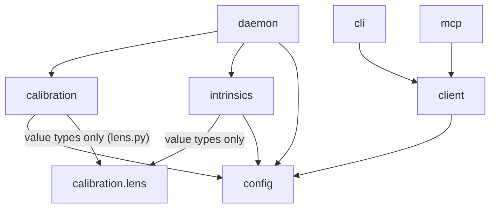
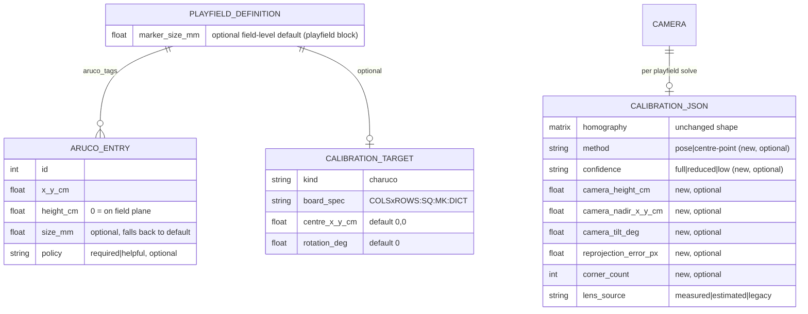

<!-- CLASI: Before changing code or making plans, review the SE process in CLAUDE.md -->

# Sprint 045: Pose-based playfield calibration from marker corners and the measured lens

## Goals

In priority order:

1. **Pose-based field solve.** Undistort every detected marker corner
   through the camera's measured lens model (`cameras/<slug>/intrinsics.json`,
   sprint 044), run a planar PnP (IPPE) over all corners of all matched
   markers, and derive from the pose both the homography the system already
   consumes (`Calibration.homography`, `to_world`/`to_pixel`, deskew: no
   downstream shape change) and the camera position over the field (height,
   nadir point, tilt), stored as provenance. Without a measured lens model,
   fall back to today's centre-point homography and say so in the result.
2. **Definition carries marker size and policy.** `aruco_tags` entries gain
   a printed `size_mm` (per entry, or the field-level `playfield.marker_size_mm`
   default; main field = 46 mm) and the definition states
   which markers are *required* vs *helpful*. Marker orientation is *detected* from the corner order, never declared.
   Honest gates replace a point count: corner reprojection error (px and cm),
   agreement between marker print size and surveyed spacing, minimum angular
   spread of used corners, and a per-marker leave-one-out residual that names
   a marker disagreeing with the rest.
   Degrade with a label (all markers best; two or more with a note; one
   marker = pose-only, low confidence). Definitions without size/policy keep
   today's behaviour.
3. **Delete the old estimator.** Remove `--with-intrinsics`,
   `estimate_intrinsics`, `_estimate_intrinsics`/`_fit_intrinsics` and their
   sanity bounds from CLI, MCP and daemon; the `estimated` lens source stays
   readable for old `calibration.json` files. Close as superseded:
   `estimate-intrinsics-crashes-with-exactly-six-ground-truth-points.md` and
   `later/coplanar-intrinsics-rejected-on-a-second-camera-reconsider-the-fx-plausibility-gate.md`.
4. **Parallax from the pose.** Mounted-tag parallax correction uses the
   pose-derived camera position instead of a separately supplied value; the
   camera-2 numbers (144 cm over nadir (3.47, -2.85); see
   `docs/knowledge/2026-09-04-secondary-playfield-resurvey-and-lens-model.md`)
   must be reproduced within tolerance.
5. **ChArUco board laid flat at the origin** as a calibration target for a
   marker-free field (reusing the sprint 044 detector); the definition names
   the board spec and its placement. Board-based and marker-based solves on
   the same camera agree within 0.5 cm.
6. **Stretch, only if time permits: staleness from evidence.** With a pose,
   the daemon watches any visible marker at low rate and flags
   `calibration_stale` on a bumped camera or moved table.

## Problem

Field calibration (UC-04 / UC-15) still solves a plane homography from one
point (the centre) per ArUco marker, requires every marker the definition
lists, and keeps the obsolete single-view `--with-intrinsics` estimator. Extra
markers existed to average out lens distortion the homography cannot model.
With a measured lens now available per camera, each marker's four corners give
a full planar pose, so fewer tags suffice and the calibrator is currently
discarding three quarters of its data.

## Solution

Pose-first calibration (undistort, PnP over all corners, derive homography and
camera position), driven by a richer definition schema (marker size,
required/helpful policy) with explicit, reported quality gates and graceful
degradation. The IPPE idea from `intrinsics/collector.py` is re-implemented in
a new `calibration/pose.py` (see Architecture, Decision 1). Terminology in
user-facing text: "lens model" (intrinsics) and "field calibration"
(extrinsics + field frame); `camera lens` may alias `camera intrinsics`.

## Success Criteria

Taken from the issue's acceptance list:

- Secondary field, four corner markers, camera 3 measured lens:
  `camera calibrate 3` uses 16 corners, reports corner reprojection error and
  both scales, passes the gate, names `lens model: measured` and the derived
  camera height/nadir.
- Two-marker definition calibrates with a warning; one-marker flagged low
  confidence; all-required definition fails as today when one is covered.
- ChArUco-at-origin calibration agrees with the marker-based solve to 0.5 cm.
- `--with-intrinsics` gone from CLI, MCP, daemon; old `estimated` files load.
- Camera-2 parallax numbers reproduced from the pose-derived position.
- Hardware-free tests on synthetic markers and boards; live runbook on
  cameras 2, 3, 4 at sprint close.

## Scope

### In Scope

Goals 1-5 above (the ChArUco-at-origin target is in scope as the final
priority), plus docs updates (calibration DESIGN.md, config DESIGN.md,
UC-04/UC-15, knowledge base) and the hardware-free test suite. Goal 6 is
stretch: ticket 014 is explicitly droppable; if dropped, record a follow-up
issue.

### Out of Scope

- Tag-free calibration from the table's own edges/lines/patches (explored in
  the issue; the option is recorded, not built).
- Changes to the intrinsics (lens-measurement) workflow from sprint 044.
- Anything downstream of `Calibration.homography` (its shape does not change).
- Using a non-`measured` lens (`estimated`/`legacy`) for the pose solve (see
  Decision 4).
- Pose from centre points only, for legacy definitions without `size_mm`.
- Elevated (`height_cm > 0`) markers in the pose solve (excluded, as they are
  from the homography today).

## Test Strategy

All automated tests are hardware-free. Synthetic frames are built by
projecting `cv2.aruco.generateImageMarker` markers (and the
`tests/aprilcam/intrinsics/boards.py` ChArUco renderer) through a known
camera matrix, distortion and pose, then fed through the real detector and
`Calibrator`; expected values (camera height, nadir, homography, reprojection
numbers) are known by construction. Layers:

- Pure-math unit tests for `calibration/pose.py` and `calibration/gates.py`
  (sign conventions: north-up, one y-flip, rotation direction; IPPE ambiguity;
  noise injection to calibrate gate thresholds).
- Loader/round-trip tests for the definition schema, including every shipping
  playfield file loading unchanged.
- Wire round-trip tests (proto <-> value types) for the additive fields,
  following sprint 044 tickets 006 and 010.
- `Calibrator` integration tests with fake frame sources and an injected
  lens lookup: 4-marker, 2-marker, 1-marker, required-missing, no-lens
  fallback, resolution-mismatch fallback, ChArUco target vs marker agreement
  (0.5 cm), camera-2 parallax numbers.
- `tests/test_no_cv2_in_client_modules.py` and `tests/test_usecases_index.py`
  stay green.
- Live checks on cameras 2, 3, 4 are not automated; they are ticket 013's
  runbook for the stakeholder.

## Architecture

**Sizing: Substantial** -- a calibration-engine rewrite touching 6+ modules
(`calibration`, `config`, `daemon`, `client`, `cli`, `mcp`, plus the proto
contract), a definition-schema change, a new cross-module edge
(`daemon` wiring a ChArUco target observer into `calibration` from
`intrinsics`), a parallax-input change, and a new wire/CLI/MCP surface. This
is above the compact tier on every concrete signal (module count, dependency
change, data-model change).

### Architecture Overview

What exists (post sprint 044): `Calibrator.calibrate` detects ArUco centres,
undistorts them with the lens (stored model or one carried forward), solves a
plane homography from centres, gates on RMS cm error, and optionally runs a
single-view intrinsics estimator. `camera_position` (nadir + height) is
operator-asserted config (`aprilcam camera locate`) read by
`DaemonService._camera_geometry_for` for parallax.

What this sprint changes, by module:

| Module | Responsibility after this sprint |
|---|---|
| `config` (loader + interfaces) | Definition schema: per-marker `size_mm` and `policy`; field-level `playfield.marker_size_mm` default (no orientation key); optional `calibration_target` (ChArUco spec + placement). Pure data + validation, cv2-free. |
| `calibration/pose.py` (new, cv2) | Planar pose solve: marker corner object points from the definition, per-marker in-plane rotation detected from the corner order, undistort, IPPE + LM refinement, ambiguity check, leave-one-out residuals; derives homography, camera position (height, nadir, tilt) and raw metrics. No policy. |
| `calibration/gates.py` (new, numpy only) | Pure decision logic: gate thresholds as named constants, angular spread, scale agreement, degradation label and notes from (matched set, policy, metrics). |
| `calibration/calibration.py` | `Calibrator` orchestrates: capture, detect corners, choose pose-vs-centre-point strategy, apply policy + gates, build `Calibration`. Loses the ~400-line estimator. |
| `calibration/interfaces.py` | `CalibrationResult`/`Calibration` gain additive method/confidence/pose/metric fields; intrinsics fields removed from the result. cv2-free. |
| `intrinsics/target.py` (new, cv2) | `ChArUcoTargetObserver`: wraps `BoardDetector`, maps ChArUco corner ids through the target placement to field-frame correspondences. |
| `daemon` (service/rpc) | Thin: injects the observer and lens lookup into `Calibrator`; `_camera_geometry_for` prefers the calibration's pose-derived camera position; surfaces new fields. |
| `client`, `cli`, `mcp` | Report the new numbers; `--with-intrinsics` / `estimate_intrinsics` removed; `camera lens` alias. |

### Dependency Graph

New edges: `intrinsics -> config` (the target observer reads the
`CalibrationTarget` value type). **Not** introduced: `calibration ->
intrinsics`. The observer is injected into `Calibrator` as a callable whose
signature is defined in `calibration/pose.py` in terms of `numpy` arrays and
`config.interfaces.CalibrationTarget`; `daemon` is the only place that knows
both sides, exactly as it already does for the lens store. No cycle:
`intrinsics` still depends on `calibration` only through the `lens.py` leaf.
`config -> calibration` does not exist. Fan-out of `Calibrator`: config,
vision, lens, pose, gates, geometry/distortion (5-6, each narrow; see review).

### Data Model

All new fields are optional/additive; absence reproduces today's behaviour
exactly.

### Key behaviours (module level)

- **Solve by pose.** For each matched marker with a known size: four
  field-frame corner positions = surveyed centre plus the marker's half-size
  offsets in the marker's own frame, in ArUco order TL, TR, BR, BL. **The
  marker's orientation is detected, not declared:** markers are printed and
  mounted at arbitrary 90-degree rotations (main field: 1, 2, 3 upright, 4
  about +90, 8 about -90, 5, 6, 7, 9, 10 upside down). Detected corners
  (multi-frame averaged, in the marker's own TL, TR, BR, BL order) are
  matched to the object points under each of the 4 possible 90-degree
  rotations of the marker's object points; the rotation with the smallest
  residual (against an approximate pose from the other markers or a
  homography seeded from the surveyed centres) is taken per marker, and the
  winner/runner-up residual ratio is recorded. The rotation is a derived
  value, reported per marker, never an input. IPPE on undistorted points gives the starting pose;
  Levenberg-Marquardt refines against the *raw* corners through the lens
  (so reported px error is honest, in pixels the camera actually produced).
  Output: rotation/translation of the field plane, from which
  `H = K [r1 r2 t]` inverted (undistorted-pixel -> field cm) is exactly the
  shape `Calibration.to_world` already consumes, and the camera centre
  `C = -R^T t` gives height (C_z), nadir (C_x, C_y) and tilt.
- **Policy** (`gates.py`): `required` ids missing -> failure naming them (as
  today). `helpful` missing -> note only. A definition with no `policy` on any
  entry treats every marker as required, so legacy behaviour is unchanged.
- **Degradation labels:** every listed marker matched -> `full`; >= 2 matched
  and all required present -> `reduced` plus a note; exactly 1 matched ->
  `low` ("pose-only, low confidence") and still stored; 0 or required missing
  -> failure.
- **Gates (all reported on success and failure):** corner reprojection RMS in
  px and in cm; **per-marker leave-one-out residual** (each marker's centre
  predicted by the pose fit to the *other* markers, in cm; the worst marker is
  named, so a misplaced or mis-surveyed marker is identified instead of
  failing with one aggregate number; N/A with fewer than 3 markers); scale agreement (per-marker camera distance from its own
  print size vs. distance implied by the global pose, median ratio, N/A with
  fewer than 2 markers); angular spread (max angle between viewing rays of any
  two used corners); IPPE ambiguity ratio. Thresholds are named constants in
  `gates.py` (defaults in Open Questions).
- **Fallback:** no `measured` lens at the frame size, or a definition without
  marker size -> today's centre-point homography, unchanged, with
  `method = centre-point` and a stated reason in the result.

### Design Rationale

**Decision 1 -- A new `calibration/pose.py`, not a shared helper extracted
from `intrinsics/collector.py`, and no cv2 calls inline in `Calibrator`.**
Context: the collector's `_pose` returns tilt/azimuth from a *guessed* K with
no undistortion or refinement, and lives on a private class; its only reusable
piece (`object_points`) is a ChArUco id -> lattice mapping. Alternatives: (a)
extract a shared pose helper into `intrinsics` and import it from
`calibration`; (b) the reverse, `intrinsics` imports a helper from
`calibration`; (c) inline cv2 in `Calibrator`. Why this: (a) creates a
`calibration -> intrinsics` edge that closes a package cycle with the existing
`intrinsics -> calibration.lens` edge; (b) makes the lens-measurement leaf
depend on the field engine; (c) bloats a 1,600-line module. The two solves
have different jobs (confident-tilt gating for coverage vs. metric camera
pose), so sharing code would couple them for ~20 lines of `solvePnPGeneric`.
Consequences: IPPE usage exists in two places; ticket 004 documents the
relationship, and the knowledge-base entry from sprint 044 stays the shared
reference.

**Decision 2 -- Derive the homography from the pose; do not change
`Calibration`'s shape.** Context: everything downstream (`to_world`,
`to_pixel`, deskew, flat-field mask, drift check) consumes
`Calibration.homography` over undistorted pixels. Why: zero downstream change;
the pose adds provenance fields next to it. Alternative (store the pose and
recompute H on load) rejected: two sources of truth for the same mapping.

**Decision 3 (revised 2026-10-16) -- Marker orientation is detected, never
declared; there is no `rotation_deg` in the marker schema.** Context: the
main field's markers are physically printed/mounted at mixed 90-degree
rotations (upright, +90, -90, upside down), so a per-field or default
rotation cannot be right and a per-marker declaration would be one more thing
to get wrong. Corner order from the detector is in the marker's own frame, so
the 4 candidate 90-degree rotations of the marker's object points are
exhaustively tried and the smallest-residual one wins. Alternatives: declare
`rotation_deg` (rejected: stakeholder fact above, plus manual upkeep);
infer from a single marker alone (the fit is still well posed for one marker
only if the 4 candidates give clearly different residuals -- the
winner/runner-up ratio is reported, and a poor ratio caps confidence at
`low`). Consequences: an unorientable marker degrades confidence rather than
silently biasing the pose; the chosen rotation per marker is reported.

**Decision 4 -- The pose path requires a `measured` lens at the frame size.**
Context: the `estimated` source is the non-physical fx/k1-ridge fit this
sprint deletes; `legacy` is that same data carried forward. Using either to
drive a metric pose would reintroduce the failure the sprint removes. Those
calibrations keep today's centre-point behaviour (the embedded lens still
applies to centres), with the reason stated.

**Decision 5 -- Pose-derived camera position outranks configured
`camera_position` for parallax when the calibration is fresh and
`method = pose`; the configured value is the fallback.** Context: the issue
says the pose "replaces that input". `camera locate` and the config block stay
(fallback for centre-point calibrations and for fields where it is the only
source). `_camera_geometry_for` stays a few lines; the preference rule lives on
`Calibration` as a method, not in the service.

**Decision 6 -- The ChArUco target observer is injected, not imported.**
Context: Decision 1's cycle argument. `Calibrator` receives
`target_observer: Callable[[np.ndarray, CalibrationTarget], Sequence[FieldCorner]]`
(field-frame corner correspondences); `intrinsics/target.py` implements it,
`daemon` wires it. Mirrors how `get_lens_model` already crosses the boundary.

**Decision 7 -- Gate decisions are pure functions in `gates.py`; thresholds
are constants.** Calibrating thresholds on synthetic noise (ticket 004/006)
then confirming live (ticket 013) is only possible if thresholds are one
edit away and the decision logic is testable without OpenCV.

### Migration Concerns

- Existing definitions (no `size_mm`, `marker_size_mm`, `policy`,
  `calibration_target`) load and behave identically (centre-point, all
  required). Every shipping playfield file is covered by a loader test.
- Existing `calibration.json` files load unchanged; new fields are optional
  and absent in old files. `estimated`/`legacy` lens sources remain readable.
- Proto: additive fields only; removed `estimate_intrinsics` (CalibrateRequest
  field 2) and CalibrationResult fields 6-8 are marked `reserved`, so an older
  client against a newer daemon (or reverse) degrades to defaults.
- Removal of `--with-intrinsics` / `estimate_intrinsics` is a deliberate
  breaking change to CLI/MCP/Python client surfaces; documented in ticket 008
  and the changelog-bearing docs.
- Regenerate protobuf with `uv run --extra dev python scripts/compile_proto.py`
  in every proto-touching ticket.
- Daemon restart not required for definition changes; recalibration is
  required to obtain pose provenance (surfaced as "method: centre-point" in
  `camera list` until then).

### Open Questions (planned defaults let the sprint proceed unanswered)

1. ~~Marker orientation on the physical fields.~~ **Resolved 2026-10-16:
   orientation is detected from the corner order (best of the 4 rotations by
   residual), never declared; `rotation_deg` is removed from the schema.**
2. **Marker size.** `size_mm` is the outer side of the black square
   (excluding the white margin), the OpenCV convention. **Resolved for the
   main field: 46 mm** (`playfield.marker_size_mm`, already in
   `main-playfield.json`). **Still open for the secondary field**; planned
   default: it stays on the centre-point path until a size is supplied.
3. **Gate thresholds.** Defaults: RMS corner error <= 1.5 px and <= 1.0 cm
   (the existing cm threshold); scale agreement within 5 %; angular spread >=
   10 degrees; IPPE ambiguity ratio >= 1.3 (borrowed from the collector), else
   confidence capped at `low`. Plus a per-marker leave-one-out gate (default: worst marker <= 2 cm,
   provisional; live reference: corrected main field 0.75 cm worst, 0.23 cm
   rms). Tuned on synthetic noise in tickets 004/006, confirmed live in 013.
4. **Pose vs configured `camera_position` precedence.** Default: pose wins
   when fresh; configured is the fallback (Decision 5). If both exist and
   differ by more than 5 cm, `camera locate` prints the comparison.
5. **Policy default for unspecified entries.** Default: `required`
   (backward compatible); authors opt entries into `helpful`.
6. **Non-measured lens.** Default: centre-point fallback (Decision 4).
7. **ChArUco placement convention.** Default: board centre at
   (`centre_x_cm`, `centre_y_cm`) = (0, 0), board upright (rotation 0 = its
   top edge toward north), lattice rows increasing southward.
8. **One-marker calibration storage.** Default: stored, labelled `low`, shown
   in `camera list`; consumers are not blocked but are told.
9. **Stretch ticket 014.** Default: attempt only after 013; drop (and file a
   follow-up issue) if the sprint is running long.

### Architecture Self-Review

**Verdict: APPROVE WITH CHANGES** (changes already applied below; gate
recorded `passed`).

- *Consistency:* module table, diagrams and rationale agree; the injected
  observer (Decision 6) is reflected in the dependency graph.
- *Codebase alignment:* read `calibrate()` (lines ~1187-1560), `_detect_averaged`
  (centre-only; must grow to corners), `Calibration.to_world` (undistort ->
  H, so H must be defined over `P = K` undistorted pixels, which
  `distortion.undistort_point` confirms), `CameraPosition`/
  `_camera_geometry_for` (config-only today), and the sprint 044 dependency
  graph. TagDetector already exposes `Detection.corners` (4x2) and defaults to
  subpixel corner refinement; ticket 003 verifies this survives
  `run_pipeline` rescaling.
- *Design quality:* `pose.py` (compute) and `gates.py` (decide) are separate
  single-purpose modules; `Calibrator` orchestrates. Coupling is narrow and
  acyclic. **Change applied:** the target observer is injected rather than
  imported to avoid a `calibration <-> intrinsics` package cycle.
- *Anti-patterns:* god component -- `calibration.py` is already ~1,600 lines;
  the plan removes ~400 (estimator) and puts all new logic in the two new
  modules rather than growing it. Shotgun surgery -- the wire fields touch
  proto, rpc, models, CLI, MCP; mitigated by the sprint 044 additive pattern
  and a single reporting ticket (007). Leaky abstraction risk -- thresholds
  must not leak into `Calibrator` (kept in `gates.py`). No speculative
  generality: tag-free calibration and centre-only pose for legacy
  definitions are explicitly out of scope. `DaemonService` gains only wiring
  plus a small preference lookup.
- *Risks:* (1) IPPE two-solution ambiguity with a near fronto-parallel camera
  and few markers -- gated and labelled; (2) marker-local scale is noisy for
  small markers -- 5 % default, tunable; (3) sign-convention errors (north-up,
  single y-flip, rotation direction) -- guilty until proven innocent, pinned
  by ticket 004 tests against known synthetic geometry; (4) removing
  `estimate_intrinsics` is breaking -- announced; (5) marker orientation is mixed on real fields -- resolved by detection
  (Decision 3), pinned by a four-rotation plus upside-down synthetic test.

## Revision 2026-10-16: marker size, detected orientation, per-marker gate

Stakeholder facts and an out-of-process check of the main playfield (camera
2: all ten ArUco markers plus the centre tag detected) changed the plan:

- Main-field marker size is 46 mm; the key is the field-level
  `playfield.marker_size_mm` (replaces the planned `default_marker_size_mm`);
  per-marker `size_mm` overrides it. Secondary size still unknown.
- Marker orientation is mixed (1, 2, 3 upright; 4 about +90; 8 about -90;
  5, 6, 7, 9, 10 upside down), so `rotation_deg` is removed from the schema
  and orientation is detected in the pose solve (Decision 3, Open Question 1).
- Ids 9 and 10 were physically swapped relative to the old definition; the
  definition is corrected. Worked example for a new per-marker leave-one-out
  gate: 30 cm rms before, 0.23 cm rms / 0.75 cm worst leave-one-out after.
- Acceptance on the main field is "at least as good as the centre-point
  solve" (0.23 cm rms with the camera-2 legacy lens), checked on cameras 2
  and 3 in ticket 013.
- Scoped re-review: the change is confined to `config` (one key removed, one
  renamed) and `pose.py`/`gates.py` (rotation detection, leave-one-out); no
  new module, dependency edge or diagram change. Verdict stays APPROVE WITH
  CHANGES.

Affected tickets: 001, 002, 003, 004, 006, 007, 012, 013 (010/011 unchanged:
the ChArUco `calibration_target` placement rotation is the board's, not a
marker's).

## Use Cases

### SUC-001: Calibrate a field by pose with a measured lens
Parent: UC-04, UC-15

- **Actor**: Operator / agent running `aprilcam camera calibrate`
- **Preconditions**: Camera linked to a playfield whose markers carry
  `size_mm`; a measured lens model installed at the current resolution.
- **Main Flow**:
  1. Operator calibrates the camera.
  2. Daemon averages marker corners over a burst, undistorts, solves the
     planar pose over all matched corners, and derives the homography and
     camera position.
  3. Gates are evaluated; the result and stored calibration carry every number.
- **Postconditions**: Calibration stored with `method: pose`, confidence, camera
  height/nadir/tilt, px and cm reprojection error, scale agreement, angular
  spread, and `lens model: measured`.
- **Acceptance Criteria**:
  - [ ] Four-marker secondary field uses 16 corners and passes the gate.
  - [ ] Main field (10 markers, mixed orientations, 46 mm): fits at least as
        well as the centre-point solve (rms within gate; derived world
        positions of the ten markers within 0.5 cm of the centre-point
        solve's; reference 0.23 cm rms).
  - [ ] CLI/MCP/`get_calibration` show all numbers.

### SUC-002: Author a definition with marker size and policy
Parent: UC-02

- **Actor**: Field author
- **Preconditions**: Surveyed field.
- **Main Flow**:
  1. Author adds `playfield.marker_size_mm` and/or per-entry `size_mm`, and
     `policy: required|helpful` (no orientation key: marker rotation is
     detected).
  2. Definition loads, round-trips, and pushes over the wire.
- **Postconditions**: Daemon holds the richer definition.
- **Acceptance Criteria**:
  - [ ] Invalid sizes/policies are rejected whole-document with a clear message.
  - [ ] Definitions without the new keys load identically; `load(x.to_dict()) == x`.

### SUC-003: Calibrate with fewer markers, honestly labelled
Parent: UC-04

- **Actor**: Operator
- **Preconditions**: Pose-capable setup (SUC-001); some markers covered.
- **Main Flow**:
  1. Calibrate with a subset visible.
  2. Policy and gates decide: helpful missing -> note; >= 2 markers -> `reduced`
     with a warning; 1 marker -> `low`; required missing -> failure naming ids.
- **Postconditions**: Previous calibration untouched on failure.
- **Acceptance Criteria**:
  - [ ] Two-marker diagonal calibrates with a warning.
  - [ ] One marker calibrates, flagged low confidence.
  - [ ] All-required definition fails exactly as today when one is covered.
  - [ ] A marker that disagrees with the rest is named by its leave-one-out
        residual (worked example: ids 9/10 swapped = 30 cm rms with the old
        definition, 0.23 cm rms and 0.75 cm worst leave-one-out with the
        corrected one).

### SUC-004: Explicit centre-point fallback
Parent: UC-04, UC-15

- **Actor**: Operator
- **Preconditions**: No measured lens at this resolution, or definition lacks
  `size_mm`.
- **Main Flow**: Calibrate; the calibrator uses today's centre-point homography
  and reports `method: centre-point` with the reason.
- **Postconditions**: Calibration equivalent to pre-sprint behaviour.
- **Acceptance Criteria**:
  - [ ] Result names method and reason on CLI/MCP.
  - [ ] Existing calibration tests pass unchanged.

### SUC-005: Parallax from the pose
Parent: UC-04 (the mounted-tag use case, if one exists, is named in ticket 012)

- **Actor**: Agent reading mounted-robot tag positions
- **Preconditions**: Fresh pose-based calibration; tag registered with `mount_z`.
- **Main Flow**: Detection projects the mounted tag to the floor using the
  pose-derived camera height and nadir; configured `camera_position` is used
  only when no pose exists.
- **Postconditions**: Camera-2 case reproduced: 144 cm over nadir (3.47, -2.85).
- **Acceptance Criteria**:
  - [ ] Synthetic camera-2 geometry recovered within tolerance.
  - [ ] Stale or centre-point calibration falls back to configured geometry.

### SUC-006: Calibrate from a ChArUco board laid at the origin
Parent: UC-04, UC-15

- **Actor**: Operator with a marker-free field
- **Preconditions**: Definition names `calibration_target` (board spec +
  placement); board placed flat as specified.
- **Main Flow**: Calibrate; the observer returns field-frame corner
  correspondences; the same pose solve runs; board is then removed.
- **Postconditions**: Calibration agrees with the marker-based solve on the
  same camera within 0.5 cm.
- **Acceptance Criteria**:
  - [ ] Synthetic board-vs-marker agreement <= 0.5 cm.
  - [ ] Missing/unreadable board fails with a clear reason.

### SUC-007: Estimator removed; old files still load
Parent: UC-04, UC-15

- **Actor**: Operator / maintainer
- **Main Flow**: `--with-intrinsics`, `estimate_intrinsics`, and the fit code
  are gone from CLI, MCP, client, daemon, proto; a `calibration.json` with an
  `estimated` lens loads and reports its source.
- **Acceptance Criteria**:
  - [ ] No reference to `estimate_intrinsics` remains in `src/`.
  - [ ] Superseded issues closed with a pointer to this sprint.

### SUC-008: Staleness from evidence (stretch)
Parent: UC-11

- **Actor**: Daemon (background)
- **Main Flow**: At low rate, visible known markers are re-solved against the
  stored pose; a disagreement beyond tolerance flips `calibration_stale`.
- **Acceptance Criteria**:
  - [ ] A synthetically shifted camera flips stale; an unchanged one does not.
  - [ ] Insufficient evidence never reads as "confirmed".

## GitHub Issues

(None.)

## Definition of Ready

Before tickets can be created, all of the following must be true:

- [x] Sprint planning document is complete (sprint.md, including its
      Architecture and Use Cases sections)
- [x] Architecture review passed (or skipped, for changes with no
      architectural impact)
- [ ] Stakeholder has approved the sprint plan

## Tickets

| # | Title | Depends On |
|---|-------|------------|
| 001 | Definition schema: marker size and required/helpful policy | - |
| 002 | Definition schema on the wire: proto, rpc and client models | 001 |
| 003 | Marker corner detection and multi-frame averaging in the Calibrator | 001 |
| 004 | Planar pose solve and gates: calibration/pose.py and gates.py | 001, 003 |
| 005 | Pose provenance on Calibration and CalibrationResult: types, persistence and wire fields | 004 |
| 006 | Calibrator pose path: strategy, policy, gates, degradation and centre-point fallback | 003, 004, 005 |
| 007 | Report the pose numbers: CLI, MCP, camera list and the camera lens alias | 006 |
| 008 | Delete the single-view intrinsics estimator and --with-intrinsics | 007 |
| 009 | Parallax from the pose-derived camera position | 005, 006 |
| 010 | Calibration target schema: ChArUco spec and placement in the definition, loader and wire | 002 |
| 011 | ChArUco target observer and Calibrator target path | 006, 010 |
| 012 | Documentation: calibration and config DESIGN.md, use cases and knowledge base | 001-011 |
| 013 | Live acceptance runbook on cameras 2, 3 and 4 | 012 |
| 014 | Optional (droppable): calibration staleness from evidence | 006, 009 |

Tickets execute serially in the order listed.
