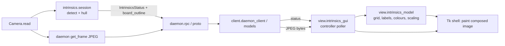

<!-- CLASI: Before changing code or making plans, review the SE process in CLAUDE.md -->

# Sprint 046: Intrinsics GUI shows the live camera image with a labelled coverage grid

## Goals

Make `aprilcam camera lens` readable as a picture of the room instead of an
abstract set of tiles: each camera column shows that camera's live image, a
labelled 3x3 coverage grid is drawn on the image, the detected board outline
follows the board, and cells tint as coverage is reached.

## Problem

After first use of the fullscreen lens GUI (stakeholder, 2026-10-16), the 3x3
coverage tiles are abstract. With several cameras it is hard to tell which
column is which camera, and "northeast" versus "southwest" is hard to map onto
the real room when a camera is mounted rotated. The operator also cannot see
whether the board is being seen at all, or where.

## Solution

* Daemon: the intrinsics status gains an additive optional `board_outline`
  (one convex polygon per board seen in the latest frame, native pixels). The
  session already runs the detector each frame; it publishes the hull of the
  corners the detector already produced. Carried over proto, gRPC converters,
  client model and the MCP status dict.
* View model (pure, `view/intrinsics_model.py`): grid geometry from image size
  using the collector's outer-40 % band fractions, compass labels in
  `cell_coverage` order, cell fill rule shared with the tiles, and outline
  scaling into a column rectangle.
* GUI: the poller thread also fetches `get_frame(camera)` JPEGs at about 4-5
  fps, decodes with Pillow, and composes the overlay (grid, labels, outline,
  tint) with `ImageDraw` before display, aspect-preserved in the column. A
  failed fetch keeps the last image, dimmed. Tilt tiles move next to the image.

## Success Criteria

* `aprilcam camera lens 2 4` shows two columns, each with its live image, a
  labelled grid on the image, and the board outline following the board.
* A cell tints green exactly when its tile would be green today.
* View-acceptance rate with the image on is not noticeably different from off
  (measured in the live check).
* `view/` and `client/` remain cv2-free; the no-cv2 test passes.
* Hardware-free tests cover geometry, labels, colours, outline scaling,
  overlay composition and the status round trip.

## Scope

### In Scope

* `board_outline` on `IntrinsicsStatus` (interfaces, session, proto, rpc,
  client models, MCP status dict) with tests.
* Pure view-model additions and tests.
* GUI live image, overlay, dimmed-on-failure, relocated tilt tiles, tests on a
  synthetic PIL image.
* Docs (`view/DESIGN.md`, `intrinsics/DESIGN.md`, knowledge runbook note) and a
  stakeholder live-check note.

### Out of Scope

* Any change to collection thresholds, solver, or the `--no-gui` text mode.
* Daemon-side image rendering (overlay is composed in the client).
* Streaming transport for the image (plain `get_frame` polling only).
* Per-marker (as opposed to per-board hull) outlines.

## Test Strategy

Hardware-free and display-free throughout. Round-trip tests for the status
field (session -> proto -> client -> MCP dict) in the style of sprint 044
ticket 006; pure-function tests for the view model; GUI tests drive
`IntrinsicsController.step()` with a fake daemon returning synthetic JPEG
bytes and compose overlays on a synthetic PIL image, never opening Tk. A
parity test (test code may import cv2-bearing modules) asserts the view
model's band fraction equals the collector's `EDGE_FRACTION`. The existing
`tests/test_no_cv2_in_client_modules.py` gates the client side. The live
frame-rate comparison is a stakeholder step, not an automated test.

## Architecture

**Sizing: Substantial** — a status data-model change (one additive field)
crossing five modules (intrinsics session/interfaces, proto, daemon rpc,
client models, MCP tools) plus the view model and GUI, i.e. more than three
modules and a changed cross-module contract. It is not a new subsystem: no new
module is created and no dependency direction changes, so the design is
deliberately small and the diagram below is the only one needed (no ERD: one
optional field; no dependency graph: edges are unchanged).

### Architecture Overview

What each touched module does, one sentence each:

* `intrinsics.interfaces` / `intrinsics.session` — the status record gains
  `board_outline`; the session fills it from the detections it already makes.
* `proto` + `daemon.rpc` + `client.models` — carry the field over the wire
  (additive; no `PROTOCOL_VERSION` bump).
* `mcp.tools.intrinsics` — includes the outline in the status dict.
* `view.intrinsics_model` — pure geometry/colour/scaling decisions.
* `view.intrinsics_gui` — fetches frames, composes the overlay, paints.

### What Changed

1. **`board_outline` on `IntrinsicsStatus`**: `Optional[tuple[tuple[tuple[float, float], ...], ...]]`
   — a tuple of polygons, each of 3+ `(x, y)` native-pixel points (the convex
   hull of one board's detected ChArUco corners, so a polygon needs at least
   three non-collinear corners; the detector already requires `min_corners`).
   `None`/empty means no board in the latest frame. It is set every capture
   step, including to empty when the board leaves, so the outline never goes
   stale. `image_size` (already present) is the coordinate frame. The hull
   helper lives daemon-side (session imports cv2 already), keeping the daemon
   change thin: the session publishes what the detector produced.
2. **Wire form**: `message IntrinsicsPolygon { repeated double xy = 1; }` and
   `repeated IntrinsicsPolygon board_outline = 23;` in `IntrinsicsStatus`
   (flat x0,y0,x1,y1,...). Empty repeated decodes to `None`. Converters in
   `daemon/rpc.py` and `client/models.py` mirror each other; regenerate
   `*_pb2.py` with `scripts/compile_proto.py`.
3. **MCP**: `_status_to_dict` adds `board_outline` as nested lists.
4. **Grid geometry (pure)**: `grid_rects(width, height)` returns nine
   rectangles in `CELL_ORDER` (NW..SE) using band fractions 0.4 / 0.2 / 0.4 on
   each axis, the same split `collector._region_index` uses. Labels are the
   existing `CELL_ORDER` names. The fraction is a display copy in the view
   model (the client must not import the cv2-bearing collector), guarded by a
   parity test against `collector.EDGE_FRACTION`.
5. **Cell fill (pure)**: the overlay reuses `_level()` (`none`/`some`/`good`,
   covered = 2+) and `TileState.level`, with a new translucent-tint colour
   table keyed on the same level, so tint and tile cannot disagree (they come
   from the same `TileState`).
6. **Outline scaling (pure)**: `scale_polygons(polys, image_size, dest_rect)`
   maps native pixels into the drawn image rectangle (letterbox-aware, using
   the viewer's `_fit_size` rule for the image rectangle itself).
7. **GUI**: the controller poller fetches `get_frame(cam)` (JPEG) at most every
   ~0.22 s per camera (rate-limited independently of the 0.33 s status poll),
   keeps the latest bytes (or the decoded image) per camera in the same
   lock-protected slot as statuses, and the UI thread composes: decode with
   Pillow, `_fit_size` into the column area, draw grid lines, compass labels,
   cell tints (alpha), the outline and reject note with `ImageDraw`, convert
   with `ImageTk`. Composition is a pure function of
   `(jpeg_bytes_or_image, CameraViewModel, board_outline, image_size, dest_size, dimmed)`
   returning a PIL image so it is testable without Tk.

### Why

The status record is already the single source for every renderer (sprint 044
Decision 6), so the outline belongs on it rather than on a side channel. The
image comes through the existing `get_frame` path because the client must stay
cv2-free and the daemon already arbitrates `Camera.read()` between the session
(8 fps cap) and RPC readers.

### Impact on Existing Components

* `IntrinsicsStatus` consumers that ignore the new field are unaffected (an
  optional field defaulting to `None`); old daemons yield `None` and the GUI
  simply draws no outline; old clients ignore the unknown proto field.
* The daemon serves roughly 4-5 extra `get_frame` JPEG encodes per second per
  camera. This is the one real risk; it is measured in the live check rather
  than assumed benign.
* Tilt tiles move; the text-mode view model lines are untouched.
* `view/` and `client/` keep zero cv2 imports (Pillow only).

### Design Rationale

**Decision 1: outline is a convex hull of detected corners, computed in the
session.** Context: the detector returns corner lists per board cluster, not a
polygon. Alternatives: send raw corners (large, noisy for drawing) or compute
the hull in the GUI (needs hull code client-side; cv2 forbidden, numpy-only
hull is extra code). Chosen: hull daemon-side, a few points on the wire.
Consequence: a board seen with concave partial detection is drawn convex —
acceptable for "where is the board".

**Decision 2: overlay composed client-side with PIL, not daemon-drawn.**
Alternatives: daemon renders an annotated JPEG (violates "thin daemon change",
couples GUI layout to the daemon, forks the `get_frame` contract); Tk canvas
items over a PhotoImage (works, but not unit-testable without a display).
Chosen: `ImageDraw` composition as a pure function, then one `ImageTk` paint.

**Decision 3: frame polling is rate-limited inside the existing poller thread**
rather than a second thread, preserving the single-slot snapshot pattern;
status polling stays at its current cadence so the banner and error numbers
never wait behind an image fetch. If a fetch is slow, the status poll slips by
at most that fetch (mitigation: fetch frames after the status poll within the
same step, with a short per-call time budget; revisit with a second thread only
if the live check shows lag).

**Decision 4: failure shows the last image dimmed** (composition takes a
`dimmed` flag that blends toward the background), together with the existing
connection banner.

### Migration Concerns

None. Additive proto field (number 23, new message `IntrinsicsPolygon`); no
version bump; mixed old/new client and daemon degrade to "no outline".

### Open Questions

None blocking. The achievable image fps through `get_frame` over a remote
daemon is untested; the live check records it.

### Self-review (architecture_review gate)

* **Consistency**: Changes list, diagram and rationale agree; field name,
  field number and wire shape are stated once and reused.
* **Codebase alignment**: verified against code — `_region_index` bands
  (0.4/0.2/0.4), `BoardDetection.corners` in native pixels, the session's
  `_update(...)` snapshot swap (the outline is one more kwarg in the existing
  per-step `_update`), `_intrinsics_status_to_proto` / `intrinsics_status_from_proto`
  mirrored converters, the status dict in `mcp/tools/intrinsics.py`, `_fit_size`
  and Pillow decode in `view/viewer.py`, `_level()`/`tile_colour` in the model.
* **Design quality**: each touched module keeps one reason to change; the
  geometry decision lives in the pure model, painting in the shell; no new
  dependency edges; no cycles. A duplicated band-fraction constant is the one
  smell; it is the existing display-copy convention, with a parity test.
* **Anti-patterns**: no god component (composition is a separate pure
  function, not grown inside `_TkShell`); no shared mutable state beyond the
  controller's existing lock-protected slot.
* **Risks**: extra daemon JPEG encodes (measured in live check); remote-daemon
  bandwidth; old/new version skew (degrades gracefully).
* **Verdict: APPROVE.**

## Use Cases

### SUC-001: See the board where it is being seen
Parent: UC (intrinsics workflow, sprint 044)

- **Actor**: Operator running `aprilcam camera lens`
- **Preconditions**: Daemon running; an intrinsics session active per camera.
- **Main Flow**:
  1. Operator holds the board in front of a camera.
  2. Daemon session detects the board and publishes its outline in status.
  3. GUI draws the outline on that camera's live image; when the board leaves
     view the outline disappears; the last reject reason (moving / blurry /
     not novel) is shown alongside.
- **Postconditions**: Operator can tell at a glance whether and where the
  board is seen.
- **Acceptance Criteria**:
  - [ ] Status carries `board_outline` end to end (session, wire, client, MCP).
  - [ ] Outline follows the board on the image and clears when it is gone.

### SUC-002: Map coverage cells onto the real room
Parent: UC (intrinsics workflow, sprint 044)

- **Actor**: Operator with several, possibly rotated, cameras
- **Preconditions**: As SUC-001.
- **Main Flow**:
  1. Each camera column shows that camera's live image.
  2. A 3x3 grid with NW..SE labels is drawn on the image using the collector's
     outer-40 % band geometry.
  3. A cell tints green when its count reaches the covered threshold, with the
     intermediate colour for partial coverage, matching the tiles.
- **Postconditions**: Operator knows which part of which image still needs the
  board.
- **Acceptance Criteria**:
  - [ ] Grid and labels readable from ~10 feet.
  - [ ] Cells go green exactly when the corresponding tile would.
  - [ ] Tilt tiles remain, next to the image.

### SUC-003: Keep working through a flaky frame feed
Parent: UC (intrinsics workflow, sprint 044)

- **Actor**: Operator
- **Preconditions**: As SUC-001.
- **Main Flow**:
  1. A frame fetch fails or the connection drops.
  2. GUI keeps the last image, dimmed, plus the existing error banner; the
     session and status polling continue.
- **Postconditions**: No crash, no blank column; recovers when frames resume.
- **Acceptance Criteria**:
  - [ ] Dimmed last image on fetch failure; undimmed on recovery.
  - [ ] Existing behaviour unchanged: banner, error lines, NEXT, Enter/Esc,
        never auto-quits, `--no-gui` untouched.

## GitHub Issues

(None.)

## Definition of Ready

Before tickets can be created, all of the following must be true:

- [x] Sprint planning document is complete (sprint.md, including its
      Architecture and Use Cases sections)
- [x] Architecture review passed (or skipped, for changes with no
      architectural impact)
- [ ] Stakeholder has approved the sprint plan

## Tickets

| # | Title | Depends On |
|---|-------|------------|
| 001 | Daemon and wire: board_outline on IntrinsicsStatus | - |
| 002 | View model: grid geometry, labels, cell tints and outline scaling | 001 |
| 003 | GUI: live image per column with grid, labels, outline and tint | 001, 002 |
| 004 | Docs and live-check note for the image-based lens GUI | 003 |
