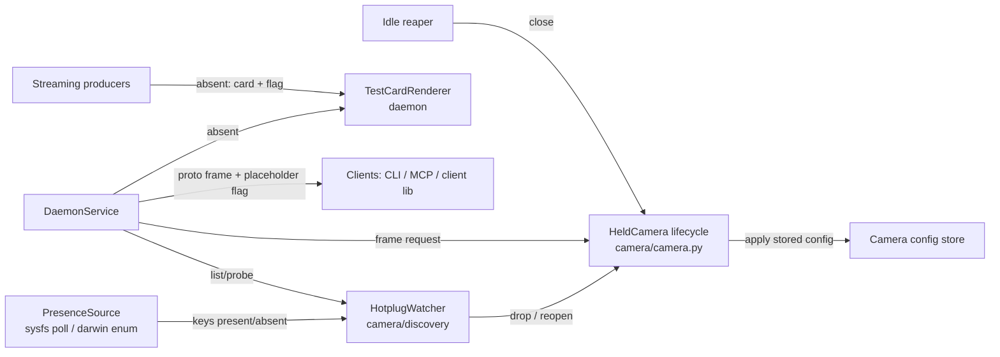

<!-- CLASI: Before changing code or making plans, review the SE process in CLAUDE.md -->

# Sprint 047: Camera hotplug robustness: drop/reopen, rescan on plug, test-card placeholder

## Goals

Make camera hotplug rock solid on Linux UVC hosts (buzzkill, donald;
OpenCVBackend, no heartbeat) and macOS (gala; WorkerBackend). Plug and
unplug drive rescans automatically; a client talks to a camera's
interface (stream), never the device, so the daemon may drop and reopen
the device at any time; "in use" means a live stream subscriber or an
in-flight read. While a camera is gone, frame consumers get a flagged
test-card placeholder, and real frames resume when it returns.

## Problem

Observed 2026-11-01: after unplugging, `camera list` reports the camera
present indefinitely; after re-plug on a new /dev/videoN, frames fail
until a daemon restart; `camera probe` skips the camera as "in use"
because the held-camera cache is mistaken for a subscriber table.
Held-camera presence is never re-checked, check_stall is inert on Linux,
and missing frames yield INTERNAL errors or silence. On macOS, cameras
plugged in after start are invisible (enumeration from worker threads
never sees main-run-loop AVFoundation notifications). Cameras can't be
closed without restarting the daemon. (Code map with file:line refs is
in the primary issue.)

## Solution

1. Separate device from subscription: held-camera cache is not "in use";
   probe verifies presence without disturbing live streams (UC-25.S-7).
2. Watch covers held cameras: key disappears -> close device, mark
   absent; key reappears (any node) -> reopen, re-apply stored config,
   resume. Evaluate a Linux udev/netlink event source vs the 2 s poll
   (decide on hardware evidence, see open questions); on darwin pump the
   main run loop / enumerate on main thread.
3. Test card: daemon renders (OpenCV is daemon-only) a generated card at
   the camera's configured frame size: bullseye rings, resolution
   wedges, gray-scale steps, camera number/name, "NO SIGNAL"; no
   caricature head. get_frame, playfield image and image streams return
   it with a placeholder flag in response metadata; tag streams send
   heartbeats with an explicit "camera absent" status.
4. Honest `camera list` within ~2 s of plug/unplug.
5. Idle-timeout release of subscriber-less devices plus explicit
   `close_camera` RPC and `aprilcam camera close` (refuse if subscribed
   unless --force).

Use cases: UC-25 S-3 (names survive re-plug), S-5 (hotplug needs no
probe), S-7 (probe during live stream); detail phase will add SUCs for
test-card and close.

## Success Criteria

On Linux UVC and macOS: with `camera view N` or a tag stream running,
unplug N -> within ~2 s `camera list` shows it absent and the viewer
shows the test card; re-plug into any port -> within ~2 s real frames
resume in the same viewer with stored exposure applied, no restart, no
probe. `camera image N` while unplugged returns the flagged test card,
not an INTERNAL error. Verified on real hardware on both OS families.

## Scope

### In Scope

- Held-camera vs subscriber separation; probe no longer skips on cache.
- Watch/rescan of held cameras; close on unplug; reopen + config
  re-apply on return (including index re-resolution via index_resolver).
- Linux event source evaluation/implementation (udev) or justified
  poll-only; macOS main-run-loop enumeration fix.
- Test-card renderer in the daemon; placeholder flag in frame response
  metadata (proto + clients: CLI, MCP, view surface it); tag-stream
  "camera absent" heartbeat status.
- close_camera RPC, `camera close` CLI, idle timeout.
- Update camera/DESIGN.md and daemon/DESIGN.md (remove "no OS hotplug
  event source"), UC-25 coverage, docs/knowledge entry.
- Interfaces follow repo rules: no typing.Protocol; behavioral bases
  raise NotImplementedError; value types frozen kw_only dataclasses.

### Out of Scope

- A caricature/Indian-head image; animated or audio test cards.
- libcamera/Raspberry Pi event sources (UC-25.S-6 still needs probe).
- Network-camera or non-UVC hotplug.
- Making tag detection or calibration state survive a camera swap beyond
  re-applying stored camera config.
- Porting v1 code wholesale (ideas only).

## Test Strategy

- Unit tests with fake backends and a fake presence source: lifecycle
  transitions (present -> absent -> reopening -> present), full config
  re-apply order on reopen, probe-vs-held-cache behaviour, idle-close
  timing (injected clock), close/--force semantics.
- Test-card renderer: size/caching, label content, determinism, non-trivial
  pixel structure, size fallback chain.
- Proto/service tests: placeholder flag set on get_frame, playfield image,
  image stream and tag-stream absent heartbeat; unset on real frames.
- Client tests: CLI exit/warn behaviour, MCP and client-library surfacing.
- Hardware (marked, Linux only, buzzkill/donald): `scripts/` acceptance
  script runs a viewer/stream across sysfs unbind/bind and asserts absent
  within ~2 s, flagged test card, real frames at configured size within
  ~3 s of bind, config applied, no restart. Hard gate.
- macOS: manual stakeholder verification (non-blocking).
- Scoped test runs per ticket; full suite once at close_sprint.

## Architecture

**Sizing: Substantial** -- touches 3+ modules (camera lifecycle,
discovery, daemon service/streaming, proto, CLI/MCP/client), adds new
cross-module dependencies (service consumes a presence source and a
test-card renderer) and changes the wire protocol.

Hardware spike (buzzkill, 2026-11-01, sysfs unbind/bind of a held camera)
is the evidence base: `camera list` stayed present 9+ s after unbind;
V4L2 `read()` fails fast (0.28 s) and `isOpened()` stays true; after bind
the device returned on a new node and the 5th failed read self-healed, but
reopen came up at 640x480 with NO stored config re-applied (config pins
1280x800 + manual exposure), silently breaking playfield warps; the 15 s
control watchdog logged drift/re-assert errors every tick while absent.

### Architecture Overview

- **PresenceSource** (camera/discovery): reports which camera keys are
  enumerated right now. Linux polls `/sys/class/video4linux` at 0.5 s;
  darwin enumerates on the main run loop. Behavioural base raising
  NotImplementedError.
- **HotplugWatcher** (existing `watch()`, extended): diffs presence,
  including held cameras, and emits appeared/disappeared events. Probe
  stays the deep open-and-identify scan; the watcher is the cheap
  authority on presence.
- **HeldCamera lifecycle** (camera/camera.py): states PRESENT, ABSENT,
  CLOSED. Drop closes the device -> ABSENT; reappear reopens, re-resolves
  the index, re-applies the FULL stored config (frame size first, then
  gated controls in order). Watchdog and stall checks skip non-PRESENT.
- **TestCardRenderer** (new, daemon-only): card for (size, number, name),
  cached per size; size chain: configured, last-opened, 1280x720.
- **DaemonService / streaming**: device cache is not a subscriber table;
  in-use = live subscriber or in-flight read. Absent/reopening frame paths
  return the card with the placeholder flag; tag streams send a
  camera-absent heartbeat. Idle reaper closes subscriber-less devices
  (never while a stream/detection loop is active); `CloseCamera` RPC.
- **Proto / clients**: `placeholder` bool on frame responses and image
  stream messages, absent status on tag heartbeats, `CloseCamera` RPC;
  CLI, MCP and client library surface the flag.

Dependency direction: clients -> service -> camera lifecycle ->
presence source/backends; the renderer is a leaf. No cycles; service
fan-out 4 (lifecycle, watcher, renderer, config store).

### What Changed

New: PresenceSource impls, TestCardRenderer, lifecycle states and
drop/reopen on HeldCamera, idle reaper, CloseCamera RPC, placeholder
proto fields. Changed: watch() covers held cameras; probe no longer skips
cached cameras; list presence derives from enumeration; reopen applies
stored config; get_frame/playfield/streams serve the card instead of
raising or going silent.

### Why

The device is an implementation detail: clients get a stream that
survives unplug/replug with an honest, flagged placeholder in the gap.

### Impact on Existing Components

camera/camera.py, camera/discovery.py, daemon/service.py, streaming.py,
proto + stubs, CLI camera/playfield commands, MCP tools, client library,
DESIGN docs. Proto changes are additive, so old clients ignore the flag.

### Design Rationale

**Linux presence via 0.5 s sysfs poll, not udev/netlink.** Alternatives:
pyudev (new dependency), raw netlink (more code, permission/container
quirks). A directory listing every 0.5 s is negligible, needs no
dependency, and meets the 2 s budget with 4x margin. A netlink
PresenceSource can replace it later behind the same base class.

**Enumeration, not read failures, signals unplug.** Spike: reads fail
fast, `isOpened()` stays true, and failure counting races the 5-read
self-heal. Self-heal remains as a fallback only.

**Full-config re-apply on every reopen.** Spike: reopen at 640x480
invalidated calibrations silently.

**Placeholder flag in the proto, not an out-of-band error.** Consumers
that cannot tell a card from a frame would run detection on it.

### Migration Concerns

Additive proto change; regenerate stubs. Mixed versions degrade
gracefully (unset flag reads false). New idle-timeout (default 60 s)
changes behaviour: idle devices close and reopen on next use. No data
migration.

### Open Questions

- `camera image` on a placeholder: plan writes the card file, prints a
  stderr warning and exits non-zero (code 3); stakeholder may prefer
  warn-only. Documented in the CLI ticket.
- macOS: main run-loop pump vs main-thread enumeration is decided in the
  macOS ticket based on the daemon's thread layout.

### Architecture Self-Review

Consistency: PASS. Codebase alignment: issue code map matches; the
reopen config gap is covered (ticket 001). Design quality: modules pass
the one-sentence cohesion test; renderer is a leaf; no cycles.
Anti-patterns: DaemonService is already large (god-component risk) --
keep additions thin, logic in lifecycle/watcher/renderer; proto changes
isolated to tickets 005/006. Risks: reaper/stream race (tested); mixed
versions (additive); macOS unverifiable in CI (manual).
Verdict: **APPROVE WITH CHANGES** (thin DaemonService additions).

## Use Cases

### SUC-001: Unplugged camera becomes honestly absent
Parent: UC-25 (S-7)

- **Actor**: Operator / agent
- **Preconditions**: Camera N held; a viewer or stream running.
- **Main Flow**:
  1. Camera N is unplugged.
  2. Within ~2 s the daemon closes the device and marks it absent.
  3. `camera list` shows N absent; no probe needed.
- **Postconditions**: No watchdog errors while absent.
- **Acceptance Criteria**:
  - [ ] Absent within ~2 s on Linux (unbind) without any read.
  - [ ] No watchdog drift/re-assert errors while absent.

### SUC-002: Replugged camera resumes with stored config
Parent: UC-25 (S-3, S-5)

- **Actor**: Operator
- **Preconditions**: Camera N absent; stored config pins size/exposure.
- **Main Flow**:
  1. Camera is plugged into any port (new node).
  2. Daemon reopens, re-resolves the index, applies full config.
  3. The same viewer receives real frames.
- **Postconditions**: Frame size equals configured size; exposure applied.
- **Acceptance Criteria**:
  - [ ] Real frames within ~3 s of bind at configured size.
  - [ ] Frame size applied before gated controls; no restart.

### SUC-003: Probe is safe during a live stream
Parent: UC-25 (S-7)

- **Actor**: Operator
- **Preconditions**: Camera held with a live subscriber.
- **Main Flow**: Run probe; presence comes from enumeration; the stream
  is undisturbed; cached-but-idle cameras are not skipped.
- **Postconditions**: Stream continues.
- **Acceptance Criteria**:
  - [ ] Probe never skips a camera merely because it is cached.
  - [ ] A streaming device is not reopened by probe.

### SUC-004: Frame consumers get a flagged test card while absent
Parent: UC-25

- **Actor**: Agent / CLI user
- **Preconditions**: Camera N absent or reopening.
- **Main Flow**: get_frame / playfield image / image stream returns an
  RCA-style card with camera number/name and "NO SIGNAL", flagged as
  placeholder; tag streams send "camera absent" heartbeats.
- **Postconditions**: Real frames resume automatically on return.
- **Acceptance Criteria**:
  - [ ] No INTERNAL error; flag true on card, false on real frames.
  - [ ] Card size: configured, else last-opened, else 1280x720.
  - [ ] CLI, MCP and client library surface the flag.

### SUC-005: Close a camera without restarting the daemon
Parent: UC-25

- **Actor**: Operator
- **Preconditions**: Camera held.
- **Main Flow**: `aprilcam camera close N` releases the device (refused
  while subscribed unless --force); idle devices release after 60 s; next
  use reopens transparently.
- **Postconditions**: Device released; camera still listed.
- **Acceptance Criteria**:
  - [ ] Idle close never happens while a stream/detection loop is active.
  - [ ] Closed camera reopens on next request with full config.

### SUC-006: macOS sees cameras plugged in after daemon start
Parent: UC-25 (S-5)

- **Actor**: Operator on gala
- **Preconditions**: Daemon running.
- **Main Flow**: Plug a camera after daemon start; it appears in
  `camera list` without restart.
- **Postconditions**: Camera usable.
- **Acceptance Criteria**:
  - [ ] Verified manually by the stakeholder (non-blocking).

## GitHub Issues

(GitHub issues linked to this sprint's tickets. Format: `owner/repo#N`.)

## Definition of Ready

Before tickets can be created, all of the following must be true:

- [ ] Sprint planning document is complete (sprint.md, including its
      Architecture and Use Cases sections)
- [ ] Architecture review passed (or skipped, for changes with no
      architectural impact)
- [ ] Stakeholder has approved the sprint plan

## Tickets

| # | Title | Depends On |
|---|-------|------------|
| 001 | Camera lifecycle states and full-config re-apply on reopen | - |
| 002 | Presence watch covers held cameras (Linux sysfs source, drop and reopen) | 001 |
| 003 | Honest list and probe: device cache is not a subscriber table | 002 |
| 004 | Test-card renderer | - |
| 005 | Proto placeholder flag; serve test card on frames and streams | 002, 004 |
| 006 | Surface placeholder flag in CLI, MCP tools and client library | 005 |
| 007 | Idle close, close_camera RPC and camera close CLI | 003 |
| 008 | macOS enumeration sees cameras plugged in after start | 002 |
| 009 | Linux hardware acceptance script (unbind/bind) | 006, 007 |
| 010 | Docs: DESIGN updates, UC-25 coverage, knowledge entry | 008, 009 |

Tickets execute serially in the order listed.
