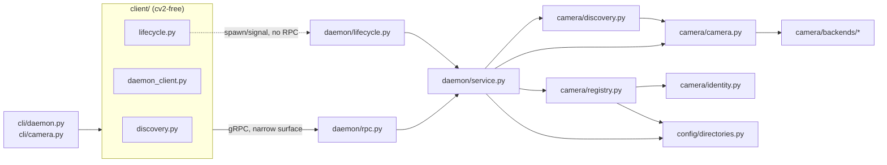

<!-- CLASI: Before changing code or making plans, review the SE process in CLAUDE.md -->

# Sprint 020: Daemon bring-up with basic camera CLI

## Goals

Stand up the v2 daemon and CLI **together** — the first v2 implementation
sprint, per the build-order revision in `docs/design/development-plan.md`
(2026-07-31, vertical slices). The sprint ends with something a person
can run from the shell on this Mac: a daemon that starts, enumerates its
cameras with stable identity, probes hardware deeply on demand, and
serves one raw frame per request — driven entirely through
`aprilcam daemon` / `aprilcam camera` subcommands.

## Problem

Today `src/aprilcam/` holds only interface skeletons
(`daemon/interfaces.py`, `camera/interfaces.py`, `client/interfaces.py`,
`config/interfaces.py`, `types.py`, `errors.py`) verified sufficient by
the interface-sufficiency traces, and `archive/src/aprilcam/` holds the
v1 implementation those skeletons were abstracted from. Nothing
implements the skeletons yet, and there is no CLI. A developer bringing
up the field on this Mac (cameras `arducam-ov9782-usb-camera`,
`hd-usb-camera`) cannot start a daemon, list a camera, or pull a frame.

## Solution

Convert the relevant v1 code from `archive/src/aprilcam/` — daemon
lifecycle (`daemon/server.py`), camera identity and the persistent
registry (`camera/identity.py`, `camera/registry.py`,
`camera/camutil.py`), and capture backends (`camera/video_camera.py`,
`daemon/v4l2_reader.py`, `camera/libcam.py`, `camera/screencap.py`) —
into implementations of the already-designed Protocols in
`src/aprilcam/{daemon,camera,client,config}/interfaces.py`. Layer a
minimal gRPC control plane over it (see Architecture — Decision 1) for
the narrow RPC surface this sprint needs: camera list/probe,
get_camera_config (introspection only, no push loop this sprint), one-shot
`get_frame`, and `status`. Build thin CLI subcommands
(`aprilcam daemon start|stop|status`, `aprilcam camera list|probe|image`)
over a minimum client library (`Discovery.connect`,
`DaemonLifecycle` for local start/stop, `Daemon.list_cameras` /
`probe_cameras` / `get_frame` / `status`).

## Success Criteria

- `aprilcam daemon start` brings up a singleton daemon with zero cameras
  and zero configuration successfully (UC-01.S-2), refuses a second
  instance naming the holder (UC-01.S-3), and `aprilcam daemon stop`
  shuts it down cleanly.
- With both Mac cameras attached, `aprilcam camera list` shows both with
  stable slugs and stable enumeration numbers that survive a daemon
  restart (UC-01.S-1, UC-14.S-1).
- `aprilcam camera probe` forces a deep re-interrogation and reports a
  `ProbeReport` naming any skipped/timed-out backends, without disturbing
  a live subscriber if one exists (UC-25).
- `aprilcam camera image <camera>` returns one raw frame — JPEG by
  default, lossless PNG via an encoding option — to a file or stdout
  (UC-17).
- Every typed error in `aprilcam/errors.py` relevant to this scope
  (`AlreadyRunning`, `UnknownCamera`, `ConnectionFailed`,
  `DiscoveryFailed`) is what the CLI and client actually raise — no
  bare message-string errors for these paths.
- The full test suite (headless) passes with no camera hardware
  attached; `@pytest.mark.camera` tests pass on this Mac with both
  cameras attached.

## Scope

### In Scope

**Daemon:**
- Lifecycle: flock singleton (refuses naming the holder via
  `AlreadyRunning`), control-plane socket, clean shutdown. Starting with
  zero cameras and zero configuration is success (UC-01).
- Camera identity + persistent registry: stable slugs across
  reboots/re-plugs, stable enumeration numbers that never reshuffle
  (UC-14, UC-25).
- Deep probe: re-interrogate all backends without disturbing live
  subscribers, returning a `ProbeReport` naming skipped/timed-out
  backends (UC-25).
- Raw one-shot frame capture: one frame per request, JPEG by default,
  lossless PNG via `get_frame`'s `encoding` parameter (UC-17).
- `Directories` (config/interfaces.py) resolution for `config_dir` /
  `state_dir` / `socket_dir`, per `docs/design/configuration.md` — this
  sprint only, not the full config-push/pull document lifecycle (UC-02,
  UC-03 config *push* is out of scope; only enough of `CameraConfig`
  introspection to satisfy `get_camera_config` read-only calls this
  sprint's CLI needs, if any).

**CLI, as thin shells over the minimum client library:**
- `aprilcam daemon start|stop|status`
- `aprilcam camera list`
- `aprilcam camera probe`
- `aprilcam camera image`
- `-d`/`--daemon` targeting per `cli.md`'s conventions; `--all` fan-out
  only where `cli.md`'s table allows among these four commands
  (`camera list`, `camera probe`, `camera image` are fan-out-eligible;
  `daemon start/stop` and `camera image` writing to a single file are
  not, per the fan-out table — see Use Cases for exact scenarios
  covered).
- Typed errors from `aprilcam/errors.py` throughout.

**Client library, minimum surface:**
- `Discovery.connect` / `Discovery.find_all`
- `DaemonLifecycle` (local-only start/stop/status)
- `Daemon.list_cameras`, `Daemon.probe_cameras`, `Daemon.get_frame`,
  `Daemon.status`

### Out of Scope

- Detection, tracking, calibration, deskew, playfields, annotations
  (UC-02 through UC-12, UC-26, UC-28 except where UC-01/UC-13's local
  lifecycle parts are shared).
- Streams — `stream_images`, `stream_tags`, `ImageStream`/`TagStream`
  (UC-07, UC-11). This sprint is one-shot capture only.
- The MCP server, the viewer (`aprilcam view`).
- Camera *config push* (`SetCameraConfig`, `ResetCameraConfig`) and
  playfield push (`SetPlayfield`) — UC-02, UC-03's push/apply loop.
  `get_camera_config` read/introspection is in scope only insofar as
  `CameraState`/`ProbeReport` need it; the full probe→dump→edit→push
  loop (UC-23, UC-24, UC-25's bootstrap chain) is a later sprint.
- mDNS discovery may be minimal or stubbed — see Architecture Decision
  2 for what this sprint actually does.
- The full gRPC RPC surface from spec §4.1 (calibration trigger,
  annotation store, playfield config service) — only the narrow subset
  this sprint's use cases require. See Architecture Decision 1.

## Test Strategy

Per the development plan's standing rules: test without hardware
wherever possible. Camera identity, registry, and probe logic get
headless unit tests against recorded enumeration-table fixtures (no
hardware); daemon lifecycle (lock, start/stop, `AlreadyRunning`) is
testable headless with zero cameras. Tests that require real capture
hardware are marked `@pytest.mark.camera` and skip cleanly on machines
without cameras, per `pyproject.toml`'s existing marker.

Each ticket's acceptance criteria cite concrete scenario ids
(UC-nn.S-m) from `docs/design/use-cases/daemon.md` and
`docs/design/use-cases/cli.md`. The final ticket runs the full
UC-14/UC-17/UC-25 (and UC-01/UC-13 local-lifecycle) scenario set
end-to-end against both real cameras on this Mac
(`arducam-ov9782-usb-camera`, `hd-usb-camera`).

## Architecture

**Substantial** — this sprint stands up four new subsystems from
skeletons to running code (`daemon/`, `camera/`, `client/`, `cli/`),
introduces the first cross-module dependency chain in the codebase
(CLI → client library → daemon wire protocol → camera subsystem), and
requires one real architecture decision the persistent design docs left
open (control-plane transport for this sprint's narrow RPC surface — see
Decision 1 below). This is squarely the "introduces new subsystems" case
the sizing rubric names for the full 7-step treatment, not the
single-module compact tier.

The persistent design-doc set (`docs/design/specification.md` §4.1
daemon / §4.2 camera / §4.9 CLI, `docs/design/design.md`,
`docs/design/adapters.md`, `docs/design/configuration.md`) and the
interface skeletons under `src/aprilcam/*/interfaces.py` are the
authority for the target shape of every subsystem below; this section
does not restate them, only records what this sprint's slice actually
builds and the one open decision it resolves.

### Step 1 — Understand the problem

The interface skeletons and the interface-sufficiency traces
(`docs/design/use-cases/daemon-interface-trace.md`,
`cli-interface-trace.md`) already verified that `Daemon`, `Camera`,
`CameraIdentity`, `CameraRegistry`, `CameraDiscovery`, `Discovery`,
`DaemonLifecycle`, and the `errors.py` taxonomy are *sufficient* to
express UC-01, UC-13, UC-14, UC-17, and UC-25. What is missing is any
implementation behind them, any process that can actually be started,
and any CLI that calls into the client library. v1's `archive/`
implementations of the same ideas (daemon lock/socket, camera identity
chain, persistent registry, capture backends) are the conversion source
per the development plan's "convert, don't rewrite blindly" rule.

### Step 2 — Identify responsibilities

- **Process lifecycle** — take/release the singleton lock, open and
  close the control-plane listener, clean shutdown. Changes only when
  the locking/socket mechanism changes.
- **Camera identity** — derive a stable slug for a physical camera from
  a fallback chain. Changes only when a new identity source is added.
- **Camera registry** — persist identity → stable enumeration number +
  camera directory across restarts. Changes only when the persistence
  format or resolution algorithm changes.
- **Camera discovery** — passive hotplug watching plus active deep
  probe across backends, producing a `ProbeReport`. Changes when a new
  backend or interrogation strategy is added.
- **Capture backends** — open/read/close a specific kind of camera
  device (`cv.VideoCapture`, v4l2 loopback, libcamera/GStreamer, screen
  capture). Each backend changes independently of the others; this is
  why they stay separate small adapters behind the `Camera` Protocol
  rather than one large capture class.
- **Camera object** — owns one physical camera end-to-end: backend
  selection, `read()`, `apply_config()`/`effective_config()` (config
  *application* only this sprint — no push RPC yet), state reporting.
  Changes when what a camera "owns" changes.
- **Control-plane RPC surface** — the wire contract client and daemon
  share for this sprint's narrow call set (list/probe/get_frame/status).
  Changes only when the RPC surface grows (deliberately narrow this
  sprint — see Decision 1).
- **Client library (discovery + wrapper)** — find daemons, connect, and
  expose `Daemon`/`DaemonLifecycle` as typed Python calls with no wire
  detail leaking out. Changes when the wire contract or discovery
  mechanism changes.
- **CLI subcommands** — argv parsing, formatting, exit codes; zero
  business logic. Changes only when command shape or output formatting
  changes — never when daemon internals change, per `adapters.md`'s
  "adapters hold no authoritative state" rule.

/ Detection, calibration, config-push, and streams are explicitly not
responsibilities of this sprint's slice (Out of Scope), and none of the
modules below take on any of them.

### Step 3 — Subsystems and modules

| Module | Purpose (one sentence) | Boundary | Use cases served |
|---|---|---|---|
| `daemon/lifecycle.py` (new, converts `archive/.../daemon/server.py`) | Owns the process-level singleton lock and control-plane listener lifecycle. | Inside: flock acquire/release, listener bind/close, pidfile. Outside: camera enumeration, RPC dispatch (calls into `daemon/service.py`). | UC-01, UC-13 |
| `daemon/service.py` (new) | Implements the `Daemon` Protocol's narrow RPC surface for this sprint by delegating to `camera/`. | Inside: RPC method bodies (`list_cameras`, `probe_cameras`, `get_frame`, `status`). Outside: camera hardware access (delegates to `camera/registry.py` + `Camera` instances), wire framing (delegates to `daemon/rpc.py`). | UC-01, UC-14, UC-17, UC-25 |
| `daemon/rpc.py` (new, thin gRPC service wrapper) | Translates the narrow gRPC service defined this sprint into `daemon/service.py` calls and back. | Inside: proto (de)serialization for this sprint's 4 RPCs only. Outside: business logic, camera access. | (transport for all of the above) |
| `camera/identity.py` (converts `archive/.../camera/identity.py`) | Derives a stable slug for one physical camera from its hardware fallback chain. | Inside: the fallback chain, no persistence. Outside: registry storage, backend I/O. | UC-14, UC-25 |
| `camera/registry.py` (converts `archive/.../camera/registry.py`) | Persists identity → stable enumeration number + camera directory across restarts. | Inside: `registry.json` read/write (atomic), enum-number assignment. Outside: identity derivation, hardware access. | UC-01.S-1, UC-14, UC-25 |
| `camera/discovery.py` (new, converts logic from `archive/.../camera/camutil.py`) | Finds what cameras are attached, passively and on demand. | Inside: passive watch loop, active `probe()` producing `ProbeReport`. Outside: per-camera read/config (delegates to `Camera` instances). | UC-01, UC-25 |
| `camera/backends/*.py` (converts `archive/.../camera/video_camera.py`, `daemon/v4l2_reader.py`, `camera/libcam.py`, `camera/screencap.py`) | Each: open/read/close one kind of capture device. | Inside: one backend's device I/O. Outside: identity, registry, discovery. | UC-17 |
| `camera/camera.py` (new, converts open/read/apply-settings glue from `archive/.../camera/video_camera.py` + config bits of `camutil.py`) | Owns one physical camera end-to-end: selects a backend, exposes `read()`/`state`/`effective_config()`. | Inside: backend lifecycle for one camera, state assembly. Outside: registry persistence, RPC. | UC-14, UC-17, UC-25 |
| `config/directories.py` (new) | Resolves `config_dir`/`state_dir`/`socket_dir` per the cascade in `configuration.md`. | Inside: flag/env/file/default cascade, unprivileged fallback. Outside: what is stored in those directories. | UC-01 |
| `client/discovery.py` (new) | Implements `Discovery`: `find_all()` (mDNS, minimal this sprint) and `connect()` (unix-socket-first per Decision 2). | Inside: daemon lookup and connection establishment. Outside: RPC method bodies (delegates to the generated stub / `Daemon` wrapper). | UC-13 |
| `client/daemon_client.py` (new) | Implements the `Daemon` Protocol client-side: typed wrapper over the gRPC stub for this sprint's 4 RPCs, raising `aprilcam.errors` types. | Inside: request/response marshalling to/from `types.py` dataclasses, error mapping. Outside: transport connection setup (delegates to `discovery.py`). | UC-01, UC-14, UC-17, UC-25 |
| `client/lifecycle.py` (new, converts `archive/.../daemon/__main__.py` + `cli/_daemon.py` process-control parts) | Implements `DaemonLifecycle`: local start/stop/status by spawning/signalling the daemon process. | Inside: subprocess spawn, signal-based stop, pidfile check. Outside: RPC, discovery. | UC-01, UC-13 |
| `cli/daemon.py`, `cli/camera.py` (new) | Thin argv-to-client-call shells for the four commands in scope. | Inside: argparse, `-d`/`--all` handling, output formatting, exit codes. Outside: everything else — zero business logic. | UC-01, UC-13, UC-14, UC-17, UC-25 |

### Step 4 — Diagrams

Component diagram — required: 3+ modules touched and this sprint
introduces the first real cross-module dependency chain in the
codebase.

No ERD — no data model changes this sprint (the config document schema,
`registry.json` shape, and `CameraState`/`ProbeReport` types are already
fixed by `types.py` and `configuration.md`; this sprint implements
against them, it does not design them). No separate dependency-graph
diagram beyond the component diagram above — dependency direction is
uniform (CLI → client → wire → daemon service → camera subsystem →
backends), matching `adapters.md`'s prescribed shape with no cycles.

### Step 5 — What changed / why / impact / migration

**What changed.** Four subsystems move from interface-only to
implemented: `daemon/` (lifecycle + narrow RPC service), `camera/`
(identity, registry, discovery, backends, the `Camera` class),
`client/` (discovery, daemon wrapper, local lifecycle), and `cli/`
(four subcommands). `config/directories.py` is added as a small
supporting module both `daemon/` and `camera/` depend on.

**Why.** This is the sprint that makes the interface skeletons real and
gives a person something runnable, per the stakeholder's vertical-slice
build order (development-plan.md, 2026-07-31).

**Impact on existing components.** None of the interface skeleton files
(`*/interfaces.py`, `types.py`, `errors.py`) change — this sprint
implements against them as designed; the interface-sufficiency traces
already certified they are sufficient for UC-01, UC-13, UC-14, UC-17,
UC-25. No prior sprint's code exists to impact (this is the first v2
implementation sprint).

**Migration Concerns:** None — greenfield implementation against
already-designed interfaces. No prior v2 data format to migrate from;
the `registry.json` format converts from v1's shape (already compatible
per `camera/registry.py`'s existing schema) but there is no live v1
deployment on this Mac to migrate — this is a fresh bring-up.

### Step 6 — Design rationale

**Decision 1 — Control-plane transport for this sprint's narrow RPC
surface is gRPC, not a bespoke socket protocol, despite the sprint
issue's generic "control-plane socket" wording.**

- *Context.* `docs/design/development-plan.md` Stage 8 (a later sprint)
  explicitly reuses `archive/.../daemon/grpc_server.py` and the full
  `aprilcam.proto` service for the daemon's complete RPC surface,
  including streams. `pyproject.toml` already lists `grpcio` and
  `protobuf` as **base** dependencies (not daemon-only), and
  `grpcio-tools` as a dev dependency for proto compilation — gRPC is
  already the committed base wire protocol for v2, not an open
  question. `archive/.../daemon/protocol.py` + `client.py` are a
  lighter length-prefixed raw-socket alternative that also exists in
  v1.
- *Alternatives considered.* (a) The v1 lightweight raw-socket protocol
  (`protocol.py`/`client.py`) — smaller surface for this sprint's 4
  RPCs, less to convert now. (b) Full gRPC with the entire
  `aprilcam.proto` service converted this sprint — over-scoped, pulls
  in calibration/annotation/config-push RPCs this sprint's use cases do
  not need. (c) gRPC with a small sprint-scoped `.proto` subset (4
  RPCs: `ListCameras`, `ProbeCameras`, `GetFrame`, `GetStatus`),
  extended in place by Stage 8 rather than replaced.
- *Why this choice.* (a) would mean building and then discarding a
  second wire protocol when Stage 8 converts `grpc_server.py` — pure
  waste, and it contradicts the already-committed base dependency
  choice in `pyproject.toml`. (b) violates this sprint's explicit scope
  boundary (no calibration, no config push, no annotations, no
  streams) and risks the same over-scoping the interface traces warned
  against. (c) is additive with Stage 8: the small proto grows rather
  than gets replaced, and this sprint's `daemon/rpc.py` is exactly the
  first slice of what `grpc_server.py`'s converted successor will be.
- *Consequences.* This sprint owns a small, hand-written `.proto` file
  (not the full `archive/proto/aprilcam.proto`) covering only
  `ListCameras`, `ProbeCameras`, `GetFrame`, `GetStatus`, plus the
  process-lifecycle path, which stays out-of-band (local subprocess
  spawn/signal via `DaemonLifecycle`, no RPC — matching
  `adapters.md`'s "process lifecycle is local-only" framing already in
  the interface skeleton). A ticket in this sprint owns defining that
  proto subset; Stage 8 extends the same file rather than starting
  over.

**Decision 2 — mDNS discovery is stubbed to unix-socket/localhost-only
resolution this sprint; full mDNS advertisement/browsing is deferred.**

- *Context.* Spec §4.1 calls for mDNS-advertised discovery
  (`_aprilcam._tcp.local.`), and `archive/.../daemon/mdns.py` already
  implements it in v1. The sprint issue explicitly allows "mDNS
  discovery may be minimal/stubbed if cli.md's local-default targeting
  works without it — decide and record."
- *Alternatives considered.* (a) Convert `archive/.../daemon/mdns.py`
  in full this sprint, wiring `Discovery.find_all()` to real zeroconf
  browsing. (b) Stub `find_all()` to return only a local daemon (probed
  via a well-known local unix socket path) plus any daemon explicitly
  named by `-d`/`APRILCAM_DAEMON_HOST`, with no network broadcast.
- *Why this choice.* This sprint's four in-scope CLI commands
  (`daemon start|stop|status`, `camera list|probe|image`) all work
  against a local daemon; `-d HOST` explicit targeting is a plain TCP
  connect requiring no discovery at all. `daemon list`, which is the
  one command that meaningfully needs `find_all()` to enumerate
  *multiple* daemons, is UC-13's own surface and not in this sprint's
  command list. Implementing full mDNS now would front-load a
  capability (multi-daemon network discovery) this sprint has no
  command to exercise or test, and `zeroconf` is already a base
  dependency for whenever `daemon list` does land. (b) keeps
  `Discovery.find_all()` truthful (it does not claim network discovery
  it does not do) while satisfying every use case in scope.
- *Consequences.* `find_all()` this sprint returns at most one
  `DaemonInfo` (the local daemon, if any pidfile/socket indicates one
  is running) — genuinely useful today, not a fake. `Discovery.connect(host)`
  for an explicit `-d HOST` bypasses discovery entirely (direct
  connect), matching UC-13's drafted "yes, `status` accepts `-d`"
  answer for the one in-scope command (`daemon status -d HOST`) that
  needs it. A follow-on sprint converting `daemon/mdns.py` and wiring
  real `find_all()` broadcast/browse is a natural, additive next step —
  no rework implied.

### Step 7 — Open questions

- **Camera config push/introspection surface for `camera image`'s
  practical use.** `get_camera_config` (read path) is technically in
  the `Daemon` Protocol and might be convenient for a probe-then-image
  workflow, but this sprint's scope explicitly excludes the config
  push/apply loop (UC-03). Flagged for the team-lead / stakeholder: is
  a read-only `get_camera_config` needed this sprint for `camera list`
  to report anything beyond `CameraState`, or does `CameraState` alone
  (already in `types.py`) fully cover UC-14.S-1's observable? Current
  read: `CameraState` alone is sufficient (it already carries
  `playfield`, `calibrated`, `number`), so `get_camera_config` is
  deferred with the rest of UC-03 — recorded here so a ticket doesn't
  silently reach for it.
- **Unix-domain socket vs TCP-only for the local control plane.** v1's
  `daemon/server.py` opens both a unix socket and an optional TCP
  socket. This sprint needs at least local (unix-socket) connectivity
  for `-d`-less commands; whether TCP:5280 is also opened this sprint
  (spec §4.1 names it) or deferred to when remote daemons are actually
  exercised is a ticket-level decision, not an architectural one —
  noted so the lifecycle ticket makes it explicitly rather than by
  accident.

## Use Cases

Substantial sprint — full sprint-level use cases below, each tracing to
its parent UC(s) in `docs/design/use-cases/daemon.md` /
`docs/design/use-cases/cli.md`. These are sprint-scoped restatements
sized to this sprint's slice, not replacements for the parent use
cases' full scenario sets — see the parent UCs for the complete failure
mode and open-question catalogue.

### SUC-001: Start a daemon with nothing configured
Parent: UC-01 (local-lifecycle parts), UC-13

- **Actor**: A-04 (daemon operator)
- **Preconditions**: No daemon running on this machine. Cameras may or
  may not be attached.
- **Main Flow**:
  1. Operator runs `aprilcam daemon start` with no arguments.
  2. Daemon takes the singleton flock, opens the local control-plane
     listener, and begins camera enumeration.
  3. Daemon reports itself ready with an empty or populated camera list,
     depending on what is attached.
- **Postconditions**: Daemon process running; `aprilcam daemon status`
  reports running; registry persisted for any cameras found.
- **Acceptance Criteria**:
  - [ ] UC-01.S-2 — empty start, no cameras attached, succeeds and
        reports an empty camera list.
  - [ ] UC-01.S-1 — empty start with both Mac cameras attached succeeds
        and lists exactly those two, with stable enumeration numbers
        that are identical after a daemon restart.
  - [ ] UC-01.S-3 / UC-13's `AlreadyRunning` — a second
        `aprilcam daemon start` exits non-zero, names the existing
        instance via `AlreadyRunning(holder)`, and does not disturb the
        running daemon or its registry.
  - [ ] UC-13.S-3 — `daemon status` before start reports not running;
        after start, running with the camera count; `daemon stop` stops
        it cleanly.
  - [ ] UC-13.S-4 — `aprilcam daemon start -d pi-field.local` refuses,
        explaining process lifecycle is local-only, without touching
        anything.

### SUC-002: List cameras with stable identity
Parent: UC-14, UC-01.S-1

- **Actor**: A-03 (human developer)
- **Preconditions**: Daemon running (SUC-001).
- **Main Flow**:
  1. Developer runs `aprilcam camera list` (optionally `-d HOST` or
     `--all`).
  2. Daemon returns every camera in its registry — present or not —
     each with its stable slug, stable enumeration number, and
     usable/present flags.
  3. CLI prints one row per camera, labelled with the daemon on
     `--all`.
- **Postconditions**: None — a read.
- **Acceptance Criteria**:
  - [ ] UC-14.S-1 — both Mac cameras listed with correct slugs
        (`arducam-ov9782-usb-camera`, `hd-usb-camera`) and enumeration
        numbers.
  - [ ] UC-14.S-2 — `-d HOST` lists a named remote daemon's cameras, not
        the local ones (exercised against a second local process bound
        to an alternate socket/port, standing in for "remote" on a
        single dev machine if no second host is available).
  - [ ] UC-14.S-3 / UC-14.S-4 — `--all` fans out, labels every row with
        its daemon, and one unreachable daemon does not fail the whole
        command.
  - [ ] UC-25.S-4 — a camera present but unopenable is listed with its
        derived name and an explicit unusable flag, never omitted.
  - [ ] UC-25.S-3 — unplugging and re-plugging a camera into a different
        port yields the same derived slug on the next list/probe.

### SUC-003: Force a deep camera probe
Parent: UC-25

- **Actor**: A-03
- **Preconditions**: Daemon running.
- **Main Flow**:
  1. Developer runs `aprilcam camera probe` (optionally `-d HOST` or
     `--all`).
  2. Daemon discards cached backend state and re-interrogates every
     backend, refreshing each camera's stable name.
  3. Daemon returns a `ProbeReport`: refreshed camera states plus any
     backends it could not interrogate, named with a reason.
- **Postconditions**: Registry reflects the refreshed probe; nothing
  written to disk beyond the registry's own persisted state.
- **Acceptance Criteria**:
  - [ ] UC-25.S-1 — probing a freshly attached camera with no prior
        configuration reports it with a derived name and its exposed
        settings.
  - [ ] UC-25.S-2 — both Mac cameras probed independently, each with its
        own key set (their hardware differs).
  - [ ] UC-25.S-5 — hotplugging a camera into a running daemon is
        visible in `camera list` without running `probe` at all
        (passive watching).
  - [ ] UC-25.S-7 — running `probe` while another client holds a frame
        request in flight does not disturb that request; if a backend
        cannot be probed without disrupting it, it is skipped and named
        in `ProbeReport.skipped`, not silently dropped.

### SUC-004: Capture one raw frame
Parent: UC-17, UC-06 (raw-only parts)

- **Actor**: A-03, also serves A-02
- **Preconditions**: Daemon running; named camera present and readable.
- **Main Flow**:
  1. Developer runs `aprilcam camera image <camera>` with an output
     option (`-o FILE`, or stdout raw/base64) and an optional `-d HOST`.
  2. CLI calls `Daemon.get_frame(camera, deskewed=False, encoding=...)`.
  3. Daemon returns one raw `ImageFrame`; CLI writes it to the chosen
     destination.
- **Postconditions**: A file exists, or bytes were written to stdout. No
  daemon state changes.
- **Acceptance Criteria**:
  - [ ] UC-17.S-1 — `-o frame.png` writes a lossless PNG frame
        (`encoding="png"`), suitable as a test fixture.
  - [ ] UC-17.S-2 — default/no-option invocation streams raw bytes to
        stdout, pipeable to another tool.
  - [ ] UC-17.S-3 — a base64 output mode works over a text-only channel
        (headless SSH stand-in).
  - [ ] UC-17.S-4 — raw-bytes mode refuses to write to an attached
        terminal without an explicit override, rather than corrupting
        it.
  - [ ] Camera unreadable → error, nothing written (no partial file).

## GitHub Issues

(No GitHub issues linked yet. This sprint implements
`clasi/issues/daemon-bring-up-with-basic-camera-cli.md`.)

## Definition of Ready

Before tickets can be created, all of the following must be true:

- [x] Sprint planning document is complete (sprint.md, including its
      Architecture and Use Cases sections)
- [x] Architecture review passed (or skipped, for changes with no
      architectural impact)
- [x] Stakeholder has approved the sprint plan

## Tickets

| # | Title | Depends On |
|---|-------|------------|
| 001 | Package scaffolding and directory resolution | — |
| 002 | Camera identity and persistent registry | 001 |
| 003 | Capture backends and the Camera class | 002 |
| 004 | Daemon lifecycle and narrow gRPC control plane | 003 |
| 005 | Client library minimum surface | 004 |
| 006 | CLI commands: daemon and camera subcommands | 005 |
| 007 | End-to-end acceptance pass on this Mac | 006 |

Tickets execute serially in the order listed. Ticket 001 resolves
architecture Open Question 2 (unix-socket-only control plane this
sprint, no TCP:5280 listener). Ticket 004 resolves architecture Open
Question 1 (`get_camera_config` deferred — `CameraState` alone is
sufficient this sprint) and owns the sprint-scoped `.proto` subset
(Decision 1). Ticket 005 implements Decision 2 (mDNS stubbed to
local-only discovery).
