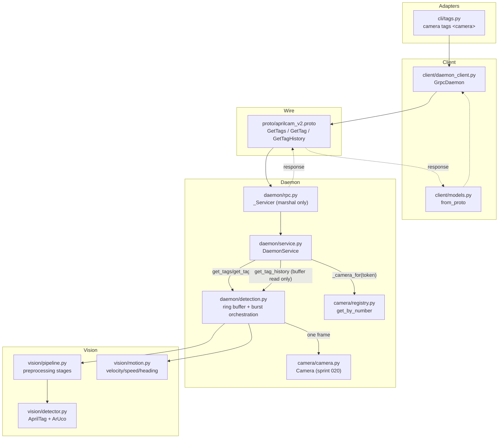

<!-- CLASI: Before changing code or making plans, review the SE process in CLAUDE.md -->

# Sprint 021: Tag detection and tag queries

## Goals

Give the daemon its first vision capability. Sprint 020 built a daemon
that owns cameras and serves raw frames but does no vision at all —
`src/aprilcam/vision/` is empty. This sprint makes the daemon **see
tags**: AprilTag 36h11 and ArUco 4x4 detection, `get_tags`/`get_tag`/
`get_tag_history` over a bounded ring buffer, and a CLI surface to list
them — the second vertical slice in `docs/design/development-plan.md`'s
2026-07-31 build order (daemon + CLI together, every sprint ships
something a person can run). Folded in: cameras become addressable by
their persistent registry number everywhere a slug works today, because
the fix is small, daemon-side, and touches the same `_camera_for`
resolution path every tag-query RPC in this sprint will also use.

## Problem

Every capability downstream of detection — calibration, deskew, world
coordinates, annotations — sits on top of tag detection, and nothing
exercises it yet. An agent or robot program can fetch a raw frame but
cannot ask "what tags are on the field" or "where has tag 7 been."
Separately, `camera list` prints a camera's registry number but typing
that number back (`camera image 3`) fails with "unknown camera '3'" —
the number is the obvious short handle and it does not work.

## Solution

Build `vision/` as the stateless detection engine (preprocessing
pipeline + AprilTag/ArUco detector, both pure functions over an image,
no camera access), then wire it into the daemon as a **demand-driven
detection burst**: `get_tags`, `get_tag` each run detection exactly
once per call and append the result to a bounded per-camera ring
buffer; `get_tag_history` reads that buffer without triggering new
detection. No background loop exists this sprint — an idle daemon does
zero detection work by construction, not by a scheduler deciding not
to run. Every record this sprint is honestly uncalibrated: `world`,
`world_velocity`, `speed`, `heading_rad`, `yaw_rad`, and `world_corners`
are `None`; only `pixel`/`pixel_corners` are populated, and the CLI
says so explicitly. The camera-addressing fix threads a persistent
registry number through the same `_camera_for` resolution every one of
these RPCs (and the existing `get_frame`) already goes through, so it
is fixed once, daemon-side, and every adapter inherits it.

## Success Criteria

- `get_tags`/`get_tag`/`get_tag_history` are implemented against the
  already-declared `Daemon` interface and pass headless tests against
  the restored `tests/images/` fixtures.
- Detection finds the real AprilTag/ArUco markers on `main-playfield`
  with the attached cameras (hardware-verified).
- An idle daemon runs zero detections over a 10 s window; a one-shot
  query is exactly one detection burst (CPU-budget regression pins).
- Every tag record from this sprint reports `calibrated=False`,
  `world=None`, and usable pixel corners — never zeros dressed as world
  coordinates.
- `camera image 3` and `camera tags 3` resolve the same camera as their
  slug form; an absent-but-registered number fails "not present," not
  "unknown camera."
- `uv run mypy` and `uv run pytest` stay green (baseline 216 passed).

## Scope

### In Scope

- `vision/pipeline.py` — the named preprocessing stage sequence
  (grayscale, illumination flattening, optional CLAHE/sharpen, optional
  downscale-with-rescale).
- `vision/detector.py` + `vision/aruco_compat.py` — AprilTag 36h11 +
  ArUco 4x4 detection over the pipeline's output, pixel-space only.
- `vision/motion.py` — stateless velocity/speed/heading computation
  over timestamped world positions (wired but inert this sprint — every
  camera is uncalibrated, so it is never invoked with a non-`None`
  world position; ready for the calibration sprint to activate).
- `daemon/detection.py` — the per-camera ring buffer and the
  detection-burst orchestration (frame → pipeline → detector → boundary
  corner reorder → `TagRecord`/`TagFrame`).
- `Daemon.get_tags`/`get_tag`/`get_tag_history` implemented in
  `DaemonService`, plus a `GetFrame` change: `ImageFrame.tags` is
  populated from the most recent ring-buffer entry when one exists,
  without `get_frame` itself triggering detection.
- `proto/aprilcam_v2.proto` extended additively with `GetTags`/`GetTag`/
  `GetTagHistory` RPCs and `TagRecord`/`TagFrame`/`TagId` messages;
  `daemon/rpc.py`, `client/models.py`, `client/daemon_client.py` wired
  to match.
- `aprilcam camera tags <camera>` CLI command.
- Camera addressing by persistent registry number, daemon-side, on the
  existing `_camera_for` path (covers `get_frame` today and every new
  RPC this sprint adds) — `camera/registry.py` gains
  `get_by_number`, a new `CameraNotPresent` error distinguishes "known
  but unplugged" from "never registered," and the `UnknownCamera`
  "available" list shows numbers alongside slugs.
- Restoring `tests/images/` fixtures and `testdev/capture_matrix.py`
  from `archive/` (Stage 0/4's remaining item — the headless pipeline
  and detector tests need them and they do not exist outside
  `archive/` yet).
- `docs/design/use-cases/cli.md` updated to record this sprint's
  command-surface decision (see Architecture, Decision 3) and the
  camera-number addressing convention.

### Out of Scope

Calibration, deskew, world coordinates, playfield definitions
(`SetPlayfield`/`GetPlayfield`), annotations, streaming
(`stream_tags`/`stream_images`), MCP, the viewer. These stay exactly as
sprint 020 left them; every camera this sprint is uncalibrated by
construction.

## Test Strategy

Headless-first, per the dev plan's standing rule: `vision/pipeline.py`
and `vision/detector.py` are pure functions tested purely against
`tests/images/` fixtures and small synthetic tag images (generated via
`aprilcam taggen`) — no camera hardware required, no daemon required.
`daemon/detection.py` and the extended `DaemonService` are tested the
same way `tests/aprilcam/daemon/test_service.py` already tests
`get_frame` — a `FakeBackend`-driven `Camera` plus, for the
detection-burst counting tests, a substitutable/mock detector so the
"exactly one burst per one-shot call, zero when idle" contract is a
regression-pinned unit test rather than a timing-sensitive one. Wire
round-trips follow the existing `stub` fixture pattern (a real
`grpc.Server` over a `tmp_path` unix socket, driven by the real
generated stub). One ticket (007) is hardware-marked
(`@pytest.mark.camera`) and runs against the real attached cameras and
`main-playfield`'s physical markers; it skips cleanly without hardware
and is the only ticket permitted to depend on real detection recall
numbers. `uv run mypy` must stay clean throughout — no new
`typing.Protocol`, behavioral additions derive from the already-declared
`Daemon` base class (no `interfaces.py` changes needed — `get_tags`/
`get_tag`/`get_tag_history` are already declared there from the
sufficiency trace), and any new value type is a frozen
`@dataclass(kw_only=True)`.

## Architecture

**Substantial** — introduces a new subsystem (`vision/`, currently
empty), a new cross-module dependency (`daemon/` → `vision/`, the first
time anything imports it), and extends the wire contract
(`proto/aprilcam_v2.proto`) with new RPCs. The camera-numbering fix is
compact on its own (one existing module, no new cross-module
dependency) but is folded into this sprint's ticket sequence rather than
planned separately, since it shares the `_camera_for` resolution path
every new RPC here also uses.

### Step 1 — Understand the problem

Sprint 020 delivered camera ownership and raw-frame serving; nothing in
the daemon does vision. The interface skeletons
(`daemon/interfaces.py`) already declare `get_tags`/`get_tag`/
`get_tag_history` and the `TagRecord`/`TagFrame`/`TagId`/`TagFamily`
value types in `types.py` — the sufficiency trace
(`docs/design/use-cases/daemon-interface-trace.md`) verified these are
sufficient for UC-09/UC-10 without changes. This sprint's job is purely
to *implement* against that declared contract: build the vision engine,
wire it into the daemon as a scheduler, extend the wire format, and
expose it from the CLI — never redesign the types.

### Step 2 — Responsibilities

- **Frame preprocessing** — turning a raw capture into a
  detection-ready image. Changes independently of detection logic
  itself (a new preprocessing stage does not change how corners are
  interpreted).
- **Tag detection** — running AprilTag/ArUco detectors over a
  preprocessed image and returning raw pixel-space hits. Changes
  independently of preprocessing (a new detector parameter does not
  change the pipeline).
- **Detection scheduling and history** — deciding *when* detection
  runs (demand-driven, one burst per one-shot query) and holding the
  bounded per-camera history. This is daemon-internal state and
  policy, not vision logic — it changes when the scheduling contract
  changes, not when detection accuracy changes.
- **Motion computation** — velocity/speed/heading from a sequence of
  world positions. Pure math, independent of both detection and
  calibration status (it simply is not invoked when `world` is
  `None`).
- **Camera addressing** — resolving a client-supplied token (slug or
  number) to a registered camera. Already daemon-internal
  (`_camera_for`); this sprint teaches it a second token form.
- **Wire/client marshalling** — proto messages, `daemon/rpc.py`,
  `client/models.py`, `client/daemon_client.py`. Changes whenever the
  RPC surface changes, never when detection logic changes — this is
  exactly the boundary sprint 020 already established for `get_frame`.
- **CLI presentation** — argv shaping and output formatting for
  `camera tags`. Changes independently of everything above except the
  client method signature it calls.

### Step 3 — Subsystems and modules

| Module | Purpose (one sentence) | Boundary | Use cases served |
|---|---|---|---|
| `vision/pipeline.py` | Turns a raw frame into a detection-ready grayscale image through a named, inspectable stage sequence. | Inside: grayscale, illumination flattening, CLAHE, sharpen, downscale+rescale. Outside: camera access, detection, any world/pixel interpretation of results. | UC-09, UC-10 (substrate) |
| `vision/detector.py` + `vision/aruco_compat.py` | Runs AprilTag 36h11 and ArUco 4x4 detection over a preprocessed image and returns raw pixel-space hits. | Inside: detector construction and tuning, corner/id extraction. Outside: camera access, world conversion, scheduling, ring-buffer state. | UC-09, UC-10 |
| `vision/motion.py` | Computes velocity, speed, and heading from a sequence of timestamped world positions. | Inside: pure kinematics over `WorldPoint` sequences. Outside: detection, calibration, daemon state. | UC-26 (readiness for calibration sprint) |
| `daemon/detection.py` | Owns the per-camera ring buffer and runs exactly one detection burst per demand. | Inside: burst orchestration (frame → pipeline → detector → `TagRecord`/`TagFrame` construction, boundary corner reordering), ring-buffer storage/eviction. Outside: camera hardware access (delegates to the already-open `Camera`), RPC marshalling. | UC-09, UC-10, UC-26 |
| `daemon/service.py` (extended) | Answers `Daemon` RPCs against the daemon's held state. | Inside: `get_tags`/`get_tag`/`get_tag_history` method bodies, `_camera_for`'s number-or-slug resolution, `get_frame`'s tag-embed read. Outside: detection internals (delegates to `daemon/detection.py`), wire format. | UC-09, UC-10, UC-26, UC-06 (tag-embed), UC-14, UC-25 |
| `camera/registry.py` (extended) | Adds number-keyed lookup to the existing identity→slug registry. | Inside: `get_by_number`. Outside: everything else, unchanged. | UC-14, UC-25 |
| `errors.py` (extended) | Adds the "known but not currently present" failure identity. | Inside: `CameraNotPresent`. Outside: everything else, unchanged. | UC-14, UC-25 |
| `proto/aprilcam_v2.proto`, `daemon/rpc.py`, `client/models.py`, `client/daemon_client.py` (extended) | Carries the new RPCs and error identities across the wire. | Inside: marshalling only — no business logic (unchanged rule from sprint 020). Outside: everything else. | UC-09, UC-10, UC-26, UC-14 |
| `cli/tags.py` (new, or a `camera tags` addition to `cli/camera.py`) | Argv-to-client-call shell for listing detected tags. | Inside: argv shaping, output formatting, the uncalibrated-flag presentation. Outside: RPC calls, vision, scheduling. | UC-20 |

Every module addresses at least one use case; `vision/motion.py` is the
one exception worth naming honestly — it serves no scenario *this*
sprint (nothing is calibrated), but its purpose (UC-26's velocity
verification, UC-09/UC-10's velocity fields) is real and deferred only
by calibration's absence, not by design uncertainty. Building it now
against synthetic world-point sequences means the calibration sprint
activates it rather than writing it.

### Step 4 — Diagram

Required because 3+ modules are touched and a genuinely new
cross-module dependency is introduced (`daemon/` → `vision/`, for the
first time in the codebase). Fan-out from `daemon/detection.py` is 3
(`Camera`, `vision/pipeline.py`, `vision/detector.py`) plus
`vision/motion.py` — within the 4-5 guideline. No ERD: nothing here
changes the on-disk data model (the ring buffer is in-memory only, and
`camera/registry.json`'s schema is untouched by adding a lookup
method). Dependency direction is unchanged from sprint 020's shape and
does not need its own graph: adapters (CLI, client) → daemon (business
logic) → vision/camera (this sprint's new "domain" and existing
infrastructure) — no cycles, nothing here reverses an existing edge.

### Step 5 — What changed / why / impact / migration

**What changed.** `vision/` goes from empty to a real subsystem
(pipeline + detector + motion). `daemon/detection.py` is new — the
scheduling and ring-buffer home. `daemon/service.py` gains three method
bodies plus a `_camera_for` extension. The proto file grows three RPCs
and three messages, additively. The CLI gains one command.
`camera/registry.py` gains one lookup method. `errors.py` gains one
type.

**Why.** This is the second vertical slice of the v2 build order: give
the daemon a real capability and ship its CLI surface in the same
sprint. Detection is the prerequisite for every later capability
(calibration, deskew, annotations all sit on top of it), so it comes
next per the dev plan's explicit stage sequence.

**Impact on existing components.** `daemon/service.py`'s `get_frame` is
touched (adds `tags` to the returned `ImageFrame` when a ring-buffer
entry exists — see Decision 4) but its existing contract
(`deskewed=True` still fails with `NotCalibrated`) is unchanged.
`_camera_for`'s existing behavior for a genuinely unregistered slug is
unchanged; only the token-parsing step gains a branch. `cli/camera.py`
is unchanged (the new command lives in its own module or as an
addition, not a modification of `cmd_list`/`cmd_probe`/`cmd_image`).
Nothing in sprint 020's four existing RPCs changes shape on the wire —
`GetFrameResponse` gains one new optional field, appended, never
renumbering an existing one.

**Migration concerns.** None on stored state: the registry's on-disk
schema (`registry.json`) is unchanged by adding a read method; the ring
buffer is pure in-memory runtime state with no persistence and nothing
to migrate. The proto change is additive per the file's own stated
evolution rule (new RPCs/messages, existing ones only ever widened).
Restoring `tests/images/` from `archive/` is a file move with no
runtime impact.

### Step 6 — Design rationale

**Decision 1 — Demand-driven bursts, no background thread this
sprint.**
*Context:* the dev plan requires "no detection when nobody is asking"
as a CPU-budget requirement, and separately wants a ring buffer for
`get_tag_history`. v1 satisfied both with a continuous background
capture/detect thread that always ran while the daemon held a camera
open.
*Alternatives considered:* (a) a continuous background loop, gated on
whether any client has queried recently (a "grace period" idle-out,
matching Stage 8's eventual streaming design); (b) detection strictly
synchronous with each one-shot call, no persistent loop at all.
*Why this choice:* streaming (`stream_tags`) is explicitly out of scope
this sprint, and a grace-period background loop is exactly the
mechanism Stage 8 designs for stream subscribers — building a partial
version of it now would be built twice. Per-call synchronous bursts
satisfy "zero detection when idle" trivially and correctly (there is no
loop to idle), and satisfy "one-shot query is exactly one burst"
literally rather than approximately.
*Consequences:* `get_tag_history`'s buffer only grows when
`get_tags`/`get_tag` are called — a client that never polls sees a
buffer of at most one entry. This is an honest, sprint-scoped
limitation, not a bug: meaningful continuous history needs either
client-side polling (works today) or the streaming subsystem (a later
sprint). Recorded as an open question below so it is not mistaken for
an oversight.

**Decision 2 — `TagId` replaces the `-(N+1)` ArUco encoding outright,
rather than porting it as an internal detail.**
*Context:* v1's calibration/homography layer stored ArUco marker *N* as
tid `-(N+1)` in a single shared int-keyed dict, specifically to avoid
colliding with AprilTag ids in the same namespace
(`archive/src/aprilcam/calibration/homography.py`). v2's `TagId` is
already a frozen, hashable `(family, number)` dataclass.
*Alternatives considered:* port the encoding into `daemon/detection.py`
internal state (e.g. the per-camera ring buffer or a tracking dict) to
match v1's structure closely; or key everything by `TagId` directly.
*Why this choice:* the collision `-(N+1)` existed to avoid — AprilTag 1
and ArUco 1 sharing one int-keyed dict — cannot happen when the key
type carries family explicitly. Porting the encoding would reintroduce
a hazard (a raw int leaking into a client-visible path) purely to match
v1's internal shape, for no benefit. `TagId` is the correct v2
replacement, not a wrapper around the old trick.
*Consequences:* no code in this sprint constructs a negative tag id at
any layer; `vision/detector.py`'s raw `Detection.id` is the family's
native non-negative dictionary index, and `daemon/detection.py` builds
`TagId(family, id)` directly from it. The archive code is read for the
detector-construction and preprocessing approach, not for this
encoding.

**Decision 3 — CLI ships `camera tags <camera>` this sprint;
`playfield tags` is deferred.** See the dedicated write-up below (this
is one of the two decisions the issue calls out explicitly).

**Decision 4 — `get_frame` embeds the latest ring-buffer `TagFrame`
without triggering detection itself.**
*Context:* the issue asks for "frames embed their `TagFrame` when
detection is running," but streaming (the only sense in which
detection "runs" continuously) is out of scope this sprint.
*Alternatives considered:* (a) leave `ImageFrame.tags` always `None`
this sprint, deferring the whole capability to the streaming sprint;
(b) have `get_frame` itself trigger a detection burst so it can always
embed a fresh result; (c) embed the most recent ring-buffer entry, if
one exists, without `get_frame` triggering new detection.
*Why this choice:* (a) throws away a real, cheap capability for no
reason — the data already exists once any `get_tags`/`get_tag` call has
run. (b) breaks demand-driven scheduling's own contract: asking for
pixels is not asking for tags, and it would silently double the cost of
every `get_frame` call. (c) is honest and free: if detection has
happened recently for this camera, the frame carries it (with its own
timestamp, so a caller can see any capture↔detection skew, per
`ImageFrame`'s existing three-way None/empty/populated contract); if
not, `tags` stays `None`, correctly signaling "detection is off" rather
than fabricating a burst nobody asked for.
*Consequences:* a client that calls `get_tags` and then `get_frame`
gets pixels and tags together at no extra detection cost; a client that
only ever calls `get_frame` sees `tags=None` forever, which is correct.

**Decision 5 — camera-number resolution lives in `_camera_for`, not a
new method.**
*Context:* `_camera_for` already resolves a camera token for
`get_frame` and will do the same for every new RPC this sprint adds.
*Alternatives considered:* a separate `_resolve_number(token)` helper
called before `_camera_for`; client-side resolution (rejected already
by the issue itself, and by `adapters.md` §2's duplication test —
every adapter would reimplement the same lookup).
*Why this choice:* one resolution path, extended once, is inherited by
every current and future camera-addressed daemon method automatically
— exactly the "fix once, daemon-side" reasoning the issue gives.
*Consequences:* `get_tags`/`get_tag`/`get_tag_history` get
number-addressing for free by construction, not by remembering to call
a second helper.

### CLI spelling decision (Decision 3, in full)

`docs/design/use-cases/cli.md`'s command surface names `aprilcam
playfield tags`, resolving its camera client-side from
`CameraState.playfield` links (cli.md's "Playfield commands resolve
their camera" convention: exactly one linked, present camera → use it;
zero or several → error). That resolution has nothing to resolve this
sprint: playfields do not exist until the next sprint (no
`SetPlayfield`, no config service), so `CameraState.playfield` is
always `None` for every camera. A `playfield tags` command shipped now
would error on every invocation, on every camera, always — not a
degraded command, a non-functional one.

**Decision: this sprint ships `aprilcam camera tags <camera>`**,
camera-addressed, mirroring the already-shipped `camera image
<camera>`. The playfield-addressed spelling (`aprilcam playfield tags`,
no camera argument) is deferred to the sprint that adds the config
service and playfield links — at that point `CameraState.playfield` is
real and the CLI-side resolution described in cli.md becomes
executable. `docs/design/use-cases/cli.md` is updated (ticket 006) to
record this explicitly: UC-20's main success path is amended to name
`camera tags <camera>` as what this sprint ships, with a forward
pointer to the deferred playfield-addressed form; the command-surface
block and the fan-out table's `playfield tags` row are updated to match
(`camera tags` joins the existing `camera image`/`camera list`/`camera
probe` fan-out-eligible read-only group).

### Step 7 — Open questions

1. **`tests/images/field-state.json` is stakeholder-unconfirmed.** Its
   `status` is `"unverified"` and `visible_april_tags`/
   `visible_aruco_tags` are empty — Stage 0's "Remaining" item
   ("stakeholder verifies field state") was never closed. Headless
   detector tests in this sprint therefore cannot assert a specific
   confirmed tag set against the captured fixtures; they use synthetic
   fixtures (tag images at known positions/rotations, generated via
   `aprilcam taggen`) for recall/corner-order correctness, and only
   smoke-test the captured fixtures ("detector runs, returns plausible
   results, families separate"). Ticket 007's hardware verification is
   this sprint's actual ground-truth check, against `main-playfield`'s
   declared definition (AprilTag 1 centre, ArUco 1–10). Confirming
   `field-state.json` is stakeholder work outside this sprint's
   tickets.
2. **Corner-order "front" convention needs empirical verification, not
   assumption.** `design.md` §6's boundary/hat contract requires
   corners ordered `(front-left, front-right, back-right, back-left)`
   with the 0→1 edge as the front edge. OpenCV's ArUco/AprilTag
   detectors return corners in an order tied to the tag's own printed
   pattern, which is a reasonable candidate for "front" directly, but
   this has not been verified against a known-orientation physical or
   synthetic tag. Ticket 003 states the working hypothesis (detector
   corner 0 → front-left directly) and must verify it against a
   known-rotation fixture rather than assume it; ticket 007 re-verifies
   against real hardware.
3. **Ring buffer is count-bounded (~300, matching v1), not additionally
   time-windowed.** Because this sprint's buffer only grows on demand
   (Decision 1), "roughly 10 seconds" (UC-26) is not a wall-clock
   guarantee this sprint — a sparsely-queried camera's buffer spans much
   longer than 10 seconds of wall time before it fills. Recorded as an
   accepted, honest consequence of Decision 1, not silently glossed
   over. Revisit once streaming exists and can genuinely fill the
   buffer at frame rate.
4. **Packaged-guide documentation (UC-27) is not updated this sprint.**
   The number-addressing issue asks for the addressing scheme to be
   documented "in the packaged guide" as well as `cli.md`. No
   `guides.py`/`AGENT_GUIDE.md` exists in the v2 source tree yet (UC-27
   is unbuilt) — this half of the ask is deferred until that subsystem
   is built, not silently dropped.

## Use Cases

Sized to a substantial sprint: full sprint-level use cases for the two
capabilities the sprint delivers (tag queries, camera-number
addressing), each tracing to the daemon use cases already specified in
`docs/design/use-cases/daemon.md` and `cli.md`.

### SUC-001: Ask for one tag by family and id
Parent: UC-09

- **Actor**: A robot program or MCP-style caller (A-01/A-02) that knows
  its own tag id.
- **Preconditions**: Daemon running, camera registered and held open.
- **Main Flow**:
  1. Caller asks `get_tag(camera, TagId(family, number))`.
  2. The daemon runs exactly one detection burst against the named
     camera.
  3. If the tag is present in that burst, its `TagRecord` is returned
     with `calibrated=False`, `world=None`, `pixel`/`pixel_corners`
     populated. If absent, `None` is returned — never a zero-valued
     record.
- **Postconditions**: The camera's ring buffer gains one new entry.
- **Acceptance Criteria**:
  - [ ] AprilTag 7 and ArUco 7 on the same camera return different
        records when both requested (UC-09.S-3) — family disambiguates,
        no negative id crosses the interface.
  - [ ] A tag not currently visible returns `None`, distinguishable
        from a tag reported at pixel `(0, 0)` (UC-09.S-4).
  - [ ] Every returned record has `calibrated=False`, `world=None`,
        `heading_rad=None`, `yaw_rad=None`, `world_velocity=None`,
        `speed=None`; `pixel`/`pixel_corners` are populated (UC-09.S-5).

### SUC-002: Get all detected tags at once
Parent: UC-10

- **Actor**: A2/A1 — an agent or robot program wanting the full current
  detection set.
- **Preconditions**: Daemon running, camera registered.
- **Main Flow**:
  1. Caller asks `get_tags(camera)`.
  2. The daemon runs exactly one detection burst.
  3. Every currently-detected tag is returned in one `TagFrame` — no
     count, no limit, no pagination.
- **Postconditions**: The camera's ring buffer gains one new entry
  (the same burst SUC-001 would produce).
- **Acceptance Criteria**:
  - [ ] An empty field returns an empty `TagFrame`, not an error
        (UC-10.S-2).
  - [ ] Every record in the frame is uncalibrated per SUC-001's flags
        (UC-10.S-3).
  - [ ] Calling `get_tags` twice with nothing in view triggers exactly
        two detection bursts, never zero and never more than two
        (the CPU-budget regression pin, dev-plan Stage 8).

### SUC-003: Ask where a tag has recently been
Parent: UC-26

- **Actor**: A2/A1 — reconstructing a trajectory or verifying a
  velocity.
- **Preconditions**: Daemon running; some prior `get_tags`/`get_tag`
  activity has populated the buffer (see Architecture Decision 1 and
  Open Question 3 — this sprint's history is query-driven, not
  continuous).
- **Main Flow**:
  1. Caller asks `get_tag_history(camera, tag=None or TagId,
     frames=None or N)`.
  2. The daemon returns the buffered `TagFrame`s, oldest to newest,
     **without** running a new detection burst.
- **Postconditions**: None — a pure read of existing buffer state.
- **Acceptance Criteria**:
  - [ ] A buffer with fewer entries than requested `frames` returns
        everything available, not an error (UC-26 failure mode).
  - [ ] Filtering by `tag` preserves frame/timestamp for frames where
        that tag was absent (an empty `.tags` tuple within a real,
        present `TagFrame`) rather than dropping the frame — the
        explicit-gap requirement (UC-26.S-4).
  - [ ] Calling `get_tag_history` alone, with no prior `get_tags`/
        `get_tag` call, triggers zero detection bursts and returns
        whatever the (possibly empty) buffer holds.

### SUC-004: List tags from the shell
Parent: UC-20 (CLI form; command spelling per Architecture Decision 3)

- **Actor**: A-03, the human developer, wanting a quick "what does the
  system see" check without a GUI.
- **Preconditions**: Daemon running, camera named.
- **Main Flow**:
  1. `aprilcam camera tags <camera>` (`-d` for remote).
  2. The CLI calls `get_tags` and prints every detected tag: family,
     id, and either world position (calibrated) or an explicit
     "UNCALIBRATED — pixel only" flag plus pixel position (this
     sprint, always the latter).
- **Postconditions**: None — a read.
- **Acceptance Criteria**:
  - [ ] Output never prints `0.0, 0.0` or any world-looking number for
        an uncalibrated camera — it prints the uncalibrated flag and
        pixel coordinates instead.
  - [ ] Nothing detected prints an empty result, not an error
        (UC-20 failure mode).
  - [ ] `--all` fans out, each row labelled with its daemon (matches
        `camera list`/`camera probe`'s existing fan-out shape).

### SUC-005: Reference a camera by its persistent number
Parent: UC-14, UC-25

- **Actor**: A-03, typing the number `camera list` just showed them.
- **Preconditions**: Daemon running; camera previously registered
  (number assigned).
- **Main Flow**:
  1. `aprilcam camera image 3` (or `camera tags 3`) — an all-digits
     token.
  2. The daemon resolves it via `CameraRegistry.get_by_number` instead
     of slug lookup.
  3. The RPC proceeds exactly as it would addressed by slug.
- **Postconditions**: None beyond the underlying RPC's own.
- **Acceptance Criteria**:
  - [ ] `camera image 3` and `camera image <that camera's slug>`
        return frames from the same camera.
  - [ ] A number matching no registered camera raises `UnknownCamera`
        whose "available" list shows `"N slug"` pairs.
  - [ ] A registered-but-currently-absent camera addressed by number
        raises `CameraNotPresent`, distinct from `UnknownCamera` —
        "camera present: no," never "unknown camera."
  - [ ] Restarting the daemon and re-resolving the same physical
        camera returns the same number (regression check on the
        sprint-020 invariant this issue depends on, not a new
        behavior).

## GitHub Issues

(None linked — this sprint tracks CLASI issues only.)

## Definition of Ready

Before tickets can be created, all of the following must be true:

- [x] Sprint planning document is complete (sprint.md, including its
      Architecture and Use Cases sections)
- [x] Architecture review passed (or skipped, for changes with no
      architectural impact)
- [x] Stakeholder has approved the sprint plan (2026-08-01, via
      team-lead: "let's plan another sprint and keep going with
      development" — gate recorded, notes carry the four flagged
      findings surfaced for veto)

## Tickets

| # | Title | Depends On |
|---|-------|------------|
| 001 | Restore image-matrix fixtures; build the vision preprocessing pipeline | — |
| 002 | Resolve cameras by persistent number, daemon-side | — |
| 003 | AprilTag 36h11 + ArUco 4x4 detection engine | 001 |
| 004 | Daemon detection integration: ring buffer, get_tags/get_tag/get_tag_history | 002, 003 |
| 005 | Wire tag-detection RPCs onto the daemon control plane | 004 |
| 006 | CLI: `camera tags` command | 005 |
| 007 | Hardware verification against main-playfield | 002, 005, 006 |

Tickets execute serially in the order listed.
