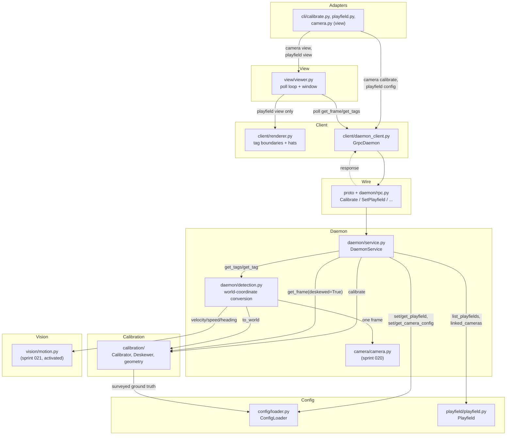

<!-- CLASI: Before changing code or making plans, review the SE process in CLAUDE.md -->

# Sprint 022: Calibration, deskew, and the live view

## Goals

Give the daemon its first world frame. Sprints 020-021 built camera
ownership and pixel-space tag detection; every position reported so far
is honestly uncalibrated. This sprint makes the pixel→world mapping
real: playfield definitions held by the daemon, a camera calibrated
against `main-playfield`'s surveyed ArUco markers, `TagRecord.world`/
`world_corners`/`yaw_rad`/`heading_rad`/`world_velocity`/`speed`
populated on a calibrated camera, the deskewed top-down image published
with exact world↔pixel metadata, and a first live view the stakeholder
can actually watch — the third vertical slice in
`docs/design/development-plan.md`'s 2026-07-31 build order (daemon +
CLI together, every sprint ships something a person can run). Folded
in: just enough of the stage-9 config service (`SetPlayfield`/
`GetPlayfield`/`ListPlayfields`, plus a minimal camera→playfield link)
for calibration to have ground truth to calibrate against — the rest of
stage 9 (camera hardware-settings push, annotations) stays deferred to
sprint 023 per the roadmap.

## Problem

Every `TagRecord` today is pixel-only: `world`, `world_corners`,
`yaw_rad`, `heading_rad`, `world_velocity`, `speed` are all `None`,
`calibrated=False`. There is no playfield ground truth in the daemon at
all — `set_playfield`/`get_playfield` are undeclared-but-stubbed
`NotImplementedError`s and no camera has ever been told which field it
looks at. Nobody can ask "where is tag 7 in centimeters," nobody can
get a top-down deskewed image, and nobody can watch the field live.
Every downstream capability — annotations, the `where` query, anything
a robot can act on — waits on this.

## Solution

Build the pixel→world mapping bottom-up and wire it through the same
vertical slice discipline as sprints 020-021: daemon capability plus its
CLI surface, together.

1. **Playfield definitions.** `config/loader.py` parses
   `main-playfield.json`-shaped documents into concrete
   `PlayfieldDefinition`/`CameraConfig` instances; `SetPlayfield`/
   `GetPlayfield`/`ListPlayfields` let the daemon hold one or more
   definitions in memory (UC-02); a minimal `SetCameraConfig`/
   `GetCameraConfig` slice carries `CameraConfig.playfield` so a camera
   can be linked to a definition — hardware-settings push stays
   deferred (Decision 1 below).
2. **Calibration.** `calibration/calibration.py` detects the corner
   ArUcos across averaged frames, matches them to the linked
   definition's surveyed positions, and solves the homography —
   all-or-nothing against the definition's required id set (UC-04).
   Success or explicit named failure is reported via
   `CalibrationResult`; success persists a `Calibration` to
   `calibration.json` under the camera's state directory, reloaded at
   startup (UC-01).
3. **World coordinates.** `daemon/detection.py` converts a burst's
   pixel-space hits through the camera's `Calibration.to_world` when
   one exists, computes yaw from the observed front edge, and hands the
   resulting world-position history to `vision/motion.py` (built and
   tested in sprint 021, inert until now) for velocity/speed/heading.
   Uncalibrated cameras are untouched — sprint 021's behaviour is
   exactly preserved.
4. **Deskew.** `calibration/deskew.py` warps the field into the fixed
   800×800 bounding box (aspect-preserved; `main-playfield` → 800×532),
   reporting derived `px_per_cm`/`world_extent`. `Daemon.get_frame(
   deskewed=True)` produces this for a calibrated camera and keeps
   failing explicitly (`NotCalibrated`) for an uncalibrated one — no
   behaviour change to that existing contract, only a real
   implementation behind it.
5. **A first live view.** `view/viewer.py` is a small poll-driven
   window (Decision 3 below); `client/renderer.py` implements the
   tag-drawing half of the already-declared `Renderer` interface so
   `playfield view` can draw tag boundaries and hats on the deskewed
   image. Both `aprilcam camera view` (raw, UC-16) and `aprilcam
   playfield view` (deskewed + tags, UC-18) ship this sprint (Decision
   2 below), plus `aprilcam camera calibrate` (UC-15) and `aprilcam
   playfield image` (UC-19).

Every sign and axis follows `docs/design/design.md` §6 /
`specification.md` §7 exactly: A1-centred origin via pure subtraction
(never a y-flip), north-up/east-right on the deskewed image with
exactly one y-flip inside the published mapping, `atan2`-based
heading/yaw with 0 = east CCW positive. `archive/src/aprilcam/
calibration/{calibration,geometry}.py` is mined for the homography
solve, corner-to-surveyed-position matching, and the deskew warp math —
not ported wholesale, and v1's `homocal` CLI / upper-left-origin corner
table is explicitly not carried forward (`specification.md` §6).

## Success Criteria

- Camera 3 (`arducam-ov9782-usb-camera`, aimed at the real
  `main-playfield`) calibrates successfully against the definition's
  full required ArUco set; occluding one marker fails calibration,
  naming that marker, and leaves any prior calibration untouched.
- AprilTag 1, at the field's surveyed centre, reports world position
  (0, 0) within tolerance on a calibrated camera — the direct check
  that the origin convention is right.
- Moving a tag physically east increases reported `x`; moving it north
  increases reported `y`; the same motions move the tag right and up on
  the deskewed image — the mirror-catching check.
- A deskewed frame of `main-playfield` is 800×532, reports its derived
  `px_per_cm`, and its corners map to the surveyed field corners
  through the published metadata.
- A deskewed request on an uncalibrated camera still fails explicitly
  with `NotCalibrated` — this contract, established in sprint 020,
  regresses to a real implementation without changing shape.
- Calibration survives a daemon restart (file-backed, UC-01); a pushed
  playfield definition does not (in-memory, UC-02).
- `aprilcam camera view` opens and shows raw live video with no
  overlays; `aprilcam camera calibrate` reports success/failure with
  named ids; `aprilcam playfield image`/`playfield view` show the
  deskewed field with tags drawn once calibrated.
- `uv run mypy` and `uv run pytest` stay green (baseline 388 passed);
  hardware-marked tests (`@pytest.mark.camera`) skip cleanly without
  cameras.

## Scope

### In Scope

- `config/loader.py` (new) — `ConfigLoader` implementation: JSON ↔
  `PlayfieldDefinition`/`CameraConfig`, whole-document validation
  (self-naming, schema shape, duplicate-ArUco-id rejection →
  `MalformedDocument`), concrete `PlayfieldDefinition.features()`/
  `required_aruco_ids()`.
- `Daemon.set_playfield`/`get_playfield`/`list_playfields` implemented
  in `daemon/service.py`, holding zero or more definitions in memory,
  keyed by name (Decision 4). `Daemon.set_camera_config`/
  `get_camera_config` implemented as the minimal playfield-link slice
  described in Decision 1 — `settings` accepted and echoed back but not
  applied to hardware this sprint.
- `playfield/playfield.py` (new) — concrete `Playfield` with
  `linked_cameras()` derived at serve time from the daemon's held
  camera configs. `FeatureQuery`/`Daemon.find_feature` stay
  unimplemented (out of scope — the `where` query).
- `calibration/calibration.py`, `calibration/geometry.py`,
  `calibration/deskew.py` (new) — `Calibrator`, `Calibration`,
  `CalibrationResult`, `Deskewer` implementations: multi-frame averaged
  ArUco detection, id matching against surveyed positions,
  all-or-nothing acceptance, homography solve, degenerate-geometry
  rejection, `calibration.json` persistence/reload, the fixed
  800×800-bounding-box deskew warp.
- `daemon/detection.py` extended: pixel→world conversion via
  `Calibration.to_world` on a calibrated camera's burst, yaw from the
  observed front edge, `vision/motion.py` wired in for
  velocity/speed/heading. Uncalibrated-camera path unchanged from
  sprint 021.
- `Daemon.calibrate`/`get_calibration` implemented; `Daemon.get_frame(
  deskewed=True)` implemented for real (was an unconditional
  `NotCalibrated` since sprint 020).
- `proto/aprilcam_v2.proto` extended additively: `Calibrate`,
  `GetCalibration`, `SetPlayfield`, `GetPlayfield`, `ListPlayfields`,
  `SetCameraConfig`, `GetCameraConfig` RPCs and their messages;
  `GetFrameResponse` gains `px_per_cm`/`world_extent` (appended,
  existing fields unchanged); `TagRecord`'s already-declared optional
  world fields go from always-absent to populated-when-calibrated.
  `daemon/rpc.py`, `client/models.py`, `client/daemon_client.py` wired
  to match.
- `client/renderer.py` (new) — concrete `Renderer`: draws tag
  boundaries + front hats from an embedded `TagFrame`'s
  `world_corners`/`yaw_rad` (deskewed) or `pixel_corners` (raw,
  unused this sprint since raw views draw no overlays). Annotation
  rendering is inert, not stubbed — `frame.annotations` is always
  `None` this sprint since the annotation store doesn't exist yet.
- `view/viewer.py` (new subsystem) — poll-driven window: `camera view`
  polls `get_frame(deskewed=False)` and displays bytes directly (no
  overlays, per UC-16); `playfield view` polls `get_tags` (to trigger a
  fresh burst) and `get_frame(deskewed=True)`, renders through
  `client/renderer.py`. Headless/no-display detection with a pointer to
  the one-shot alternative (UC-16.S-3, UC-18's equivalent).
  `ImageStream`/`TagStream` stay unimplemented — polling is this
  sprint's honest first step (Decision 3).
- `cli/calibrate.py` (new) — `aprilcam camera calibrate <camera>`.
  `cli/playfield.py` (new) — `aprilcam playfield config <file>`,
  `playfield image`, `playfield view`. `cli/camera.py` extended —
  `aprilcam camera view <camera>`.
- `errors.py` extended — `NoPlayfieldLinked` (UC-15.S-2's precondition
  failure — a camera calibrate request with no playfield link).
- `docs/design/use-cases/cli.md` updated to record the view-command
  decision (Decision 2) and the config-service scoping (Decision 1).

### Out of Scope

Camera hardware-settings push/reset (`SetCameraConfig`'s UVC-control
half, `ResetCameraConfig`) — deferred to sprint 023 with the rest of
stage 9. The annotation store, `stream_images`/`stream_tags`, the MCP
server, ROS, the `where`/feature-query RPC (`FeatureQuery.find`,
`Daemon.find_feature`), and mobile-tag mount corrections
(`register_tag`/`MountParameters`). These stay exactly as sprint 021
left them.

## Test Strategy

Headless-first, per the dev plan's standing rule. `calibration/` and
`config/loader.py` are tested purely against `tests/images/` fixtures
and synthetic playfield/ArUco fixtures — no camera or daemon required:
homography solve accuracy against known surveyed positions,
all-or-nothing acceptance (occluded-marker fixture → named failure),
degenerate-geometry rejection, document round-trip (`load(x.to_dict())
== x`). The **geometry convention suite is permanent and never
relaxed** (dev-plan Stage 6): +x east/+y north from fixtures with known
east/north tag relationships, north-up on deskewed fixture output,
exactly one y-flip, `atan2` heading/yaw sign — asserted as regression
tests, not smoke tests. `daemon/detection.py`'s world-conversion path is
tested the way sprint 021 tested pixel detection — a `FakeBackend`-driven
`Camera` plus a stored fixture `Calibration`, asserting
`TagRecord.world`/`world_corners`/`yaw_rad` come out correct and that an
uncalibrated camera's records are byte-for-byte the sprint-021 shape.
Wire round-trips follow the existing `stub` fixture pattern (a real
`grpc.Server` over a `tmp_path` unix socket). `view/viewer.py` and
`client/renderer.py` are tested headless — the renderer against a
fixture `ImageFrame` with known `world_corners` (pixel-neighborhood
check, no live window), the viewer's poll loop against a fake client
(frame delivery, headless-detection branch) rather than an actual GUI.
One ticket is hardware-marked (`@pytest.mark.camera`) and runs the
physical geometry checks from Success Criteria against the real
attached camera and `main-playfield`; it skips cleanly without
hardware. `uv run mypy` must stay clean throughout — no new
`typing.Protocol`, every new behavioral class derives from its declared
base, every new value type is a frozen `@dataclass(kw_only=True)`.

## Architecture

**Substantial** — introduces three new subsystems this sprint touches
for the first time as real code (`calibration/`, `playfield/`, and
`view/`, all previously empty or interface-only), several new
cross-module dependencies (`daemon/` → `calibration/`, `daemon/` →
`config/`, `daemon/` → `playfield/`, `calibration/` → `config/`,
`view/` → `client/`), a new persisted data model (`calibration.json`,
plus the activation of `TagRecord`'s world-coordinate fields from
always-`None` to populated), and an extension to the wire contract with
seven new RPCs. Every signal in the compact/substantial boundary points
the same direction, so this gets the full 7-step methodology with
diagrams.

### Step 1 — Understand the problem

Sprints 020-021 gave the daemon cameras and pixel-space detection.
Nothing establishes what those pixels mean in the world. The interface
skeletons (`calibration/interfaces.py`, `daemon/interfaces.py`,
`config/interfaces.py`, `playfield/interfaces.py`) already declare
every method and value type this sprint needs — `Calibrator`,
`Calibration`, `CalibrationResult`, `Deskewer`, `Daemon.calibrate`/
`get_calibration`/`get_frame(deskewed=True)`/`set_playfield`/
`get_playfield`/`list_playfields`/`set_camera_config`/
`get_camera_config`, `PlayfieldDefinition`/`Feature`/`ConfigLoader`,
`Playfield`. `client/interfaces.py`'s `Renderer` is also already
declared, unused since sprint 020. This sprint's job is purely to
*implement* against those declared contracts — never redesign the
types — plus add the one genuinely new thing the interfaces don't yet
cover: the `view/` viewer and its CLI surface, and one new error
identity (`NoPlayfieldLinked`).

### Step 2 — Responsibilities

- **Config document handling** — parsing/validating/serializing
  whole playfield and camera-config documents. Changes independently
  of what the daemon does with a document once loaded (a new
  validation rule doesn't change how calibration consumes a
  definition).
- **Playfield state** — holding definitions and deriving which
  cameras currently link to each. Changes independently of parsing
  (a new derived query doesn't change the document format) and of
  calibration (a playfield exists whether or not any camera is
  calibrated against it).
- **Calibration and deskew geometry** — one subsystem, two internally
  separable files: `calibration.py` detects corner ArUcos, matches
  them to surveyed positions, and solves/validates the homography;
  `geometry.py`/`deskew.py` apply an already-solved `Calibration` —
  pixel↔world conversion and the fixed-bounding-box warp. The two
  files change for different proximate reasons (a better solver vs. a
  different box size), which is why they stay separate files, but both
  serve one responsibility from the rest of the system's point of
  view — "the pixel↔world geometry" — declared together in one
  `calibration/interfaces.py` by the existing codebase convention, and
  treated as one fan-out edge from `daemon/service.py` accordingly
  (Step 3, Step 4).
- **World-coordinate conversion** — applying a stored `Calibration` to
  a detection burst's pixel hits, every frame. Daemon-internal
  scheduling glue, not vision and not calibration math — it changes
  when the burst pipeline changes, not when the homography solver
  does.
- **Motion** — unchanged from sprint 021 (`vision/motion.py`); listed
  for completeness since it starts actually running this sprint.
- **Wire/client marshalling** — proto messages, `daemon/rpc.py`,
  `client/models.py`, `client/daemon_client.py`. Changes whenever the
  RPC surface changes, never when calibration/deskew logic changes —
  the same boundary sprints 020-021 already established.
- **Client-side rendering** — turning an `ImageFrame`'s embedded tags
  into drawn pixels. Changes independently of the daemon entirely (a
  different hat-marker style doesn't touch any daemon code) — this is
  exactly why `Renderer` lives client-side, not in the daemon.
- **Live viewing** — the poll loop and window. Changes independently
  of rendering (a different poll rate doesn't change what gets drawn)
  and of the client RPC layer (it is a consumer, not an extension, of
  `client/daemon_client.py`).
- **CLI presentation** — argv shaping for the five new/changed
  commands. Changes independently of everything above except the
  client method signatures it calls.

### Step 3 — Subsystems and modules

| Module | Purpose (one sentence) | Boundary | Use cases served |
|---|---|---|---|
| `config/loader.py` | Turns playfield-definition and camera-config JSON documents into validated typed documents and back. | Inside: JSON↔dataclass conversion, whole-document validation (`MalformedDocument` on reject), concrete `PlayfieldDefinition.features()`/`required_aruco_ids()`. Outside: RPC transport, daemon storage, hardware application of camera settings. | UC-02, UC-03 (link slice), UC-23 |
| `playfield/playfield.py` | Holds one playfield's definition plus which cameras currently observe it. | Inside: `linked_cameras()`, derived at serve time from the daemon's held camera configs. Outside: fuzzy feature lookup (`FeatureQuery`, unimplemented — out of scope), document parsing (`config/`'s job). | UC-02 |
| `calibration/calibration.py`, `geometry.py`, `deskew.py` | Establishes and applies one camera's pixel↔world mapping. | Inside: multi-frame averaged ArUco detection, id matching, all-or-nothing acceptance, homography solve/validation, `Calibration.to_world`/`to_pixel`, the fixed-bounding-box deskew warp. Outside: camera frame access (frames are handed in), persistence I/O (daemon's job), detection of AprilTags (vision's job). | UC-04, UC-05, UC-06, UC-15, UC-19 |
| `daemon/service.py` (extended) | Answers the new `Daemon` RPCs against held state. | Inside: `calibrate`/`get_calibration`/`set_playfield`/`get_playfield`/`list_playfields`/`set_camera_config`/`get_camera_config` bodies; `get_frame`'s real `deskewed=True` path; calibration.json read/write orchestration. Outside: calibration/deskew math, config parsing, playfield-link derivation (all delegate). | UC-01, UC-02, UC-03, UC-04, UC-05, UC-06, UC-15, UC-19 |
| `daemon/detection.py` (extended) | Converts a burst's pixel hits to world coordinates when the camera is calibrated. | Inside: `Calibration.to_world` application, front-edge yaw, handing world-position history to `vision/motion.py`. Outside: detection itself (unchanged), calibration math (delegates), camera access (unchanged). | UC-04 (world activation), UC-09/UC-10 (calibrated variant) |
| `vision/motion.py` (unmodified, activated) | Computes velocity/speed/heading from timestamped world positions. | Inside: pure kinematics (sprint 021). Outside: everything else. | UC-26 readiness, now exercised |
| `proto/aprilcam_v2.proto`, `daemon/rpc.py`, `client/models.py`, `client/daemon_client.py` (extended) | Carries the new RPCs across the wire. | Inside: marshalling only — no business logic. Outside: everything else. | UC-01, UC-02, UC-03, UC-04, UC-05, UC-06, UC-15, UC-19 |
| `client/renderer.py` | Rasterizes a frame's embedded tag boundaries/hats to an image, client-side, cv2-free. | Inside: the tag half of `Renderer.render()` — `world_corners`/`yaw_rad` → drawn quad + hat. Outside: annotation rendering (inert this sprint — always `None`), vision, RPC calls. | UC-18 |
| `view/viewer.py` (new subsystem) | A poll-driven window showing a camera's live frames. | Inside: poll loop (`get_frame`, plus `get_tags` for the playfield view), window display, headless-no-display detection. Outside: rendering (delegates to `client/renderer.py` for the playfield view only — raw view shows bytes directly), RPC calls (delegates to `client/daemon_client.py`). | UC-16, UC-18 |
| `cli/calibrate.py`, `cli/playfield.py` (new), `cli/camera.py` (extended) | Argv-to-client-call shells for the five new/changed commands. | Inside: argv shaping, output formatting, `--all` refusal for single-target commands. Outside: everything else. | UC-15, UC-16, UC-18, UC-19 |
| `errors.py` (extended) | Adds the "nothing to calibrate against" precondition identity. | Inside: `NoPlayfieldLinked`. Outside: everything else, unchanged. | UC-15 |

Every module addresses at least one use case. `playfield/playfield.py`
is the one worth naming honestly as thin this sprint: `FeatureQuery` —
its other declared responsibility — stays unimplemented, so this
module currently does only `linked_cameras()`. That is a real, if
small, use-case-serving responsibility (UC-02.S-1's "reports zero
linked cameras"), not padding; `FeatureQuery` activates it fully in a
later sprint without this module changing shape.

### Step 4 — Diagram

Required — 3+ modules touched and several genuinely new cross-module
dependencies (`daemon/` → `calibration/`, `daemon/` → `config/`,
`daemon/` → `playfield/`, `calibration/` → `config/`, `view/` →
`client/`). No ERD: nothing here changes an *externally-shared* schema
— `calibration.json` is new but wholly internal, regenerable state
(dev-plan's "regenerable state" category, same as `registry.json`), and
`main-playfield.json`'s on-disk shape is unchanged, only newly parsed.
No separate dependency graph beyond this diagram: direction is
unchanged from sprints 020-021's shape (adapters → client → wire →
daemon → domain/infrastructure) and nothing here reverses an existing
edge. `daemon/service.py`'s fan-out is 5 (`calibration/`, `config/`,
`playfield/`, `daemon/detection.py`, `camera/camera.py`) — at the top of
the 4-5 guideline, justified the same way sprint 021 justified this
exact module: it is a pure RPC-answering facade whose job is to route
every `Daemon` method to the subsystem that owns it, so fan-out tracks
RPC surface area, not cohesion — it contains none of the five
subsystems' logic, only delegation.

### Step 5 — What changed / why / impact / migration

**What changed.** `calibration/`, `playfield/`, and `view/` go from
empty/interface-only to real code. `config/loader.py` is new.
`daemon/service.py` gains seven method bodies and a real
`get_frame(deskewed=True)`. `daemon/detection.py` gains the
pixel→world conversion step. `client/renderer.py` is new. The proto
file grows seven RPCs and their messages, additively, plus two new
`GetFrameResponse` fields. The CLI gains three commands and one
extension. `errors.py` gains one type.

**Why.** This is the third vertical slice: give the daemon a real
capability (calibration + world coordinates + deskew) and ship its CLI
surface, including a first viewer, in the same sprint — continuing the
2026-07-31 build-order revision's philosophy exactly as sprint 021
did.

**Impact on existing components.** `daemon/service.py`'s `get_frame`
keeps its existing contract for an uncalibrated camera
(`NotCalibrated`) byte-for-byte; only the calibrated branch gains a
real body. `daemon/detection.py`'s uncalibrated path is untouched —
every sprint-021 assertion about an uncalibrated camera's `TagRecord`
shape still holds, now conditionally rather than unconditionally.
`GetFrameResponse` gains two new optional fields, appended, never
renumbering an existing one — the same additive-only rule sprint 021's
proto file states for itself. `cli/camera.py` gains a `view` subcommand
without touching `list`/`probe`/`image`/`tags`. Nothing in sprints
020-021's existing RPCs changes shape.

**Migration concerns.** `calibration.json` is genuinely new persisted
state — no prior format to migrate from, and it is regenerable
(deleting it just means recalibrating). `registry.json`'s schema is
untouched. Pushed playfield/camera-config documents are in-memory only
(UC-02), so there is nothing to migrate there either. The proto
extension is additive per the file's stated evolution rule. Nothing in
this sprint requires a deployment-sequencing step beyond "restart the
daemon to pick up the new binary" — no data format anyone has to
convert by hand.

### Step 6 — Design rationale

**Decision 1 — the config service ships a minimal camera→playfield
link slice this sprint; hardware-settings push stays in sprint 023.**
*Context:* calibration cannot proceed without *some* path from
`main-playfield.json` to the daemon and from a camera to that
definition (`CameraConfig.playfield`), but the dev-plan's roadmap
explicitly assigns the full stage-9 config service (camera UVC
settings push, `ResetCameraConfig`'s hardware re-apply, settable-key
introspection) to the next sprint.
*Alternatives considered:* (a) build the full `SetCameraConfig`/
`GetCameraConfig`/`ResetCameraConfig` surface now, including hardware
application; (b) invent a bespoke small RPC (e.g.
`LinkCameraPlayfield`) outside the declared `Daemon` interface; (c)
implement `set_camera_config`/`get_camera_config` against their
already-declared signatures, but scoped to carrying `name` + `playfield`
— `settings` is accepted and echoed back (so the document round-trips)
but never applied to hardware, and `reset_camera_config` stays
`NotImplementedError`.
*Why this choice:* (a) is a full extra subsystem's worth of work
(UVC-util command ordering, settable-key introspection, hard-error
semantics for unsupported keys) that this sprint's own success criteria
don't need — nothing here reads a camera's exposure or gain. (b)
invents a wire surface the interface skeletons never declared,
contradicting "implement against the interface skeletons." (c) reuses
the exact declared method signatures and the exact `CameraConfig`
dataclass shape (which already has both `playfield` and `settings`),
costs almost nothing beyond (b), and leaves a clean seam: sprint 023
adds hardware application to an already-correct document model instead
of redesigning it.
*Consequences:* a `camera config <file>` push this sprint changes only
the daemon's in-memory `playfield` link; any `settings` in the pushed
document is stored and returned by `get_camera_config` but has no
effect on the camera. This is a real, stated limitation for this
sprint, not a silent gap — `ResetCameraConfig`'s docstring ("re-applies
the stored config to hardware") is honestly not yet true and stays
`NotImplementedError` until sprint 023.

**Decision 2 — both `camera view` (raw) and `playfield view` (deskewed
+ tags) ship this sprint, per the design's existing spelling.**
*Context:* the issue notes the stakeholder said "`aprilcam camera
view`" while describing the calibrated, deskewed result — but
`cli.md`'s existing convention is `camera view` = raw (UC-16, "raw
means raw," the pre-calibration aiming view) and `playfield view` =
deskewed + tags (UC-18, "the whole system actually working" view).
*Alternatives considered:* (a) ship only what the stakeholder literally
said — repoint `camera view` at the deskewed result, dropping the
raw/deskewed distinction; (b) ship only `playfield view`, since that is
what "calibrated and deskewed" actually means, and defer the raw view;
(c) ship both, under the design's existing spelling, and treat the
stakeholder's phrasing as an imprecise description of the *outcome*
("show the view") rather than a literal command-name spec.
*Why this choice:* (a) destroys a real, load-bearing distinction —
UC-16's own text is explicit that raw vs. deskewed is "how you tell
whether the problem is the camera or the geometry," and collapsing it
would make `camera view` mean different things depending on
calibration state, which is exactly the kind of silent-mirroring-shaped
footgun this sprint is supposed to guard against elsewhere. (b) throws
away a nearly-free capability: `camera view` needs zero new daemon
capability (raw `get_frame` has existed since sprint 020) and is a
genuine operational prerequisite for this sprint's own hardware
verification — the developer must aim camera 3 so all 10 ArUco markers
are visible before calibration can succeed, and a live raw view is the
tool for that (UC-16.S-1). (c) costs one thin CLI command wrapping the
same `view/viewer.py` core the deskewed view needs anyway, and keeps
faith with the design doc's already-considered convention rather than
re-litigating it under time pressure.
*Consequences:* `docs/design/use-cases/cli.md` is updated (ticket work)
to record this explicitly, the same way sprint 021 recorded its
`camera tags`/`playfield tags` decision — not silently left to be
inferred from the code. The stakeholder's literal words are not what
ships; the sprint plan states why, so this is a recorded resolution,
not an unnoticed substitution.

**Decision 3 — the viewer polls; it does not build `ImageStream`/
`TagStream`.**
*Context:* both view commands need frames continuously, but streaming
is undeclared-but-unimplemented and is Stage 8/12 territory, not this
sprint's.
*Alternatives considered:* (a) implement `stream_images`/`stream_tags`
now, satisfying the viewer the "real" way; (b) poll `get_frame` (and,
for the playfield view, `get_tags`) at a modest fixed rate from the
client.
*Why this choice:* streaming needs backpressure (bounded queues, silent
drop), a stream-endpoint allocation RPC, and per-subscriber lifecycle —
a real subsystem this sprint's scope does not otherwise touch. Building
a partial version of it just to feed one viewer window would be built
twice, the same reasoning sprint 021 used to defer background detection
loops. Polling is the smaller, honest step the issue itself names.
*Why get_tags, not just get_frame, for the playfield view:* sprint
021's Decision 4 established that `get_frame` embeds the *most recent
ring-buffer entry* without triggering detection itself. A playfield
view that only polled `get_frame` would show a frame frozen at whatever
the last `get_tags`/`get_tag` call happened to be — possibly never, if
nothing else has queried. The viewer's poll loop therefore calls
`get_tags` (triggering a fresh burst) immediately before `get_frame(
deskewed=True)` each tick, at a modest starting rate (~2 Hz — a
starting point, not a tuned constant; see Open Questions).
*Consequences:* opening `playfield view` is, as a side effect, what
makes a previously-idle camera's ring buffer start filling at a
roughly-regular rate — sprint 021's Open Question 3 (the buffer's
"roughly 10 seconds" claim is honest only while something is actively
polling) becomes true *while the viewer window is open*, and reverts to
sparse/query-driven the moment it closes. This is the natural
consequence of Decision 1's demand-driven design meeting a real
poll-based consumer, not a new mechanism — recorded here so it reads as
understood, not discovered later.

**Decision 4 — the daemon can hold more than one playfield at once.**
*Context:* UC-02's own open question asks whether cardinality is
bounded to one; `spec §3`'s camera↔playfield cardinality (one camera,
one playfield) does not bound how many playfields the daemon knows.
*Alternatives considered:* (a) a single current-playfield slot,
replaced wholesale by each `SetPlayfield`; (b) a name-keyed collection,
any number of playfields held simultaneously.
*Why this choice:* (b) costs nothing extra to implement (a dict instead
of a single slot) and matches `list_playfields()`'s already-declared
plural return type, which would be a strange signature for a
single-slot design. Nothing in the use cases requires exclusivity.
*Consequences:* `SetPlayfield` is additive/replacing-by-name, never
replacing an unrelated playfield; `main-playfield` and a future second
field can coexist, each with independently-calibrated cameras.

**Decision 5 — `client/renderer.py` implements only the tag half of
`Renderer.render()` this sprint.**
*Context:* `Renderer` (already declared, `client/interfaces.py`) draws
both tags and annotations from an `ImageFrame`'s embedded state.
*Why this choice:* the annotation store doesn't exist yet (out of
scope, sprint 023+), so `ImageFrame.annotations` is always `None` on
every frame this sprint produces — per `ImageFrame`'s own three-way
`None`/empty/populated contract, `None` correctly means "not carried,"
and the renderer's annotation-drawing code path is naturally inert
rather than needing a stub. No design compromise: the interface is
implemented completely for the data that exists.
*Consequences:* a later sprint activating the annotation store needs no
`Renderer` interface change — only a real annotation-drawing body where
today there is nothing to draw.

### Step 7 — Open questions

1. **Reprojection-error acceptance threshold is undecided.**
   `CalibrationResult.reprojection_error_cm` is computed and reported
   this sprint (informational, per UC-04's main flow), but no maximum
   is enforced — completeness against the required id set is the only
   acceptance gate. A complete-but-sloppy solve therefore succeeds this
   sprint. Flagged in the interface's own docstring as open; this
   sprint does not resolve it, only reports the number so a future
   sprint has data to set a threshold from.
2. **Staleness triggers beyond playfield replacement are undecided.**
   This sprint marks a calibration stale when its playfield definition
   is replaced (UC-02's drafted resolution) — the one concretely
   specified trigger. Camera reopen, elapsed time, or an explicit
   recalibrate-request signal (UC-05's open question) are not
   implemented as staleness triggers this sprint.
3. **The viewer's ~2 Hz poll rate is a starting guess, not a tuned
   constant.** No CPU-budget or perceived-smoothness measurement backs
   this number; it is chosen only to be "modest" per the issue's
   instruction. Revisit once the streaming subsystem exists and the
   two can be compared.
4. **Default-visible layers for `playfield view` stay moot this
   sprint.** UC-18's own open question — which layers are on by
   default (tag ids, headings, velocity vectors, annotation layers) —
   has nothing to resolve yet: this sprint's viewer draws exactly one
   thing (tag boundaries + hats), unconditionally. The question
   resurfaces once annotation layers exist to toggle.
5. **`CameraConfig.settings` is accepted but inert this sprint** (
   Decision 1) — a pushed camera config's hardware-settings block
   round-trips through `get_camera_config` but is never applied. This
   is a stated, temporary limitation inherited by sprint 023, not a
   silent gap; flagged here so ticket work in that sprint does not
   have to rediscover it.

## Use Cases

Sized to a substantial sprint: full sprint-level use cases for the
capabilities this sprint delivers, each tracing to the daemon/CLI use
cases already specified in `docs/design/use-cases/daemon.md` and
`cli.md`.

### SUC-001: Push a playfield definition and link a camera to it
Parent: UC-02, UC-03 (link slice)

- **Actor**: A-03, the human developer, preparing a camera for
  calibration.
- **Preconditions**: Daemon running (UC-01). `main-playfield.json`
  exists locally.
- **Main Flow**:
  1. `aprilcam playfield config config/aprilcam-old/playfields/
     main-playfield.json` pushes the definition; the daemon adopts it
     in memory, keyed by its own `name`.
  2. `aprilcam camera config <file>` pushes a minimal `CameraConfig`
     naming `arducam-ov9782-usb-camera` and `playfield:
     "main-playfield"`.
  3. `aprilcam camera list` (or `get_playfield`) shows the camera
     linked.
- **Postconditions**: The daemon holds `main-playfield` (1 AprilTag, 10
  ArUco, 6 rectangles, 8 dots, 134.3×89.3 cm) and reports the camera as
  linked. Neither survives a daemon restart (UC-02's ephemeral rule).
- **Acceptance Criteria**:
  - [ ] Fetching the pushed definition back returns all 25 features
        with identical coordinates — ArUco 1 at (−67, 44.65), ArUco 5
        at (67, −44.65) (UC-02.S-1).
  - [ ] A definition with a duplicate ArUco id at different coordinates
        is rejected whole, naming the duplicate id; any previously-held
        definition is untouched (UC-02.S-2).
  - [ ] A camera-config document with no `name` field is rejected
        (`MalformedDocument`) before it reaches daemon state (UC-23.S-4
        pattern).
  - [ ] After a daemon restart, both the playfield and the camera link
        are gone — the config directory, not the push, is the source of
        record.

### SUC-002: Watch live raw video from a camera
Parent: UC-16

- **Actor**: A-03, aiming a camera before calibrating.
- **Preconditions**: Camera exists and is readable. No calibration or
  playfield link needed.
- **Main Flow**:
  1. `aprilcam camera view arducam-ov9782-usb-camera`.
  2. A window shows live raw frames — camera settings applied, no
     deskew, no tag overlays, no annotations.
  3. The developer physically aims the camera until all 10 of
     `main-playfield`'s ArUco fiducials are in frame, then closes the
     window.
- **Postconditions**: None. The daemon returns to idle capture when the
  last subscriber leaves.
- **Acceptance Criteria**:
  - [ ] The displayed frames carry no drawn tag boundaries, hats, or
        annotations even when detection has been run recently on this
        camera (UC-16's "raw means raw" contract).
  - [ ] Run headless (no display), the command fails with a clear
        message pointing at `camera image` instead of a toolkit
        backtrace (UC-16.S-3).
  - [ ] `--all` is refused, naming calibration/viewing as single-target
        (UC-16 fan-out rule).

### SUC-003: Calibrate a camera against the playfield
Parent: UC-04, UC-15

- **Actor**: A-03, the human developer.
- **Preconditions**: Camera linked to `main-playfield` (SUC-001). The
  physical field is in view with all required ArUco fiducials visible
  (aimed via SUC-002).
- **Main Flow**:
  1. `aprilcam camera calibrate arducam-ov9782-usb-camera`.
  2. The daemon detects ArUco markers across multiple averaged frames,
     matches all 10 required ids to `main-playfield`'s surveyed
     positions, and solves the homography.
  3. The daemon reports success, which ids matched, and persists the
     result to `calibration.json`.
- **Postconditions**: The camera has a persisted `Calibration` with
  provenance (`calibrated_at`, `playfield`). World-coordinate queries
  and the deskewed view become available.
- **Acceptance Criteria**:
  - [ ] All 10 required ArUco ids (perimeter 1–8, interior 9 and 10)
        visible → calibration succeeds, reports all 10 matched
        (UC-04.S-1).
  - [ ] One id occluded (e.g., ArUco 6 covered) → calibration **fails**,
        naming exactly `ArUco 6` as missing; no calibration is stored;
        a previously-good calibration is left untouched (UC-04.S-2,
        UC-15.S-3).
  - [ ] A camera with no playfield link → `calibrate` raises
        `NoPlayfieldLinked` before any frame is captured — a
        precondition error, not a calibration failure (UC-15.S-2).
  - [ ] `aprilcam camera calibrate --all` is refused, naming
        single-daemon targeting (UC-15.S-4).
  - [ ] After calibration, AprilTag 1 (field centre by definition)
        reports world position **(0, 0) within tolerance** — the direct
        origin-convention check.

### SUC-004: World coordinates become real for a calibrated camera
Parent: UC-04 (world activation), UC-09/UC-10 (calibrated variant)

- **Actor**: A robot program or agent (A-01/A-02) reading tag
  positions.
- **Preconditions**: Camera calibrated (SUC-003).
- **Main Flow**:
  1. Caller asks `get_tags(camera)` or `get_tag(camera, tag)`.
  2. The daemon runs a detection burst, converts each hit's pixel
     position through the camera's `Calibration.to_world`, computes
     yaw from the observed front edge, and — using this and prior
     buffered positions — computes velocity/speed/heading via
     `vision/motion.py`.
  3. Returned `TagRecord`s carry `calibrated=True`, populated `world`/
     `world_corners`/`yaw_rad`, and `heading_rad`/`world_velocity`/
     `speed` once enough history exists.
- **Postconditions**: The ring buffer gains a world-coordinate entry.
- **Acceptance Criteria**:
  - [ ] **Moving a physical tag east increases its reported `x`;
        moving it north increases its reported `y`** — the mirror-
        catching check, asserted against fixtures with known east/north
        tag relationships as well as physically (SUC-007).
  - [ ] Yaw and heading follow `atan2(..., ...)`, 0 = east, CCW
        positive, verified against a tag at a known rotation.
  - [ ] An uncalibrated camera's `TagRecord`s are byte-for-byte
        identical in shape to sprint 021's output — `calibrated=False`,
        `world=None`, pixel fields populated. This capability is purely
        additive.
  - [ ] `world_corners` preserve the `(front-left, front-right,
        back-right, back-left)` order, converted through the same
        homography as `world`, never independently computed.

### SUC-005: Capture a single deskewed playfield frame
Parent: UC-06, UC-19

- **Actor**: A-02/A-03.
- **Preconditions**: Camera calibrated (SUC-003).
- **Main Flow**:
  1. `aprilcam playfield image -o field.png` (or the equivalent
     `get_frame(camera, deskewed=True)` call).
  2. The daemon warps the field into the fixed bounding box and returns
     the image plus derived `px_per_cm`/`world_extent` metadata.
- **Postconditions**: A file or stdout output. No daemon state change.
- **Acceptance Criteria**:
  - [ ] `main-playfield`'s 134.3×89.3 cm field deskews to exactly
        800×532 (aspect-preserved into the 800×800 box), north up, east
        right (UC-06.S-1, UC-19.S-1).
  - [ ] World (0, 0) converted through the returned metadata lands on
        AprilTag 1 in the image.
  - [ ] A deskewed request on an uncalibrated camera fails explicitly
        with `NotCalibrated`; no file is written and no raw frame is
        substituted (UC-06.S-3, UC-19.S-2) — this exact contract,
        unchanged in shape since sprint 020, now has a real
        implementation on the calibrated branch.

### SUC-006: Watch the live calibrated playfield
Parent: UC-18

- **Actor**: A-03.
- **Preconditions**: Camera calibrated (SUC-003).
- **Main Flow**:
  1. `aprilcam playfield view`.
  2. The window polls `get_tags` then `get_frame(deskewed=True)` at a
     modest rate, rendering the deskewed image with tag boundaries and
     hats drawn via `client/renderer.py` — north up, east right.
  3. The developer closes it; polling stops.
- **Postconditions**: None.
- **Acceptance Criteria**:
  - [ ] AprilTag 1 is drawn at the image centre; a second tag is drawn
        where it physically is (UC-18.S-1).
  - [ ] **Moving a tag east on the physical field moves its drawn
        position right on the image; moving it north moves it up** —
        the same mirror-catching check as SUC-004, now verified
        end-to-end through rendering.
  - [ ] An uncalibrated camera's `playfield view` errors explicitly,
        naming calibration as the missing step, and never falls back to
        showing a raw frame (UC-18.S-2).
  - [ ] `--all` is refused (single-target, matching SUC-002).

### SUC-007: Hardware verification against main-playfield
Parent: UC-04 verification scenarios, UC-01 (restart survival)

- **Actor**: A-03, running the sprint's ground-truth check against real
  hardware.
- **Preconditions**: Camera 3 (`arducam-ov9782-usb-camera`) aimed at
  the physical `main-playfield`, linked (SUC-001).
- **Main Flow**: Runs every physical check from Success Criteria
  against the real camera and field: full-set calibration, occluded-
  marker failure, AprilTag-1-at-origin, east/north sign checks (both in
  world coordinates and on the deskewed image), deskewed dimensions and
  corner mapping, calibration surviving a daemon restart.
- **Postconditions**: None beyond what each check already asserts.
- **Acceptance Criteria**:
  - [ ] Every physical check in Success Criteria passes against real
        hardware; this ticket is the only one permitted to depend on
        real detection recall numbers (mirroring sprint 021's ticket
        007 pattern).
  - [ ] Marked `@pytest.mark.camera`; skips cleanly on a machine with no
        cameras attached.
  - [ ] Stopping and restarting the daemon leaves the calibration
        intact — `get_calibration` returns the same provenance before
        and after.

## GitHub Issues

(None linked — this sprint tracks CLASI issues only.)

## Definition of Ready

Before tickets can be created, all of the following must be true:

- [x] Sprint planning document is complete (sprint.md, including its
      Architecture and Use Cases sections)
- [x] Architecture review passed (see gate result recorded via
      `record_gate_result`)
- [x] Stakeholder has approved the sprint plan (recorded by the
      team-lead, 2026-08-01, on the stakeholder's authority)

## Tickets

| # | Title | Depends On |
|---|-------|------------|
| 001 | Playfield definitions and camera-playfield link | — |
| 002 | Raw live view: `aprilcam camera view` | — |
| 003 | Calibration engine | 001 |
| 004 | World coordinates in detection | 003 |
| 005 | Deskew and playfield image | 003, 004 |
| 006 | Playfield live view: `aprilcam playfield view` | 002, 005 |
| 007 | Hardware verification against main-playfield | 003, 004, 005, 006 |

Tickets execute serially in the order listed.
