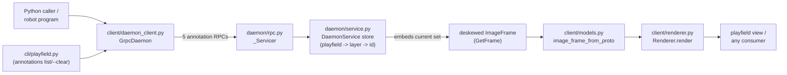

<!-- CLASI: Before changing code or making plans, review the SE process in CLAUDE.md -->

# Sprint 024: Annotation store and detection trust

## Goals

Two independent stories, riding in one sprint:

1. **Ship the daemon-held annotation store** (spec §9 decision 8, UC-28)
   — the shared-drawing rendezvous that lets multiple services (a
   planner, a viewer, an agent) communicate spatially through the
   daemon instead of each other. The design is already fully written
   and the wire-adjacent types (`Annotation`, `AnnotationSet`, the
   shape union, `Style`, `ImageFrame.annotations`) already shipped in a
   prior architecture pass — this sprint builds the daemon-side store,
   the five RPCs, the client-side renderer half, and the CLI list/clear
   surface.
2. **Fix phantom tag detections carrying fabricated motion** — a
   correctness bug in already-shipped detection: a false ArUco decode
   (id 17, not on the field, ~1 poll in 4) is reported as an ordinary
   tag, and when it flickers at different positions across polls the
   motion pipeline joins those sightings into a confident `speed`/
   `heading` for an object that does not exist. This is exactly the
   "plausible-looking wrong answer" the world-first contract exists to
   prevent, and it has been latent since sprint 021 first shipped
   detection.

## Problem

**Annotation store.** Sprints 020–022 built cameras, detection,
calibration, deskew, and single-client viewing. Nothing lets two
services agree on what is drawn on the field — a planner has no way to
show its route to a viewer or a second robot except by building its
own out-of-band channel, which `docs/design/adapters.md` §2 rules out
(adapters do not talk to each other). This was split out of sprint 023
deliberately (see that issue's "Related" section) because it is a
structurally unrelated, independently valuable capability from that
sprint's config-service work.

**Phantom detections.** `DetectionEngine.run_burst` is stateless and
single-frame: whatever `TagDetector.detect` returns for one frame
becomes a first-class `TagRecord`, with no confirmation across frames.
A single bad ArUco decode is therefore reported exactly like a real
tag, and — because the motion pipeline has no way to know a sighting
is spurious — two spurious sightings at different positions become a
fabricated trajectory. A robot subscribing to tags would act on it.

## Solution

**Annotation store**: an in-memory, playfield-addressed store inside
`DaemonService`, keyed `(playfield, layer, id)`, exposed over five new
gRPC RPCs (`PutAnnotation`, `RemoveAnnotation`, `ReplaceLayer`,
`ClearAnnotations`, `GetAnnotations`), embedded into every deskewed
frame with a monotonic revision, rendered client-side by
`client/renderer.py`'s already-stubbed annotation half, and exposed
read/clear-only from the CLI (`aprilcam playfield annotations`).
Full detail in the Architecture section below.

**Phantom detections**: presence-based temporal confirmation inside
`daemon/detection.py` — a tag id must be detected in two *consecutive*
bursts before it is included in the returned/buffered `TagFrame`.
Confirmation is presence-only (same id, any position), never
position-matched, so a real tag legitimately moving fast between
sightings is not penalized the way a naive "same id at the same place
twice" rule would penalize it. Full reasoning in the Architecture
section.

## Success Criteria

- A marker/path put by one client is visible in a second client's
  `list_annotations` and in `playfield view`'s rendering, without any
  action by the second client (UC-28.S-1, S-3).
- A daemon restart wipes all annotations; `list_annotations` returns
  an empty set at revision 0 (UC-28.S-4).
- `aprilcam playfield annotations` lists the store; `--clear [--layer
  NAME]` clears it.
- Polling a static, clean field 20+ times reports zero ids outside the
  surveyed set (today: ArUco 17 appears ~1 in 4 polls).
- A genuinely new tag placed on the field is still reported, with the
  latency before its first report measured and documented.
- A reported phantom (if one ever survives confirmation) never carries
  a computed `world_velocity`/`heading_rad`/`speed` — moot under the
  chosen design, since an unconfirmed sighting is never reported at
  all, but stated as a hard requirement regardless of mechanism.
- The mobile-tag path (a real tag entering, moving fast, leaving)
  still tracks correctly, with only the documented one-burst
  confirmation delay.

## Scope

### In Scope

- Daemon-side annotation store (5 methods on `DaemonService`), proto
  RPCs, server-side (`daemon/rpc.py`) and client-side
  (`client/daemon_client.py`, `client/models.py`) wire marshalling.
- Deskewed-frame embedding of the current annotation set; raw frames
  continue to carry none.
- `client/renderer.py`'s annotation-drawing half (marker, path,
  polygon, circle, text), completing its already-stubbed interface.
- CLI: `aprilcam playfield annotations` (list) and `--clear [--layer
  NAME]`.
- Resolving UC-28's open questions that block implementation (embed
  policy, unknown-playfield handling, playfield-replacement,
  layer-name collisions, TTL, limits, CLI authoring surface) —
  recorded explicitly in Architecture, not left implicit.
- Temporal confirmation for tag detections in `daemon/detection.py`,
  with unit and real-hardware verification.

### Out of Scope

- MCP drawing tools (`draw_marker` etc., spec §4.7) — no `mcp/`
  subsystem exists anywhere in the v2 tree yet (confirmed: no
  `aprilcam mcp` CLI entry, no `src/aprilcam/mcp/`). UC-28 nominally
  lists MCP as an interface; this sprint cannot build it because there
  is nothing to attach it to. Deferred to whichever future sprint
  stands up the MCP server, which then wraps this sprint's RPCs.
- CLI *authoring* of annotations (draw a marker from a script) — the
  issue and `process.md`'s parity rule ask for list/clear only.
- TTL expiry logic, annotation/point count limits, `stream_annotations`
  — all recorded as deliberately deferred (Architecture, Open
  Questions).
- Detector parameter re-tuning (ArUco error-correction rate, etc.) —
  considered and rejected as this sprint's mechanism; see Design
  Rationale.
- Any change to `types.py` — `Annotation`/`AnnotationSet`/the shape
  union/`Style`/`ImageFrame.annotations` already shipped in a prior
  architecture pass and need no rework here.

## Test Strategy

Headless-first, matching every prior sprint in this series: fakes and
fixtures for `DaemonService`/`GrpcDaemon`/`Renderer` unit and
integration tests (no camera needed for the annotation store — it is
playfield-addressed, not vision), a synthetic-calibration integration
test for the deskewed-frame embed path (mirroring
`test_lifecycle_integration.py`'s pattern of a real gRPC channel over a
`FakeBackend` camera), and CLI subprocess tests mirroring
`test_cli_integration.py`. `daemon/detection.py`'s confirmation logic
gets deterministic unit tests against a scripted detector double
(mirroring `test_detection.py`'s existing `_ScriptedDetector`/
`_CountingDetector` patterns) reproducing the observed intermittent
pattern. Both stories close with a `@pytest.mark.camera` hardware
ticket against camera 3 / `main-playfield` (currently calibrated, field
clean and lit) — the annotation store's is folded into its integration
ticket only where rendering genuinely needs a real deskewed frame;
phantom-detection's needs a real 20+ poll run against real optics,
which no fake can substitute for. `uv run pytest -m "not camera"` stays
green throughout; the full suite (751 tests today) grows, nothing
regresses.

## Architecture

**Sizing: Substantial.** The annotation store alone touches 8 files
across 7 modules (`proto/aprilcam_v2.proto`, `daemon/service.py`,
`daemon/rpc.py`, `client/daemon_client.py`, `client/models.py`,
`client/renderer.py`, `cli/playfield.py`) and introduces a new
cross-module RPC surface (5 new gRPC calls, a new field going live on
the wire) — comfortably past the "3+ modules or a new cross-module
dependency" bar for the full 7-step methodology, diagram included. The
phantom-detection fix is compact-shaped in isolation (one module,
`daemon/detection.py`, no new dependency), riding alongside rather than
inflating the tier — described in its own subsection below with no
diagram, per the same reasoning sprint 020 used for its own
independent-bugfix half: a diagram would show one box with an
algorithm change inside it, clarifying nothing a sentence doesn't
already say.

### Part A — Annotation store

#### Component diagram

Required per the sizing decision above: 7 modules touched, a new
cross-module RPC dependency (client wire → daemon store). Every node
already existed before this sprint except the annotation store's write
path through it (`RPC`→`Service` and `Frame`→`Models`→`Renderer` are
new edges through existing boxes) — no new top-level component is
created, which is exactly why this stays "extend the existing daemon"
rather than "new subsystem."

#### What Changed

- **`proto/aprilcam_v2.proto`** — additive: `Annotation`,
  `AnnotationSet`, one message per shape (`Marker`, `PathShape`,
  `Polygon`, `Circle`, `Text`), `Style`, and five RPCs
  (`PutAnnotation`, `RemoveAnnotation`, `ReplaceLayer`,
  `ClearAnnotations`, `GetAnnotations`) with their request/response
  messages. `GetFrameResponse.annotations` (already reserved in
  comment, per the header's own "a later stage adds it here,
  additively") goes live.
- **`daemon/service.py`** — `DaemonService` grows a fourth in-memory
  store (alongside `_playfields`, `_camera_configs`, `_calibrations`):
  `_annotations: Dict[str, Dict[str, Dict[str, Annotation]]]`, keyed
  playfield → layer → id, plus `_annotation_revisions: Dict[str,
  int]` per playfield. Five new methods implement
  `Daemon.put_annotation`/`.remove_annotation`/`.replace_layer`/
  `.clear_annotations`/`.get_annotations`. `_get_deskewed_frame` grows
  one more overlay: it embeds `get_annotations(playfield)` for the
  calibration's linked playfield, exactly as it already embeds
  `self._detection.latest(cam.slug)` for tags. The raw branch of
  `get_frame` is untouched — it never sets `annotations`.
- **`daemon/rpc.py`** — five new `_Servicer` methods, plus
  `to_proto`/`from_proto`-shaped converters for `Annotation`/
  `AnnotationSet`/each shape/`Style`, following the existing
  `_tag_record_to_proto`-style pattern exactly. `_image_frame_to_proto`
  grows a presence-checked `annotations` field.
- **`client/daemon_client.py`** — five new `GrpcDaemon` methods
  (request marshalling only, per this module's established
  request/response split).
- **`client/models.py`** — the reverse-direction converters, plus
  `image_frame_from_proto` updated to actually carry `annotations`
  (today it is hardcoded absent with a comment saying so — that
  comment is deleted, not the field).
- **`client/renderer.py`** — the annotation half of `Renderer.render`
  goes from inert to real: one draw routine per shape
  (`Marker`/`PathShape`/`Polygon`/`Circle`/`Text`), world→pixel via the
  same `calibration.geometry.world_to_deskewed_pixel` the tag-drawing
  half already uses, `Style` hints honored where present (a sensible
  default color/width when absent — style is presentation, per
  `types.Style`'s own docstring, so a renderer choosing a default for
  an absent hint is exactly its job), `layers` filtering applied,
  `extra` annotations drawn alongside embedded ones.
- **`cli/playfield.py`** — new `annotations` subcommand: bare form
  lists the current set (structured, one line per annotation);
  `--clear [--layer NAME]` clears one layer or everything. No `--all`
  fan-out for the write form (matches the existing fan-out table,
  which already lists this exact row); list is fan-out-eligible,
  matching the table's other read-only rows.

No change to `types.py`, `errors.py` (reuses `UnknownPlayfield`), or
`playfield/interfaces.py`.

#### Why

One service draws, every service sees it — the daemon is the only
component all consumers already depend on being up, so it is the only
place shared drawing state can live without adapters talking to each
other (`adapters.md` §2's own worked example for this exact
capability). Nothing here is a new *idea*; the design was fully
resolved in a prior architecture pass (spec §9 decision 8, UC-28,
`types.py`'s already-shipped `Annotation`/`AnnotationSet`). This
sprint's job is mechanical completion of an already-agreed shape,
following the same vertical-slice pattern every daemon capability in
this series has followed (proto → service → rpc → client wire →
consumer).

#### Impact on Existing Components

- `DaemonService` gains a fourth store but no new relationship to the
  three that already exist (`_playfields`, `_camera_configs`,
  `_calibrations`) — annotations are addressed by playfield name the
  same way calibration is, but the two stores never read each other
  except that `_get_deskewed_frame` already resolves a playfield name
  from the calibration to build the warp, and now reuses that same
  resolved name to look up annotations. No new field on `Calibration`
  or `PlayfieldDefinition`.
- `ImageFrame`/`GetFrameResponse` gain a live field they already
  declared — additive on the wire, no existing field renumbered or
  changed shape (matches the proto file's own stated evolution rule:
  "existing ones only ever widened... never removed or renumbered").
  Every existing consumer of a raw frame or an already-uncalibrated
  deskewed frame is unaffected: `annotations` is `None` on raw frames
  by contract and a real (possibly empty) set only appears where none
  was read before.
- `client/renderer.py`'s tag-drawing half (sprint 022) is untouched;
  the annotation half is additive in the same `render()` method.
- `view/viewer.py`'s `_fetch_playfield` needs **no code change** — it
  already calls `renderer.render(frame)` with `layers=None` (draw
  everything), which is exactly the right default for a "deliberately
  basic" viewer (spec §4.8) once the renderer actually has something
  to draw. Collapsible per-layer panel toggling (UC-18's still-open
  question) stays out of scope — the viewer draws all layers, it does
  not yet let a human hide one.

#### Migration Concerns

None. Every change is additive on the wire (new messages, new
optional field, new RPCs); no existing message is renumbered or
changed shape. No persisted state is affected — the store is in-memory
only, so there is nothing to migrate on an existing daemon's upgrade,
only a restart to pick up the new binary (same as every prior sprint's
daemon-side additions).

#### Resolved UC-28 open questions

UC-28 (`docs/design/use-cases/daemon.md`) lists several open questions
that block implementation. Resolved here, deliberately, not left for a
ticket to guess at:

1. **Embed policy** — a deskewed frame from a camera linked to a known
   playfield **always embeds a real `AnnotationSet`**, never omits it,
   even when empty (revision starts at 0 for a playfield with nothing
   drawn). This differs from `tags`, which has a genuine on/off state
   (detection running or not) that None/empty exists to distinguish;
   annotations have no such off-switch once a playfield link and
   calibration exist — there is only "empty" to represent, never
   "off". Raw frames continue to carry `None` unconditionally (UC-16,
   "raw means raw" — unchanged, already settled).
2. **Unknown playfield: reject or hold?** — **reject, uniformly,
   across all five methods** (`UnknownPlayfield`, naming the
   playfields held), matching `get_playfield`'s own existing
   precedent exactly rather than the `register_tag`/`MountParameters`
   accept-and-hold analogy UC-28 raised as the competing option. A
   playfield *name* is validated everywhere else this system already
   touches one (`get_playfield`, a camera config's link, calibration);
   a tag *id* is never validated anywhere, which is why the two
   analogies actually point different directions once compared
   directly rather than by surface similarity. Within a *known*
   playfield, a nonexistent layer is a no-op for `remove_annotation`/
   `clear_annotations` and an empty result for `get_annotations` —
   never an error — matching UC-28's own stated "clear of a
   nonexistent layer is a no-op" failure mode, applied consistently
   one level up in the addressing hierarchy (unknown *playfield*
   errors; unknown *layer* within a known playfield does not).
3. **Playfield replacement** — `SetPlayfield` for an already-held name
   does **not** clear that playfield's annotations. `set_playfield`
   already does not cascade to mark an existing calibration stale
   (`daemon/service.py`'s own docstring: "does not (yet) mark any
   calibration against it stale") — annotations are lower-stakes than
   calibration (presentation, not metrology), so this sprint follows
   the same non-cascading precedent rather than inventing a new one.
   An annotation whose world coordinates no longer make sense against
   a changed definition is a client-visible oddity the authoring
   client resolves by replacing its own layer — the same self-service
   model UC-28.S-4 already establishes for a full restart. Flagged to
   the stakeholder below as a real judgment call, not a foregone
   conclusion.
4. **Layer-name collisions with viewer built-ins (`tags`, `features`)**
   — no reservation, no daemon-side enforcement. A client-chosen layer
   named `"tags"` is stored and served exactly like any other layer;
   any resulting viewer-panel-label collision is a display concern the
   viewer owns, not something the daemon's store should know or care
   about (`adapters.md`'s "capability goes in the daemon only when it
   must" — a reserved-word rule serving one particular adapter's
   cosmetic choice is exactly the "adapter asking the daemon to do the
   adapter's job" smell §2 warns against). Fix-if-it-bites, in the
   viewer, not here.
5. **TTL** — **not implemented this sprint.** `Annotation.ttl_seconds`
   continues to round-trip (stored, served back) but drives no expiry
   behaviour — no daemon-side pruning, lazy or active. This is a
   recorded deferral, not silence: nothing in this sprint's scope
   needs it (no ticket's acceptance criteria depend on expiry), and
   the crashed-client-lingering-annotation problem it would solve has
   the same manual remedy every other runtime-state store in this
   system has today: a restart, or an explicit `clear_annotations`.
6. **Limits** — **not enforced this sprint.** No cap on annotation
   count, path points, or per-playfield/layer size. Flagged to the
   stakeholder below.
7. **CLI authoring surface** — list/clear only, matching the issue's
   explicit scope and `process.md`'s stated minimum
   ("list/clear from the shell"). Authoring from the CLI (script a
   marker draw) is deferred, not decided against — the Python client
   library already covers it for any caller that needs it
   programmatically.
8. **No `stream_annotations`** — reaffirmed out of scope, unchanged
   from UC-28's own already-drafted position: frames are the publish
   channel, `GetAnnotations` is the query.

### Part B — Phantom detection (temporal confirmation)

#### What Changed

`daemon/detection.py`'s `DetectionEngine` gains per-`(slug, TagId)`
consecutive-sighting counters (`self._streaks: Dict[str, Dict[TagId,
int]]`) and a module constant `CONFIRMATION_STREAK = 2` (overridable
per instance, matching the existing `drift_tolerance_cm`/
`drift_check_interval_s` override pattern). `run_burst` increments a
detection's streak when that id was also present in the immediately
preceding burst for that camera, resets it to 1 on a fresh sighting
(no immediately-prior hit), and drops it to 0 the moment a burst runs
and the id is absent. Only detections whose streak has reached
`CONFIRMATION_STREAK` are built into `TagRecord`s and included in the
`TagFrame` this call returns and appends to the ring buffer — an
unconfirmed detection is simply not reported this burst, not reported
with a pending flag. No change to `TagRecord`'s shape, no wire change:
this is entirely internal to `daemon/detection.py`.

#### Why

Four candidate fixes were weighed (issue's own framing):

1. **Temporal confirmation (N-of-M)** — chosen. See below.
2. **Detector parameter tuning** — investigated and rejected as this
   sprint's mechanism. `vision/detector.py`'s module docstring already
   records that v1's real-playfield-tuned `adaptiveThreshWinSize*`
   sweep and subpixel corner refinement were mined and ported in
   sprint 021; re-checking `archive/src/aprilcam/core/detector.py` and
   `vision/aruco_compat.py` for this sprint found no additional
   ArUco-specific false-decode tuning (no `errorCorrectionRate`,
   `minMarkerPerimeterRate`, or similar knob anywhere in v1) beyond
   what is already ported — there is no further "earned constant" to
   mine. Introducing *new*, untested detector tuning is an open-ended
   experimental effort (its own real-hardware validation cycle,
   genuine risk of narrowing true-positive range) that does not fit a
   single focused ticket, and the issue itself calls it "harder to
   reason about." Left as a future option if temporal confirmation
   alone proves insufficient.
3. **Report confidence, don't filter** — rejected. Contradicts
   principle 2 (clients are thin, the daemon is the single vision
   authority) by pushing the actual decision onto every consumer, and
   fails this sprint's own verification bullet literally: "no id
   outside the surveyed set is reported" means *reported*, confidence
   field or not.
4. **Suppress motion for unconfirmed tags** — subsumed, not chosen as
   a separate mechanism. Under the chosen design, an unconfirmed
   detection is never reported at all, so it obviously never carries
   computed motion either — option 4's entire guarantee falls out of
   option 1 as a side effect once option 1 is applied. Implementing
   both would be two code paths enforcing the same fact.

**Presence-based, not position-based — the load-bearing design
choice.** The observed phantom sightings appear at *different
positions* each time (issue: `(-59.4, -19.6)` in one session,
`(50.1, -30.3)` in another). A confirmation rule that required "the
same id at the same place twice" would reject this specific phantom by
accident, but it would just as easily reject a **real** fast-moving
robot tag, whose position legitimately differs between two consecutive
sightings — exactly the hard constraint this design must not violate.
Confirmation here therefore checks only "was this id detected in the
immediately preceding burst," never where — which is also simpler to
implement and reason about than any position-aware variant.

**Uniform across all ids — the plausibility-gate alternative,
rejected.** The issue's Cause section raises a third candidate not in
the numbered list: hold ids outside the playfield's surveyed set to a
higher bar than surveyed ones. Considered and rejected: it requires
`DetectionEngine` to know a linked playfield's surveyed ArUco ids at
detection time — a new cross-module dependency
(`daemon/detection.py` → playfield definitions) this fix does not
otherwise need, since presence-based confirmation is already
playfield-agnostic and works identically before a camera is even
linked. A uniform rule also means a genuinely new *surveyed* marker
(the stakeholder adds one to the field) gets the same fast, honest
confirmation as a mobile tag, with no special-cased surprise.

**Consecutive, not N-of-M with a wider window.** The issue frames the
mechanism generally as "N of the last M frames." This sprint's
concrete choice is the narrowest form, N=2 of M=2 (strictly
consecutive), for two reasons: it is the simplest to implement and
verify, and the observed data supports it — across the two recorded
phantom sightings (sprint 021 hardware notes: 1 of ~8 polls; this
issue: 1 of 4 polls), **neither ever recurred on the immediately
following poll**. A wider N-of-M window (e.g. "2 of the last 4") is
strictly weaker per-window against an independently-random false
decode than strict consecutiveness, for no latency benefit, so it was
not chosen.

**Honest uncertainty about the constant.** `CONFIRMATION_STREAK = 2`
is a starting value informed by thin empirical data (on the order of a
dozen real polls total across two sessions, two phantom hits, zero
consecutive). It is not derived from a large enough sample to prove a
zero-false-accept guarantee from first principles, and this sprint
does not pretend otherwise — ticket 007's real-hardware 20-poll run is
the actual empirical acceptance gate. If that run still shows a false
accept, the documented next step is raising the constant to 3, not a
redesign; this mirrors this codebase's existing style for a tuned,
named, honestly-derived constant (see `vision/motion.py`'s
`MIN_RELIABLE_DISPLACEMENT_CM` docstring for the precedent this
sprint's own docstring will follow).

**Precedent for the mechanism itself.** Mining `archive/` per
`CLAUDE.md`'s rule found no direct ArUco-confirmation precedent, but
did find the same *idiom* — require N consecutive occurrences before
acting — used twice already in v1: `cli/view_cli.py`'s
`_PROMOTE_FRAMES = 10` (motion-detection debounce) and
`daemon/camera_pipeline.py`'s `_DARK_WINDOW_SAMPLES = 30`
(`frame_dark` debounce). Temporal confirmation is not a novel pattern
for this codebase's lineage; it is the established way this system
already turns a noisy single-frame signal into a stable one.

#### Impact on Existing Components

- `DetectionEngine.run_burst`'s **output contract changes**: a tag
  that appears in exactly one burst and is then gone is no longer
  reported at all (previously: reported once, with no motion, since
  motion already needed two samples). This is a deliberate, accepted
  behaviour change on already-shipped output, not a regression —
  flagged explicitly below and in Migration Concerns.
- A confirmed tag's **first reported** sighting still carries no
  motion (unchanged — motion needs two *reported* samples), but that
  first report now lands one burst later than before the fix, since
  the confirming burst is the first one included. `_finish_record`,
  `_history_for_tag`, and `vision/motion.py` are otherwise untouched —
  they operate only on whatever `run_burst` decides to include, same
  as today.
- No effect on an already-calibrated tag's steady-state reporting once
  confirmed and continuously visible: streak stays at (or above)
  `CONFIRMATION_STREAK` every subsequent burst, so nothing changes for
  the common case of a tag sitting in view across many polls.
- `daemon/rpc.py`, `client/*`, `types.py` — untouched. This is entirely
  internal to `daemon/detection.py`.

#### Migration Concerns

One real, accepted behaviour change on already-shipped output (no
external consumers exist yet — pre-1.0, everything is internal to this
repo, so "migration" here means "documented," not "backward
compatible with a shipped client"):

- A tag visible for exactly one burst and then gone is no longer
  reported at all. Previously it was reported once, with no motion
  data. Given the daemon is demand-driven (not continuous streaming)
  and typical polling is ~2 Hz (`playfield view`'s `DEFAULT_POLL_HZ`),
  "visible for one burst" corresponds to well under half a second in
  view — a genuinely marginal sighting a consumer could not have
  computed anything from anyway (no motion, and now confirmed
  precisely because it *cannot* be told apart from a phantom by the
  system's own admission). Ticket 007's hardware run explicitly checks
  the mobile-tag path is unaffected in the case that matters (a tag
  visible across multiple polls).
- Every genuinely new tag's first report is delayed by exactly one
  confirming burst, always — this is the "measured and documented
  latency" the issue's own verification section explicitly permits,
  not an unbounded or open-ended cost.

### Open Questions

Carried forward for stakeholder awareness, not blocking this sprint's
tickets:

1. Annotation store has no enforced limits (count, path points). If a
   client misbehaves this is unbounded daemon memory and per-frame
   wire cost — worth a limit in a future sprint if it becomes a real
   problem, not invented speculatively here.
2. `SetPlayfield` not clearing a replaced playfield's annotations
   (resolution 3, Part A) is a genuine judgment call — reasonable
   people could default the other way. Flagged for stakeholder
   awareness; not re-opened without a concrete reason to.
3. `CONFIRMATION_STREAK = 2`'s empirical basis is thin (Part B, "Honest
   uncertainty about the constant"). Ticket 007's 20-poll hardware run
   is the real validation; a bump to 3 is the documented contingency,
   not a redesign, if that run shows a residual false accept.
4. MCP drawing tools (spec §4.7) are out of scope for lack of an `mcp/`
   subsystem to attach them to (Scope, Out of Scope). Flagged because
   UC-28 nominally lists MCP as one of three interfaces; the gap is
   structural (nothing exists yet), not an oversight.

## Use Cases

### SUC-001: Author an annotation, see it from anywhere
Parent: UC-28

- **Actor**: A-01 (robot program / planner), also serves A-02 (agent), A-03 (viewer/human)
- **Preconditions**: Daemon holds the named playfield (`main-playfield`).
- **Main Flow**:
  1. Client A puts marker `goal` and path `route` into layer `planner`
     on `main-playfield`.
  2. The daemon stores both, bumping the playfield's annotation
     revision.
  3. Client B (a different session) calls `list_annotations` and sees
     both, unchanged in content from what A sent.
  4. A camera linked to `main-playfield` publishes its next deskewed
     frame; the frame embeds the current set at the new revision.
- **Postconditions**: The annotation is visible to every consumer of
  the playfield until removed, replaced, or the daemon restarts.
- **Acceptance Criteria**:
  - [ ] UC-28.S-1 — two independent client connections agree on the
        stored set with no polling delay beyond the next RPC/frame.
  - [ ] UC-28.S-3 — `list_annotations` returns structured data, no
        image fetch required.

### SUC-002: Atomic replace, clear, and the unknown-playfield/layer rules
Parent: UC-28

- **Actor**: A-01, A-02
- **Preconditions**: Daemon holds `main-playfield`.
- **Main Flow**:
  1. A client replaces layer `planner`'s entire contents in one call.
  2. No consumer observes a half-updated layer — every frame embeds
     either the old set or the new one.
  3. A client clears a layer that does not exist — no error.
  4. A client puts to a playfield the daemon does not hold — rejected,
     naming the playfields that exist.
- **Postconditions**: Store state matches exactly one of "before" or
  "after" the replace at every observable point.
- **Acceptance Criteria**:
  - [ ] UC-28.S-2 — atomic replace, no torn read.
  - [ ] UC-28.S-5 — unknown playfield on put is a named rejection, not
        a silent hold.
  - [ ] Clear of a nonexistent layer on a *known* playfield is a
        no-op, not an error (per Architecture resolution 2).

### SUC-003: Restart wipes the slate
Parent: UC-28

- **Actor**: A-01
- **Preconditions**: A daemon holding annotations restarts.
- **Main Flow**:
  1. The daemon process restarts.
  2. `list_annotations` on `main-playfield` returns an empty set at
     revision 0.
  3. The original client re-puts its layer on reconnect.
- **Postconditions**: No annotation state survives a restart, by
  contract.
- **Acceptance Criteria**:
  - [ ] UC-28.S-4 — empty set, revision 0, after restart.

### SUC-004: List and clear annotations from the shell
Parent: UC-28, cli.md command surface

- **Actor**: A-03 (human developer)
- **Preconditions**: A reachable daemon holding a playfield with
  annotations on it.
- **Main Flow**:
  1. `aprilcam playfield annotations` prints the current set.
  2. `aprilcam playfield annotations --clear --layer planner` clears
     one layer; without `--layer`, clears everything.
- **Postconditions**: Matches `get_annotations`/`clear_annotations`
  exactly — the CLI invents no separate truth.
- **Acceptance Criteria**:
  - [ ] List is fan-out-eligible (`--all` works, each row labelled by
        daemon, per the existing fan-out table).
  - [ ] `--clear` is refused with `--all` (a write, per the same
        table).

### SUC-005: A phantom detection is never reported
Parent: UC-09, UC-10

- **Actor**: A-01, A-02 (any tag consumer)
- **Preconditions**: A calibrated camera on a clean, static field with
  no unsurveyed markers physically present.
- **Main Flow**:
  1. The detector occasionally false-decodes an id not on the field.
  2. `DetectionEngine` tracks its per-burst presence.
  3. Absent a second, immediately-consecutive sighting, the id is
     never included in any `TagFrame` this daemon returns.
- **Postconditions**: `get_tags`/`get_tag`/`get_tag_history` never
  show the phantom id, at any point, for a single-burst false decode.
- **Acceptance Criteria**:
  - [ ] 20+ real polls of a clean, static `main-playfield` report zero
        ids outside the surveyed set.
  - [ ] No reported tag ever carries motion computed from an
        unconfirmed sighting (moot by construction — flagged as a hard
        requirement regardless of mechanism).

### SUC-006: A real new tag is still reported, with documented latency
Parent: UC-09, UC-10

- **Actor**: A-01 (robot entering the field)
- **Preconditions**: A calibrated camera; a tag not previously in view.
- **Main Flow**:
  1. The tag enters the field and is detected on consecutive bursts.
  2. It is reported starting on its second (confirming) burst.
  3. It continues tracking, including motion, as it moves.
- **Postconditions**: The tag is indistinguishable in steady-state
  behaviour from pre-fix reporting, aside from the one-burst
  confirmation delay on first appearance.
- **Acceptance Criteria**:
  - [ ] A real tag placed on the field is reported; the number of
        polls/bursts before its first report is measured and recorded
        in the ticket's completion notes.
  - [ ] A real moving tag's motion (speed/heading) is computed
        correctly once confirmed, matching pre-fix behaviour from its
        second reported sample onward.

## GitHub Issues

(None — both source issues are CLASI-local, `clasi/issues/`.)

## Definition of Ready

Before tickets can be created, all of the following must be true:

- [x] Sprint planning document is complete (sprint.md, including its
      Architecture and Use Cases sections)
- [x] Architecture review passed (or skipped, for changes with no
      architectural impact)
- [x] Stakeholder has approved the sprint plan

## Tickets

| # | Title | Depends On |
|---|-------|------------|
| 001 | Annotation store — daemon side (proto, service, RPC marshalling) | — |
| 002 | Annotation store — client wire (daemon_client, models) | 001 |
| 003 | Client renderer — draw annotations | — |
| 004 | CLI: playfield annotations (list, --clear) | 002 |
| 005 | Annotation store — integration and acceptance verification | 001, 002, 003, 004 |
| 006 | Phantom detection: temporal confirmation in DetectionEngine | — |
| 007 | Phantom detection: real-hardware verification against main-playfield | 006 |

Tickets execute serially in the order listed. 003 and 006 have no
dependency on 001/002 or on each other — they are sequenced here for
narrative continuity (each story's tickets grouped together), not
because execution order requires it.
