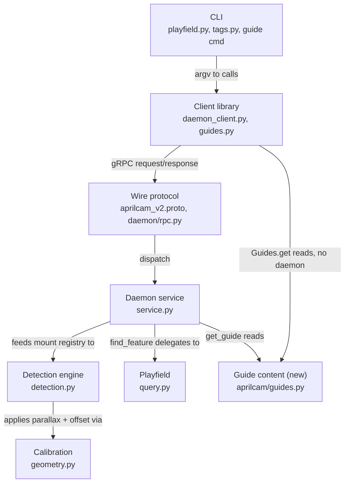

<!-- CLASI: Before changing code or making plans, review the SE process in CLAUDE.md -->

# Sprint 025: Complete the daemon query surface

## Goals

Implement the three `Daemon` capabilities that currently `raise
NotImplementedError`: `find_feature` (UC-08), the mobile-tag registry
`register_tag`/`unregister_tag`/`list_tag_parameters` (UC-12), and
`get_guide` (UC-27). All three are query-surface RPCs the MCP server
(sprint 026) must expose — this sprint exists specifically to finish
them before that wire layer is built, so it is built once, against a
complete daemon, not twice.

## Problem

Sprints 020-024 built camera ownership, detection with confirmed-tag
filtering, calibration + deskew + live view, restart-surviving config,
and the daemon-held annotation store. Three capabilities were declared
in the interface skeletons during that design work and verified
sufficient by the sufficiency traces, but no sprint has claimed them:

1. **`find_feature`** — a client cannot ask "where is the blue dot" and
   get a surveyed position back; `Daemon.find_feature` and
   `playfield.interfaces.FeatureQuery.find` both `raise
   NotImplementedError`.
2. **The mobile-tag registry** — the system can report where a *tag* is
   but not where the *robot carrying it* is. `mount_z`/`mount_x`/
   `mount_y`/`mount_yaw` (`MountParameters`, already in `types.py`) are
   never applied to a detected pose.
3. **`get_guide`** — an MCP agent (and any robot programmer) has no way
   to ask the system how to use itself; `Daemon.get_guide` and
   `client.interfaces.Guides` are both unimplemented, and nothing is
   packaged to serve.

## Solution

Implement all three against their already-specified interfaces
(`daemon/interfaces.py`'s `find_feature`/`register_tag`/
`unregister_tag`/`list_tag_parameters`/`get_guide`,
`playfield/interfaces.py`'s `FeatureQuery`, `client/interfaces.py`'s
`Guides`), mining `archive/src/aprilcam/` for v1's proven approach to
each (fuzzy feature matching, mount registration, packaged guide text)
without porting any of it wholesale — v1's persistence, config
plumbing, and CLI verbs are all superseded by v2's ephemeral-runtime-state
and CLI conventions.

Two design decisions this sprint resolves, both previously left open in
`docs/design/use-cases/daemon.md`:

- **The robot's mount reference point is client-defined**, not
  daemon-mandated (recommended default: centre of rotation), in the
  robot's own frame (+x forward, +y left, matching v1), rotating with
  `mount_yaw`.
- **The packaged guide is static text this sprint**, not generated from
  live daemon state; generation is recorded as a follow-up once sprint
  026's MCP server gives a concrete consumer to design the
  live-augmentation contract against.

See the Architecture section's Design Rationale for the full reasoning
behind both.

## Success Criteria

- `aprilcam playfield where "the orange dot"` returns all four matches
  on `main-playfield`, with positions, and opens no camera (UC-08.S-2).
- Registering a mount for a tag moves its reported position to the
  robot's reference point rather than the tag's; unregistering reverts
  it (UC-12.S-2/S-3/S-4, hardware-verified).
- `aprilcam guide` (and the daemon RPC) returns the system's own
  conventions with **no daemon running** for the client-side path
  (UC-27.S-1).
- All three capabilities are reachable from Python (the client
  library), the CLI, and are ready for the MCP server (sprint 026) to
  wrap without further daemon changes.
- `uv run mypy` clean; full test suite green headless (`-m "not
  camera"`), and green with hardware attached.

## Scope

### In Scope

- `playfield/query.py` (new) — concrete `FeatureQuery`, fuzzy match
  adapted from v1's `core/playfield_query.py`.
- `daemon/service.py` — `find_feature`, `register_tag`,
  `unregister_tag`, `list_tag_parameters`, `get_guide` implemented on
  `DaemonService`.
- `calibration/geometry.py` — parallax projection + mount offset/yaw
  composition, as pure functions alongside the existing homography
  functions.
- `daemon/detection.py` — `DetectionEngine` gains an injectable mount
  lookup, applied so `get_tag`/`get_tags`/`get_tag_history` report the
  robot's pose, not the tag's.
- `proto/aprilcam_v2.proto`, `daemon/rpc.py`,
  `client/daemon_client.py` — new RPCs: `FindFeature`, `RegisterTag`,
  `UnregisterTag`, `ListTagParameters`, `GetGuide`.
- New shared static-content module (e.g. `aprilcam/guides.py` +
  packaged guide text) — read by both `Daemon.get_guide` and the new
  `client/guides.py`'s `Guides` implementation, so the two can never
  disagree (single source of text).
- CLI: `aprilcam playfield where <query>`; a new `cli/tags.py` module
  for `aprilcam tags mount register|clear|list`; a new top-level
  `aprilcam guide [name]`.
- `types.py`'s `MountParameters` docstring updated to state the
  resolved reference-point and frame convention (no longer "Open").
- `docs/design/use-cases/daemon.md` — a "Decisions resolved 2026-08-03"
  table recording both decisions above, plus the retroactive-history
  question (resolved: no).

### Out of Scope

- `stream_images`/`stream_tags` (sprint 027) — untouched.
- The MCP server itself (sprint 026) — this sprint only makes the
  daemon ready for it.
- Generated/live-augmented guide content (real camera/playfield names)
  — recorded as a follow-up issue, not built this sprint.
- A global, non-per-camera daemon configuration document for a default
  tag size — no correction math this sprint consumes `size_cm`, so
  inventing config plumbing for it now is unjustified; recorded as a
  follow-up.
- `aprilcam tags generate` and real mDNS discovery (sprint 028) —
  unrelated to this sprint's scope despite the shared `tags/` CLI noun.

## Test Strategy

Headless fixtures wherever a claim doesn't require hardware; hardware
verification (`@pytest.mark.camera`, skipping cleanly) only where a
claim is genuinely hardware-checkable:

- **`find_feature`** — pure logic, no hardware ever needed. Fixture
  playfield definitions matching `main-playfield`'s worked example
  (`dot-west-blue`, the four orange dots, AprilTag 1 + ArUco 1 both at
  distinct positions) exercise UC-08.S-1/S-2/S-3 directly against
  `FeatureQuery.find`, then again through `DaemonService.find_feature`
  and the RPC round trip, all headless.
- **Mount registry — math** — synthetic cases (a tag at a known
  homography-derived world position, given `mount_z`/`mount_x`/
  `mount_y`/`mount_yaw`) against hand-computed expected results,
  headless, in `calibration`'s own test module alongside the existing
  geometry suite.
- **Mount registry — service behavior** — headless: register/unregister
  round-trip, `list_tag_parameters` reflects current state, `mount_z`
  set with no calibration is rejected (UC-12.S-5), partial mount spec
  (`z` set, `x`/`y` unset) treated as zero offset (UC-12's own failure
  mode), a registration for a tag never seen is accepted and applies
  once the tag appears.
- **Mount registry — hardware verification** — `@pytest.mark.camera`:
  register a mount for a tag physically visible to camera 3
  (`arducam-ov9782-usb-camera`, calibrated per the current field state),
  confirm the reported position moves off the raw tag position by
  approximately the registered offset; unregister and confirm it
  reverts. This is the issue's own Verification bullet, made concrete.
- **Guides** — headless: `client.guides.Guides.get()`/`available()`
  work with no daemon constructed at all (the literal test for
  UC-27.S-1's no-daemon-needed property); unknown name raises
  `UnknownGuide` naming the real available guides (UC-27.S-3);
  `Daemon.get_guide` returns byte-identical text to
  `client.guides.Guides.get()` for the same name (the single-source-of-
  text guarantee, not merely "similar").
- **CLI** — argparse wiring tests for `playfield where`, `tags mount
  register|clear|list`, and `guide`, mirroring the existing
  `tests/aprilcam/cli/` pattern (mocked `Discovery`/`Daemon` where a
  daemon is contacted; no mock at all for `aprilcam guide`, since it
  must not construct one).
- **Typing** — `uv run mypy` clean, `tests/test_typing.py` unchanged in
  intent, covering every new module.

## Architecture

**Substantial** — touches five existing subsystems (`playfield`,
`daemon`, `calibration`, `client`, `cli`) and introduces one new shared
leaf module (packaged guide content) that both `daemon` and `client`
depend on for the first time. No single one of the three capabilities
is large on its own — `find_feature` in particular is "the smallest,
pure lookup against an already-loaded definition" — but together they
touch enough modules, and the guide-content module is a genuinely new
cross-module dependency, to clear the substantial threshold rather than
compact. Full 7-step methodology below, with a component diagram: three
independently-composed capabilities landing in the same daemon service
class is exactly the case a diagram earns its keep for, unlike sprint
020's bugfix sweep.

### Architecture Overview

**Step 1 — the problem.** Three declared-but-unimplemented `Daemon`
methods block sprint 026 (the MCP server) from having a complete
surface to wrap. Each is specified already (interface docstrings, UC-08/
UC-12/UC-27's scenarios) — this sprint is implementation and two open
decisions, not new design space, except where noted below.

**Step 2 — responsibilities.**
- *Answer "where is X" from the surveyed definition* (no camera, no
  calibration) — independent of the other two; changes only when
  matching heuristics change.
- *Track per-tag mount registrations and apply them to observed poses*
  — two sub-responsibilities that change together: the registry
  (register/unregister/list) and the correction math (parallax +
  offset + yaw), both only meaningful together.
- *Serve packaged instructions, identically, with or without a daemon*
  — independent of the other two; changes only when the guide's content
  or the static/generated decision changes.
- *Carry all three over the wire* (proto + client stub) — changes
  whenever any of the three's request/response shape changes, not
  otherwise.

**Step 3 — modules.**

| Module | Purpose (one sentence) | Boundary | Serves |
|---|---|---|---|
| `playfield/query.py` (new) | Fuzzy-match surveyed features against a free-text query. | Takes a `PlayfieldDefinition`'s `features()`; returns `Feature` tuples; touches no daemon state, no camera. | UC-08 |
| `daemon/service.py` (extended) | Dispatch each RPC to the right subsystem and hold the mount registry's live state. | Owns the `TagId -> MountParameters` map under the existing daemon lock; delegates matching to `playfield/query.py`, math to `calibration/geometry.py`, text to the guide module. | UC-08, UC-12, UC-27 |
| `calibration/geometry.py` (extended) | Turn an observed tag pose plus its mount parameters into the robot's pose. | Pure functions, no daemon state, no I/O — same shape as the existing `pixel_to_world`/`world_to_pixel`. | UC-12 |
| `daemon/detection.py` (extended) | Apply the current mount registry to every record before it enters the ring buffer. | Gains one injectable (`mount_lookup`); does not itself store registrations. | UC-12 |
| `aprilcam/guides.py` (new) | Hold and serve the packaged guide text. | Pure file/text access, no daemon, no client dependency — a leaf. | UC-27 |
| `client/guides.py` (new) | The no-daemon-needed `Guides` implementation. | Reads only from the guide-content leaf module. | UC-27 |
| `client/daemon_client.py` (extended) | Carry the five new RPCs' request/response conversions. | Proto <-> Python at the client boundary only, mirroring every existing method here. | UC-08, UC-12, UC-27 |
| `proto/aprilcam_v2.proto`, `daemon/rpc.py` (extended) | Define and dispatch the five new RPCs. | Wire shapes plus server-side dispatch only; no business logic. | UC-08, UC-12, UC-27 |
| `cli/playfield.py` (extended), `cli/tags.py` (new), CLI guide command (new) | Argv-to-client-call shells, per existing CLI convention. | No authoritative state, no vision (`adapters.md`'s rule, already followed by every existing CLI module). | UC-08, UC-12, UC-27 |

**Step 4 — diagram.** Required: this sprint composes three
capabilities into the same daemon service and introduces a new shared
dependency (the guide-content leaf) — exactly the case where a reader
benefits from seeing the shape rather than inferring it from prose.

No cycles: `Guides` and `Playfield`/`Calibration` are leaves with no
outgoing edges into anything above them. The two edges into `Guides`
(from `Daemon` and directly from `Client`) are the diagram's whole
point — they are what makes "serves identical text with or without a
daemon" true by construction rather than by discipline.

**Step 5 — What Changed / Why / Impact / Migration Concerns.**

*What Changed.*
- `playfield/query.py`: first concrete `FeatureQuery`. Tokenizes each
  `Feature`'s `slug` (split on `-`), `kind`, and `colour`; a query
  matches when every one of its normalized tokens is a subset of a
  feature's token set (exact-superset matching — see Design Rationale
  for why no ranking or threshold is introduced). A bare "tag" prefers
  `april_tag` over `aruco_tag` when both match, mirroring UC-09.S-3's
  own family-disambiguation spirit. Note: `main-playfield`'s slugs
  (`dot-west-blue`, `dot-northeast-orange`, ...) already encode
  cardinal direction and colour, so cardinal matching (UC-08's
  "blue dot west") works from slug tokenization alone — v2's `Feature`
  dataclass deliberately carries no separate `cardinal` field (a prior
  sprint's decision, `config/loader.py`'s own docstring), and this
  sprint does not reopen that.
- `daemon/service.py`: five new methods. `find_feature` looks up the
  named playfield's current definition and delegates to
  `FeatureQuery`. `register_tag`/`unregister_tag` mutate an in-memory
  `Dict[TagId, MountParameters]` under the existing lock;
  `list_tag_parameters` returns a snapshot. `get_guide` reads the new
  guide-content module.
- `calibration/geometry.py`: new pure functions — project a tag's
  world position down through `mount_z` (parallax), then apply
  `mount_x`/`mount_y` (rotated into the world frame by the tag's
  observed yaw) and `mount_yaw` to the reported heading/yaw.
- `daemon/detection.py`: `DetectionEngine.__init__` gains
  `mount_lookup: Callable[[TagId], Optional[MountParameters]]`,
  defaulting to "no registrations" (a no-op lookup) so every existing
  caller/test is unaffected unless it opts in. Applied once per record,
  inside the same step that already turns pixels into world
  coordinates, so it lands in the ring buffer already corrected — every
  consumer (`get_tag`, `get_tags`, `get_tag_history`, and the not-yet-
  built streams) sees the robot's pose for free, with no per-call
  correction logic duplicated anywhere else.
- **Resolved, not left open**: mount-parameter changes are **not**
  retroactive. A registration or un-registration only affects frames
  detected after the change; buffered `TagFrame`s keep whatever
  correction (or none) was in effect when they were built. Recomputing
  history would require storing raw, pre-correction detections, which
  the ring buffer does not do and this sprint does not add.
- `proto/aprilcam_v2.proto`: five new RPCs (`FindFeature`,
  `RegisterTag`, `UnregisterTag`, `ListTagParameters`, `GetGuide`) and
  their messages, following this file's existing conventions exactly
  (`optional` for legitimate-absence fields, no world-cm placeholders
  for absent data).
- `aprilcam/guides.py` + `client/guides.py`: packaged guide text
  (adapted from v1's `AGENT_GUIDE.md`/`ROBOT_API_GUIDE.md` for v2's
  conventions — A1-centred world frame, tag family+id addressing,
  UC-01...UC-05 bring-up order, per-session re-registration of mounts
  and annotations), served identically by both accessors because both
  read the same module.
- CLI: `aprilcam playfield where <query>`; new `aprilcam tags mount
  register|clear|list`; new top-level `aprilcam guide [name]` (reads
  locally via `client.guides.Guides` — no `-d`/discovery, since it must
  work with no daemon running at all, UC-27.S-1).

*Why.* All three capabilities are already fully specified by the
interface skeletons and use-case scenarios; the work is implementation
plus the two decisions this sprint owns (reference point, static vs.
generated guide). Doing this before the MCP server (sprint 026) avoids
building the wire layer against an incomplete daemon and then again
against the completed one.

*Impact on Existing Components.* Additive throughout. `daemon/
interfaces.py` and `playfield/interfaces.py` are unchanged (already
fully specified); `DaemonService` implements 5 more of `Daemon`'s
methods, remaining an honest partial implementation (`stream_images`/
`stream_tags` still `NotImplementedError`, correctly deferred to sprint
027). `DetectionEngine`'s one new constructor parameter defaults to a
no-op, so no existing test or caller changes behavior unless it opts
in. `errors.py` already declares `UnknownGuide` (added ahead of this
sprint with the interface skeletons) and `NotCalibrated` (existing,
reused for UC-12.S-5's mount-without-calibration rejection) — no new
error types are anticipated.

*Migration Concerns.* None. No on-disk schema changes, no data
migration. The mount registry and the guide-serving path both start
empty/available fresh on every daemon start, consistent with the
already-made decision that mount registrations are runtime-only and do
not survive a restart.

### Design Rationale

**Decision: the robot's mount reference point is client-defined, not
daemon-mandated, with a recommended default of "centre of rotation."**
- *Context*: UC-12 leaves this open — geometric centre, drive-axle
  centre, or client-defined — and states plainly that "offsets are
  meaningless without a stated convention."
- *Alternatives considered*: (a) the daemon mandates geometric centre;
  (b) the daemon mandates drive-axle centre; (c) client-defined, with a
  recommended default stated in the guide.
- *Why this choice*: calibration is deliberately kept robot-agnostic
  (spec §2.4) — the daemon has no way to inspect or verify a robot's
  physical geometry, so mandating a specific point would be an
  unenforceable rule dressed up as a real one. (c) keeps the daemon's
  job purely mechanical (apply whatever offset it is given) while the
  guide gives every team an unambiguous default to reach for if they
  have no reason to choose otherwise — matching v1's own practice,
  which called the mount point "the object's reference point — its
  centre of rotation" without ever enforcing that choice in code.
- *Consequences*: robots with genuinely different reference-point
  choices (a symmetric holonomic platform vs. a differential-drive
  robot) are equally well served. The discipline lives entirely in the
  packaged guide (UC-27) — if a client ignores it, results are self-
  consistent but not comparable across teams, which is an acceptable
  and explicitly documented trade.

**Decision: mount offsets use the robot's own frame, +x forward, +y
left, rotating with `mount_yaw`.**
- *Context*: UC-12 resolves that offsets must be in the robot's frame
  (for yaw to compose correctly) but does not fix a sign convention.
- *Alternatives considered*: invent a new convention (e.g. +x right,
  +y forward); carry v1's forward/left convention forward unchanged.
- *Why this choice*: no reason to invent a new convention when v1's
  (`x_mm` forward, `y_mm` left) is already proven and eases porting
  existing robot client code; consistency with a working precedent
  beats novelty here.
- *Consequences*: documented explicitly in `types.py`'s
  `MountParameters` docstring and the packaged guide — this is exactly
  the class of thing UC-12 warns "silently mirrors or shifts positions
  if left implicit."

**Decision: the packaged guide is static text this sprint; generation
is deferred.**
- *Context*: UC-27 asks whether the guide should be partly generated
  (real tool list, camera names, playfields) rather than purely static;
  a generated guide is more useful but conflicts with the no-daemon-
  needed property `client.Guides` must have (UC-27.S-1).
- *Alternatives considered*: (a) fully generated, daemon-only; (b)
  fully static, one shared source for both accessors; (c) static base
  plus an optional daemon-appended "live facts" section.
- *Why this choice*: v1 shipped purely static guides successfully and
  they were considered adequate; a shared static-text module makes
  `client.Guides` (no daemon) and `Daemon.get_guide` (wire-served)
  *provably* identical by construction — both read the same module,
  so there is no path by which they could drift, which is the entire
  point UC-27 makes about why the system should carry its own
  instructions. (c) is a reasonable near-term evolution but designing
  a live-augmentation contract belongs to a sprint with a concrete
  consumer for it (sprint 026's MCP server), not this one.
- *Consequences*: a follow-up issue is warranted for generated content
  once sprint 026 exists; until then the guide's examples use
  placeholder names (`arducam-ov9782-usb-camera`, `main-playfield`)
  exactly as v1's did, presented as illustrative, not introspected.

**Decision: `MountParameters.size_cm` has no daemon-level startup
default this sprint.**
- *Context*: UC-12.S-1 describes "a default tag size from the config
  the daemon loads at startup," but no daemon-level (non-per-camera)
  configuration concept exists, and no correction math this sprint adds
  actually consumes `size_cm` — only `mount_x`/`mount_y`/`mount_z`/
  `mount_yaw` feed the parallax/offset/yaw projection.
- *Alternatives considered*: invent a new global daemon config document
  now for this one field; accept it as registration-only with no
  default source until something needs one.
- *Why this choice*: a new configuration-document kind (loader path,
  directory convention, schema) is a disproportionate addition for a
  field nothing yet reads.
- *Consequences*: `register_tag` accepts an optional `size_cm` with no
  substituted default; `list_tag_parameters` reports exactly what was
  registered, `None` otherwise. Recorded as a follow-up, not silently
  dropped — see Open Questions.

### Migration Concerns

None — see Step 5 above. Every change is additive: new methods on an
intentionally-partial base class, one new optional constructor
parameter with a safe no-op default, new RPCs, new CLI commands, no
on-disk schema or data migration.

### Open Questions / Follow-ups

- Generated/live-augmented guide content (real camera and playfield
  names) once sprint 026's MCP server gives a concrete consumer to
  design the augmentation contract against.
- A global, non-per-camera daemon configuration document, if and when
  something other than `MountParameters.size_cm` needs a daemon-wide
  default.
- UC-08's own open question ("ranked-best-match or all-matches-above-
  threshold?") is resolved by this sprint: neither — exact token-
  superset matching, no ranking, no threshold (see Step 5).

## Use Cases

### SUC-001: Ask where a surveyed feature is
Parent: UC-08

- **Actor**: A-02 (MCP agent), also served by A-01, A-03
- **Preconditions**: A playfield definition is held by the daemon
  (UC-02). No calibration and no camera required.
- **Main Flow**:
  1. Client sends a free-text query and a playfield name to
     `find_feature`.
  2. The daemon tokenizes the query and matches it against every
     surveyed feature's slug/kind/colour tokens.
  3. Every feature whose token set is a superset of the query's tokens
     is returned, each with its surveyed world position.
- **Postconditions**: None — a read.
- **Acceptance Criteria**:
  - [ ] UC-08.S-1: "the blue dot", "blue dot west", and the exact slug
        all resolve to `dot-west-blue` at (-50, 0).
  - [ ] UC-08.S-2: "the orange dot" returns all four orange dots, never
        an arbitrary single pick.
  - [ ] UC-08.S-3: "the orange triangle" (nothing on the field matches)
        returns empty, never the nearest orange feature.
  - [ ] No camera is opened and no calibration is required to answer
        any of the above.

### SUC-002: Report the robot's pose, not the tag's
Parent: UC-12

- **Actor**: A-01 (robot program), also served by A-03
- **Preconditions**: Daemon running; calibration present on the camera
  in question for any correction to be meaningful.
- **Main Flow**:
  1. Client registers a tag's mount parameters (`size_cm` optional,
     `mount_x`/`mount_y`/`mount_z`/`mount_yaw` in the robot's own frame,
     +x forward +y left) via `register_tag`.
  2. The daemon applies parallax (via `mount_z`), then the X/Y offset
     and yaw, to every subsequent detection of that tag.
  3. `get_tag`/`get_tags`/`get_tag_history` report the robot's position
     and heading, not the tag's.
  4. Client calls `unregister_tag`; subsequent reports revert to the
     raw tag pose.
- **Postconditions**: Per-tag parameters held in memory, applied per
  frame going forward only (not retroactively); gone on daemon restart.
- **Acceptance Criteria**:
  - [ ] UC-12.S-1: with no per-tag override, a detected tag reports
        `size_cm=None` (no startup-config default source exists this
        sprint — see Design Rationale) rather than a fabricated value.
  - [ ] UC-12.S-2: a tag mounted 20cm above the field, viewed
        obliquely, reports a position measurably closer to the robot's
        actual footprint once `mount_z` is registered than with it
        unset.
  - [ ] UC-12.S-3: an off-centre, elevated tag reports the robot's
        reference point, not the tag — rotating the robot in place
        keeps the reported position fixed while the raw tag position
        sweeps around it.
  - [ ] UC-12.S-4: a tag mounted rotated 90 degrees from the robot's
        forward direction reports the robot's true heading, not the
        tag's presented orientation.
  - [ ] UC-12.S-5: registering `mount_z` on an uncalibrated camera is
        rejected or flagged inert, never silently accepted and ignored.
  - [ ] Hardware-verified (`@pytest.mark.camera`): registering a mount
        moves the reported position off the raw tag position by
        approximately the registered offset; unregistering reverts it
        (the issue's own Verification bullet).
  - [ ] Partial mount spec (`z` set, `x`/`y` unset) is treated as zero
        offset, not an error.
  - [ ] A registration for a tag not currently visible is accepted and
        takes effect once the tag appears.

### SUC-003: Ask the system how to use itself
Parent: UC-27

- **Actor**: A-02 (MCP agent), also served by A-01
- **Preconditions**: None. Must work with **no daemon running** for the
  client-side accessor.
- **Main Flow**:
  1. Client asks for a guide, optionally by name, with no daemon
     started (`client.guides.Guides`) or via a running daemon
     (`Daemon.get_guide`).
  2. The system returns packaged text: world frame conventions, tag
     family+id addressing, the UC-01...UC-05 bring-up order, and the
     per-session re-registration rule for mounts (UC-12) and
     annotations (UC-28).
- **Postconditions**: None — a read.
- **Acceptance Criteria**:
  - [ ] UC-27.S-1: a fresh process with no daemon running can fetch the
        default guide and receive the bring-up order and conventions.
  - [ ] UC-27.S-2: the guide states the world frame explicitly (+x
        east, +y north, A1-centred, heading 0 = east CCW positive) so
        an agent never has to infer it from observed data.
  - [ ] UC-27.S-3: an unknown guide name raises `UnknownGuide` naming
        the guides that actually exist, never empty text.
  - [ ] `Daemon.get_guide(name)` and `client.guides.Guides.get(name)`
        return byte-identical text for the same name.

## GitHub Issues

(None — this sprint's work is tracked via `clasi/issues/`, not GitHub
issues.)

## Definition of Ready

Before tickets can be created, all of the following must be true:

- [x] Sprint planning document is complete (sprint.md, including its
      Architecture and Use Cases sections)
- [x] Architecture review passed (or skipped, for changes with no
      architectural impact)
- [x] Stakeholder has approved the sprint plan

## Tickets

| # | Title | Depends On |
|---|-------|------------|
| 001 | Feature fuzzy-match core (`playfield/query.py`) | - |
| 002 | Wire find_feature into daemon, RPC, and CLI | 001 |
| 003 | Mount-correction geometry and reference-point decision | - |
| 004 | Mobile-tag registry service, detection wiring, and RPC | 003 |
| 005 | CLI tags mount surface and hardware verification | 004 |
| 006 | Packaged guide content and no-daemon client accessor | - |
| 007 | Wire get_guide into daemon and RPC, CLI guide command | 006 |

Tickets execute serially in the order listed. Three independent
chains: 001->002 (find_feature), 003->004->005 (mount registry),
006->007 (guides) — a stakeholder or execution mode that opts into
parallel worktrees could run the three chains concurrently; absent
that, execute strictly in ticket-number order. Ticket 007 carries
`completes_issue: true`; 001-006 carry `completes_issue: false` — the
single linked issue (`complete-the-daemon-query-surface.md`) is
archived only once all seven reach `done`.
