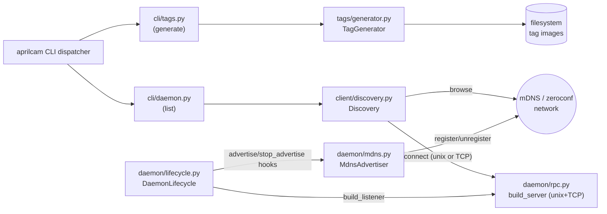
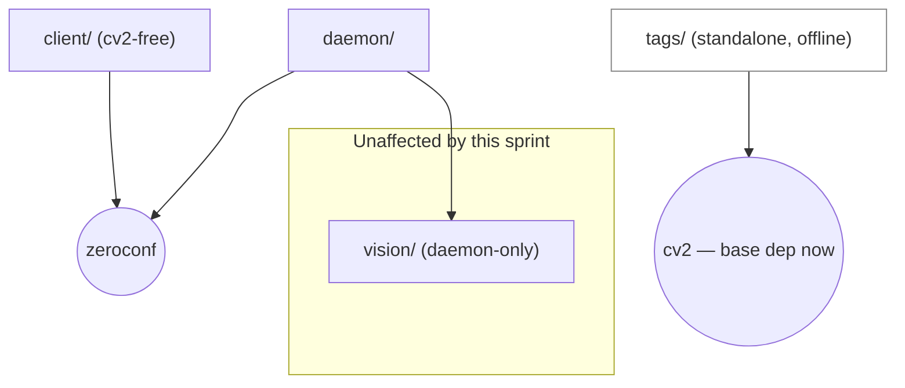

<!-- CLASI: Before changing code or making plans, review the SE process in CLAUDE.md -->

# Sprint 028: Tag generation and daemon discovery

## Goals

Close two independent, small gaps that both amount to "the system's own
docs describe a capability that does not exist yet":

1. **`aprilcam tags generate` (UC-21).** `src/aprilcam/tags/` has
   `interfaces.py` and nothing else. Implement a concrete `TagGenerator`
   and wire it into the CLI so a developer can print AprilTag 36h11 and
   ArUco 4x4 markers at a known physical size — the offline step that
   builds a playfield in the first place.
2. **Real mDNS discovery and `aprilcam daemon list` (UC-13).**
   `Discovery.find_all()` is stubbed to local-only (sprint 020's
   Architecture Decision 2). Make it real: the daemon advertises itself,
   a client can browse for every daemon on the network, and `aprilcam
   daemon list` exists. This is also the sprint that opens the daemon's
   gRPC control plane on TCP — a explicitly deferred decision (`config/
   directories.py`'s "Open Question 2") whose own deferral condition
   ("whichever future sprint actually exercises a daemon-to-daemon or
   CLI-to-remote-daemon path end-to-end against a real second host") is
   exactly this sprint.

## Problem

**Tag generation.** `TagGenerator.valid_ids`/`generate` raise
`NotImplementedError`. There is no way to produce a printable tag from a
bare `aprilcam` install, even though UC-21 already recorded the decision
that makes this possible (OpenCV as a base dependency) — the decision
was made, but nothing built on it.

**Daemon discovery.** `Discovery.find_all()` returns at most one
`DaemonInfo` (the local daemon, via a lock-file probe) — never a real
mDNS broadcast/browse. Consequences: `--all` fan-out can never find a
second daemon, so every fan-out-capable command silently degenerates to
"the local one"; `aprilcam daemon list` does not exist at all; and the
daemon's control plane still only binds a unix socket, so even an
explicitly-named `-d HOST` pointed at a real second machine has nothing
to connect to. This directly blocks the deployment the whole design is
shaped around (`docs/design/adapters.md`, spec §3, UC-01's own main
success path step 2): a Raspberry Pi over the field, discovered and
used by remote clients.

Both gaps were scoped out of earlier sprints with recorded, still-valid-
at-the-time reasons (tag generation: the stakeholder's playfield already
existed; mDNS: sprint 020 had no command that needed it). Neither reason
still holds.

## Solution

**Tag generation.** A concrete `aprilcam.tags.generator.TagGenerator`
deriving from `tags.interfaces.TagGenerator`, self-contained (no
dependency on `vision/`, `daemon/`, or `client/` — tags/ stays a
standalone, purely-offline utility). It validates every requested id
against the family's real OpenCV dictionary size before generating
anything, checks output-directory writability before anything is
rendered, and warns (does not fail) when the requested physical size is
unachievable at the target DPI. `aprilcam tags generate` becomes a
sibling subcommand next to the existing `tags mount`. OpenCV moves from
the `daemon` optional extra into the base `dependencies` list, executing
UC-21's already-recorded decision.

**Daemon discovery.** Three parts, in dependency order:

1. **Daemon-side**: a new `daemon/mdns.py` (`MdnsAdvertiser`, converted
   from `archive/src/aprilcam/daemon/mdns.py`) advertises
   `_aprilcam._tcp.local.` once the daemon's gRPC control plane is
   listening on TCP — a small addition to `daemon/rpc.py`'s
   `build_server()`, bound on the spec-reserved `TCP:5280` alongside the
   existing unix socket, with the same "never load-bearing" failure
   philosophy already established for mDNS in v1: if the TCP port can't
   bind, the daemon logs a warning, skips advertising, and continues on
   the unix socket exactly as it does today. It never fails to start
   because of this.
2. **Client-side**: `client/discovery.py`'s `Discovery.find_all()` keeps
   its existing, network-independent local lock-probe (unchanged — it is
   the more precise, instant answer for "is a daemon running on *this*
   machine") and adds a real zeroconf `ServiceBrowser` browse for
   everything else, self-filtered so the local daemon's own
   advertisement is never double-counted. A browse failure (not "found
   nothing") raises `DiscoveryFailed`, distinctly, per UC-13.S-5.
3. **CLI**: `aprilcam daemon list` — a new subcommand in `cli/daemon.py`
   that lists every daemon `find_all()` reports, with camera count and
   linked playfields for each reachable one (reusing the existing
   `Daemon.status()` RPC and the existing `fan_out()` helper — no new
   RPC method is needed).

## Success Criteria

- `aprilcam tags generate` produces correctly-sized AprilTag 36h11 and
  ArUco 4x4 PNGs for both families, and its three UC-21 failure
  contracts (bad id, unwritable path, unachievable size) all behave as
  specified.
- `aprilcam daemon list` finds every daemon on the network, not just the
  local one; an empty network reports an empty list, not an error; a
  blocked/broken discovery reports failure, distinctly from empty; a
  daemon that advertises but does not answer RPCs is listed and flagged,
  not filtered out.
- `--all` fan-out (`camera list --all`, etc.) can discover and report on
  more than one daemon for the first time.
- The daemon's control plane opens a TCP listener alongside its existing
  unix socket, without changing unix-socket-only behavior for any
  existing local command.
- Full suite green, `uv run mypy` clean, zero `typing.Protocol`
  anywhere touched.
  **Ticket 006 update, reported honestly rather than left as the
  planning-time aspiration**: green *per subset* — headless
  (`-m "not camera and not integration"`, 1274 passed) and
  `-m integration` (8 passed, including both of this sprint's own real
  two-local-daemon mechanism tests) are both fully green with zero
  regressions from this sprint. The full, unfiltered `uv run pytest`
  (camera + integration together) is not clean, but its 14 failures all
  trace to one real, current, pre-existing field-calibration condition
  (main-playfield's live `calibrate()` consistently missing ArUco ids
  6-10) in sprints 020-026's own hardware/integration suites — none
  touched by this sprint. This ticket's execution environment also came
  with a report of a separate, previously-observed SIGABRT crash when
  running the complete unfiltered suite in one process (attributed to a
  sprint-027 streaming worker thread's behavior during garbage
  collection, predating this sprint). That crash did not reproduce in
  this ticket's own one complete full-unfiltered run this session (exit
  1, the 14 calibration-related failures above, no abort); see ticket
  006's completion notes for the full, honest account of both data
  points rather than a single unqualified claim either way.

## Scope

### In Scope

- `tags/generator.py` (new): concrete `TagGenerator`.
- `cli/tags.py`: new `generate` subcommand alongside the existing
  `mount` subcommand.
- `errors.py`: one new typed error for the unwritable-output-path
  contract.
- `pyproject.toml`: move `opencv-contrib-python` from the `daemon` extra
  to base `dependencies`.
- `daemon/mdns.py` (new): `MdnsAdvertiser`.
- `daemon/rpc.py`: `build_server()` also binds TCP (graceful skip on
  failure).
- `daemon/lifecycle.py`: `DaemonLifecycle` gains `advertise`/
  `stop_advertise` hooks, mirroring the existing `watch`/`stop_watch`
  pattern.
- `daemon/__main__.py`: wires `MdnsAdvertiser` + the TCP port into
  `build()`.
- `config/directories.py`: centralizes `DEFAULT_DAEMON_PORT` (moved from
  `client/discovery.py`, which re-exports it) so both `client/` and
  `daemon/` have a shared, dependency-direction-clean home for it.
- `client/discovery.py`: real `find_all()`.
- `cli/daemon.py`: new `list` subcommand.
- Hardware-blocked documentation for the genuine second-physical-machine
  scenario, matching sprint 027's pattern.

### Out of Scope

- **PDF / multi-tag-sheet output** (UC-21's own open question). v1 had
  it; this sprint's contracts are all satisfiable with PNG generation
  alone, and PDF would pull `fpdf2` into the base install too for a
  capability nothing in this issue's verification list needs. Left
  open, not decided against.
- **Authentication/authorization on the new TCP control-plane
  listener.** Out of scope and flagged as an explicit open question
  (see Architecture) — this sprint matches the system's existing
  zero-auth posture, it does not invent one.
- **ROS node, streamable-HTTP MCP transport, multi-camera-per-playfield**
  — unrelated, per `development-plan.md`'s standing "not scheduled"
  list.
- **Changing any existing RPC's request/response shape.** `daemon list`
  is built entirely from `list_cameras`/`status`, both of which already
  exist; no `.proto` change is needed.

## Hardware Constraints

Two acceptance criteria from the source issue's own verification list
need real hardware this sprint cannot provide and are marked
hardware-blocked, matching sprint 027's convention (mark, document,
skip cleanly — never assume-passing):

1. **Printing a generated tag and confirming detection on the real
   field** (issue verification bullet 1). `tags generate`'s own
   correctness (size, DPI, dictionary content) is fully verifiable
   without a camera; whether a *printed* copy detects reliably is not.
2. **`daemon list` finding a genuine second physical machine** (issue
   verification bullet 3, e.g. a Raspberry Pi). This sprint verifies the
   full mechanism — advertise, browse, TCP connect, fan-out with one
   unreachable — using **two local daemon processes on alternate TCP
   ports standing in for two hosts**, the exact pattern already named in
   `client/discovery.py`'s own docstring ("tested against a second local
   process bound to an alternate port standing in for 'remote' on this
   one dev machine"). That proves the mechanism; it does not prove real
   multicast traversal across a genuine LAN with a Pi on it.

Both are `@pytest.mark.camera`-equivalent — written, correctly marked,
and documented as blocked, not silently treated as passing. See ticket
006.

**Ticket 006's actual findings, closing the loop on both items above.**
Both `@pytest.mark.camera` tests were written
(`tests/aprilcam/tags/test_taggen_hardware.py`,
`tests/aprilcam/client/test_discovery_hardware.py`), run for real against
this machine's real hardware/network, and both genuinely stayed blocked
this sprint — but for two different, now-recorded reasons, not assumed
without checking (mirroring sprint 027 ticket 008's own precedent of
running the hardware suite rather than assuming the worst case):

1. **Printed-tag detection**: `TagGenerator().generate()` ran for real
   and wrote a real 8cm-edge ArUco-42 PNG; the arducam is genuinely
   attached on this machine and its real detection pipeline was polled
   for real (10 attempts over ~10s). Blocked for the expected reason —
   nobody had printed the generated PNG and placed it in view — not for
   any code defect; the test's own skip message names the exact file
   path a human needs to print. The *mechanism* is proven working: the
   same polling loop, in the same run, was observed detecting
   main-playfield's own real printed ArUco markers (1-5) on every
   attempt, so "a printed tag detects via this pipeline" is not in
   doubt — only "the specific tag this test generated has been printed
   and placed" is unverified.
2. **Genuine second physical machine**: `Discovery().find_all()` ran for
   real (real default `browse=`, no fakes, no synthetic hostname) against
   this machine's actual LAN. The real `zeroconf` multicast socket opens
   fine in this environment (confirmed — this is not a sandboxing/
   permission block) and the browse completes promptly and returns
   empty, because no second physical AprilCam host (e.g. a Raspberry Pi)
   is currently anywhere on this LAN. Distinct from and additional to
   the two-local-daemon-alternate-port mechanism proof already covered
   by `test_discovery.py`'s/`test_daemon_cli.py`'s
   `@pytest.mark.integration` tests (unconditionally green on every dev
   machine) — this is the genuinely-still-open leg: nobody has yet run
   this suite with a real second host on the LAN.

Neither is fixable in code — both require a real human action (print a
sheet of paper; plug in a second physical host) this sprint's execution
environment cannot perform. See ticket 006's completion notes for the
full evidence and exact skip messages.

**A third, unplanned finding from ticket 006's full-suite sweep, unrelated
to either criterion above.** Running the complete `uv run pytest` (no
marker filter, camera and integration tests included) surfaced 14
failures, all tracing to one real, current field condition: a live
`calibrate()` against `main-playfield` consistently matches ArUco ids
`(1, 2, 3, 4, 5)` and misses `(6, 7, 8, 9, 10)` — a different, and larger,
occlusion than the 2-3-missing-id pattern sprint 027 ticket 008 recorded
against the same field. All 14 failures are in `test_calibration_
hardware.py` (8), `test_detection_hardware.py` (3), `test_lifecycle_
integration.py` (1), `test_mobile_tags_hardware.py` (1), and `mcp/
test_integration.py` (1) — sprints 020-026's own hardware/integration
suites, none touched by sprint 028. Confirmed pre-existing and unrelated
to this sprint's changes (`git status`/`git diff` show no modification to
any of those test files or the modules under test this sprint). Not this
sprint's regression, not fixed here — the field's real occlusion is a
standing hardware condition, not a code defect.

## Test Strategy

- **Tag generation**: fixture/headless only, no daemon or camera needed
  anywhere in this feature. Unit tests on `TagGenerator.valid_ids`/
  `generate` against both real OpenCV dictionaries (`DICT_APRILTAG_36h11`
  = 587 ids, `DICT_4X4_50` = 50 ids — confirmed against the installed
  OpenCV 4.11 this sprint was planned against); id-range CLI parsing;
  the three failure contracts (bad id, unwritable path, size/DPI
  warning) each get an explicit test. `tests/test_no_cv2_in_client_modules.py`
  is confirmed unaffected — `tags/` was never in its `client`/`view`/
  `mcp` scope, and stays out of it (ticket 001 confirms this explicitly
  rather than assuming it).
- **Daemon discovery**: dependency-injected fakes for zeroconf at every
  seam that needs one (`Discovery`'s existing `lock_holder`/
  `socket_reachable` DI pattern extended with a `browse` parameter,
  mirroring `tests/aprilcam/client/test_discovery.py`'s existing style —
  no real network needed for the bulk of the suite). One real
  two-local-daemon-alternate-port integration test proves the full
  mechanism end to end without needing a second machine (see Hardware
  Constraints). `@pytest.mark.camera`-equivalent tests document the
  genuinely-blocked two-machine case.
- Full existing suite must stay green; this sprint adds tests, it does
  not delete any (`test_no_cv2_in_client_modules.py`, all of
  `tests/aprilcam/client/test_discovery.py`, `tests/aprilcam/cli/
  test_daemon_cli.py`, `tests/aprilcam/cli/test_tags_cli.py`).
- `uv run mypy` clean; zero `typing.Protocol` anywhere touched.

## Architecture

**Sizing: substantial.** Ten files touched across four packages
(`tags/`, `errors.py`, `daemon/`, `client/`, `cli/`, `config/`,
`pyproject.toml`); two new cross-module/external dependencies
(`daemon/` and `client/` both gain a real dependency on `zeroconf`,
where before only the optional-degradation path existed in v1 and
nothing at all exists in v2 yet); a new network-facing listener (TCP
control plane) that did not exist before. Full 7-step methodology,
diagrams included.

### Step 1 — Understand the problem

Covered above (Problem/Solution). The two gaps are independent in their
CLI surface and their use cases (UC-21 vs UC-13) but share one
structural theme: both are "the interface was designed for this, the
concrete implementation was deferred." Neither requires a new RPC
method or a data-model change — both are additive.

### Step 2 — Identify responsibilities

- **Fiducial image rendering** — turn a family+id into a correctly-
  sized printable image. Changes only if OpenCV's ArUco API changes or a
  new family is added. Independent of everything else in this sprint.
- **CLI shell for tag generation** — argv → `TagGenerator` call →
  formatted result/error. Changes only if the CLI's argument shape
  changes.
- **Daemon self-advertisement** — announce "a daemon lives here, on this
  port" over mDNS once there is a real port to announce. Changes only if
  the advertised service record's shape changes.
- **Daemon control-plane transport** — what the gRPC server binds to
  (unix socket today; unix + TCP after this sprint). Changes only if the
  transport surface changes (e.g. TLS, a different port).
- **Client-side daemon discovery** — turn "who is out there" into a list
  of `DaemonInfo`, correctly distinguishing empty/failed/unreachable.
  Changes only if the discovery mechanism or its failure taxonomy
  changes.
- **CLI shell for daemon listing** — argv → `find_all()` (+ `status()`
  per reachable entry) → formatted result. Changes only if the CLI's
  output shape changes.

Six responsibilities, six modules (one new: `tags/generator.py`; one new:
`daemon/mdns.py`; four modified in place). Each is independently
replaceable without touching the others — the fiducial renderer has no
idea daemons or mDNS exist, and the discovery/advertisement machinery
has no idea tags exist.

### Step 3 — Subsystems and modules

| Module | Purpose (one sentence) | Boundary | Serves |
|---|---|---|---|
| `tags/generator.py` (new) | Renders a family+id to a correctly-sized printable image | In: OpenCV ArUco dictionary generation, size/DPI math, writability check. Out: no daemon, camera, network, or `vision/`/`client/` import | SUC-001, SUC-002, SUC-003 |
| `cli/tags.py` (modified) | Translates `tags generate` argv into a `TagGenerator` call | In: id-range parsing, error formatting. Out: no image rendering itself | SUC-001, SUC-002, SUC-003 |
| `daemon/mdns.py` (new) | Advertises the daemon's control plane over mDNS | In: zeroconf `ServiceInfo`/`Zeroconf` lifecycle, all failures caught. Out: no knowledge of cameras, RPCs, or clients | SUC-004 |
| `daemon/rpc.py` (modified) | Binds the gRPC control plane to its transport(s) | In: unix socket bind (existing) + TCP bind (new). Out: no service logic — unchanged `_Servicer` | SUC-004, SUC-007 |
| `client/discovery.py` (modified) | Turns "who is out there" into `DaemonInfo`s, honestly | In: local lock-probe (existing) + mDNS browse (new) + self-filter + reachability probes. Out: no RPC calls beyond probing/connecting | SUC-004, SUC-005, SUC-006 |
| `cli/daemon.py` (modified) | Translates `daemon list` argv into a `find_all()` + per-daemon `status()` report | In: formatting only. Out: no discovery logic itself | SUC-004, SUC-005, SUC-006, SUC-007 |

### Step 4 — Diagrams

**Component diagram** (required — 3+ modules touched, new cross-module
dependencies on `zeroconf`):

**Dependency-direction diagram** (required — module dependencies
change: `daemon/` and `client/` both gain a new external dependency):

`tags/` gains exactly one new dependency (`cv2`, already the case for
`vision/` and now also a base install requirement) and continues to
depend on nothing else in this tree — no edge to `client/`, `daemon/`,
or `vision/`. This preserves design.md §4.10's "standalone" contract for
`tags/` even though `vision/detector.py` happens to need the identical
family→dictionary mapping; see Design Rationale below for why that is
deliberate duplication, not a missed reuse.

### Step 5 — What changed / Why / Impact / Migration

**What changed:**
1. `tags/generator.py` (new) — concrete `TagGenerator`.
2. `cli/tags.py` — `generate` subcommand added next to `mount`.
3. `errors.py` — `UnwritableOutputPath(AprilCamError)` added, matching
   the existing `InvalidTagId`'s pattern for UC-21's other failure mode.
4. `pyproject.toml` — `opencv-contrib-python` moves from the `daemon`
   extra to base `dependencies`.
5. `daemon/mdns.py` (new) — `MdnsAdvertiser`, converted from
   `archive/src/aprilcam/daemon/mdns.py`.
6. `daemon/rpc.py` — `build_server()` gains an optional TCP bind
   alongside the existing unix socket bind, on `DEFAULT_DAEMON_PORT`
   (5280) by default, overridable for the two-local-daemon test
   scenario; failure to bind is caught, logged, and non-fatal.
7. `daemon/lifecycle.py` — `DaemonLifecycle` gains `advertise`/
   `stop_advertise` optional hook parameters, invoked at the same points
   `watch`/`stop_watch` already are.
8. `daemon/__main__.py` — `build()` wires `MdnsAdvertiser` in, gated on
   whether `build_server()` actually bound TCP.
9. `config/directories.py` — gains `DEFAULT_DAEMON_PORT = 5280`, the
   shared home for a constant both `client/` and `daemon/` need without
   either importing the other.
10. `client/discovery.py` — `find_all()` becomes real: local lock-probe
    (unchanged) merged with a real mDNS browse, self-filtered, with
    `DiscoveryFailed` on a genuine browse failure.
11. `cli/daemon.py` — `list` subcommand added next to `start`/`stop`/
    `restart`/`status`.

**Why:** covered in Problem/Solution above; each change traces to
either UC-21 or UC-13.

**Impact on existing components:**
- `cli/tags.py`'s existing `mount` subcommand: unchanged, gains a
  sibling.
- `cli/daemon.py`'s existing `start`/`stop`/`restart`/`status`:
  unchanged, gain a sibling. `status`'s existing local-vs-remote split
  is untouched.
- `client/discovery.py`'s `find_all()` **return type is unchanged**
  (`tuple[DaemonInfo, ...]`) — every existing caller (`fan_out()` in
  `cli/_common.py`, and by extension every `--all`-capable command)
  benefits with zero code changes on their side. This was the explicit
  design intent recorded in sprint 020's Architecture Decision 2 (
  "Converting `archive/.../mdns.py` to real advertise/browse is deferred
  to the sprint that adds `daemon list`" — this is that sprint, and the
  interface was already shaped to make this a non-breaking change).
- `daemon/rpc.py`'s unix-socket bind: unchanged; TCP is additive. Every
  existing headless test that builds a server against a `tmp_path`
  socket is unaffected as long as it does not also assert "no TCP port
  is ever bound" (none currently do — confirmed by reading the existing
  `test_lifecycle.py`/`test_rpc.py` suites during planning).
- No `.proto` change. `daemon list`'s camera-count/playfield summary is
  built entirely from the existing `Daemon.status()` RPC.
- `daemon/service.py`, `vision/`, `calibration/`, `playfield/`: untouched.

**Migration concerns:**
- No data migration — nothing persisted changes shape.
- A v2 daemon built *before* this sprint (unix-socket-only, no mDNS
  advertisement) simply will not appear in `daemon list`'s remote
  results until it is restarted onto the new build. Expected, not a
  bug — matches every other daemon-behavior-changing sprint in this
  project's history (e.g. sprint 018's flock singleton).
- **The daemon now opens a listener reachable from the LAN, not just
  the local machine, by default.** This is a real, user-visible
  behavior change or a fresh install/restart, called out explicitly as
  a Risk/Open Question below rather than treated as a routine detail.
- If TCP:5280 is already in use on a host (e.g. two daemons on one dev
  machine for testing), the daemon degrades to unix-socket-only and
  logs a warning rather than failing to start — matches the existing
  "never load-bearing" mDNS philosophy, now extended to the TCP bind
  itself.
- `pyproject.toml`'s dependency move means every future `pip install
  aprilcam` (no extras) pulls OpenCV — a real, user-visible packaging
  weight increase, already accepted in principle by UC-21's recorded
  decision but landing as a concrete change in this sprint.

**Ticket 006's Architecture cross-check (what tickets 001-005 actually
built vs. this section's plan): no divergence found.** Every module,
class, and constant name above was checked against the real source
during ticket 006's integration pass: `tags/generator.py`'s
`TagGenerator` (plus the planned `_MIN_LEGIBLE_PIXELS` judgment call —
implemented at 300px, documented with its own rationale in the module,
exactly as Step 7 Open Question 4 anticipated); `errors.py`'s
`UnwritableOutputPath`; `pyproject.toml`'s `opencv-contrib-python` in
base `dependencies` (confirmed, not merely in the `daemon` extra);
`daemon/mdns.py`'s `MdnsAdvertiser` (no base class, exactly as Design
Rationale Step 6 argued for); `daemon/rpc.py`'s `build_server(...,
tcp_port=...)` additive TCP bind; `daemon/lifecycle.py`'s
`advertise`/`stop_advertise` constructor hooks, wired from `start()`/
`stop()` exactly like the existing `watch`/`stop_watch` pair;
`daemon/__main__.py`'s `build(..., tcp_port=DEFAULT_DAEMON_PORT)` wiring
a real `MdnsAdvertiser`; `config/directories.py`'s `DEFAULT_DAEMON_PORT
= 5280`; `client/discovery.py`'s real `find_all()` (local lock-probe
unchanged, merged with a real `_browse_zeroconf`, self-filtered by
hostname, `"ip:port"`-formatted remote `host`); `cli/daemon.py`'s `list`
subcommand built on the existing `fan_out()`. One shape not literally
named in this Architecture section but consistent with its intent:
ticket 004's `_BrowseResult` (a small local dataclass the `browse=` DI
seam speaks in, deliberately not a raw zeroconf type) — an
implementation-level choice within the "client-side daemon discovery"
responsibility this section already scoped, not a divergence from it.
Zero `typing.Protocol` confirmed by grep across every file this sprint
touched (all hits are prose explicitly stating "not `Protocol`" — see
ticket 006's completion notes for the exact grep output).

### Step 6 — Design rationale

**Decision: open the daemon's gRPC control plane on TCP, fixed port
5280, as part of this sprint.**
*Context:* sprint 020 deliberately deferred this ("Opening TCP:5280 is
deferred to whichever future sprint actually exercises a
daemon-to-daemon or CLI-to-remote-daemon path end-to-end against a real
second host" — `config/directories.py`). UC-01's own main success path
step 2 already specifies the target end state as one step: "the daemon
takes its singleton lock and opens its control plane (unix socket + TCP,
mDNS-advertised)."
*Alternatives considered:* (a) leave TCP closed and let every
mDNS-discovered remote daemon report `reachable=False` forever — matches
the literal wording of this sprint's source issue (which only asks for
"real mDNS discovery," not TCP), but makes `daemon list`/`--all`
fan-out permanently decorative for exactly the deployment the whole
design targets, and contradicts UC-01's already-documented contract.
(b) Bind an OS-assigned ephemeral port (mirroring `daemon/
stream_transport.py`'s existing `enable_tcp` pattern, which sidesteps
any fixed-port collision) — rejected as the *primary* bind because it
would silently break the already-documented "`-d HOST` with no port
suffix defaults to 5280" CLI ergonomic for a real deployed daemon;
mDNS-discovered entries do not need this since they always carry the
real advertised port regardless.
*Why this choice:* UC-01 already named the target shape; this is the
sprint whose own deferral condition ("actually exercises... a real
second host") is met. Fixed-port binding preserves the documented
`-d HOST` shortcut; the two-local-daemon test scenario uses an explicit
override, mirroring the existing `lock_path`/`socket_path` override
precedent in `daemon/__main__.py.build()`.
*Consequences:* the daemon is now reachable, unauthenticated, from
anywhere on the LAN that can name it — flagged explicitly under Open
Questions/Risks below for the stakeholder to consciously accept, not
silently inherit. A port collision degrades gracefully (warning, no
crash) rather than blocking daemon startup.

**Decision: `tags/generator.py` duplicates the family→dictionary
mapping instead of importing `vision/detector.py`'s.**
*Context:* `vision/detector.py` already maps `TagFamily.APRILTAG →
DICT_APRILTAG_36h11` / `TagFamily.ARUCO → DICT_4X4_50` (confirmed
identical values needed here).
*Alternatives considered:* import the mapping from `vision/detector.py`
directly — rejected: `vision/` is documented as daemon-only detection
machinery (design.md §4.3); `tags/` is documented as a standalone,
purely-offline utility (design.md §4.10) that must work with no daemon
process anywhere. Creating an import edge from `tags/` to `vision/`
would couple two modules with no shared reason to change together (the
cohesion test: "detection tuning" and "printable image generation" are
different reasons to change) and would make `tags/`'s "no daemon
needed" property merely behavioral instead of structural.
*Why this choice:* the two-line duplication costs far less than the
coupling, and both files cross-reference each other in a comment so a
future dictionary change (e.g. a new AprilTag family) does not silently
desync.
*Consequences:* a reviewer changing one must remember to check the
other; mitigated by the cross-reference comment, not by shared code.

**Decision: PDF/multi-tag-sheet output stays out of scope.**
*Context:* the source issue explicitly leaves this open, defaulting to
"leave it out unless nearly free."
*Alternatives considered:* port v1's `fpdf`-based sheet generator —
rejected: `fpdf2` is currently gated behind the `daemon` extra; adding
PDF would mean moving a second dependency to base install for a
capability none of this sprint's verification criteria need, and adds
real page-layout logic (margins, per-page tag centering) that the
core UC-21 contracts (bad id, unwritable path, size/DPI warning) do not
require.
*Consequences:* an operator needing a multi-tag print sheet runs
`tags generate` once per id/range and assembles a sheet externally, or
a follow-up sprint adds it properly.

**Decision: keep the existing local lock-probe in `find_all()` rather
than relying on mDNS for local detection too.**
*Context:* the lock-probe is instant and network-independent; mDNS
requires the local machine's own multicast stack to work.
*Alternatives considered:* drop the lock-probe once the daemon
advertises itself via mDNS — rejected: it would make "is a daemon
running on this machine" spuriously dependent on multicast working at
all, regressing the already-tested (`test_find_all_lists_a_reachable_
local_daemon`) property that local detection needs no network.
*Consequences:* `find_all()`'s local branch is unchanged code; the mDNS
browse results are filtered (by the TXT record's `host` property vs.
`socket.gethostname()`) so the local daemon is never reported twice.

### Step 7 — Open questions

1. **Unauthenticated TCP control plane on the LAN** — this sprint
   matches the system's pre-existing zero-auth posture (the unix socket
   was already unauthenticated, just locally scoped) but removes the
   "local machine only" boundary. Flagged for explicit stakeholder
   sign-off; not addressed by this sprint.
2. **Real two-machine verification is hardware-blocked this sprint**
   (see Hardware Constraints). The mechanism is proven with two local
   processes on alternate ports; genuine multicast traversal across a
   real LAN with a physically separate host (e.g. a Raspberry Pi) is
   not exercised. Recommend a follow-up real-hardware verification pass
   before relying on this in a field deployment. **Ticket 006 update**:
   this question is now backed by a real, executable check rather than
   just a plan — `tests/aprilcam/client/test_discovery_hardware.py`
   attempted the genuine check for real this sprint (real `zeroconf`
   browse against this machine's actual LAN, no fakes) and confirmed
   no second physical AprilCam host is currently reachable here; the
   test is ready to pass for real the moment one is. Still genuinely
   open, not resolved — just now falsifiable rather than assumed.
3. **PDF output** (UC-21's own open question) remains genuinely open,
   not decided against — a future sprint's call.
4. **The exact "unachievable size at DPI" warning threshold** is left
   as an implementation-level judgment call for ticket 001 (documented
   in code with its own rationale, so it is revisable) rather than
   specified numerically here.
5. **`docs/design/design.md` §4.10 is already stale** relative to
   UC-21's recorded decision (it still says OpenCV "or [is] replaced
   with pre-rendered dictionaries to make the base install fully
   cv2-free" — the opposite of UC-21's actual decision). This predates
   this sprint and is not fixed here; `docs/design/design.md` is
   maintained by the standing architecture-consolidation process, not
   by an individual sprint's planning pass. Noted so it is not mistaken
   for drift this sprint introduced.

## Use Cases

### SUC-001: Generate a playfield's ArUco corner set
Parent: UC-21, scenario UC-21.S-1

- **Actor**: A-03 (developer building a playfield)
- **Preconditions**: none — purely offline, no daemon/camera/network
- **Main Flow**:
  1. Developer runs `aprilcam tags generate --family aruco --ids 1-10 --size-cm 8 --out ./playfield-tags`.
  2. The CLI parses `--ids` into `(1, 2, ..., 10)`.
  3. `TagGenerator.generate(TagFamily.ARUCO, ids, size_cm=8, out_dir=Path("./playfield-tags"), dpi=300)` validates every id and the output directory, then renders and writes one PNG per id.
- **Postconditions**: ten PNG files exist at the requested size/DPI; nothing else on disk changes; no daemon, camera, or network connection was ever opened.
- **Acceptance Criteria**:
  - [ ] Ten distinct PNG files are written, one per id 1-10.
  - [ ] Each image's pixel dimensions match `size_cm` at `dpi` (within normal rounding).
  - [ ] No import of `daemon/`, `client/`, or `vision/` anywhere in the call path.

### SUC-002: Reject an id outside the family's dictionary range
Parent: UC-21, scenario UC-21.S-3

- **Actor**: A-03
- **Preconditions**: none
- **Main Flow**:
  1. Developer requests `aprilcam tags generate --family aruco --ids 1-3,55 --size-cm 8 --out ./out`.
  2. `valid_ids(ARUCO)` reports `range(0, 50)`; 55 is outside it.
  3. `TagGenerator.generate` raises `InvalidTagId`, naming the valid range, before writing anything for *any* requested id — including the in-range ones in the same batch.
- **Postconditions**: `./out` contains no generated tag image.
- **Acceptance Criteria**:
  - [ ] The error names the valid range (0-49).
  - [ ] Nothing is written for ids 1-3 either, even though they were valid — the whole batch fails together.

### SUC-003: Unwritable output path fails before generating
Parent: UC-21

- **Actor**: A-03
- **Preconditions**: `--out` names a path the process cannot write to
- **Main Flow**:
  1. Developer runs `tags generate` targeting a read-only `--out`.
  2. `TagGenerator.generate` checks writability before rendering anything and raises `UnwritableOutputPath`.
- **Postconditions**: no image is written, no partial file appears.
- **Acceptance Criteria**:
  - [ ] The failure happens before any image-encoding call (verified by call-count assertion in the test).
  - [ ] The error is a typed `AprilCamError`, usable with the existing `cli/_common.report_error` helper.

### SUC-004: List daemons — local and remote, with camera/playfield summary
Parent: UC-13, scenario UC-13.S-1

- **Actor**: A-04 (daemon operator)
- **Preconditions**: a local daemon is running and advertising; a second daemon (a real second host, or — this sprint's verified stand-in — a second local process on an alternate TCP port) is also advertising
- **Main Flow**:
  1. Operator runs `aprilcam daemon list`.
  2. `Discovery.find_all()` merges the authoritative local lock-probe with a real mDNS browse, filtering out the local daemon's own advertisement.
  3. For each reachable entry, the CLI calls `status()` and prints host, local/remote flag, camera count, and linked playfields; unreachable entries are printed flagged, with no camera data.
- **Postconditions**: none — read-only.
- **Acceptance Criteria**:
  - [ ] Both daemons appear; the local one is flagged local.
  - [ ] Each reachable daemon's row shows camera count and linked playfields.
  - [ ] Verified via two local processes on alternate ports (see Hardware Constraints); the genuine second-physical-machine case is marked hardware-blocked.

### SUC-005: No daemons anywhere
Parent: UC-13, scenario UC-13.S-2

- **Actor**: A-04
- **Preconditions**: no daemon running anywhere reachable
- **Main Flow**:
  1. Operator runs `aprilcam daemon list`.
  2. `find_all()` returns an empty tuple.
  3. CLI prints an explicit "(no daemons found)" and exits zero.
- **Postconditions**: none.
- **Acceptance Criteria**:
  - [ ] Exit code 0.
  - [ ] Output is explicit, matching this codebase's established `(no X)` convention — never blank.

### SUC-006: mDNS blocked — failure distinct from empty
Parent: UC-13, scenario UC-13.S-5

- **Actor**: A-04
- **Preconditions**: the mDNS browse step itself cannot run (simulated via dependency injection in tests — e.g. a broken browse callable raising an `OSError`)
- **Main Flow**:
  1. Operator runs `aprilcam daemon list`.
  2. The browse step raises.
  3. `Discovery.find_all()` raises `DiscoveryFailed` rather than returning empty.
  4. CLI reports the failure distinctly, non-zero exit.
- **Postconditions**: none.
- **Acceptance Criteria**:
  - [ ] `DiscoveryFailed` is raised, never silently swallowed into an empty result.
  - [ ] The CLI's failure message is visibly distinct from SUC-005's "(no daemons found)".
  - [ ] An explicitly-named `-d HOST` connection (`connect()`) is unaffected — it never goes through `find_all()`.

### SUC-007: One daemon unreachable during --all fan-out
Parent: UC-13/UC-14, scenario UC-14.S-4 extended to a genuinely-discovered remote

- **Actor**: A-03
- **Preconditions**: two daemons advertise; one's control plane does not answer (stopped mid-session, or never bound TCP)
- **Main Flow**:
  1. Operator runs `aprilcam camera list --all`.
  2. `fan_out()` (existing, unmodified) connects to each daemon `find_all()` reports.
  3. The unreachable one is reported as unreachable alongside the other's real results.
- **Postconditions**: none.
- **Acceptance Criteria**:
  - [ ] Command exits non-zero (partial failure) but still prints the reachable daemon's full results.
  - [ ] No existing single-local-daemon fan-out behavior changes.

## GitHub Issues

(None yet — this sprint is driven by `clasi/issues/tag-generation-and-daemon-discovery.md`, a local CLASI issue, not a GitHub issue.)

## Definition of Ready

Before tickets can be created, all of the following must be true:

- [x] Sprint planning document is complete (sprint.md, including its
      Architecture and Use Cases sections)
- [x] Architecture review passed (self-review, recorded below)
- [ ] Stakeholder has approved the sprint plan

## Tickets

| # | Title | Depends On |
|---|-------|------------|
| 001 | Implement TagGenerator and move OpenCV to base dependencies | — |
| 002 | Wire `aprilcam tags generate` CLI command | 001 |
| 003 | Daemon-side real mDNS advertising and TCP control-plane listener | — |
| 004 | Client-side real mDNS discovery (Discovery.find_all()) | 003 |
| 005 | `aprilcam daemon list` CLI command and fan-out verification | 004 |
| 006 | Integration pass, full-suite/mypy sweep, and hardware-blocked documentation | 002, 005 |

Tickets execute serially in the order listed.
