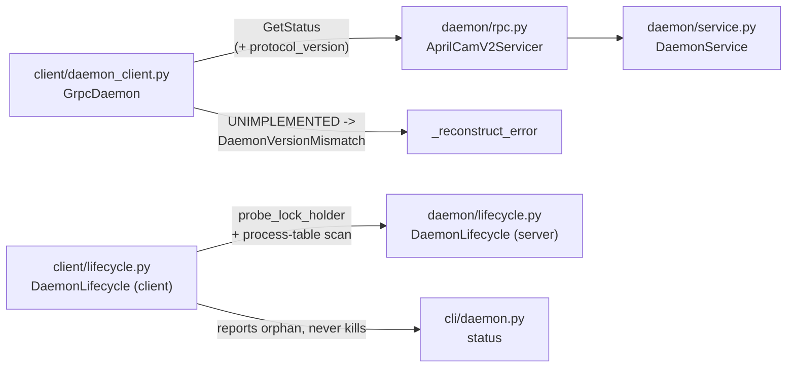

<!-- CLASI: Before changing code or making plans, review the SE process in CLAUDE.md -->

# Sprint 031: Hardening, cleanup, and the design-doc set

## Goals

Close the accumulated debt pool the stakeholder has framed as "the sprint
that decides whether this is a system someone else can pick up." This is
explicitly **not** a features sprint: no new capability, no new use case
in the product sense. Every item traces to something already observed,
already recorded, and already costing time — a v1/v2 daemon collision
that produced a confusing failure in sprint 020's own acceptance pass, a
broken fixture-regeneration tool, a `clasi design validate` gate that has
been failing since the v2 tree was rebuilt, and test-suite noise that two
separate investigations (in this same sprint's own linked issues) traced
back to environmental contamination rather than product bugs.

## Problem

Six related-but-distinct problems, all already diagnosed by prior work:

1. **A running v1 daemon and a running v2 daemon collide** on the same
   conventional control-socket path. A v2 client that reaches the v1
   daemon gets an uninterpretable `Method not found!` rather than a clear
   diagnosis. Confirmed live in sprint 020's acceptance pass, and
   independently confirmed as the root cause of 18 of 19 `-m camera`
   test failures during sprint 030 (issue
   `camera-marked-tests-failing-en-masse-suspected-v1-daemon-contention.md`,
   RESOLVED section).
2. **Daemon lifecycle has no visibility into a process that is alive but
   not doing anything** — running, not holding the singleton lock, not
   serving. Nothing currently detects or reports this state; `daemon
   status`/`daemon stop` only ever look at the lock file's holder.
3. **CLI output breaks Unix piping conventions** —
   `camera image --base64 | head` raises an unhandled `BrokenPipeError`
   instead of exiting quietly, and there is no SIGPIPE/BrokenPipe
   handling anywhere in the CLI boundary (`cli/__init__.py`).
4. **The Raspberry Pi capture path is incomplete.** Libcamera camera
   *enumeration* was ported in sprint 020 (`camera/backends/libcamera.py`);
   a *capture* backend (`V4l2LoopbackBackend`, `camera/backends/
   v4l2_loopback.py`) exists but is never selected for a
   libcamera-identified camera — both `camera/discovery.py` and
   `daemon/service.py` unconditionally construct `OpenCVBackend(index)`
   regardless of identity source. This is required before any
   Pi-over-the-field deployment, which is the deployment the
   architecture is shaped around.
5. **`camera view`'s raw-ness is not visible on sight.** UC-16's "raw
   means raw" is a genuine, deliberate diagnostic guarantee (it is how
   you tell a camera problem from a geometry problem) — but the
   stakeholder hit this in practice, expecting deskew. The window title
   (`view/viewer.py`'s `run_raw_view`) and the CLI's startup line say
   nothing about raw-ness or point at `playfield view`.
6. **Dev tooling and documentation have not kept pace with the v2
   rebuild.** `testdev/capture_matrix.py` fails to import — five of its
   dependencies were deleted or restructured in the v2 rebuild, which
   makes `docs/design/design.md` §8's "regenerable, not sacred" claim
   about the fixture matrix currently false. Every subsystem under
   `src/aprilcam/` (12 subsystems, plus the source root itself) is
   missing its co-located `DESIGN.md`, so `clasi design validate` fails
   outright even though `design_docs: enabled` is set in
   `.clasi/config.yaml` — a standing failure, not a preference.
7. **Two more reliability gaps hide in plain sight**: hardware tests
   inherit whatever UVC exposure the previous process left on the device
   instead of setting their own (demonstrated concretely: the same test
   file went from 7 failed/3 passed to 7 passed/3 skipped with no code
   change, only a change to ambient exposure), and the annotation store's
   `put_annotation`/`replace_layer` enforce no bound on annotation count
   or per-shape point count, so a misbehaving client can grow the store
   and the wire payload without limit.

Two items the umbrella issue raised turned out, on investigation, not to
need new work this sprint (see Architecture's "Already resolved" note
and "Confirmed, not new work" note below): the UC-12 robot
reference-point convention, and the UC-25 camera-slug-rename-on-reconnect
behavior.

## Solution

Land eleven independently-scoped tickets across five workstreams —
daemon/client reliability, camera capture, developer tooling, the
design-doc set, and test infrastructure — each traceable to a sprint-level
use case (SUC) and, through it, to one of this sprint's six linked
issues. See the Architecture section for the module-level design and the
Tickets table for the full list and dependency order.

One item is explicitly **not** ticketed because no ticket can fix it: one
of the 19 `-m camera` failures is a genuinely physical camera-aim problem
(confirmed in the linked issue's RESOLVED section — 4 of 10 ArUco markers
visible where 10 were visible earlier the same day). This is recorded as
a stakeholder action item, not sprint work.

## Success Criteria

Drawn directly from the umbrella issue's own Verification list, plus this
plan's two added items (orphan reconciliation, annotation limits) that
the umbrella issue named in its Description but did not enumerate under
Verification:

- `clasi design validate` passes.
- `uv run pytest` green in a single full run, hardware included (module
  contention and ambient-exposure flakiness both eliminated) — **except**
  the one physical-camera-aim failure, which is a stakeholder hardware
  action item, not a code defect this sprint can close.
- A v2 client meeting a v1 daemon reports a version mismatch clearly,
  instead of a bare `Method not found!` / `ConnectionFailed`.
- `camera image --base64 | head` exits cleanly, no traceback.
- `testdev/capture_matrix.py` regenerates the fixture set.
- `camera view` makes its raw-ness obvious on sight (window title +
  startup line + pointer to `playfield view`).
- A libcamera-identified camera opens through `V4l2LoopbackBackend`, not
  `OpenCVBackend` (unit-verifiable without Pi hardware; live capture
  remains hardware-gated, per Architecture's Migration Concerns).
- The annotation store rejects a per-layer count or per-shape point
  count beyond a stated bound, with a clear typed error, instead of
  growing unbounded.
- A daemon process alive but not holding the lock is detectable via
  `daemon status`, distinct from "not running."

## Scope

### In Scope

- Protocol version handshake between v2 client and v2/v1 daemon.
- Orphaned-daemon-process detection surfaced through `daemon status`.
- SIGPIPE/BrokenPipeError handling at the CLI boundary.
- Wiring `V4l2LoopbackBackend` for libcamera-identified cameras (backend
  *selection*; the backend class itself already exists).
- `camera view` RAW signposting (window title, startup line).
- Closing UC-25's camera-slug-rename-on-reconnect open question in the
  use-case doc (the code behavior is already implemented and tested;
  this is a documentation-closure ticket, not a new-behavior ticket).
- Porting `testdev/capture_matrix.py` onto the v2 surface, including the
  direct-open-vs-daemon-RPC design decision.
- Bootstrapping the full per-subsystem `DESIGN.md` set (13 files: one
  root-level overview plus twelve subsystem docs) via the
  `bootstrap-design` skill.
- Hardware test fixtures pushing their own exposure instead of inheriting
  ambient device state, with a corrected failure diagnosis.
- Annotation count and per-shape point-count limits.
- The Stage 12 import-graph/dead-code verification (confirming nothing
  imports a module the v2 rebuild already condemned).

### Out of Scope

- **The one physically-caused camera test failure** (arducam currently
  seeing 4/10 markers) — stakeholder hardware action item, not code.
- **`archive/`'s fate** (keep, delete, or relocate the 5.7 MB v1 tree) —
  flagged as an explicit stakeholder decision in this plan's Architecture
  section, not resolved unilaterally. CLAUDE.md currently treats
  `archive/` as a live ideas source for the whole v2 rebuild ("go read
  how v1 did it"); a sprint-planner does not have standing to override
  that project-level instruction by deleting the tree it governs.
- **`tests/images/field-state.json` verification** (what tags are
  physically on the field) — named in the umbrella issue as related
  stakeholder work, not sprint work; it requires someone to look at the
  physical field, which is the same category of action item as the
  camera-aim finding above.
- **The gst-mode libcamera enumeration path** (`cam -l` subprocess) and
  **`screencap`** — sprint 020's own issue defers these for want of
  hardware/no stated need; nothing in this sprint's research changed
  that. Only the loopback *capture* backend wiring is in scope.
- **Auto-exposure sweep at hardware-fixture setup** — the umbrella issue
  frames this as worth *considering*, not committing to. Ticket 009
  below implements the simpler, immediately-actionable fix (push a known
  exposure, diagnose correctly); the sweep is recorded as a follow-on
  idea in that ticket's plan, not built this sprint, since a fixed
  exposure already resolves the demonstrated failure and a sweep adds
  real design surface (how many candidates, what "most markers" means
  when two candidates tie) that the umbrella issue did not specify.

## Test Strategy

Every ticket in the daemon/client/camera/CLI workstreams gets headless
unit coverage (mocked sockets, fake `Popen`, fixture-backed cameras) --
the project's existing pattern throughout `tests/aprilcam/`. Two tickets
are inherently hardware-gated for *full* verification (the libcamera
backend wiring's live capture, and the hardware-fixture reliability
fix's live re-run) — both get everything mechanically testable covered
headless, with the hardware-only portion named explicitly as such rather
than silently skipped without comment. The sprint-level acceptance gate
is `uv run pytest` green in one full run, hardware included, run once at
or near sprint close (not per-ticket, per this project's
`.claude/rules/source-code.md`) — except the one physical-camera-aim
failure carved out above. `clasi design validate` is a second,
independent sprint-level gate, satisfied by ticket 008.

## Architecture

**Substantial** — this sprint touches daemon, client, camera, cli,
proto, view, and testdev/ across five largely-independent workstreams;
it introduces a new wire-protocol field (protocol version), a new
backend-selection code path, and a new bounded-store contract on the
annotation service. Module count and the wire-protocol change both clear
the substantial-tier bar on their own; the diagram below is scoped to
the two workstreams that actually gain new cross-module composition
(daemon/client reliability, camera capture) rather than all eleven
tickets, since most of the rest are single-module, non-composing changes
(see the per-workstream notes below for the omission reasoning in each
case).

**A note on where this content lives.** `.clasi/config.yaml` has
`design_docs: enabled`, which normally means Mode 2a of the
`architecture-authoring` skill applies: sprint architecture is written
into the sprint's `design/` overlay by diffing against the existing
canonical `docs/design/design.md` and co-located subsystem `DESIGN.md`
files, not into this section. That mechanism assumes the canonical
subsystem docs already exist to diff against. **They do not** — that is
this sprint's own ticket 008 (per `validate_design`, all 12 subsystem
docs and the root doc are currently missing). Seeding an overlay against
a nonexistent canonical file has nothing to copy verbatim, and
pre-writing `docs/design/design.md` content now, ahead of ticket 008's
`bootstrap-design` run (which itself calls `write_system_doc` to
(re)write that file from the actual, post-sprint code), risks a stale
draft clobbering the bootstrap's authoritative output at sprint close.
This sprint's architecture is therefore recorded here, in `sprint.md`,
per Mode 2 (the not-opted-in path) as a deliberate exception for this
one bootstrapping sprint — not a rejection of the opt-in. Once ticket
008 lands, every subsequent sprint touching these subsystems resumes
Mode 2a normally, diffing against the doc set this sprint creates.

**Already resolved — no ticket.** The umbrella issue lists "the robot
reference point convention (UC-12)" as an open question, noting it "may
be resolved earlier by sprint 025." It was: sprint 025 ticket
`003-mount-correction-geometry-and-reference-point-decision.md` resolved
it (2026-08-03) — client-defined, not daemon-mandated, recommended
default is centre of rotation, frame convention is the robot's own frame
(+x forward, +y left, rotating with `mount_yaw`) — and recorded the
resolution in `types.py`'s `MountParameters` docstring and
`docs/design/use-cases/daemon.md`. No further action.

**Confirmed, not new work.** The follow-up issue's "camera slug is never
renamed on reconnect" item reads as an open behavioral question, but the
code already implements a considered decision:
`camera/registry.py`'s `resolve()` explicitly never renames on reconnect
(module docstring, "Reused... conservative reading... never renames"),
with regression coverage in
`tests/aprilcam/camera/test_registry.py::test_reconnect_refreshes_device_name_and_last_seen`.
The behavior is also the *safe* answer to UC-25's stated risk ("a
changed name silently orphans an installed config") — never renaming is
precisely what prevents that orphaning, not a source of it. What is
missing is closing the loop in the use-case document itself, the same
way ticket 025-003 closed UC-12 — that is ticket 005 below, a
documentation-and-regression-test ticket, not a behavior change.

### Workstream A — Daemon/client reliability (tickets 001-005)

**Responsibilities**: (1) tell a client honestly when it has reached an
incompatible daemon; (2) tell an operator honestly when a daemon process
is alive but not serving; (3) make CLI output pipe-safe; (4) make the
camera-view CLI honest about what it shows; (5) close a use-case
question the code already answered.

Responsibilities 1 and 2 are grouped as one module-level concern —
**daemon lifecycle honesty** — because both are instances of the same
failure shape (something claims a resource or advertises a socket
without actually being the thing a client expects) and both touch
`daemon/lifecycle.py` plus the client-side `client/lifecycle.py`.
Responsibilities 3, 4, and 5 are each single-module, non-composing CLI
changes with no shared code path to 1/2 or to each other; grouping them
under "reliability" is a planning convenience for use-case traceability,
not a claim that they form one component.

**Module: protocol version handshake** (ticket 001). *Purpose*: let a
v2 client distinguish "reached an incompatible daemon" from "reached
nothing" or "hit an ordinary RPC error." *Boundary*: adds a
`protocol_version` field to `GetStatusResponse` (`proto/aprilcam_v2.proto`)
and a client-side check in `client/daemon_client.py`'s `_reconstruct_error`
path (currently: any unrecognized `grpc.RpcError` — which is exactly
what a v1 daemon's `UNIMPLEMENTED`/`Method not found!` response looks
like, since it carries none of `_reconstruct_error`'s expected
`aprilcam-error-type` trailing metadata — falls through to a generic
`ConnectionFailed`). Does not touch camera, calibration, or annotation
code. *Use cases served*: UC-13 (daemon discovery/identification).

**Module: orphaned-process detection** (ticket 002). *Purpose*: surface
a daemon-shaped process that is alive but not the lock holder, so an
operator sees it instead of silently living with two "aprilcam.daemon"
processes competing for the same hardware. *Boundary*: extends
`daemon/lifecycle.py`'s `status()` (server-side) and
`client/lifecycle.py`'s `status()` (client-side, which already reads the
lock holder) with a best-effort process-table scan for other
`python -m aprilcam.daemon` processes not matching the current lock
holder's pid; reports them, does not kill them (the umbrella issue asks
to "decide what start/stop do about an orphan" — the decision this
ticket records is: report, never auto-kill, since an unattended kill of
an unrelated process misidentified by a race is worse than a stale
report). Does not touch the flock mechanism itself, which is already
correct (the OS releases a held flock when its process dies; the gap is
visibility into a process that released the lock but did not fully
exit, or that never went through `start()`'s lock acquisition at all).
*Use cases served*: UC-01 (daemon lifecycle singleton), UC-13.

**Module: CLI pipe safety** (ticket 003). *Purpose*: make every
subcommand's stdout output behave like a standard Unix tool under a
truncating consumer. *Boundary*: one change, in `cli/__init__.py`'s
`main()` — the single dispatch point every subcommand's `func(args)`
already funnels through — wrapping the call and handling
`BrokenPipeError` at that one seam rather than at each of the ~20
individual `print()` call sites across `cli/*.py`. No other module
changes. *Use cases served*: UC-17 (image capture output).

**Module: `camera view` RAW signposting** (ticket 004). *Purpose*: make
`camera view`'s raw-ness visible without reading documentation.
*Boundary*: `view/viewer.py`'s `run_raw_view` (window title) and
`cli/camera.py`'s `cmd_view` (startup stderr/stdout line naming
`playfield view`). Does not change `run_raw_view`'s actual behavior —
UC-16's "raw means raw" guarantee is preserved exactly; only the
signposting changes, per the umbrella issue's explicit "keep the
behaviours" instruction. *Use cases served*: UC-16.

**Module: UC-25 naming-decision closure** (ticket 005). *Purpose*: close
UC-25's open "what if a name comes out different" question in the
use-case document itself, recording the already-implemented, already-
tested resolution. *Boundary*: `docs/design/use-cases/cli.md` (the open
question and its resolution), plus one additional regression test in
`tests/aprilcam/camera/test_registry.py` asserting the specific case the
existing test does not cover directly (a reconnect where the *proposed*
slug from identity resolution differs from the stored slug, not just
where `device_name` differs). No production code change. *Use cases
served*: UC-25.

*Diagram scope note*: this covers only workstream A's two composing
modules (protocol handshake, orphan detection) — tickets 003/004/005 are
each a single non-composing module change with no new edge into this
graph, so including them would add nodes without showing any new
relationship.

### Workstream B — Camera capture (ticket 006)

**Module: libcamera backend wiring**. *Purpose*: open a
libcamera-identified camera through the capture backend that can
actually read a v4l2loopback device reliably, instead of the one that
cannot. *Boundary*: `camera/discovery.py` and `daemon/service.py` each
currently have exactly one backend-construction call site
(`return OpenCVBackend(index)`, unconditional). Both change to branch on
`identity.hardware_key`'s `"libcamera:"` prefix (already assigned by
`camera/identity.py`'s `_probe_libcamera`) and construct
`V4l2LoopbackBackend(f"/dev/video{n}")` instead, where `n` is the
enumerated device index from `camera/backends/libcamera.py`'s
`list_loopback_cameras()`. No change to `V4l2LoopbackBackend` itself
(exists, per its own module docstring, "unverifiable here" for lack of
loopback hardware on this Mac — that constraint is unchanged by this
ticket) or to the enumeration/identity code. *Use cases served*: UC-25
(S-6, the Pi-camera-needs-a-probe scenario).

No diagram: this is a single-module change (backend selection, two call
sites in one responsibility) with no new cross-module dependency — both
`V4l2LoopbackBackend` and the `"libcamera:"` hardware-key convention
already exist; this ticket only connects an existing edge that was
never wired, which a diagram would not clarify beyond the sentence
above.

### Workstream C — Developer tooling (ticket 007)

**Module: `capture_matrix.py` port**. *Purpose*: regenerate the
image-matrix fixture set from live cameras, restoring the tool
`docs/design/design.md` §8 already claims exists. *Boundary*: ports the
five now-missing imports onto their v2 equivalents
(`camera/identity.py` + `camera/registry.py` for identity/slugs,
`camera/camera.py` + `camera/backends/` for capture/settings,
`config/directories.py` for roots) — the tool's own contract (sweep a
device-name-matched variation matrix, always restore baseline controls,
write `tests/images/<slug>/manifest.json`) is unchanged. Stays a
repo-root offline script; does not become a `src/aprilcam/` package
module.

*Design decision — direct-open vs. daemon RPC*: kept as direct-open, not
routed through the daemon's RPC surface. `SetCameraConfig`/`GetFrame`
are whole-document push/single-frame-read operations; they have no RPC
shape for "apply this one raw UVC control in isolation via `uvc-util`,
capture, restore baseline, repeat per matrix row" — the tool's actual
operation. Building that shape into the daemon's config service would
add an RPC surface serving exactly one caller (this offline tool) and
would also make the tool depend on a running daemon, breaking its
documented ability to run standalone, before a daemon exists or while
one is down for maintenance (`design.md` §8's own sanctioned exception
for offline test tooling). Direct-open is not a stopgap here; it is the
right shape for what the tool does.

No diagram: single-module port with no new cross-module dependency —
every dependency it imports (`camera/identity.py`, `registry.py`,
`camera.py`, backends, `directories.py`) already exists and is already
depended on elsewhere; this ticket only repairs stale import paths.
*Use cases served*: none directly (internal developer tooling, not a
stakeholder-facing use case) — supports the fixture-regenerability claim
that stages 4-5's test suites rely on.

### Workstream D — Design-doc set (ticket 008)

**Module: per-subsystem `DESIGN.md` bootstrap**. *Purpose*: produce the
persistent design-doc set `clasi design validate` requires and
`docs/design/design.md`'s subsystem table already links to (currently
13 dead links). *Boundary*: run the `bootstrap-design` skill against
`src/aprilcam` (the sole declared source root): one root-level
`src/aprilcam/DESIGN.md` overview, plus one co-located `DESIGN.md` per
subsystem — `calibration/`, `camera/`, `cli/`, `client/`, `config/`,
`daemon/`, `mcp/`, `playfield/`, `proto/`, `tags/`, `view/`, `vision/`
(12 subsystems; confirmed via `validate_design`). Six have real
implementations to document from code (`camera/`, `client/`, `cli/`,
`config/`, `daemon/`, `proto/`); the rest are interface-only and should
say so rather than invent undelivered behavior, per the source issue's
own instruction. Sequenced after tickets 001, 002, 006, and 010 (the
ones that change daemon/camera subsystem behavior) so the bootstrapped
docs describe this sprint's own final state rather than a snapshot that
is stale the moment it lands.

No diagram: this ticket produces documentation artifacts, not code
composition — there is no new runtime dependency edge to show.
*Use cases served*: none directly — closes the `clasi design validate`
gate, which is process infrastructure, not a stakeholder use case.

### Workstream E — Test infrastructure (tickets 009-010)

**Module: hardware-fixture exposure reliability** (ticket 009).
*Purpose*: make `@pytest.mark.camera` hardware tests set the device
state they depend on, instead of inheriting whatever the previous
process left. *Boundary*: `tests/aprilcam/daemon/test_calibration_hardware.py`
and its siblings that share the identical `CameraConfig(...,
settings={})` pattern documented as "matches every other
`@pytest.mark.camera` module's identically-named workaround" —
`test_streaming_hardware.py`, `test_detection_hardware.py` — push an
explicit exposure (the sprint 030 ticket 003 measured value, `12`, as
the current baseline) instead of an empty settings block, and failure
messages name the exposure actually in force rather than asserting the
camera is mis-aimed. Test-only change; no `src/aprilcam/` code changes.
*Use cases served*: none directly (test infrastructure) — protects the
signal every hardware-marked test in stages 2-11 depends on.

**Module: annotation store limits** (ticket 010). *Purpose*: bound the
annotation store's memory and per-frame wire cost against a misbehaving
client. *Boundary*: `daemon/service.py`'s `put_annotation` and
`replace_layer` (the two mutation points that can grow the store —
`remove_annotation`/`clear_annotations` only shrink it) gain a
per-layer annotation-count check and a per-shape point-count check
(`PathShape.points`/`Polygon.points`, `types.py`), raising a new typed
error (`errors.py`, following the existing `InvalidTagId`/
`MalformedDocument` naming and metadata pattern) instead of accepting
an unbounded document. Limits are constants for this sprint, not a
configurable document field — sprint 024's own recorded decision scoped
limits out entirely, so introducing even a fixed bound is new ground;
making it configurable is a larger design surface (where does the
config live, per-playfield or global, can a document push change it)
this sprint does not need to open. *Use cases served*: UC-28 (annotation
store).

No diagram for either: both are single-module changes (one test
directory, one service method pair) with no new cross-module
dependency.

### Workstream F — Repo hygiene (ticket 011)

**Module: package-restructure verification**. *Purpose*: confirm the
Stage 12 package restructure's actual remaining content, since `ls
src/aprilcam/` shows the directory moves it named (`server/`→`mcp/`,
`core/` dissolved, `view/` extracted, `ui/` deleted) already happened
incrementally across sprints 026-030 rather than as one big-bang
restructure — the development plan's Stage 12 description predates that
incremental delivery. *Boundary*: an import-graph sweep confirming
nothing in `src/aprilcam/` or `tests/` imports a module the v1
demolition already condemned (mirroring the no-cv2-import-style test
pattern already used elsewhere in this codebase), run after tickets
001, 002, 006, and 010 so it checks the sprint's own final state, not a
mid-sprint snapshot. Does **not** delete or move `archive/` — see Scope
→ Out of Scope for why that decision is deliberately left to the
stakeholder rather than resolved here. *Use cases served*: none directly
— repo hygiene / process infrastructure.

No diagram: a verification pass over existing structure, not a new
composition.

### Design Rationale

**Decision: report orphaned daemon processes, never auto-kill them**
(ticket 002). *Context*: the umbrella issue asks to "decide what
start/stop do about an orphan." *Alternatives considered*: (a) auto-kill
any `aprilcam.daemon` process not holding the lock; (b) report only,
leave disposal to the operator. *Why this choice*: the process-table
scan that identifies a candidate orphan is inherently best-effort (name
matching, not a cryptographic proof of identity) — a false positive
under (a) kills a process that happens to match a command-line pattern
but is not actually this system's daemon, which is a strictly worse
failure than a stale report an operator has to act on manually. (c) is
the same asymmetry v1's process-control code already respected
(`client/lifecycle.py`'s own `stop()` only ever signals the pid the lock
names, never a pattern-matched candidate). *Consequences*: an operator
still has to manually clean up a genuine orphan; acceptable, since the
alternative risk (killing the wrong process) is worse than the
inconvenience.

**Decision: protocol version lives in `GetStatusResponse`, not a new
RPC** (ticket 001). *Context*: needed a way for a v2 client to detect a
version-incompatible daemon. *Alternatives considered*: (a) a dedicated
`GetVersion`/handshake RPC called before any other RPC; (b) a new field
on the already-universal `GetStatusResponse`; (c) detect purely from the
gRPC `UNIMPLEMENTED` status code with no new field at all. *Why this
choice*: (c) alone cannot distinguish "v1 daemon, wrong protocol" from
"v2 daemon, genuinely missing this one RPC in some future partial
rollout" — both look identical as a bare `UNIMPLEMENTED`. (b) adds one
field to a call every client already makes (`status()`/`GetStatus` is
the first RPC `client/lifecycle.py`'s own `status()` makes once a lock
is observed), so no new round trip is needed for the common path; a
version mismatch is *still* detected from (c)'s `UNIMPLEMENTED` signal
on whichever RPC the v1 daemon fails to recognize (which, since v1 has
no `GetStatus` at all, is `GetStatus` itself for the first call), with
(b)'s field giving positive confirmation whenever a response is
actually returned (e.g., a hypothetical future v3 client talking to a
v2 daemon that *does* implement `GetStatus` but at a different protocol
version). (a) was rejected as a second round-trip for a check needed
only on the failure path. *Consequences*: `.proto` schema change
(additive, backward compatible — a v1 client reading an unfamiliar field
from a v2 daemon ignores it per protobuf's normal forward-compatibility
rules; the risk runs only in the v2-client-meets-v1-daemon direction
this ticket exists to fix).

**Decision: fixed exposure constant, not a config-driven value, for
hardware test fixtures** (ticket 009). *Context*: the umbrella issue
demonstrates lighting drift within a single afternoon (exposure `100`
worked in the morning, blew out by mid-afternoon; `12` was the
mid-afternoon fix). *Alternatives considered*: (a) fixed constant in the
test file; (b) read the value from the real installed camera config;
(c) an auto-exposure sweep at fixture setup. *Why this choice*: (b)
reintroduces exactly the ambient-dependency bug this ticket fixes, just
one layer further away (now depending on whatever is installed rather
than whatever the last process left). (c) is the most robust long-term
answer but is out of scope this sprint (see Scope → Out of Scope) —
recorded as a follow-on idea in ticket 009's own plan rather than
built now. (a) is a known, explicit, documented dependency instead of a
silent one — an honest trade (it will drift with the room again
eventually) rather than a hidden one. *Consequences*: this fix is
expected to need re-tuning again if room lighting changes materially;
the corrected failure-diagnosis half of ticket 009 (naming the exposure
in force) is what makes that future drift cheap to re-diagnose instead
of costing another multi-issue investigation.

### Migration Concerns

- **Proto change (ticket 001)** is additive only (`protocol_version`
  field, no removed/renumbered fields) — no breaking change to any
  existing client. Requires a `protoc`/`grpc_tools` regeneration of
  `aprilcam_v2_pb2.py`/`aprilcam_v2_pb2_grpc.py`, same as every prior
  `.proto` change in this project's history.
- **Libcamera backend wiring (ticket 006)** cannot be live-verified in
  this sprint — there is no v4l2loopback/Pi hardware in this development
  environment, the same constraint sprint 020's own deferral recorded.
  The ticket's acceptance criteria are scoped to what is mechanically
  testable (backend selection logic, given a mocked libcamera identity)
  with the hardware-dependent portion (does a real loopback device
  actually decode through `V4l2LoopbackBackend`) explicitly named as
  future, hardware-gated verification — not silently dropped, not
  claimed as done.
- **Annotation limits (ticket 010)** is a behavior change for any
  existing client that happens to already push more annotations or
  points than the new bound — none is known to exist today (sprint 024
  shipped with no limit at all, so no client could have been written
  against an unbounded contract as a *feature*), but the ticket's plan
  should pick a bound generous enough that no known legitimate use
  (drawing a path around a real playfield, for instance) is anywhere
  close to it.
- **DESIGN.md bootstrap (ticket 008)** rewrites `docs/design/design.md`
  wholesale (`bootstrap-design`'s `write_system_doc` call) — this is a
  full-overwrite operation per that skill's own documented semantics,
  not a merge. Any hand-edits to the current `docs/design/design.md`
  made between now and ticket 008's execution should be captured first.
- **No production data migration** — no persisted-document schema
  changes anywhere in this sprint (camera configs, playfield defs,
  calibration files, and the annotation store's wire shape are all
  unchanged; annotation limits reject a request, they do not transform
  stored data).

### Open Questions

- **`archive/`'s fate** — flagged to the stakeholder, not resolved here
  (see Scope → Out of Scope for the reasoning).
- **Auto-exposure sweep for hardware fixtures** — recorded as a
  follow-on idea in ticket 009, not committed to this sprint.
- **Annotation limit values** — ticket 010's plan should propose
  specific numbers (count per layer, points per shape) grounded in a
  real playfield's plausible annotation load; this document does not
  fix them, since that is implementation-level detail the ticket is
  better positioned to reason about against actual `PathShape`/`Polygon`
  usage in the renderer.

## Use Cases

### SUC-001: v2 client detects a version-incompatible daemon
Parent: UC-13

- **Actor**: A developer or operator running `aprilcam` against a daemon
  they do not know the version of (e.g., a machine that might still have
  a v1 checkout's daemon running).
- **Preconditions**: A daemon (of any protocol version) is reachable at
  the control-plane socket/host the client targets.
- **Main Flow**:
  1. The client issues its first RPC against a freshly-connected daemon
     (in practice, `GetStatus`, since that is what `status()` calls).
  2. If the daemon is v2 and protocol-compatible, the response includes
     a `protocol_version` field the client recognizes; the call proceeds
     normally.
  3. If the daemon is v1 (or a future incompatible v2), the RPC comes
     back `UNIMPLEMENTED` (v1 has no `GetStatus` at all) or with a
     `protocol_version` the client does not recognize.
  4. The client raises a specific, named error identifying the mismatch
     — not a generic `ConnectionFailed`.
- **Postconditions**: The operator sees a message naming the actual
  problem (version mismatch) instead of a bare RPC failure or, worse,
  the illusion of a successful-but-wrong connection.
- **Acceptance Criteria**:
  - [ ] A v2 client connecting to a v1 daemon (or a fake gRPC server
        that returns `UNIMPLEMENTED` for `GetStatus`) raises a distinct,
        named exception rather than falling through to
        `ConnectionFailed`.
  - [ ] The exception's message names the socket/host it connected to
        and states plainly that the daemon speaks an incompatible
        protocol.
  - [ ] A v2 client connecting to a compatible v2 daemon is unaffected —
        no new failure mode, no extra round trip beyond the existing
        first `status()` call.

### SUC-002: Operator sees an orphaned daemon process
Parent: UC-01

- **Actor**: An operator running `daemon status` (or `daemon start`,
  hitting `AlreadyRunning`) on a machine where a daemon process is alive
  but not the current lock holder.
- **Preconditions**: At least one process matching the daemon's spawn
  pattern (`python -m aprilcam.daemon`) is running and is not the
  process the daemon lock currently names.
- **Main Flow**:
  1. Operator runs `aprilcam daemon status`.
  2. The command reports the lock holder as usual (running/not running).
  3. It additionally reports any other daemon-shaped process found,
     distinctly labeled as a candidate orphan — not silently ignored,
     not conflated with the real, lock-holding daemon.
- **Postconditions**: The operator has visibility into a state that was
  previously invisible; no process is killed automatically.
- **Acceptance Criteria**:
  - [ ] `daemon status` output distinguishes "the running daemon" (lock
        holder) from "other daemon-shaped process found, not the lock
        holder" when both are present.
  - [ ] With only the real, lock-holding daemon present, output is
        unchanged from today (no false positives against the daemon's
        own process).
  - [ ] No code path in this ticket signals or kills any process other
        than the one `stop()` already targets (the lock holder).

### SUC-003: CLI output pipes cleanly
Parent: UC-17

- **Actor**: A developer piping `aprilcam` output into a truncating
  consumer (`head`, `less`, a broken downstream pipeline).
- **Preconditions**: None — any subcommand that writes to stdout.
- **Main Flow**:
  1. `aprilcam camera image <camera> --base64 | head -c 80` (or any
     other subcommand piped into something that closes its read end
     early).
  2. The downstream consumer closes the pipe before the CLI finishes
     writing.
  3. The CLI exits quietly and promptly, exit code reflecting a broken
     pipe, no Python traceback on stderr.
- **Postconditions**: Standard Unix tool behavior — the operator sees a
  clean prompt return, not a stack trace.
- **Acceptance Criteria**:
  - [ ] `aprilcam camera image <camera> --base64 | head -c 80` exits
        with no traceback (verified against a fake/mocked daemon in the
        test suite, not requiring live hardware).
  - [ ] The fix lives at the single `main()` dispatch seam in
        `cli/__init__.py`, not duplicated across individual `print()`
        call sites.
  - [ ] Normal (non-piped, non-truncated) CLI output is unaffected.

### SUC-004: `camera view`'s raw-ness is visible on sight
Parent: UC-16

- **Actor**: An operator running `camera view` who has not read UC-16's
  documentation.
- **Preconditions**: A camera is reachable and `camera view <camera>`
  is invoked.
- **Main Flow**:
  1. Operator runs `aprilcam camera view <camera>`.
  2. The CLI prints a startup line stating the view is raw (no
     deskew/homography applied) and naming `playfield view` as the
     deskewed alternative.
  3. The opened window's title also states RAW, visible for the whole
     session, not just at startup.
- **Postconditions**: The operator cannot mistake a raw view for a
  calibrated/deskewed one without deliberately ignoring two separate
  signals.
- **Acceptance Criteria**:
  - [ ] `camera view`'s startup output names itself RAW and points at
        `playfield view`.
  - [ ] The view window's title includes an explicit RAW marker.
  - [ ] `run_raw_view`'s actual image content and behavior are
        byte-for-byte unchanged — this ticket is signposting only, per
        the umbrella issue's explicit "keep the behaviours" instruction.

### SUC-005: UC-25's naming-on-reconnect question is closed
Parent: UC-25

- **Actor**: A future reader of `docs/design/use-cases/cli.md`.
- **Preconditions**: None.
- **Main Flow**:
  1. Reader reaches UC-25's "Open questions" section.
  2. Finds the naming-on-reconnect question marked resolved, with the
     decision (never rename) and its rationale (prevents the exact
     config-orphaning risk the open question itself named) stated
     inline, in the same style as ticket 025-003's UC-12 closure.
- **Postconditions**: No future sprint re-investigates this as if it
  were still open.
- **Acceptance Criteria**:
  - [ ] `docs/design/use-cases/cli.md`'s UC-25 open-questions section
        records the resolution and points at
        `camera/registry.py`'s `resolve()` docstring.
  - [ ] A new regression test in `tests/aprilcam/camera/test_registry.py`
        covers the specific case existing coverage does not: the same
        `hardware_key` reconnecting with a *different proposed slug*
        from identity resolution, asserting the stored slug is
        unchanged.

### SUC-006: A libcamera-identified camera opens through the loopback backend
Parent: UC-25

- **Actor**: The daemon (and `camera list`/`camera probe`'s underlying
  open path), when the identity chain resolves a camera as
  libcamera-sourced.
- **Preconditions**: A camera's identity has `hardware_key` prefixed
  `"libcamera:"` (from `camera/identity.py`'s `_probe_libcamera`).
- **Main Flow**:
  1. The camera-opening code path (`camera/discovery.py` or
     `daemon/service.py`) resolves the camera's backend.
  2. For a libcamera-identified camera, it constructs
     `V4l2LoopbackBackend(f"/dev/video{n}")` using the enumerated device
     index, instead of `OpenCVBackend(index)`.
  3. For every other identity source, behavior is unchanged
     (`OpenCVBackend(index)` as today).
- **Postconditions**: A Pi-attached camera, once physically available,
  opens through a backend actually capable of reading a v4l2loopback
  device reliably.
- **Acceptance Criteria**:
  - [ ] Given a mocked/fixture identity resolution reporting a
        `"libcamera:"`-prefixed `hardware_key`, both call sites
        (`camera/discovery.py`, `daemon/service.py`) construct
        `V4l2LoopbackBackend`, not `OpenCVBackend`.
  - [ ] Given any other identity source, both call sites are unchanged
        (regression coverage against today's behavior).
  - [ ] Live capture through a real loopback device is explicitly named
        as out of scope for this sprint's verification (no Pi/loopback
        hardware available) rather than silently unclaimed.

### SUC-007: `capture_matrix.py` regenerates the fixture set
Parent: N/A — internal developer tooling, not a stakeholder-facing use
case; supports the fixture-regenerability claim `docs/design/design.md`
§8 makes and stages 4-5's test suites depend on.

- **Actor**: A developer regenerating `tests/images/` fixtures.
- **Preconditions**: A camera physically attached; daemon not holding it
  (the tool's own contention check).
- **Main Flow**:
  1. `uv run python testdev/capture_matrix.py --help` runs without an
     import error.
  2. A capture run against an attached camera reproduces the
     `tests/images/<camera-slug>/` layout with a valid `manifest.json`
     (effective controls, camera identity, field-state id).
  3. Baseline controls are restored afterward, verified where the
     backend supports read-back.
- **Postconditions**: The fixture set can be regenerated on demand, as
  `design.md` §8 already claims.
- **Acceptance Criteria**:
  - [ ] `uv run python testdev/capture_matrix.py --help` runs (import
        error resolved).
  - [ ] A live capture run (hardware-gated) reproduces the documented
        manifest layout for at least one attached camera.
  - [ ] Baseline controls are restored in a `finally` block, matching
        the tool's pre-existing contract.
  - [ ] The direct-open-vs-RPC design decision is recorded in the
        tool's own module docstring, not only in this sprint plan.

### SUC-008: The design-doc set passes validation
Parent: N/A — process infrastructure; closes the `clasi design validate`
gate `.clasi/config.yaml`'s `design_docs: enabled` already requires.

- **Actor**: Anyone running `clasi design validate` (including the
  automated sprint-close gate).
- **Preconditions**: None.
- **Main Flow**:
  1. `bootstrap-design` runs against `src/aprilcam`.
  2. Every subsystem gets a co-located `DESIGN.md`; the source root gets
     its own overview `DESIGN.md`; `docs/design/design.md` is rewritten
     to link to all of them.
  3. `clasi design validate` passes with no missing/dead-linked docs.
- **Postconditions**: The design-doc set accurately describes the
  current v2 tree; `docs/design/design.md`'s subsystem table's links all
  resolve.
- **Acceptance Criteria**:
  - [ ] `clasi design validate` reports `ok: true`, zero messages.
  - [ ] All 12 subsystem `DESIGN.md` files exist and are non-empty;
        `src/aprilcam/DESIGN.md` (root overview) exists.
  - [ ] The six subsystems with real implementations
        (`camera/`, `client/`, `cli/`, `config/`, `daemon/`, `proto/`)
        are documented from actual code, not aspiration.
  - [ ] The six interface-only subsystems (`calibration/`, `mcp/`,
        `playfield/`, `tags/`, `view/`, `vision/`) state plainly that
        they are interface-only where that is still true at ticket
        execution time (some may have gained implementation by then).

### SUC-009: Hardware tests set their own exposure
Parent: N/A — test infrastructure; protects the signal every
hardware-marked test depends on.

- **Actor**: A developer running the `@pytest.mark.camera` hardware
  suite, regardless of what the previous process left on the device.
- **Preconditions**: A camera physically attached, at any starting
  exposure (including a deliberately bad one).
- **Main Flow**:
  1. Test fixture setup pushes a known exposure explicitly (not an empty
     `settings={}` block).
  2. Tests run against that known state.
  3. If markers are still missing at that exposure, the failure message
     names the exposure actually in force and suggests it may be mis-set
     — it does not assert the camera is mis-aimed.
- **Postconditions**: Test results do not depend on process run order or
  what a prior process left on the device.
- **Acceptance Criteria**:
  - [ ] `tests/aprilcam/daemon/test_calibration_hardware.py` and its two
        siblings using the identical `settings={}` pattern
        (`test_streaming_hardware.py`, `test_detection_hardware.py`)
        push an explicit exposure in fixture setup.
  - [ ] Deliberately leaving the device at a known-bad exposure (e.g.
        100 under current lighting) before running the suite: tests
        either pass (fixture corrects it) or skip/fail with a message
        naming exposure as the unmet precondition — never a message
        blaming the field/camera aim.
  - [ ] Running the file twice in a row, and after an unrelated
        camera-using process, produces the same result both times.

### SUC-010: Annotation store rejects unbounded growth
Parent: UC-28

- **Actor**: The daemon, receiving `put_annotation`/`replace_layer`
  calls from any client (well-behaved or not).
- **Preconditions**: A known playfield exists.
- **Main Flow**:
  1. A client pushes annotations via `put_annotation` or `replace_layer`.
  2. If accepting the annotation would exceed the per-layer count bound,
     or the annotation's shape (`PathShape`/`Polygon`) exceeds the
     per-shape point bound, the call is rejected with a specific typed
     error naming the limit and the offending value.
  3. A request within bounds succeeds exactly as today.
- **Postconditions**: The store's memory and per-frame embed cost are
  bounded regardless of client behavior.
- **Acceptance Criteria**:
  - [ ] `put_annotation` rejects an addition that would exceed the
        per-layer annotation-count bound, with a typed error naming the
        bound and the current count.
  - [ ] `replace_layer` rejects a replacement layer whose annotation
        count exceeds the bound (same error type).
  - [ ] Either mutation rejects a `PathShape`/`Polygon` whose `points`
        tuple exceeds the per-shape point bound.
  - [ ] A request at or under both bounds is unaffected — no behavior
        change for any legitimate existing use.

### SUC-011: Nothing imports a condemned v1 module
Parent: N/A — process infrastructure / repo hygiene.

- **Actor**: CI / any developer running the test suite.
- **Preconditions**: None.
- **Main Flow**:
  1. An import-graph sweep runs across `src/aprilcam/` and `tests/`.
  2. It confirms no module imports anything from a module the Stage 1
     demolition condemned (i.e., nothing outside `archive/` imports
     `archive/`, and no dead v1-era module name survives inside
     `src/aprilcam/`).
- **Postconditions**: Confidence that the incremental Stage 12 restructure
  (already substantially complete via sprints 026-030's direct-to-final-name
  delivery) left no dangling references.
- **Acceptance Criteria**:
  - [ ] A test asserts no module under `src/aprilcam/` imports anything
        from `archive/`.
  - [ ] The sweep's result (clean, or naming what it found) is recorded
        in the ticket's completion notes.
  - [ ] `archive/`'s fate is explicitly flagged to the stakeholder in
        this ticket's completion notes as a decision this sprint did
        not make, per Scope → Out of Scope.

## GitHub Issues

(None linked to this sprint's tickets.)

## Definition of Ready

Before tickets can be created, all of the following must be true:

- [x] Sprint planning document is complete (sprint.md, including its
      Architecture and Use Cases sections)
- [x] Architecture review passed (or skipped, for changes with no
      architectural impact) — recorded as `passed` (APPROVE WITH
      CHANGES)
- [x] Stakeholder has approved the sprint plan — recorded as `passed`

## Tickets

| # | Title | Depends On |
|---|-------|------------|
| 001 | Protocol version handshake for v1/v2 daemon collision detection | — |
| 002 | Orphaned daemon process detection and reporting | — |
| 003 | SIGPIPE/BrokenPipeError handling at the CLI boundary | — |
| 004 | camera view RAW signposting | — |
| 005 | Close UC-25's naming-on-reconnect open question | — |
| 006 | Wire V4l2LoopbackBackend for libcamera-identified cameras | — |
| 007 | Port testdev/capture_matrix.py onto the v2 surface | — |
| 008 | Bootstrap per-subsystem DESIGN.md set | 001, 002, 006, 010 |
| 009 | Hardware test fixture exposure reliability | — |
| 010 | Annotation store count/point limits | — |
| 011 | Package-restructure verification and archive/ fate flag | 001, 002, 006, 010 |

Tickets execute serially in the order listed. Tickets 001-007, 009, and
010 are mutually independent (different subsystems/files); 008 and 011
are sequenced last so the design-doc bootstrap and the dead-import sweep
both reflect this sprint's final state rather than a mid-sprint
snapshot.
