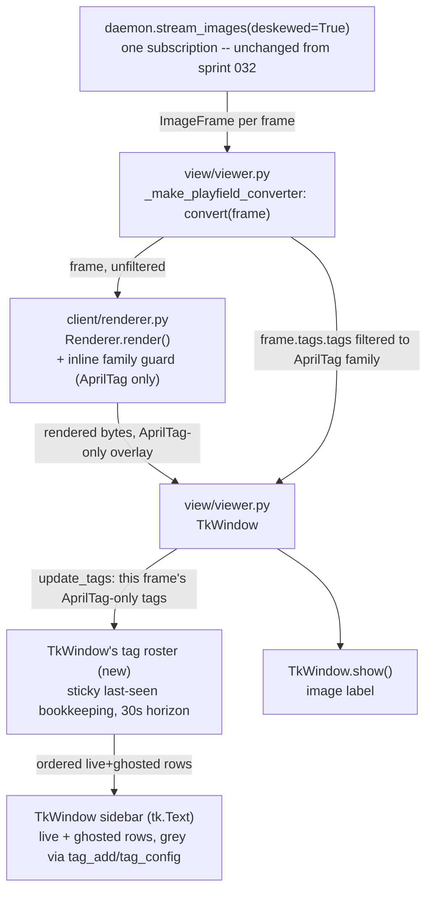
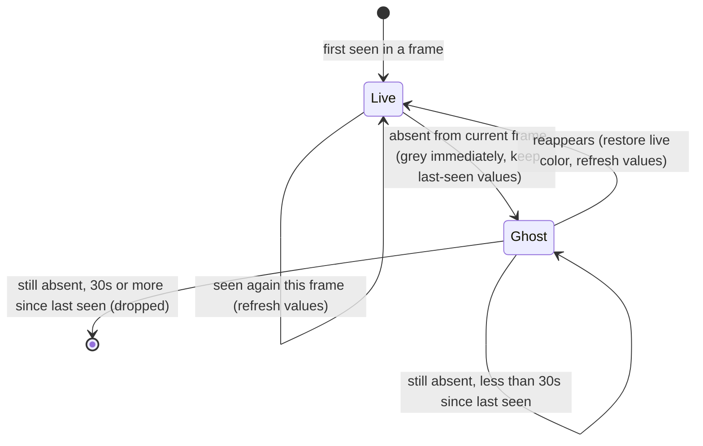

<!-- CLASI: Before changing code or making plans, review the SE process in CLAUDE.md -->

# Sprint 033: AprilTags-only overlay and sticky sidebar

## Goals

1. The playfield-view overlay (sprint 032's red-U/green-hat/ID/crosshair)
   and the tag sidebar show AprilTag-family records only; ArUco records
   (the field's calibration fixtures) are no longer drawn over or
   listed. Detection itself is untouched — ArUco detection keeps
   running in the daemon because calibration depends on it; this is
   presentation-side filtering only.
2. The sidebar becomes a sticky roster: a tag absent from the current
   frame greys out immediately but stays listed with last-seen values;
   it is dropped only after 30 seconds unseen; reappearing restores it
   live, fully refreshed. Single ordered list, live and ghosted rows
   interleaved (no separate "stale" section).

## Problem

Sprint 032 gave `playfield view` a v1-parity overlay and a live tag
sidebar, but both draw/list every detected record indiscriminately —
including the ten ArUco 4x4 corner markers that ring the field as
calibration fixtures. They never move and their positions are
calibration inputs, not game state, so drawing the full overlay
annotation over each one buries the field in noise the stakeholder
never asked for
(`clasi/issues/playfield-overlay-and-sidebar-should-show-apriltags-only.md`).

Separately, the sprint-032 sidebar rebuilds its list from each frame's
tags, so a tag that misses even one frame (occlusion, detection
flicker) vanishes and reappears — the list churns instead of reading
like a stable roster
(`clasi/issues/sidebar-tag-list-sticky-30s-grey-ghosting.md`).

## Solution

View-only presentation filtering and state-tracking on top of the
sprint-032 pipeline — no new geometry, no new detection, no daemon or
wire changes:

- Filter to AprilTag-family records only, at whichever seam
  (`client/renderer.py`'s draw loop and/or the `DisplayFrame.tags`
  population point in `view/viewer.py`) the detail-mode architecture
  determines is correct — verifying the actual family discriminator on
  `TagId` (`types.py`) rather than assuming a string, since the
  daemon's AprilTag 36h11 vs. ArUco 4x4 records must be distinguishable
  on that type.
- Add per-tag last-seen bookkeeping (id → record + monotonic
  timestamp) inside `TkWindow`'s existing sidebar state (per sprint
  032's decision to keep sidebar state local, no new module), with a
  named 30-second constant, to grey out and eventually drop rows for
  tags absent from the live stream while keeping pure row-formatting
  and bookkeeping helpers unit-testable without a Tk root.

Full module-level design (exact filtering seam, ghost-state data shape,
Tk rendering approach for greyed rows) is deferred to this sprint's
Detail Mode architecture pass.

## Success Criteria

- `playfield view`'s overlay draws only AprilTag-family records; no
  ArUco marker is boxed, hatted, ID-labeled, or crosshaired.
- The sidebar lists only AprilTag-family records.
- A tag absent from the current frame greys out immediately in the
  sidebar, stays listed with its last-seen values, and is removed only
  after 30 seconds unseen.
- A tag that reappears before removal returns to normal color with
  fully refreshed live values.
- The single-subscription contract
  (`test_run_playfield_view_never_calls_get_tags_only_stream_images`)
  and the cv2-free client rule are preserved.

## Scope

### In Scope

- `src/aprilcam/client/renderer.py` — AprilTag-family filtering in the
  per-record overlay draw loop.
- `src/aprilcam/view/viewer.py` — AprilTag-family filtering for the
  sidebar; sticky/ghosting state (last-seen bookkeeping, 30s horizon,
  grey rendering) for `TkWindow`'s tag list.
- Corresponding tests: `tests/aprilcam/client/test_renderer.py`,
  `tests/aprilcam/view/test_viewer.py`.

### Out of Scope

- Any daemon, RPC, or wire-format change — detection (both AprilTag and
  ArUco) is untouched; ArUco detection must keep running for
  calibration.
- The UVC-drift backlog issue (unrelated; not part of this sprint's
  driving issues).
- Any CLI changes (`src/aprilcam/cli/`) — no new flags or command
  surface for this sprint.
- The velocity arrow, gripper-offset dot, and Objects/Paths sidebar
  sections — already deferred by sprint 032, unaffected here.

## Test Strategy

Entirely unit/headless, plus one extended `@pytest.mark.camera` smoke
test — no daemon, RPC, or detection changes, matching sprint 032's own
approach.

- **`tests/aprilcam/client/test_renderer.py`**: extend the existing
  fixture-based pixel tests. New cases: a frame whose `tags.tags` mixes
  an ArUco (`TagFamily.ARUCO`) record with an AprilTag record draws
  nothing at all for the ArUco one — no boundary, hat, ID text, or
  crosshair pixels anywhere near its corners — while the AprilTag
  record still draws exactly as sprint 032 pinned it (regression
  guard). A frame whose `tags.tags` is entirely ArUco draws nothing
  (no exception, no stray pixels).
- **`tests/aprilcam/view/test_viewer.py`**:
  - Converter level: a mixed-family frame run through
    `_make_playfield_converter`'s `convert()` yields a
    `DisplayFrame.tags` containing only the AprilTag record(s) — new
    coverage, since today's converter is unfiltered.
  - Roster level (pure, no Tk root, injected fake clock): tag present
    → live row; tag absent for one `update_tags` call → immediately
    ghosted with its last-seen values retained; tag still absent once
    the fake clock crosses the 30s horizon → dropped; tag reappearing
    before the horizon → restored to live with refreshed values;
    ordering by tag number holds across live+ghosted rows in one list;
    an ArUco record is never admitted to the roster (defense in depth,
    even though ticket 001's filter should mean the roster never sees
    one on the real path).
  - The existing ArUco-abbreviation test for `_format_tag_row`
    (`test_format_tag_row_formats_present_numeric_fields_and_abbreviates_aruco`)
    is left as-is: it exercises the row formatter directly as a pure,
    family-agnostic per-record function — it is simply never handed an
    ArUco record on the real (post-filter) path any more.
  - `test_tkwindow_with_sidebar_builds_a_side_panel_and_updates_it_from_tags`
    (`@pytest.mark.camera`) is extended to confirm a ghosted row
    actually renders with the grey Tk text tag applied — real widget
    behavior no pure unit test can observe.
- No new hardware/camera-marked tests beyond extending the one that
  already exists — detection (`daemon/detection.py`,
  `vision/detector.py`) is untouched by this sprint.

## Architecture

**Substantial, by decision rather than raw module count.** Two existing
modules are touched (`client/renderer.py`, `view/viewer.py`) — below
the "3+ modules" trigger that would make substantial automatic — with
no new cross-module dependency, no dependency-direction change, and no
data-model change, which would ordinarily point at "compact." This is
sized up deliberately because the sprint carries real architectural
texture a compact write-up would flatten: a filtering-seam decision
that has to be made independently at two different points in the data
flow (not one), and a genuinely new stateful mechanism — the sticky
roster — with its own lifecycle (live → ghost → dropped, with
reappearance) that a single "one module, one paragraph" treatment would
under-describe. Per the borderline-sizing rule, the heavier tier is
used and justified here rather than guessed at.

### Architecture Overview

**Step 1 — the problem.** Sprint 032's overlay and sidebar draw/list
every `TagRecord` a deskewed frame carries, with no regard for family.
The field's ten ArUco 4x4 corner markers are calibration fixtures, not
game state — the stakeholder wants them detected (unchanged) but never
drawn or listed. Separately, the sidebar rebuilds its full row set from
each individual frame, so one dropped detection on an otherwise-present
tag reads as churn rather than a stable list. Both are presentation
decisions over data already on the wire; nothing in `daemon/` or the
wire protocol needs to change for either.

**Step 2 — responsibilities.**
- *Decide whether one record belongs to the family the operator wants
  drawn/listed* — a small eligibility check, logically one concern, but
  applied independently at the two points that each read the frame's
  tag list for their own purpose (see Step 3 and Design Rationale for
  why this is not one shared function).
- *Rasterize the v1-parity overlay for eligible records* — unchanged
  from sprint 032 except for which records reach it.
- *Populate the sidebar's live, per-frame tag list for eligible
  records* — unchanged from sprint 032 except for which records reach
  it.
- *Maintain sticky, per-tag-id state across frames* (new) — given this
  frame's live (already-filtered) tags, refresh present entries, grey
  out newly-absent ones immediately, drop entries unseen for ≥ 30s, and
  restore a reappearing entry to live. This is bookkeeping, not
  drawing — it changes independently of both the overlay's visual
  scheme and the sidebar's column layout.
- *Render the roster's current live+ghosted rows into the Tk sidebar
  with per-row color* — extends `TkWindow`'s existing row-insertion
  responsibility to also apply a Tk text tag per ghosted line.

Each of the first three already belongs to exactly one existing module
(`client/renderer.py` or `view/viewer.py`); the fourth (roster
bookkeeping) is new but has exactly one consumer (`TkWindow`) and no
reason to be a new module — see Design Rationale.

**Step 3 — modules.**

| Module | Purpose (one sentence) | Boundary | Serves |
|---|---|---|---|
| `client/renderer.py` (extended) | Rasterize the v1-parity overlay for AprilTag-family records only, Pillow-only, unchanged otherwise from sprint 032. | Its own `render()` loop gains one inline family guard before computing any geometry for a record; no new import beyond `TagFamily`, no new public surface. | SUC-001 |
| `view/viewer.py` (extended) | Present the same streamed AprilTag-family tag data as a sticky, live side panel, and choose annotated vs. bare per-frame conversion (unchanged responsibility from sprint 032, now scoped by family and by roster state). | `_make_playfield_converter`'s `convert()` filters `frame.tags.tags` to AprilTag-family before assigning `DisplayFrame.tags`; a new pure roster structure lives inside this module, consumed only by `TkWindow.update_tags`; no new RPC, no new subscription, no new module. | SUC-001, SUC-002 |

No third module is touched — `cli/playfield.py` is explicitly out of
scope this sprint (no new flag, no new argv surface).

**Step 4 — diagrams.** A component diagram is not strictly required by
the "3+ modules / new dependency" trigger, but one is included anyway
because the filter is applied at *two* independent points in the same
data flow sprint 032 already diagrammed, and the roster is a genuinely
new element in that flow worth showing rather than inferring:

No cycles: `Renderer` and `Roster`/`Sidebar`/`Image` are leaves off
`Window`/`Convert`. The two arrows leaving `Convert` are the same
fan-out sprint 032 diagrammed; the new fact this diagram adds is that
each arm now carries its own family filter, and the sidebar arm now
passes through a stateful roster instead of being displayed directly.

A second, small diagram — the roster's own per-tag state machine — is
included because it is the sprint's least obvious mechanism and a
reader should see the transitions rather than reconstruct them from
prose:

**Step 5 — What Changed / Why / Impact / Migration Concerns.**

*What Changed.*
- `client/renderer.py`: `render()`'s per-record loop gains one inline
  guard — `record.tag.family != TagFamily.APRILTAG` → skip before any
  geometry is computed — so ArUco records are never boxed, hatted,
  ID-labeled, or crosshaired. `TagFamily` is added to the module's
  existing `from aprilcam.types import (...)` list. Nothing else about
  the draw routines changes; an eligible AprilTag record draws exactly
  as sprint 032 left it.
- `view/viewer.py`: `_make_playfield_converter`'s `convert()` filters
  `frame.tags.tags` to AprilTag-family records before assigning
  `DisplayFrame.tags` — the sidebar, and any future consumer of that
  field, never sees an ArUco record. `_convert_raw_frame` and
  `_convert_bare_playfield_frame` are untouched — neither ever
  populates `.tags` at all, so neither needs the filter.
- `view/viewer.py`: a new pure, Tk-free roster structure is added,
  keyed by `TagId` (family+number — the type's own identity contract),
  holding each tracked tag's latest `TagRecord` plus a monotonic
  last-seen timestamp. Given one frame's already-filtered AprilTag-only
  live tags, it refreshes present entries, marks previously-live
  entries ghosted the instant they are absent (no grace period before
  greying), and drops entries whose last-seen exceeds a new named
  constant, `_GHOST_HORIZON_S = 30.0` (documented rationale: the
  stakeholder-specified retention window). The clock is injectable
  (`time.monotonic` by default) so tests control elapsed time without
  sleeping. Each per-frame update touches only currently-tracked and
  currently-live entries — cost proportional to the number of tracked
  ids, not to elapsed wall time, so it stays cheap at the
  `_PUMP_INTERVAL_S` (20Hz) cadence `update_tags` is called on.
- `view/viewer.py`: `TkWindow.update_tags` is reworked to feed the
  roster and render its current ordered snapshot (live and ghosted rows
  interleaved by tag number, per the issue's "single list" requirement)
  into the `tk.Text` sidebar, applying a Tk text tag
  (`tag_add`/`tag_config`) to grey out ghosted rows' lines. `_format_tag_row`
  is unchanged and reused for both live and ghosted rows — only the
  surrounding per-line color decision is new (see Design Rationale for
  why coloring is not folded into the row formatter itself).
- `src/aprilcam/client/DESIGN.md`, `src/aprilcam/view/DESIGN.md`:
  updated to describe the AprilTag-only filter and the sticky roster
  respectively (already seeded into this sprint's `design/` overlay).
- No change to `daemon/`, `cli/`, `types.py`, or the wire protocol.
  ArUco detection is untouched — the daemon keeps detecting and
  streaming ArUco records exactly as before; this sprint changes only
  what two presentation modules choose to do with records already on
  the wire.

*Why.* Two stakeholder-confirmed requests (2026-08-22). The overlay and
sidebar currently draw/list all ten ArUco calibration fixtures
indiscriminately, burying the field in static annotation noise nobody
asked for. Separately, the sidebar rebuilds its list from each raw
frame, so ordinary single-frame detection flicker on an otherwise
present tag makes its row disappear and reappear, reading as churn
instead of a stable roster.

*Impact on Existing Components.* `run_raw_view`/`camera view` is
unaffected — its converter never reads `frame.tags` and never touches
the sidebar path. `run_playfield_view --bare` is unaffected — it never
calls `Renderer.render()` and never populates `DisplayFrame.tags`, so
neither the family filter nor the roster is ever reached on that path.
`test_run_playfield_view_never_calls_get_tags_only_stream_images` is
unaffected — both the filter and the roster consume data already on
the existing single subscription; nothing here changes how or how
often the daemon is called. `DisplayFrame`'s own shape is unchanged
this sprint (the roster lives inside `TkWindow`, not on `DisplayFrame`)
so no other construction site is touched. Calibration workflows
depending on ArUco detection are unaffected — detection
(`daemon/detection.py`, `vision/detector.py`) is untouched; this sprint
changes rendering/listing choices only.

*Migration Concerns.* No data migration — nothing persisted changes
shape, and no wire/RPC contract changes. The one behavioral change
worth flagging for anyone scripting or screenshotting against
`playfield view`'s annotated (non-`--bare`) output: ArUco corner
markers, previously drawn/listed, will no longer appear in either the
overlay or the sidebar. Anyone relying on seeing them (e.g. to visually
confirm the ten corner markers are being detected) needs a different
tool going forward (`camera tags`, or a future ArUco-focused view) —
this sprint deliberately does not add a flag to opt back into drawing
them, mirroring sprint 032's own precedent of not preserving
stakeholder-rejected behavior behind a flag. `--bare` remains exactly
what sprint 032 defined (the fully undecorated stream, no overlay, no
sidebar) and is untouched by this sprint.

### Design Rationale

**Decision: the family filter is two independent inline checks (one in
`client/renderer.py`'s `render()` loop, one in `view/viewer.py`'s
`convert()`), not a single shared exported predicate.**
- *Context.* The driving issue explicitly leaves the seam choice open,
  naming a shared-helper-vs-filter-once tradeoff. In fact the two
  consumers read from two different points in the data flow:
  `Renderer.render()` receives the raw, unfiltered `ImageFrame` and
  loops `frame.tags.tags` internally to draw; `convert()` separately
  reads `frame.tags.tags` when populating `DisplayFrame.tags` for the
  sidebar. A single "filter once" seam cannot cover both — filtering
  only where `DisplayFrame.tags` is populated would leave the
  renderer's own internal loop still drawing ArUco markers, which does
  not solve the driving issue at all.
- *Alternatives considered.* (a) Export a shared `is_apriltag`-style
  predicate from a common module both sites import, guaranteeing the
  two checks can never drift apart. (b) Filter once, only at the
  `DisplayFrame.tags` assignment — rejected outright, since it leaves
  the overlay unfixed.
- *Why this choice.* `types.py`'s own module docstring states its
  contents are "data, not behaviour" — `TagFamily`/`TagId` are pure
  value types, and no behavioral helper function lives there today;
  adding the first one to satisfy a single-line boolean comparison
  (`record.tag.family == TagFamily.APRILTAG`) over-abstracts a check
  trivial enough that duplication carries no real drift risk. A third
  fiducial family, if one is ever added, would already require
  dedicated new drawing/abbreviation/roster work at both sites for
  other reasons — "keep the boolean in sync" is not the operative risk.
  Exporting the predicate from `client/renderer.py` for `view/viewer.py`
  to import (reusing the existing view→client dependency edge, so not
  literally a *new* edge) was also considered and rejected as
  speculative generality for a one-line check with exactly two call
  sites, both reviewed together in this same sprint.
- *Consequences.* Two literal, independently-written copies of the same
  one-line comparison exist in the codebase after this sprint —
  recorded here explicitly so a future reader does not mistake it for
  oversight; the project's existing anti-speculative-generality stance
  was applied deliberately, not to avoid the small amount of work a
  shared helper would have taken.

**Decision: the sticky roster's state lives inside `view/viewer.py` as
one new pure class, not a new module.**
- *Context.* Sprint 032 already decided the sidebar's own
  row-tracking/ghosting state, if built, lives on `TkWindow` rather
  than in a new `view/sidebar.py` module, deliberately deferring the
  actual ghosting behavior "if it stays simple." This sprint is that
  deferred work, and while it is not trivial (a 30s horizon, monotonic
  timestamps, three-state transitions), it is still one class with
  exactly one consumer (`TkWindow`).
- *Alternatives considered.* A new `view/sidebar.py` module owning the
  panel, its formatting, and its roster state as one cohesive unit, now
  that `view/viewer.py`'s line count has grown across two sprints.
- *Why this choice.* Still only one concrete consumer of the roster;
  splitting it into its own module would add an interface with a
  single implementation and no second caller — exactly the reasoning
  sprint 032's own Design Rationale already recorded for keeping
  sidebar state local. Growing `view/viewer.py` further is an accepted,
  previously-recorded tradeoff, not a new one this sprint introduces.
- *Consequences.* `view/viewer.py` grows again; still one cohesive
  "display surface" concern (subscribe, convert, show, list) rather
  than two, since the roster is bookkeeping in service of the one
  sidebar the module already owns.

**Decision: `_format_tag_row` stays pure and per-record; live-vs-ghost
coloring is decided one layer up, in `TkWindow`, not inside the row
formatter.**
- *Context.* Sprint 032 deliberately kept `_format_tag_row`/
  `_format_sidebar_text` pure (no `tkinter` import) so sidebar content
  logic stays unit-testable without a display. This sprint adds a
  second axis to what gets displayed — not just which fields, but what
  color — which could have been folded into the row formatter itself.
- *Alternatives considered.* Extending `_format_tag_row` to accept a
  `ghosted: bool` and return a styled string or a `(text, color)`
  tuple, keeping one function as the single per-row formatting
  authority.
- *Why this choice.* Color here is a Tk-rendering concern
  (`tag_add`/`tag_config` against line ranges in a `tk.Text` widget),
  not a text-content concern — folding it into the formatter's return
  value would make a supposedly toolkit-agnostic helper start encoding
  a Tk-specific styling contract. Keeping "which rows are ghosted" as a
  separate, still-pure query (answered by the roster) lets `TkWindow`
  remain the only place that translates "ghosted or not" into an actual
  Tk text-tag call, while `_format_tag_row` keeps producing plain text
  for any record regardless of roster status.
- *Consequences.* `TkWindow.update_tags` does slightly more work than
  before (iterating rows and calling `tag_add` per ghosted line rather
  than inserting one pre-built string); the `@pytest.mark.camera` smoke
  test is the right place to confirm the grey styling actually applies,
  since it is real widget behavior no pure unit test can observe. The
  roster's own live/ghost/drop transition logic remains fully
  unit-testable without a Tk root.

### Open Questions

- Should the sidebar visually distinguish "ghosted, about to drop soon"
  from "ghosted, just went absent" (e.g. a fade)? Out of scope per the
  issue's own spec (binary grey vs. normal) — flagged in case a future
  refinement is wanted.
- The exact grey shade/Tk color name is a presentation constant the
  implementing ticket will pick, mirroring this module's existing
  named-constant convention (e.g. `_CROSSHAIR_COLOR`) — not a decision
  requiring architecture-level sign-off, but named here so it isn't
  invented silently without a documented rationale comment.
- What happens to the roster across a full stream disconnect/reconnect
  (e.g. the daemon restarts mid-view)? `view/viewer.py`'s own
  documented limitation ("no automatic reconnect on stream failure")
  means the whole `run_playfield_view` call — and with it the
  `TkWindow`/roster instance — ends before this could matter; no new
  behavior is needed this sprint, noted only so it isn't assumed
  elsewhere.

### Migration Concerns

See Step 5 above (What Changed / Impact) — no data migration; the one
concern is a default-output behavior change (ArUco no longer drawn or
listed), which is intentional and not opt-out, mirroring sprint 032's
own precedent for a stakeholder-rejected default.

## Use Cases

UC-18 ("Watch the live calibrated playfield," `docs/design/
use-cases/cli.md`) is the parent for both of this sprint's use cases —
the same parent sprint 032 used, since this sprint refines exactly that
experience rather than introducing a new one.

### SUC-001: The overlay and sidebar show only the fiducials the operator cares about
Parent: UC-18

- **Actor**: A-03 (developer)
- **Preconditions**: Camera calibrated and linked to a playfield whose
  ArUco corner markers are configured; `playfield view` open without
  `--bare`.
- **Main Flow**:
  1. The daemon streams a deskewed `ImageFrame` carrying both AprilTag
     and ArUco `TagRecord`s — ArUco detection is unaffected by this
     sprint.
  2. `client/renderer.py` draws the v1-parity overlay (boundary, hat,
     ID, crosshair) only for records whose `tag.family` is AprilTag;
     ArUco records are skipped entirely, with nothing drawn for them.
  3. `view/viewer.py`'s converter populates `DisplayFrame.tags` with
     only the AprilTag-family records from the same frame.
  4. The sidebar lists only AprilTag records.
- **Postconditions**: None — presentation-only; detection state is
  unaffected.
- **Acceptance Criteria**:
  - [ ] No ArUco record is boxed, hatted, ID-labeled, or crosshaired in
        the overlay.
  - [ ] No ArUco record appears in the sidebar.
  - [ ] An AprilTag record still draws/lists exactly as sprint 032
        established (no regression to its own overlay/sidebar
        behavior).
  - [ ] ArUco detection continues to run in the daemon and remains
        queryable by other means (e.g. `camera tags`) — nothing about
        detection changes.
  - [ ] `test_run_playfield_view_never_calls_get_tags_only_stream_images`
        continues to pass unmodified.

### SUC-002: The sidebar reads like a stable roster, not a per-frame snapshot
Parent: UC-18

- **Actor**: A-03 (developer)
- **Preconditions**: `playfield view` open without `--bare`; at least
  one AprilTag currently visible.
- **Main Flow**:
  1. A tag present in the current frame's (already family-filtered)
     records shows in the sidebar in the normal live color, refreshed
     from this frame's values.
  2. The same tag becomes absent from one frame (occlusion, detection
     flicker, or genuinely leaving the field) — its row immediately
     turns grey, still showing its last-seen values, still in its same
     ordered position.
  3. The tag stays absent for 30 or more seconds — its row is removed
     from the sidebar.
  4. The tag reappears before 30 seconds elapses — its row returns to
     the normal live color with fully refreshed values.
- **Postconditions**: None.
- **Acceptance Criteria**:
  - [ ] A tag's row greys out on the very first frame it is absent from
        — no multi-frame grace period before greying.
  - [ ] A greyed row keeps its last-seen values (not blanked, not
        zeroed) until dropped.
  - [ ] A row is dropped only once at least 30 seconds (the named
        constant) have elapsed since its last live sighting.
  - [ ] A tag that reappears before the 30-second horizon is fully
        restored to live color and current values, not left grey.
  - [ ] Live and ghosted rows share one ordered list by tag number — no
        separate "stale" section.
  - [ ] The roster's live/ghost/drop bookkeeping is unit-testable with
        an injected clock, with no real Tk window required.
  - [ ] Only AprilTag-family tags are ever tracked by the roster (an
        ArUco record is never even briefly ghosted).

## GitHub Issues

(GitHub issues linked to this sprint's tickets. Format: `owner/repo#N`.)

## Definition of Ready

Before tickets can be created, all of the following must be true:

- [ ] Sprint planning document is complete (sprint.md, including its
      Architecture and Use Cases sections)
- [ ] Architecture review passed (or skipped, for changes with no
      architectural impact)
- [ ] Stakeholder has approved the sprint plan

## Tickets

| # | Title | Depends On |
|---|-------|------------|
| 001 | AprilTag-family filter: renderer overlay and sidebar population | - |
| 002 | Sticky sidebar roster: ghost-state bookkeeping, 30s horizon, grey rendering | 001 |

Tickets execute serially in the order listed. Ticket 001 establishes
the AprilTag-family filter at both consumer sites (the renderer's draw
loop and the sidebar's `DisplayFrame.tags` population); ticket 002
depends on it because the sticky roster is specified to track only
"the tags the sidebar displays" (its own driving issue's own wording)
— it must be built on top of an already-filtered live-tag stream, not
filter a second time itself. Both tickets also touch overlapping
regions of `tests/aprilcam/view/test_viewer.py`, so serial execution
avoids merge churn on that file. `001`'s linked issue
(`playfield-overlay-and-sidebar-should-show-apriltags-only.md`) is
archived once ticket 001 reaches `done`; `002`'s linked issue
(`sidebar-tag-list-sticky-30s-grey-ghosting.md`) is archived once
ticket 002 reaches `done`.
