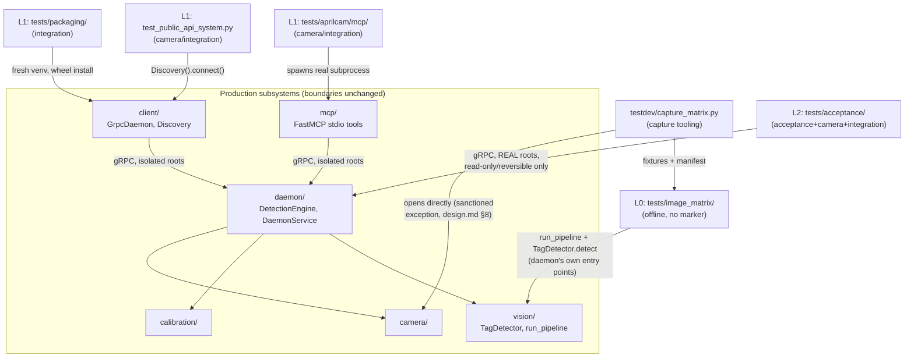

<!-- CLASI: Before changing code or making plans, review the SE process in CLAUDE.md -->

# Sprint 035: AprilTag Reliability Investigation and Layered Test System

## Goals

1. Investigate and resolve (or definitively characterize) the AprilTag-1
   detection-reliability issue on camera 5
   (`arducam-ov9281-usb-camera`), landing whatever code-side fix is
   possible plus a regression test that pins the outcome either way.
2. Land the layered test system proposed in
   `clasi/issues/aprilcam-v2-layered-test-system.md`: L0 offline
   image-matrix tests on committed fixtures, L1 live-hardware system
   tests, and L2 acceptance tests against the real daemon — closing the
   gap between 111 use-case scenarios and an empty traceability
   "Tests" column.
3. Prove the whole stack works together with a full dress rehearsal
   (gate → hardware → acceptance, back to back) before the sprint
   closes, including a byte-identical proof that the real
   `camera_position` was never touched.

The stakeholder was told this work was originally scoped as a 3-sprint
arc (Sprint A/B/C in the issue) and chose to run it as one sprint
anyway. This sprint.md treats that A/B/C breakdown as the ticket-group
structure within this single sprint, not as three sprints — see
Test Strategy below for the sequencing.

## Problem

Two related gaps, both surfaced during the 2026-08-23 exposure-tuning
work on camera 5:

- **AprilTag reliability**: AprilTag 1 decodes on only 1-3 of 10 polls
  on camera 5 across the exposure range tested, while all 10 ArUco
  markers decode on effectively every poll on the same frames. Only
  exposure has been ruled out as a cause; focus and per-family
  detector-parameter tuning (quad decimation, decode sharpening) have
  not been checked, and there is no regression test pinning current
  behavior either way.
- **No real test system**: the project has 29 use cases / 111 scenario
  IDs and `docs/design/process.md` §5 declares scenarios ARE the test
  plan, but every traceability "Tests" column is empty. Hardware test
  sweeps take ~9-12 minutes and one measured run showed 18 of 19
  failures were environmental (daemon contention), not code — so even
  the ad hoc verification that exists is noisy. Recent incidents (dark
  camera, exposure drift, the detection-confirmation cliff, the pipx
  daemon silently seeing zero cameras) were all diagnosed by one-off
  scripts that a real test system would have caught automatically.

## Solution

Sequence the sprint so every ticket group that does **not** depend on
freshly captured fixtures can land before the one hard human
dependency (the operator-assisted capture session), and so later
groups build on earlier ones:

1. **AprilTag investigation (code side)** — per-camera detector
   parameter tuning, a regression test pinning the measured behavior.
   No fixture dependency; can start immediately. The physical checks
   named in the issue (lens focus, printed tag held closer) are a
   stakeholder/operator step, not a ticket — see Scope.
2. **L0 offline image-matrix suite** — capture-tool updates first
   (`testdev/capture_matrix.py`/`.yaml`, HD-cam control-ordering fix),
   then the operator-assisted capture session (hard gate, ~15 min:
   daemon stopped, views closed, run from Terminal for macOS camera
   permission, stakeholder confirms field state for cameras 2, 3, 5),
   then the `tests/image_matrix/` pytest package (recall,
   world-accuracy, geometry, calibration-robustness, color-objects,
   preprocessing families) and synthetic-degradation tests built on
   the committed fixtures, then `scripts/test-gate.sh`.
3. **L1 live-hardware system tests** — MCP stdio system tests (offline
   handshake + hardware flagship: golden path, paths, off-center
   tag-height/parallax), generalized `hardware_camera.py` rig
   enumeration across cameras 2/3/5, the public `aprilcam.client` API
   system test, and the installed-package (cv2-free base install)
   test.
4. **L2 acceptance layer** — `acceptance` marker + no-write guard,
   read-only/reversible acceptance inventory against the real daemon,
   and the elevated ("with raised blocks") procedure gated behind
   `APRILCAM_TEST_ELEVATED=1` and documented in a new operator doc.
5. **Full dress rehearsal + traceability fill** — gate → hardware →
   acceptance run back-to-back, proving the real `camera_position`
   file is byte-identical before/after, plus filling every remaining
   traceability row.

Each group builds directly on the existing assets named in the issue
(`docs/test-plans/camera-image-matrix.md` §6, `testdev/capture_matrix.py`,
`tests/images/`, the isolation pattern in
`tests/aprilcam/daemon/test_camera_geometry_hardware.py`,
`tests/aprilcam/hardware_camera.py`) rather than reinventing them.

## Success Criteria

- AprilTag-1 issue resolved with a tuned parameter fix, or explicitly
  documented as a physical limitation of this camera/lens — either way
  pinned by a regression test that would fail on silent improvement or
  regression.
- L0, L1, and L2 test layers land, pass, and are wired into the
  appropriate runner (`scripts/test-gate.sh`, `scripts/test-hardware.sh`,
  `scripts/test-acceptance.sh`); L0 joins the sprint-close gate
  automatically with zero hardware tests in it.
- Skip-cleanly holds: renaming the fixture dir skips all L0 image
  tests (gate stays green); unplugging cameras skips L1 with
  remediation text.
- Every major use case named in the issue (daemon 01, 03, 04, 06, 09,
  10, 11, 12, 26, 28; CLI 13, 14, 15, 18, 19, 20, 22, 25, 29) has at
  least one named test in traceability (`get_use_case_coverage`).
- The installed-package test proves the base install is genuinely
  cv2-free (fresh venv, wheel install, `import aprilcam.client`
  succeeds, `import cv2` fails) and round-trips against a real daemon.
- Dress rehearsal at sprint close proves the real
  `~/.config/aprilcam/cameras/arducam-ov9782-usb-camera/config.json`
  `camera_position` is byte-identical before and after — proven by the
  no-write guard's sha256 sweep, not assumed.

## Scope

### In Scope

- AprilTag-1 code-side investigation: per-camera detector-parameter
  tuning (quad decimation, decode sharpening) and a regression test
  pinning the outcome.
- `testdev/capture_matrix.py`/`.yaml` updates (`--field-state-id` flag,
  calibration-snapshot pinning with sha256, ov9281 sweep entry,
  HD-cam auto-to-manual control-ordering fix).
- The operator-assisted capture session for cameras 2, 3, 5 and
  confirming `tests/images/field-state.json`'s `fs-20260823` entry.
- `tests/image_matrix/` package: recall, world-accuracy, geometry,
  calibration-robustness, color-objects, preprocessing test families,
  plus synthetic-degradation transforms and tests.
- `scripts/test-gate.sh` and associated traceability/doc updates.
- MCP stdio system tests (offline + hardware), generalized
  `hardware_camera.py` rig enumeration, public `aprilcam.client` API
  system test, installed-package (base-install, cv2-free) test.
- `acceptance` marker, no-write guard, acceptance inventory, elevated
  ("with raised blocks") procedure gated behind
  `APRILCAM_TEST_ELEVATED=1`, new `docs/test-plans/staged-elevated-locate.md`.
- `scripts/test-hardware.sh`, `scripts/test-acceptance.sh`.
- Final traceability fill across `docs/design/use-cases/{daemon,cli}.md`.
- The full dress-rehearsal run (gate → hardware → acceptance) at
  sprint close.
- All calibration/config work in this sprint runs against isolated
  config/state roots (`APRILCAM_CONFIG_DIR`/`APRILCAM_STATE_DIR`/
  `XDG_RUNTIME_DIR` + private daemon) — the real
  `camera_position` for `arducam-ov9782-usb-camera` is never written
  by any test in this sprint.

### Out of Scope

- The physical portion of the AprilTag investigation (checking lens
  focus, holding a printed tag closer) — these are stakeholder/operator
  hands-at-the-rig steps, not ticketable code work. The sprint records
  the outcome of these checks (as reported by the stakeholder) but does
  not perform them as a ticket.
- Any non-dry `camera locate` / real calibration write — excluded from
  every automated test in this sprint; elevated coverage is
  `--dry-run` only. A real non-dry locate remains a deliberate,
  separate stakeholder action per the issue's own language.
- Pi-side acceptance / systemd persistence on a calibrated playfield —
  tracked by `clasi/issues/later/live-tag-detection-and-systemd-persistence-on-a-pi-with-a-calibrated-playfield.md`,
  explicitly out of scope per the source issue.
- Multi-camera compositing (removed feature; N/A).
- Streamable HTTP MCP transport (deferred elsewhere per the project
  roadmap).
- Sprint-030's unproven distortion-benefit question and the
  camera-marked-tests-failing-en-masse daemon-contention issue are
  referenced by this issue as related context but are not themselves
  resolved by this sprint — L0's `test_world_accuracy.py` bears on the
  former; this sprint doesn't claim to close either separately-tracked
  issue.

## Test Strategy

This sprint's deliverable is largely test infrastructure, so testing
strategy and scope are the same thing here — see Solution above for
the five-group sequence. Key points not to lose sight of during Detail
Mode ticketing:

- **The operator gate is real and mid-sprint, not a formality.**
  Ticket groups 1 (AprilTag code-side) and the capture-tool-update half
  of group 2 have no fixture dependency and should be ordered to land
  *before* the capture session so the stakeholder's ~15-minute
  window (daemon stopped, views closed, Terminal session for macOS
  camera permission, field-state confirmation) blocks the minimum
  amount of remaining work. Everything downstream of the capture
  session (the L0 pytest package itself, L1, L2, the dress rehearsal)
  is gated on it landing successfully.
- **Isolation is non-negotiable.** Every hardware/system/acceptance
  test that touches config or state must use the proven isolation
  pattern (`APRILCAM_CONFIG_DIR`/`APRILCAM_STATE_DIR`/`XDG_RUNTIME_DIR`
  + private daemon + skip-if-not-isolatable), and L2 acceptance tests
  additionally require a byte-level no-write guard over the real
  config/state dirs. The solved `camera_position` for
  `arducam-ov9782-usb-camera` must never be overwritten by any test —
  this is proven, not assumed, by the dress rehearsal's sha256 sweep.
- **Skip-cleanly is a hard requirement, not a nice-to-have.** Fixture
  absence, unplugged cameras, or missing isolation must all skip
  (with remediation text) rather than fail, so the gate stays green
  when hardware isn't present — this was the specific failure mode
  (fixture-corpus rot) that killed v1's system tests.
- **Regression-first framing for the AprilTag issue.** Given the issue
  itself records "Not blocking — ArUco alone gives full playfield
  coverage," the most likely honest outcome is "documented physical
  limitation + tuned parameters + a regression test that pins current
  behavior" rather than a clean fix. That is an acceptable sprint
  outcome; Detail Mode should not force a fix if tuning doesn't
  produce one.
- **Risks to carry into ticketing:**
  - Capture logistics: daemon down ~15 min, v1 daemon must also be
    off, Terminal needed for macOS camera permission, camera-5
    lighting variance must be recorded in the manifest.
  - July's baseline captures recorded zero AprilTags; if the new
    capture session repeats that, the L0 recall/world-accuracy tests
    gain a debugging detour before they can be written meaningfully.
  - `mcp.client.stdio` under `asyncio_mode=auto` may need anyio
    bridging; the 103-char unix-socket path limit applies to the MCP
    subprocess env same as existing hardware tests.
  - Fixture growth is ~5 MB/camera/generation — keep confirmed
    generations, prune superseded unconfirmed ones, always
    skip-not-fail when a fixture dir is absent.
  - Because this is one sprint covering what was scoped as three, the
    single sprint-close test-gate run and single architecture review
    have to cover materially more surface than a typical sprint — see
    the closing report to team-lead for the resulting size concern.

## Architecture

**Substantial** — this sprint stands up three new test-layer subsystems
(L0 offline, L1 live-hardware, L2 acceptance), extends the capture
tooling, and makes one production-code change (per-camera detector
tuning). 6+ modules are touched, several are wholly new, and the new
test layers introduce a deliberate, load-bearing dependency onto every
production subsystem's own entry points (never a parallel
reimplementation) — well past the "one module, no new cross-module
dependency" compact threshold. Unlike sprint 020 (substantial but no
diagram, because nothing new was being composed), this sprint's whole
point *is* a new composition — three test layers wired onto the
existing subsystem map in a specific, deliberate way — so a component
diagram earns its place (Step 4 below).

### Step 1 — Understand the Problem

Two related, previously-unaddressed gaps, both surfaced during the
2026-08-23 exposure-tuning work on camera 5 (see Problem above): (a) one
specific detection-reliability question (AprilTag 1 on
`arducam-ov9281-usb-camera`) has never been investigated past ruling out
exposure, and (b) the project has 111 scenario IDs and zero of them are
wired to an executable test — every recent production incident was
caught by a one-off script, not a regression suite. Both gaps share a
root cause worth naming once: nothing in this codebase runs the
detection/calibration/MCP/client pipeline end to end and checks the
answer against known-good ground truth, so every "does this still work"
question is answered by a human running `aprilcam camera tags` by hand.
This sprint's job is to make that question answerable by `pytest`, at
three different levels of realism, and to close out the one concrete
reliability question that motivated writing it down.

### Step 2 — Identify Responsibilities

- **Capture confirmed, ground-truthed image fixtures** — a camera,
  under a documented control matrix, against a documented field state,
  with the resulting JPEGs and manifests committed. Changes
  independently of what the fixtures are used to test (it's already a
  separate tool, `testdev/capture_matrix.py`, being extended here, not
  rebuilt).
- **Assert detection/calibration/geometry correctness offline, against
  those fixtures** — no hardware, no daemon process, pure pytest over
  committed JPEGs. Changes independently of live-daemon concerns; it
  changes when the vision/calibration pipeline's *expected output*
  changes, not when the daemon's RPC surface changes.
- **Assert the real daemon's live behavior in isolation** — MCP stdio
  handshake and golden path, the public `aprilcam.client` API, the
  installed (cv2-free base) package, and multi-camera rig enumeration,
  all against real hardware but a throwaway config/state/socket root
  and a private daemon process. Changes when the client-facing contract
  (MCP tool surface, `aprilcam.client` API, packaging boundary) changes.
- **Assert the real daemon's behavior against the real, persistent
  field state, without ever risking the one irreplaceable file**
  (`camera_position` for `arducam-ov9782-usb-camera`). This is a
  distinct responsibility from the previous one specifically *because*
  of that constraint — L1 may freely write to its own throwaway roots;
  L2 must prove, not assume, that it wrote to nothing real.
- **Tune per-camera detection parameters, and pin the result with a
  regression test** — a narrow, code-side responsibility distinct from
  all of the above: it changes `vision.detector.DetectorConfig` values
  and how `daemon.detection.DetectionEngine` builds a `TagDetector` per
  camera, not test infrastructure.
- **Make every layer runnable by one canonical command, and make every
  major use case traceable to a named test** — the glue responsibility:
  shell wrappers plus doc updates, no test logic of its own.

### Step 3 — Subsystems and Modules

| Module | Purpose (one sentence, no "and") | Boundary | Serves |
|---|---|---|---|
| **Capture tooling** (`testdev/capture_matrix.py` + `.yaml`, extended) | Produces a confirmed, manifested set of image fixtures per camera. | Opens cameras directly (the one sanctioned exception to daemon-sole-ownership, design.md §8); writes JPEGs + manifests + a pinned `calibration.json` snapshot under `tests/images/`; never writes a camera's live `config.json`. | SUC-001, SUC-005 (regression fixtures) |
| **L0 offline image-matrix suite** (`tests/image_matrix/`, new package) | Asserts detection/calibration/geometry correctness against committed fixtures with no hardware. | Reads `tests/images/**` + `field-state.json` + the pinned calibration snapshot only; calls `vision.pipeline.run_pipeline`/`vision.detector.TagDetector` directly — the daemon's own entry points, never a reimplementation; writes nothing; carries no pytest marker so it joins the sprint-close gate by construction. | SUC-001 |
| **L1 live-hardware system tests** (`tests/aprilcam/mcp/`, `tests/aprilcam/client/test_public_api_system.py`, `tests/packaging/`, generalized `tests/aprilcam/hardware_camera.py`) | Proves every client-facing surface works end to end against real hardware, in an isolated environment. | Real camera, real (but throwaway) daemon subprocess; every write lands in an isolated `APRILCAM_CONFIG_DIR`/`APRILCAM_STATE_DIR`/`XDG_RUNTIME_DIR` root, never the real one; `camera`/`integration` markers. | SUC-002, SUC-004 |
| **L2 acceptance layer** (`tests/acceptance/`, new package) | Proves the real, persistent system is safe and correct without ever writing to it. | The REAL config/state roots; read-only/reversible RPCs only, enforced by a node-id allowlist; a sha256 no-write guard sweeps every real file before/after; elevated ("with raised blocks") coverage is `--dry-run` only, gated behind `APRILCAM_TEST_ELEVATED=1`; `acceptance`+`camera`+`integration` markers. | SUC-003 |
| **Test runners and traceability** (`scripts/test-gate.sh`/`test-hardware.sh`/`test-acceptance.sh`, `docs/design/use-cases/{daemon,cli}.md` Tests columns, `docs/test-plans/camera-image-matrix.md` update, new `docs/test-plans/staged-elevated-locate.md`) | Wires each layer into one canonical, documented command and records which test proves which use case. | Shell wrappers and doc edits only — no assertions of their own. | All SUCs' "runs via one command" postcondition |
| **Per-camera detector tuning** (`vision.detector.DetectorConfig`, `daemon.detection`'s `DetectorFactory`) | Lets one camera's `TagDetector` use different `quad_decimate`/`corner_refine` values than another camera's, without a global change. | `DetectorConfig` itself (a pure value type) is unchanged; only `DetectorFactory`'s shape and `DetectionEngine._detector_for`'s construction site change — everything downstream of `TagDetector.detect()` is unaffected. | SUC-005 |

### Step 4 — Diagram

A component diagram is warranted here (unlike sprint 020's "nothing new
is being composed" exception): the deliverable *is* a new composition —
three test layers wired deliberately onto the existing subsystem map,
each hitting a different, named set of production entry points.

No ERD: no data-model change (`field-state.json` gains a confirmed
entry via existing shape; `main-playfield.json` is untouched). No
dependency-graph diagram beyond the component diagram above: no
existing production dependency direction changes — every new edge
originates from new test code pointing *at* unchanged production entry
points, never the reverse.

### Step 5 — What Changed / Why / Impact / Migration Concerns

**What Changed**

- `testdev/capture_matrix.py`/`.yaml`: `--field-state-id` flag,
  calibration-snapshot sha256 pinning, an `ov9281` sweep entry, the
  HD-cam auto-to-manual control-ordering fix.
- New `tests/images/fs-20260823/<slug>/` fixture generation (cameras 2,
  3, 5) plus a confirmed `fs-20260823` entry in `field-state.json`; the
  existing July corpus and its `unverified-20260729` entry are left in
  place, not replaced.
- New `tests/image_matrix/` package: conftest fixture discovery,
  `test_recall.py`, `test_world_accuracy.py`, `test_geometry.py`,
  `test_calibration_robustness.py`, `test_preprocessing.py`,
  `transforms.py` + `test_synthetic_degradation.py`. (A planned
  `test_color_objects.py` was dropped by stakeholder decision — ticket
  006, 2026-08-24 — since no color/object classifier exists or is
  architecturally permitted; see the ticket's "Dropped criterion" note.)
- New `tests/aprilcam/mcp/test_stdio_offline.py` and
  `test_stdio_hardware.py`; generalized
  `tests/aprilcam/hardware_camera.py`; new
  `tests/aprilcam/client/test_public_api_system.py`; new
  `tests/packaging/test_installed_package.py`.
- New `tests/acceptance/` package: `acceptance` marker + conftest
  no-write guard, the read-only/reversible inventory, the
  `APRILCAM_TEST_ELEVATED=1`-gated elevated procedure.
- New `scripts/test-gate.sh`/`test-hardware.sh`/`test-acceptance.sh`;
  new `docs/test-plans/staged-elevated-locate.md`; updated
  `docs/test-plans/camera-image-matrix.md` and
  `docs/design/use-cases/{daemon,cli}.md` Tests columns.
- `pyproject.toml`: one new `acceptance` marker.
- `src/aprilcam/vision/detector.py` (`DetectorFactory`'s type widens to
  accept a camera slug) and `src/aprilcam/daemon/detection.py`
  (`DetectionEngine._detector_for` passes the slug through; a small
  per-slug tuning table decides camera 5's `DetectorConfig`).

**Why**

`docs/design/process.md` §5 declares scenarios ARE the test plan, and
every traceability "Tests" column has been empty since the use cases
were written — this sprint is what makes that declaration true. The
layering exists because a single test suite cannot serve all three
needs at once: offline tests must run with zero hardware to be useful
in CI-like contexts and to stay fast; hardware tests must exercise the
real daemon/MCP/client stack to catch what offline tests structurally
cannot (real UVC quirks, real subprocess handshakes); acceptance tests
must prove — not assume — that testing the real system never corrupts
the one hand-solved value (`camera_position`) that would be expensive
to redo. The AprilTag investigation is folded into the same sprint
because it needed exactly the same instrumentation (a real regression
test) that L0 exists to provide, and because "not blocking, but
undiagnosed" is exactly the kind of finding this test system exists to
turn into either a fix or a pinned, honest fact.

**Impact on Existing Components**

- `vision/detector.py` / `daemon/detection.py`: `DetectorFactory`
  widens from `Callable[[], TagDetector]` to `Callable[[str],
  TagDetector]`. The one production call site
  (`DetectionEngine._detector_for`) and the one default implementation
  (`_default_detector_factory`) both change; any test double
  constructing a `DetectionEngine` with a custom zero-arg factory needs
  updating (grep confirms there is no other call site in the tree
  today).
- `testdev/capture_matrix.py`/`.yaml`: additive only — existing camera
  entries (arducam-ov9782) and existing capture behavior are unchanged;
  the HD-cam fix only changes behavior for a camera that was previously
  failing to apply its variation matrix at all.
- `tests/aprilcam/hardware_camera.py`: generalized to enumerate *all*
  qualified cameras, not just resolve the single best one;
  `resolve_hardware_camera_slug()`'s existing single-camera contract is
  preserved for existing callers, the enumeration is additive.
- `pyproject.toml`: the existing `camera`/`integration` markers and the
  gate's exclusion expression (`-m "not camera and not integration"`)
  are untouched — L0 carries no marker at all, so it joins the gate by
  construction, not by editing the exclusion expression.
- `docs/design/use-cases/{daemon,cli}.md`: only the Tests columns
  change; no use-case text itself is edited.
- `docs/test-plans/camera-image-matrix.md`: updated to describe a
  *package* (`tests/image_matrix/`), correcting its own
  now-superseded "single module" framing.

**Migration Concerns**

No runtime data migration. `field-state.json` gains a new confirmed
entry (`fs-20260823`) alongside the existing `unverified-20260729`
stub — additive, reversible (git-tracked), no schema change. The one
production-code signature change (`DetectorFactory`) is internal-only
(no external package imports it) and has exactly one call site and one
default implementation to update in the same commit. No deployment
sequencing concern beyond the normal per-sprint version bump — this
sprint ships no daemon-restart-visible behavior change except
per-camera detector tuning, which is a pure improvement-or-no-op for
every camera whose tuning table entry stays at defaults.

### Step 6 — Design Rationale

**Decision 1 — compress the 3-sprint arc into one sprint's ticket
groups, sequenced by fixture dependency, not by the original A/B/C
split.**
*Context:* the source issue scoped this as Sprint A (offline)/B
(hardware)/C (acceptance). The stakeholder chose to run it as one
sprint.
*Alternatives considered:* keep it as three sprints — rejected, the
stakeholder's explicit choice; split differently (e.g., by subsystem
rather than by fixture dependency) — rejected, fixture dependency is
the one axis that actually gates parallelizable work (the operator
capture session is the sole hard human dependency).
*Consequences:* one sprint-close test-gate run and one architecture
review now cover materially more surface than typical; ticket
dependency ordering carries more weight than usual (see Test Strategy
above) — every ticket group that doesn't need fixtures is sequenced
before the capture-session gate specifically to minimize what blocks on
it.

**Decision 2 — `DetectorFactory` becomes slug-aware rather than adding
a global override or a new `CameraConfig` field.**
*Context:* today's `_default_detector_factory` builds an identical
`TagDetector()` for every camera; camera 5 needs different
`DetectorConfig` values than camera 3 without affecting camera 3.
*Alternatives considered:* (a) an env-var-driven global override —
rejected, would tune every camera identically, defeating the purpose;
(b) surfacing tuning params through `CameraConfig.settings` (the
UVC-control-shaped push/fetch document) — rejected for this sprint as
scope creep into the config-document schema and its whole-document-push
convention; a small per-slug constants table inside
`daemon/detection.py` is the smallest change that unblocks a regression
test, with promotion to a real config field flagged as a future
refinement if a second camera ever needs non-default tuning (Open
Questions, below).
*Consequences:* `DetectorFactory`'s signature changes (see Impact
above); the change is contained to one module and one call site.

**Decision 3 — the no-write guard hashes file contents (sha256), not
mtime/size.**
*Context:* the sacred invariant (`camera_position` for
`arducam-ov9782-usb-camera` is never overwritten) must be *proven*,
not assumed, at sprint close.
*Alternatives considered:* mtime+size comparison — rejected, does not
catch a same-size, forced-mtime rewrite; a single hash of the whole
`config_dir`/`state_dir` tree concatenated — rejected in favor of
per-file hashes, which localize a failure to the specific file that
changed instead of reporting only "something changed."
*Consequences:* every real file under `config_dir`/`state_dir` is
hashed twice per acceptance run; negligible cost at this file count.

**Decision 4 — `acceptance` is a third marker layered on top of
`camera`+`integration`, not a replacement for them.**
*Context:* the existing gate's exclusion expression
(`-m "not camera and not integration"`) must keep excluding acceptance
tests with zero edits to that expression.
*Alternatives considered:* an `acceptance`-only marker scheme —
rejected, would require editing the gate's exclusion expression and
risks a silent regression the day a new acceptance test forgets the
extra markers.
*Consequences:* every acceptance test carries three markers;
`test-hardware.sh`'s own selection (`(camera or integration) and not
acceptance`) is the one place that has to know to exclude `acceptance`
explicitly.

**Decision 5 — elevated ("with raised blocks") coverage is `--dry-run`
only, gated behind `APRILCAM_TEST_ELEVATED=1`.**
*Context:* the source issue's own language treats a real, non-dry
`camera locate` as a deliberate, rare stakeholder action, never
something automated testing should trigger.
*Alternatives considered:* deferring elevated coverage entirely until
blocks are permanently installed — rejected, the stakeholder explicitly
wants both raised-block and no-raised-block coverage this sprint.
*Consequences:* elevated coverage proves the solve math and its
RMS/condition gates, not the live-commit code path; that path keeps
relying on the existing unit/real-fixture regressions
(`tests/aprilcam/calibration/test_geometry.py:485-887`) per
`calibration/DESIGN.md`.

### Step 7 — Open Questions

- Whether the new `fs-20260823` capture session repeats July's "zero
  AprilTags detected" outcome — if so, L0's AprilTag-specific recall
  and world-accuracy assertions gain a debugging detour before they can
  be written meaningfully (already flagged as a risk above; not
  resolvable before the capture session itself runs).
- Whether `mcp.client.stdio` under this project's `asyncio_mode=auto`
  pytest config needs anyio bridging, or works directly — an
  implementation-time finding, not a planning-time one.
- Whether per-camera detector-parameter tuning alone resolves
  AprilTag-1's reliability, or whether the honest sprint outcome is
  "documented physical limitation + tuned parameters + a regression
  test pinning current behavior" — Test Strategy above already frames
  both outcomes as acceptable; ticketing does not force a clean fix.
- Whether a future sprint should promote the per-slug detector-tuning
  table (Decision 2) into a real `CameraConfig`-surfaced field, once a
  second camera needs non-default tuning — flagged, not decided here.

## Use Cases

Five sprint-level use cases, one per test layer plus one for the
AprilTag investigation. None of these are new top-level product
capabilities — the layered test system is meta (it proves existing
UCs hold), so each SUC parents to the existing UC its layer most
directly exercises. `SUC-004`'s natural parent would be a client-library
use case; per `docs/design/use-cases/README.md`, that file is "planned,
not yet written," so it parents to UC-10 (the core query the public API
wraps) instead, noted explicitly below.

### SUC-001: Catch a detection/calibration regression with no camera attached
Parent: UC-10 — Get all detected tags at once

- **Actor**: Human developer (A-03)
- **Preconditions**: `tests/images/fs-20260823/**` fixtures and a
  confirmed `field-state.json` entry exist (this sprint's capture
  session); the pinned `calibration.json` snapshot is committed beside
  each camera's fixtures.
- **Main Flow**:
  1. Developer runs `uv run pytest tests/image_matrix/` (or
     `scripts/test-gate.sh`) with no camera attached.
  2. For each fixture, `run_pipeline` + `TagDetector.detect` (the same
     entry points the daemon itself calls) run against the saved JPEG.
  3. Recall, world-accuracy (≤1.5 cm), geometry-convention
     (+x east/+y north/north-up), calibration-robustness, and
     preprocessing-effectiveness assertions run per fixture family. (A
     color-object family was planned but dropped by stakeholder
     decision — ticket 006 — since no vision-confirmed color/object
     classifier exists or is architecturally permitted.)
  4. Synthetic degradation transforms (exposure/gamma/contrast/
     brightness/blur/noise/recompress) run against a mild and a severe
     grid, asserting full recall and the documented boundary
     respectively.
- **Postconditions**: A pass proves the pipeline still produces correct
  output on every confirmed fixture; a regression (or a silent
  improvement on a documented cliff config) fails readably, naming the
  fixture and the expectation that broke.
- **Acceptance Criteria**:
  - [ ] Renaming/removing the fixture directory skips every L0 test
        cleanly (no failures) and the gate stays green.
  - [ ] Falsifying one expectation per assertion family (mutation
        check) produces a readable failure, then reverts clean.
  - [ ] `scripts/test-gate.sh` selects old-suite ∪ L0 and zero
        `camera`/`integration` tests, before and after this sprint.

### SUC-002: Prove the real daemon and MCP stdio surface work end to end, in isolation
Parent: UC-22 — Run the MCP server

- **Actor**: Human developer (A-03)
- **Preconditions**: A real camera from {2, 3, 5} is attached and free;
  `APRILCAM_CONFIG_DIR`/`APRILCAM_STATE_DIR`/`XDG_RUNTIME_DIR` are set
  to a throwaway root per the proven isolation pattern
  (`test_camera_geometry_hardware.py:204-227`).
- **Main Flow**:
  1. Developer runs `scripts/test-hardware.sh`.
  2. `test_stdio_offline.py` spawns a real `aprilcam mcp` subprocess
     over stdio, completes the MCP handshake, and asserts `tools/list`
     is a superset of the pinned 27-tool inventory with no eager daemon
     connect.
  3. `test_stdio_hardware.py` starts an isolated private daemon, pushes
     a playfield + camera config (no `camera_position`), calibrates
     into the isolated state dir, then drives the golden path
     (`get_guide`→`list_cameras`→`get_tags`→`where`), the paths flow
     (`draw_path`→round-trip→`get_frame` deskewed→rendered-pixel
     assertion→`clear_layer`→gone), and the off-center tag-height flow
     (`register_tag` mount_z on a tag ~70 cm off-nadir →
     `mount_z_applied == False` while unconfigured → push real geometry
     → `mount_z_applied == True`, center moves per the parallax
     formula, hypot > 2 cm → `unregister_tag` → restored) — entirely
     over the stdio session.
- **Postconditions**: A pass proves the MCP stdio transport, the
  golden-path tool sequence, path annotations, and off-center mount
  correction all work against a real camera and a real (but throwaway)
  daemon.
- **Acceptance Criteria**:
  - [ ] Every write in this flow lands under the isolated roots;
        nothing under the real `~/.config/aprilcam` or
        `~/.local/share/aprilcam` changes (spot-checked, not just
        assumed — the L2 no-write guard is the systematic version of
        this check).
  - [ ] Unplugging every qualifying camera skips this test cleanly with
        remediation text naming what to attach.
  - [ ] The off-center displacement constants are imported from the
        same helper `test_camera_geometry_hardware.py` uses, not
        redeclared, so the two cannot drift apart.

### SUC-003: Prove the real daemon works without ever touching the real camera_position
Parent: UC-29 — Determine a camera's physical position and height

- **Actor**: Human developer (A-03)
- **Preconditions**: The real, persistent daemon and its real
  `config_dir`/`state_dir` are in their normal, already-calibrated
  state; no isolation environment variables are set (L2 refuses to run
  if they are).
- **Main Flow**:
  1. Developer runs `scripts/test-acceptance.sh`.
  2. The conftest sha256-hashes every file under the real
     `config_dir`/`state_dir` before any test runs.
  3. The read-only/reversible inventory runs against the REAL daemon:
     status, camera list, raw + deskewed frames from cameras 3 and 5,
     `get_tags` ⊇ the confirmed field state, `where` on a surveyed tag,
     an MCP stdio round trip against the real daemon (guide, tags,
     draw/list/clear a throwaway annotation layer), and a mount_z
     register→moves-per-formula→unregister→restored cycle.
  4. If `APRILCAM_TEST_ELEVATED=1`, the elevated procedure additionally
     runs `camera locate <cam> --dry-run --reference
     TAG:SLUG:HEIGHT_CM ...` and asserts RMS ≤ 1.0 cm and condition
     ≤ 447 — zero writes, per its own contract.
  5. The conftest re-hashes every file under `config_dir`/`state_dir`
     after every test completes.
- **Postconditions**: A pass proves the real daemon answers correctly
  against the real field, and — proven by the sha256 sweep, not
  assumed — that `camera_position` for
  `arducam-ov9782-usb-camera` (and every other real config/state file)
  is byte-identical before and after the entire run.
- **Acceptance Criteria**:
  - [ ] The no-write guard is itself unit-tested: touching a file in a
        fake tree makes it raise.
  - [ ] Every acceptance test carries `acceptance`+`camera`+`integration`
        markers; `scripts/test-hardware.sh`'s selection
        (`(camera or integration) and not acceptance`) excludes them.
  - [ ] A non-dry `camera locate` or any `calibrate` call is
        structurally excluded from this suite via a node-id allowlist,
        not merely avoided by convention.
  - [ ] `docs/test-plans/staged-elevated-locate.md` documents the
        blocks/tags/heights/commands/quality-gates for the elevated
        procedure, and states plainly that a real non-dry locate is a
        deliberate, separate stakeholder action, never a test.

### SUC-004: Verify the public robot-facing API works, including as an installed package
Parent: UC-10 — Get all detected tags at once
(No dedicated client-library use case exists yet — `use-cases/README.md`
lists the client library as "planned, not yet written" — so this SUC
parents to the core query UC-10 wraps; the actual coverage is broader,
spanning the whole `aprilcam.client` surface named in the Main Flow.)

- **Actor**: Robot program (A-01)
- **Preconditions**: A real camera is attached and isolated roots are
  set up (same isolation pattern as SUC-002), for the driven-directly
  half; a built wheel and a fresh venv exist for the installed-package
  half.
- **Main Flow**:
  1. `test_public_api_system.py` drives `aprilcam.client` directly:
     `Discovery().connect()` → `get_tags`/`get_tag`/`get_tag_history`,
     `get_frame` raw and deskewed, one `stream_images` subscription,
     `register_tag`/`unregister_tag`, `put_annotation` and
     `replace_layer`, `get_guide`.
  2. `test_installed_package.py` builds the wheel (`uv build`), creates
     a fresh venv, `pip install`s the BASE extra only, asserts `import
     aprilcam.client` succeeds with no `cv2` importable in that venv,
     asserts the console script exists and `-V` matches, then runs a
     consumer script from that fresh venv against a private isolated
     daemon (run from the dev venv) and round-trips camera-free data
     (playfield push, annotation draw/list/clear, guide).
- **Postconditions**: A pass proves the sanctioned robot-program surface
  (`Discovery().connect()` → typed `Daemon`) works end to end, and that
  the base install genuinely needs no `cv2` — closing the 2026-08-23
  "pipx daemon silently sees zero cameras" incident's gap permanently.
- **Acceptance Criteria**:
  - [ ] `import cv2` fails inside the fresh base-install venv.
  - [ ] The consumer script round-trips real data through a real
        (isolated) daemon from the installed package alone.
  - [ ] Camera-dependent assertions in `test_public_api_system.py`
        carry `camera`; daemon-only assertions carry `integration`.

### SUC-005: Resolve or document AprilTag-1's detection reliability on camera 5
Parent: UC-09 — Ask for one tag by its number

- **Actor**: Human developer (A-03), diagnosing on behalf of a robot
  program (A-01) that would otherwise rely on AprilTag 1 as an origin
  anchor
- **Preconditions**: Camera 5 (`arducam-ov9281-usb-camera`) attached and
  configured against `main-playfield`; the 2026-08-23 exposure sweep
  already ruled out exposure as the sole cause.
- **Main Flow**:
  1. Developer tunes `DetectorConfig.quad_decimate`/`corner_refine` for
     camera 5 via the new per-slug tuning table
     (`daemon.detection.DetectorFactory`), leaving every other camera's
     detector unchanged.
  2. Developer measures AprilTag 1's detection rate over repeated
     bursts at the tuned settings against the tuned settings' effect on
     the other cameras' recall (regression check).
  3. A regression test (`tests/image_matrix/` or a vision-level unit
     test) pins whatever the measured outcome is — either an improved
     rate, or the current rate as a documented floor — so a future
     silent regression or silent improvement is both visible.
- **Postconditions**: Either AprilTag 1's detection rate measurably
  improves with no regression to camera 5's ArUco recall or any other
  camera's detection, or the current rate is recorded as a documented
  physical limitation of this camera/lens pairing — either way, pinned
  by a test, not left as an undocumented hunch.
- **Acceptance Criteria**:
  - [ ] The regression test fails if AprilTag 1's detection rate on
        camera 5 silently drops below the measured/tuned baseline.
  - [ ] The regression test also fails if the rate silently improves
        past the documented baseline without the test being
        deliberately updated (so an accidental future fix doesn't go
        unnoticed either).
  - [ ] No regression to camera 5's ArUco recall (still ~10/10 across
        the tested range) or to any other camera's detection from the
        per-camera tuning mechanism itself.
  - [ ] If tuning does not measurably improve AprilTag 1's rate, the
        sprint records this as a documented physical limitation (lens
        focus / decode margin, per the source issue's own hypothesis)
        rather than blocking on an agent-unreachable physical fix — the
        physical checks (lens focus, printed tag held closer) are
        explicitly out of scope for this ticket group, per Scope above.

## GitHub Issues

(GitHub issues linked to this sprint's tickets. Format: `owner/repo#N`.)

## Definition of Ready

Before tickets can be created, all of the following must be true:

- [ ] Sprint planning document is complete (sprint.md, including its
      Architecture and Use Cases sections)
- [ ] Architecture review passed (or skipped, for changes with no
      architectural impact)
- [ ] Stakeholder has approved the sprint plan

## Tickets

| # | Title | Group | Issue | Depends On |
|---|-------|-------|-------|------------|
| 001 | Widen DetectorFactory to per-camera detector tuning | 1. AprilTag (code-side) | apriltag-1 | — |
| 002 | Tune camera 5 detector parameters and pin AprilTag-1 regression | 1. AprilTag (code-side) | apriltag-1 | 001 |
| 003 | Capture-tool updates: field-state-id, calibration snapshot pinning, ov9281 entry, HD-cam fix | 2. L0 offline | layered-test-system | — |
| 004 | **Operator-assisted image-matrix capture session for cameras 2, 3, 5** (human-at-rig gate) | 2. L0 offline | layered-test-system | 003 |
| 005 | L0 image-matrix package: fixture discovery, recall and world-accuracy tests | 2. L0 offline | layered-test-system | 004 |
| 006 | L0 image-matrix package: geometry, calibration-robustness, color-objects, preprocessing tests | 2. L0 offline | layered-test-system | 005 |
| 007 | L0 synthetic degradation transforms and tests | 2. L0 offline | layered-test-system | 005 |
| 008 | Wire test-gate.sh and fill L0 traceability and doc updates | 2. L0 offline | layered-test-system | 006, 007 |
| 009 | MCP stdio offline handshake and tool-inventory test | 3. L1 hardware | layered-test-system | — |
| 010 | Generalize hardware_camera.py rig enumeration across cameras 2, 3, 5 | 3. L1 hardware | layered-test-system | — |
| 011 | MCP stdio hardware flagship test: golden path, paths, off-center tag height | 3. L1 hardware | layered-test-system | 009, 010 |
| 012 | Public aprilcam.client API system test | 3. L1 hardware | layered-test-system | 010 |
| 013 | Installed-package cv2-free base-install test | 3. L1 hardware | layered-test-system | — |
| 014 | Acceptance marker and no-write guard | 4. L2 acceptance | layered-test-system | — |
| 015 | Acceptance inventory against the real daemon | 4. L2 acceptance | layered-test-system | 014 |
| 016 | Elevated with-raised-blocks dry-run locate coverage and operator doc | 4. L2 acceptance | layered-test-system | 015 |
| 017 | Wire test-hardware.sh and test-acceptance.sh runners | 4. L2 acceptance | layered-test-system | 011, 012, 013, 016 |
| 019 | Convert hard-failing -m camera tests to skip-with-remediation | Cross-cutting: skip hygiene | layered-test-system | 010 |
| 018 | Full dress rehearsal and final traceability fill | 5. Dress rehearsal | layered-test-system | 008, 017, 019 |

Tickets execute serially in the order listed above (001→017→019→018),
which is also dependency order: within a group, a ticket with no
`Depends On` entry has no fixture/prior-ticket dependency and could in
principle run earlier, but grouping is preserved for readability since
the groups themselves are sequential (ticket-group 2's capture-session
gate, 004, blocks everything from 005 onward; group 3 and group 4 each
have internal parallelism the serial order doesn't exploit but doesn't
violate either). Ticket 019 was added mid-sprint (after ticket 010's
regression check of the existing `-m camera` suite found 41 of 57 tests
hard-failing rather than skipping) and runs after group 4, before the
dress rehearsal (018), since 018's hardware run is meaningless while
most of the hardware suite fails environmentally rather than skipping.
"apriltag-1" = `apriltag-1-detects-unreliably-on-arducam-ov9281-usb-camera.md`;
"layered-test-system" = `aprilcam-v2-layered-test-system.md`.
