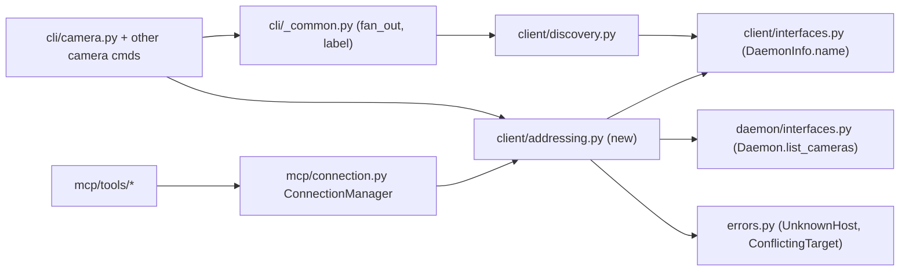

<!-- CLASI: Before changing code or making plans, review the SE process in CLAUDE.md -->

# Sprint 048: Host names in fan-out listings and HOST-N camera addressing

## Goals

1. Every `--all` fan-out block is labelled with the daemon's short host
   name (`gala (local):`, `buzzkill:`, `donald:`), not an address.
2. A camera on any daemon can be named `HOST-N` (e.g. `donald-4`), where
   N is the bracketed persistent registry number (`CameraState.number`),
   in every CLI camera subcommand and every MCP tool `camera` parameter.

## Problem

`camera list --all` labels blocks `localhost (local):`, `192.168.1.23:5280:`,
`192.168.4.60:5280:`. Reaching a camera on another machine needs `-d ADDRESS`
on every command. `find_all()` already receives the daemon's name (TXT `host`
property, `_BrowseResult.hostname`) but drops it when building `DaemonInfo`.

## Solution

Carry the name through `DaemonInfo`, label fan-out with it, and add one
shared client-side resolver that turns `(camera argument, -d / default host)`
into `(daemon target, camera argument for the daemon)`. The CLI and the MCP
`ConnectionManager` both call that resolver, so the rules live in one place.

## Success Criteria

- `aprilcam camera list --all` prints `gala (local):`, `buzzkill:`, `donald:`
  headers; each row shows a copyable `HOST-N` address.
- `aprilcam camera image donald-4 -o f.jpg` works with no `-d`.
- `brio-501` and `hd-pro-webcam-c920` still resolve as slugs on the targeted
  daemon (no regression from the HOST-N parse).
- MCP `get_tags(camera="donald-4")` routes to Donald's daemon.
- All new behaviour covered by unit tests using fake discovery; no hardware.

## Scope

### In Scope

- `DaemonInfo.name`, populated by `find_all()` (local and browsed), normalized.
- Fan-out labels use the name; `(local)` marker for the local daemon.
- `HOST-N` resolver and its errors; CLI wiring for all camera-taking
  subcommands; MCP wiring for all tools with a `camera` parameter.
- `HOST-N` address shown per row in `--all` listings.
- Global repeatable root `-v` count (also accepted after the subcommand
  without shadowing the root value); `camera calibrate`'s own `-v/--verbose`
  merged into it; `-v` adds the address to fan-out labels
  (`donald (192.168.4.60:5280):`); `-vv`/`-vvv` set the root logger to
  INFO/DEBUG (level wiring only).
- `camera list` / `camera list --all` hide rows with `usable=false` unless
  `-v`, with a trailing `(N unusable cameras hidden; -v to show)` note.
- Docs: README camera-addressing section, `cli` / `client` / `mcp` DESIGN
  docs, `docs/design/use-cases/cli.md` fan-out label text.

### Out of Scope

- Per-command `-v` detail beyond `camera list` and `camera calibrate`.
- Log content: `-vv` / `-vvv` only set the root logger level; no new log
  statements are added.
- Any daemon-side or proto change. Host names already travel in mDNS TXT.

## Test Strategy

Unit tests only. A fake `Discovery` (injected through the existing
`discovery_factory` seams in `cli/camera.py` and `ConnectionManager`)
supplies `DaemonInfo` tuples with names and fake `Daemon`s with
`list_cameras()` results. Resolver tests cover each rule in the resolution
order, case-insensitivity, `.local` / domain stripping, slug-with-digits
collisions, conflict with `-d`, unknown host, and unreachable target daemon.
Discovery tests use the existing injectable `browse` seam.

## Architecture

**Sizing: Substantial** - touches three modules (`client`, `cli`, `mcp`),
adds a new cross-module dependency edge (`cli` and `mcp` both depend on a
new `client.addressing` module), and adds a field to a cross-boundary value
type. Code volume is modest; the heavier tier is chosen because of the new
shared-dependency edge and the borderline-prefers-heavier rule.

### Architecture Overview

No cycles: `addressing` depends only on `client.interfaces`,
`daemon.interfaces`, and `errors`; `cli` and `mcp` each already depend on
`client`.

#### What Changed

- **`client/interfaces.py` - `DaemonInfo`.** New frozen-dataclass field
  `name: str = ""` (short, lowercase host name; empty means unknown, in
  which case labels fall back to the address). A field, not a property, per
  the project rule. Existing constructors keep working.
- **`client/discovery.py` - `find_all()`.** Populates `name` from
  `_BrowseResult.hostname` for browsed entries, and from this machine's
  `socket.gethostname()` for the local entry. A helper `short_host_name(raw)`
  lowercases and strips `.local` and any domain suffix (`Donald.local` ->
  `donald`, `buzzkill.home` -> `buzzkill`). The self-filter and the
  load-bearing `ip:port` format of `DaemonInfo.host` are untouched.
- **`cli/_common.py` - `fan_out()`.** Label is `info.name` (plus ` (local)`
  for the local daemon), falling back to the old address label when `name`
  is empty. Renderers can derive the `HOST-N` address from the same name.
- **`cli/__init__.py` + `cli/_common.py` - verbosity.** A root `-v`
  (`action="count"`, default 0) beside `-d`, plus a way to accept `-v` after
  the subcommand without the subcommand's default overwriting the root count
  (subparser copy uses `default=argparse.SUPPRESS` and a shared count
  reader). `args.verbose` becomes an int; `cli/calibrate.py` drops its own
  flag and reads `verbose >= 1`. `fan_out` appends the address to the label at
  `verbose >= 1`. `print_cameras` filters `usable=false` rows unless
  `verbose >= 1` and prints the hidden-count note (the note counts per daemon
  block). Count >= 2 / >= 3 sets the root logger to INFO / DEBUG at startup.
  `camera probe` is not filtered (it reports discovery state).
- **`client/addressing.py` (new) - camera address resolution.** One
  responsibility: turn a camera argument plus the effective daemon target
  into a `(host, camera)` pair. It never touches a camera; it only calls
  `Discovery.find_all/connect` and `Daemon.list_cameras`.
- **`errors.py`.** Two small `AprilCamError` subclasses: `UnknownHost`
  (message lists the daemon names found) and `ConflictingTarget` (HOST-N
  versus a different `-d`).
- **CLI camera subcommands and `mcp/connection.py` + `mcp/tools/*`.** Call
  the resolver before connecting; `--all` camera-list rows print their
  `HOST-N` address.

#### Resolution order (the contract the resolver implements)

Given camera argument `A` and effective target `T` (CLI `-d`, MCP per-call
`daemon`, else session default / `APRILCAM_DAEMON_HOST`, else local):

1. If `A` does not match `^(.+)-(\d+)$`, pass through unchanged. No RPC.
2. Otherwise ask the daemon at `T` for `list_cameras()`. An exact match of
   `A` against a slug or a persistent number wins; pass through unchanged.
   If `T` is unreachable, pass through unchanged and let the normal error
   surface (never guess a host when the exact-match question cannot be
   answered).
3. No exact match: split `A` at the last `-` into `HOST` and `N`. Match
   `short_host_name(HOST)` against `DaemonInfo.name` from `find_all()`,
   case-insensitively. A hit selects that daemon (local hit means
   `host=None`) and camera `N`.
4. No name hit: try a direct connect to `HOST` as given (covers hosts mDNS
   cannot see). If that connect or a `list_cameras()` on it fails, raise
   `UnknownHost` listing the daemon names `find_all()` returned.
5. If an explicit target `T` was supplied and the resolved daemon is a
   different one (compared by name or address), raise `ConflictingTarget`.
   A `T` naming the same daemon is accepted. The check applies only when
   step 3 or 4 selected a host; a slug matched in step 2 is never a conflict.

### Design Rationale

**Decision: the resolver lives in `client/addressing.py`, not `cli/_common.py`.**
Context: CLI and MCP must apply identical rules. Alternatives: put it in
`cli/_common.py` and have `mcp` import `cli` (adapter importing adapter, wrong
direction); or duplicate it (drift risk, the collision rules are subtle).
Why: `client` is the layer both adapters already depend on, and the resolver
needs only `Discovery` and `Daemon`. Consequence: one small new module, no new
package edge.

**Decision: check the exact slug/number match first, via `list_cameras()` on
the targeted daemon, only when the argument looks like `X-digits`.**
Context: slugs such as `brio-501` look exactly like HOST-N. Alternative:
treat the trailing `-digits` as HOST-N whenever HOST is a known daemon.
Rejected: a daemon named `brio` would silently shadow the camera. Cost: one
extra RPC, only for arguments with a trailing `-digits`.

**Decision: N is the persistent registry number, not row position**
(stakeholder). Consequence: the resolver hands `N` to the daemon as the number
string, a form the daemon already accepts as a camera argument.

### Migration Concerns

None. `DaemonInfo.name` has a default, so existing callers and tests are
unaffected. Fan-out label text changes (a script parsing `192.168.x.x:5280:`
headers would break; judged acceptable for a human-facing listing). No daemon,
proto, or on-disk change; the daemon already advertises `host`.

### Open Questions

1. `Discovery.connect(host)` may be lazy (channel created before any RPC), so
   the step-4 fallback validates with `list_cameras()`, not `connect` alone.
   Confirm in ticket 002.
2. With `-d 192.168.4.60` and `donald-4`, the conflict check matches by address
   against `DaemonInfo.host`. If `find_all()` cannot see that daemon, sameness
   cannot be confirmed; proposed behaviour is a conservative
   `ConflictingTarget`. Stakeholder may prefer to allow it.
3. `camera intrinsics` takes several cameras; proposed rule: all must resolve
   to the same daemon, else `ConflictingTarget`.

## Use Cases

### SUC-001: Fan-out listings show host names
Parent: UC-14 (fan-out, cli.md UC-14.S-4)

- **Actor**: Developer running `aprilcam camera list --all`
- **Preconditions**: One or more daemons discoverable (local and remote)
- **Main Flow**:
  1. User runs a `--all` command.
  2. Each daemon block is headed by its short host name; the local one reads
     `<this machine> (local)`.
  3. Each camera row shows its `HOST-N` address.
- **Postconditions**: No IP:port appears in headers.
- **Acceptance Criteria**:
  - [ ] Header names are lowercase short names (`.local`/domain stripped)
  - [ ] A daemon with no advertised name falls back to its address
  - [ ] The unreachable-daemon message uses the same name label

### SUC-002: Address a camera on any daemon as HOST-N from the CLI
Parent: UC-14

- **Actor**: Developer
- **Preconditions**: Target daemon discoverable by name or directly reachable
- **Main Flow**:
  1. User runs `aprilcam camera image donald-4 -o f.jpg`.
  2. The resolver applies the resolution order; the command runs against
     Donald's camera `[4]`.
- **Postconditions**: Existing slug/number arguments behave as before.
- **Acceptance Criteria**:
  - [ ] `Donald-4` equals `donald-4`
  - [ ] `brio-501` resolves as a slug on the targeted daemon
  - [ ] `donald-4` with `-d buzzkill` is an error
  - [ ] Unknown host error lists the daemons found

### SUC-003: Address a camera as HOST-N from an MCP tool
Parent: UC-22 (MCP late-binding daemon connection)

- **Actor**: AI agent calling a tool with `camera="donald-4"`
- **Preconditions**: MCP server running with any default daemon
- **Main Flow**:
  1. The tool passes the camera through `ConnectionManager`.
  2. The same resolver picks the daemon and the camera argument.
- **Postconditions**: The per-target connection cache is keyed by the resolved
  target; other cached targets are untouched.
- **Acceptance Criteria**:
  - [ ] Every tool with a `camera` parameter resolves HOST-N
  - [ ] A per-call `daemon` conflicting with HOST-N yields a tool error

### SUC-004: Quiet camera listing, with `-v` for everything
Parent: UC-14

- **Actor**: Developer running `aprilcam camera list` (optionally `--all`)
- **Preconditions**: A daemon has registered cameras that are absent or broken
- **Main Flow**:
  1. User runs `aprilcam camera list`; only `usable` cameras are printed, and
     a trailing note reports how many were hidden.
  2. User re-runs with `-v` (before or after the subcommand); every camera is
     shown and fan-out labels also include the daemon address.
- **Postconditions**: A daemon whose cameras are all unusable does not look
  empty (the note says why).
- **Acceptance Criteria**:
  - [ ] Default hides `usable=false` rows and prints `(N unusable cameras hidden; -v to show)` (singular form for 1)
  - [ ] `-v` shows all rows and no note; `aprilcam -v camera list` == `aprilcam camera list -v`
  - [ ] `camera calibrate -v` still gives the verbose pose report; `-vv` does too
  - [ ] `-vv` / `-vvv` set INFO / DEBUG on the root logger

## GitHub Issues

(None.)

## Definition of Ready

Before tickets can be created, all of the following must be true:

- [x] Sprint planning document is complete (sprint.md, including its
      Architecture and Use Cases sections)
- [x] Architecture review passed (or skipped, for changes with no
      architectural impact)
- [ ] Stakeholder has approved the sprint plan

## Tickets

| # | Title | Depends On |
|---|-------|------------|
| 001 | DaemonInfo.name and host-name fan-out labels | - |
| 002 | Global -v count, hide unusable cameras, address in labels at -v | 001 |
| 003 | Camera address resolver (client/addressing.py) | 001 |
| 004 | HOST-N in CLI camera subcommands and HOST-N row addresses | 002, 003 |
| 005 | HOST-N in MCP tools via ConnectionManager, and docs | 003 |
